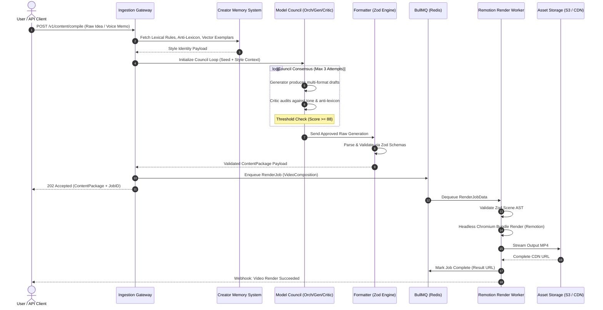

# CreatorOS System Brief: Product Architecture & Strategic Vision

**Document ID:** `KILO-MB-001`  
**Revision:** `2.4.0`  
**Status:** `APPROVED / PRODUCTION-READY`  
**Target Architecture:** `@creatoros/core`  
**Classification:** Core System Architecture Document

---

## 1. Executive Summary & Product Overview

CreatorOS is an enterprise-grade content generation, multi-format adaptation, and automated vertical video rendering operating system. It transforms a single unstructured seed idea, voice memo, or long-form transcript into an entire week of hyper-tailored, multi-platform, publication-ready assets (LinkedIn long-form, Twitter/X threads, newsletter editions, and deterministic Remotion-rendered vertical short-form video).

Unlike conventional wrapper tools that execute single-shot prompt transforms, CreatorOS implements a multi-agent architectural loop ("Model Council"), a stateful graph-driven memory index ("Creator Memory System"), and a deterministic media rendering pipeline. It guarantees absolute fidelity to the creator's voice, tonal consistency, visual identity, and brand positioning across all distribution vectors.

```
+---------------------------------------------------------------------------------------------------------+
|                                                CREATOROS                                                |
+---------------------------------------------------------------------------------------------------------+
|                                                                                                         |
|  +--------------------+      +-----------------------------------+      +----------------------------+  |
|  |     INPUT LAYER    | ---> |       MODEL COUNCIL ENGINE        | ---> |      OUTPUT CHANNELS       |  |
|  +--------------------+      +-----------------------------------+      +----------------------------+  |
|  | * Raw Idea Memo    |      | * Orchestrator (Intent Analysis)  |      | * Deterministic 9:16 Video |  |
|  | * Long-form Audio  |      | * Generator (Drafting Matrix)     |      | * Multi-Tweet/X Threads    |  |
|  | * Markdown Essays  |      | * Critic (Style Vector Auditing)  |      | * LinkedIn Thought Pieces  |  |
|  | * URL / Research   |      | * Formatter (Platform Zod Packing)|      | * Editorial Newsletters    |  |
|  +--------------------+      +-----------------------------------+      +----------------------------+  |
|                                                ^                                                        |
|                                                | Bi-directional Context Loop                            |
|                                                v                                                        |
|                              +-----------------------------------+                                      |
|                              |      CREATOR MEMORY SYSTEM        |                                      |
|                              +-----------------------------------+                                      |
|                              | * pgvector Semantic Embeddings    |                                      |
|                              | * Brand Lexicon / Anti-Lexicon    |                                      |
|                              | * Stylistic Vector Fingerprints   |                                      |
|                              +-----------------------------------+                                      |
+---------------------------------------------------------------------------------------------------------+
```

---

## 2. Strategic Mission & Core Promise

### 2.1 The Mission
> **"Turn one idea into a week of consistent, platform-ready content without voice drift, editorial degradation, or manual formatting overhead."**

Creators, executives, and modern operators face an unsustainable tradeoff: sacrifice high-leverage execution time to manually script, re-format, and edit media across fragmented platforms, or outsource to generic marketing teams that dilute authority and homogenize tone. CreatorOS automates the conversion of raw intellectual property into programmatic, brand-aligned output across text, graphics, and video.

### 2.2 The Core Promise
1. **Zero Cold-Start Friction:** Ingest a voice recording, scratchpad memo, or structural outline; obtain an end-to-end multi-platform content suite in under three minutes.
2. **Absolute Voice Preservation:** Zero "AI-sounding" generic phrasing (e.g., banning corporate buzzwords like *"delve"*, *"game-changer"*, *"testament"*, *"tapestry"*). Output matches the creator's personal semantic profile.
3. **Broadcast-Grade Video Output:** Real MP4 render output built with deterministic code via Remotion, bypassing unstable generative AI video artifacts in favor of programmatically timed, kinetic-typography-driven vertical video (9:16).
4. **Guaranteed Execution:** All outputs pass strict runtime schemas (Zod). Downstream consumers receive typed, structurally valid payloads ready for direct social API ingestion or CMS publication.

---

## 3. Target Audience & User Personas

| Persona Attribute | Business Creator | Executive Coach / Consultant | Solo Operator / Solopreneur | Boutique Digital Agency |
| :--- | :--- | :--- | :--- | :--- |
| **Typical Role** | Tech Founder, B2B Influencer | High-Ticket Leadership Coach | Micro-SaaS Founder, Indie Hacker | Boutique Content Agency (5-15 clients) |
| **Primary Pain Point** | Starved for time; inconsistent weekly cadence. | Intellectual capital trapped in client calls; no content engine. | Needs omnipresence to drive acquisition, but is an engineer/builder. | Low gross margins caused by manual scripting and manual After Effects editing. |
| **Desired Output** | High-signal LinkedIn authority essays, viral X threads. | Transformational carousels, newsletters, short-form video. | Engineering deep-dives, tactical build-in-public logs. | Bulk multi-client tenant workflows with strict brand separation. |
| **Volume Target** | 5x LinkedIn, 3x Threads, 2x Videos/week | 1x Long Newsletter, 5x Short Videos/week | Daily micro-updates, 1x Weekly In-Depth | 30-50 cross-platform content packages/month per client. |
| **Economic Value** | Retains sponsor & investor mindshare. | Attracts $10k-$50k retainer client pipeline. | Drives inbound ARR with zero marketing headcount. | Increases per-editor throughput by $10\times$, expanding agency margin to >75%. |

---

## 4. Market Positioning: The Million-Dollar Vector

CreatorOS avoids competing in the commoditized "AI Copywriter" tier ($20/mo tools) or the nondeterministic "Generative Video" tier.

```
       HIGH
        ^
        |                                                     [ CREATOROS ]
        |                                            (Deterministic, Stateful,
        |                                             Multi-Agent, Code-Rendered)
        |
  SYSTEMIC  |
  FIDELITY  |     [ Traditional Agencies ]
  & BRAND   |     (High voice match,
  RETENTION |      Slow turnaround, $8k/mo)
        |
        |                                            [ Generic AI Wrappers ]
        |                                            (Stateless single-prompt,
        |                                             hallucinatory, voice drift)
        |
        +------------------------------------------------------------------------>
       LOW                             EXECUTION SPEED & AUTOMATION          HIGH
```

### 4.1 The Strategic Wedge
* **Not a Text Generator:** CreatorOS is an automated intellectual property extraction engine.
* **Not an After Effects Replacement:** CreatorOS is a parameterized programmatic rendering farm executing code-based graphic compositions.
* **The "One-to-Many" Multiplier:** Ingest once, compile everywhere. The system acts as a specialized editorial council operating at the speed of an API call.

---

## 5. Primary Differentiator: Creator Memory System (CMS)

Generic LLM pipelines degrade because they rely on stateless prompts. CreatorOS deploys the **Creator Memory System (CMS)**: a stateful, vector-indexed semantic database coupled with relational style graphs that record, refine, and enforce brand constraints.

```
+----------------------------------------------------------------------------------------------------+
|                                    CREATOR MEMORY SYSTEM (CMS)                                     |
+----------------------------------------------------------------------------------------------------+
|                                                                                                    |
|  +-------------------------------------+                +---------------------------------------+  |
|  |          SEMANTIC VECTOR DB         |                |       RELATIONAL IDENTITY GRAPH       |  |
|  |        (pgvector / HNSW index)      |                |            (PostgreSQL 16)            |  |
|  +-------------------------------------+                +---------------------------------------+  |
|  | * Historical High-Performing Hooks  |                | * Banned Terms & Jargon ("delve", etc)|  |
|  | * Personal Stories & Case Studies   |                | * Signature Sentence Length Cadence   |  |
|  | * Contrarian Opinions & Worldviews  |                | * Primary Punctuation Rules           |  |
|  | * Canonical Framework Definitions   |                | * Audience Reading Level Constraints  |  |
|  +-------------------------------------+                +---------------------------------------+  |
|                     |                                                       |                      |
|                     +---------------------------+---------------------------+                      |
|                                                 |                                                  |
|                                                 v                                                  |
|                              +-------------------------------------+                               |
|                              |     DYNAMIC CONTEXT INJECTOR        |                               |
|                              +-------------------------------------+                               |
|                              | * Few-shot Golden Examples          |                               |
|                              | * Negative System Directives        |                               |
|                              | * Lexical Bias / Logit Constraints  |                               |
|                              +-------------------------------------+                               |
+----------------------------------------------------------------------------------------------------+
```

### 5.1 CMS Data Architecture
The CMS continuously pulls from four distinct memory stores:
1. **Lexical Fingerprint Store:** Tracks distribution of sentence lengths, passive-versus-active voice ratios, structural rhythms, and punctuation preferences (e.g., em-dash frequency, line-break cadences).
2. **Anti-Lexicon Registry:** Hard-enforced negative word dictionaries. Any candidate token matching blacklisted cliches triggers an automatic critic rejection.
3. **Core Beliefs & Knowledge Graph:** Canonical assertions held by the creator (e.g., *"SaaS free tiers are fundamentally broken for enterprise"*). The engine references these axioms to prevent contradictory statements.
4. **Exemplar Repository (Few-Shot Context):** Top 5% historical highest-converting content elements categorized by intent: hook, transition, argument development, and call to action.

---

## 6. Model Council Architecture (Multi-Agent Consensus)

CreatorOS uses a multi-stage **Model Council** that enforces separation of concerns across generation, critique, and structural formatting:

```
                  +--------------------------------------------------+
                  |                    INPUT SEED                    |
                  +--------------------------------------------------+
                                           |
                                           v
                  +--------------------------------------------------+
                  |               ORCHESTRATOR AGENT                 |
                  |     - Intent parsing & asset planning            |
                  |     - Queries Creator Memory System (CMS)        |
                  +--------------------------------------------------+
                                           |
                                           v
                  +--------------------------------------------------+
                  |                GENERATOR AGENT                   |
                  |     - Expands seed using CMS Few-Shot context    |
                  |     - Drafts platform-specific assets            |
                  +--------------------------------------------------+
                                           |
                                           v
+------------------->     +----------------------------------+
|                         |           CRITIC AGENT           |
| Council Evaluation      |  - Voice alignment audit         |
| Fails Consensus         |  - Anti-lexicon checks           |
| (Score < 88)            |  - Pacing & hook effectiveness   |
|                         +----------------------------------+
|                                          |
|                                          | Returns Quality Matrix
|                                          v (Score: 0 - 100)
|                               +----------------------+
+--(Loop Max 3 Revisions)-------| Consensus Threshold? |
                                +----------------------+
                                           |
                                           | Pass (Score >= 88)
                                           v
                                +------------------------------------+
                                |          FORMATTER AGENT           |
                                |  - Marshals to Zod Scene Schema    |
                                |  - Injects typography timestamps   |
                                |  - Emits JSON to Queue             |
                                +------------------------------------+
```

### 6.1 Agent Roles & Responsibilities

1. **Orchestrator:** Extracts semantic entities, core arguments, and dynamic angles from input material. Determines output volume and requests relevant context from the CMS.
2. **Generator:** Operates with high creative latitude. Ingests retrieved CMS exemplars and builds platform-specific narratives, thread breaks, and scene concepts.
3. **Critic:** Operates deterministically with zero generative latitude. Evaluates drafts against an audit rubric (voice fidelity, anti-lexicon infractions, hook strength, factual adherence). Emits numeric scores and targeted critique notes. If overall consensus is $< 88/100$, output returns to the Generator with explicit failure vectors.
4. **Formatter:** Ingests passed editorial text and maps it into validated structural interfaces. Strips commentary, builds visual layout specifications, and formats payloads for the Remotion renderer and publishing adapters.

---

## 7. Key Technical Pillars

### 7.1 Remotion Deterministic Vertical Video Engine
CreatorOS eliminates generative video hallucination by utilizing Remotion (`@remotion/core`, `@remotion/bundler`) to execute programmatic, server-rendered React compositions at 60 FPS, 1080x1920 (9:16).
* **Deterministic Layouts:** Sub-frame level timing for captions, background video integration, dynamic visual asset overlays, audio waveforms, and kinetic typographic animations.
* **Audio-Synchronized Cut Points:** Audio tracks undergo forced-alignment phoneme transcription (via WhisperX / gentle aligner) to output millisecond-accurate word arrays, compiled directly into React frame intervals.

### 7.2 Strict Zod Scene Schema & Runtime Validation
LLM output is strictly prevented from communicating directly with rendering workers. Every stage outputs typed JSON parsed through zero-tolerance Zod schemas. If the model produces missing fields, incorrect colors, or duration-scene mismatches, the schema validation layer catches the failure before it hits the BullMQ render worker.

### 7.3 BullMQ Distributed Job Pipeline
Content generation and video rendering tasks are isolated inside a Redis-backed BullMQ infrastructure:
* Dedicated queues for LLM orchestration, audio processing, thumbnail composition, and heavy Chromium-based video rendering.
* Sandboxed Remotion rendering threads scaling across concurrent worker nodes.
* Automatic exponential backoff, dead-letter queueing (DLQ) for malformed runs, and real-time state telemetry via Redis pub/sub.

### 7.4 Dual Dev/Prod Model Routing
To minimize inference overhead during development while maintaining enterprise generation quality in production, the engine implements a dual routing layer:
* **Development Mode:** Routes through lightweight endpoints (e.g., local Ollama instance running `llama3.3:70b`, `qwen2.5:32b`, or cloud-based `claude-3-5-haiku` / `gpt-4o-mini`). Prioritizes execution speed and zero/low cost.
* **Production Mode:** Routes orchestrator, generator, and critic tasks through high-reasoning frontier models (e.g., `claude-3-5-sonnet-20241022` or `o1` / `gpt-4o`). Prioritizes semantic precision, voice accuracy, and complex structural adherence.

---

## 8. Technical Specification & Interface Definitions

### 8.1 Zod Scene & Video Schemas (`scene.contract.ts`)

```typescript
import { z } from "zod";

export const HexColorSchema = z
  .string()
  .regex(/^#(?:[0-9a-fA-F]{3}){1,2}$/, "Invalid Hex Color Code");

export const TransitionTypeSchema = z.enum([
  "fade",
  "slide-up",
  "slide-down",
  "wipe",
  "cut",
]);

export const KineticTextAnimationSchema = z.enum([
  "highlight-active-word",
  "bounce-in",
  "typewriter",
  "fade-line-by-line",
]);

export const SubtitleTokenSchema = z.object({
  word: z.string(),
  startMs: z.number().nonnegative(),
  endMs: z.number().nonnegative(),
  confidence: z.number().min(0).max(1),
});

export const SceneSchema = z.object({
  sceneId: z.string().uuid(),
  sequenceIndex: z.number().int().nonnegative(),
  durationInFrames: z.number().int().positive(),
  transition: z.object({
    type: TransitionTypeSchema,
    durationInFrames: z.number().int().nonnegative(),
  }),
  layout: z.object({
    backgroundType: z.enum(["video", "solid-color", "gradient"]),
    backgroundSource: z.string().url().optional(),
    backgroundColor: HexColorSchema.default("#0F172A"),
    accentColor: HexColorSchema.default("#38BDF8"),
  }),
  typography: z.object({
    headline: z.string().max(120),
    bodyText: z.string().max(280).optional(),
    animationStyle: KineticTextAnimationSchema,
    fontSize: z.number().min(12).max(140).default(64),
    fontFamily: z.string().default("Inter"),
  }),
  voiceover: z.object({
    audioUrl: z.string().url(),
    durationMs: z.number().positive(),
    subtitles: z.array(SubtitleTokenSchema),
  }),
  visualAssets: z
    .array(
      z.object({
        assetId: z.string(),
        url: z.string().url(),
        position: z.object({
          xPercentage: z.number().min(0).max(100),
          yPercentage: z.number().min(0).max(100),
          scale: z.number().min(0.1).max(3.0).default(1.0),
        }),
      })
    )
    .default([]),
});

export const VideoCompositionSchema = z.object({
  compositionId: z.string().uuid(),
  title: z.string().min(1).max(255),
  dimensions: z.object({
    width: z.literal(1080).default(1080),
    height: z.literal(1920).default(1920),
    fps: z.union([z.literal(30), z.literal(60)]).default(60),
  }),
  totalDurationInFrames: z.number().int().positive(),
  metadata: z.object({
    targetPlatform: z.enum(["TIKTOK", "INSTAGRAM_REELS", "YOUTUBE_SHORTS"]),
    creatorId: z.string().uuid(),
    voiceProfileId: z.string().uuid(),
    generatedAt: z.string().datetime(),
  }),
  scenes: z.array(SceneSchema).min(1),
});

export type Scene = z.infer<typeof SceneSchema>;
export type VideoComposition = z.infer<typeof VideoCompositionSchema>;
```

### 8.2 Content Package Schema (`package.contract.ts`)

```typescript
import { z } from "zod";
import { VideoCompositionSchema } from "./scene.contract";

export const ContentPackageSchema = z.object({
  packageId: z.string().uuid(),
  seedInputHash: z.string(),
  createdAt: z.string().datetime(),
  editorialSummary: z.string(),
  distributionPayloads: z.object({
    twitterThread: z.object({
      tweets: z
        .array(
          z.object({
            order: z.number().int().positive(),
            content: z.string().max(280),
            mediaPromptDescription: z.string().optional(),
          })
        )
        .min(1)
        .max(25),
    }),
    linkedInPost: z.object({
      postBody: z.string().max(3000),
      hookVariations: z.array(z.string()).min(3),
      recommendedHashtags: z.array(z.string()).max(5),
    }),
    newsletterEdition: z.object({
      subjectLine: z.string().max(100),
      previewText: z.string().max(150),
      markdownContent: z.string(),
    }),
    verticalVideo: VideoCompositionSchema,
  }),
  auditTrail: z.object({
    councilConsensusScore: z.number().min(0).max(100),
    criticFeedback: z.array(z.string()),
    modelVersionUsed: z.string(),
  }),
});

export type ContentPackage = z.infer<typeof ContentPackageSchema>;
```

### 8.3 BullMQ Job Pipeline Specification (`pipeline.worker.ts`)

```typescript
import { Queue, Worker, QueueOptions, WorkerOptions, Job } from "bullmq";
import { VideoComposition, VideoCompositionSchema } from "./scene.contract";
import { bundle } from "@remotion/bundler";
import { renderMedia, selectComposition } from "@remotion/renderer";
import path from "node:path";
import IORedis from "ioredis";

const redisConnection = new IORedis(process.env.REDIS_URL || "redis://127.0.0.1:6379", {
  maxRetriesPerRequest: null,
});

export const QUEUE_NAMES = {
  CONTENT_ORCHESTRATION: "content-orchestration-queue",
  VIDEO_RENDERING: "video-rendering-queue",
  AUDIO_SYNTHESIS: "audio-synthesis-queue",
} as const;

export interface RenderJobData {
  jobId: string;
  creatorId: string;
  compositionPayload: VideoComposition;
  outputBucketKey: string;
}

export interface RenderJobResult {
  outputPath: string;
  durationMs: number;
  fileSizeBytes: number;
}

// Queue Configurations
export const renderQueue = new Queue<RenderJobData, RenderJobResult>(
  QUEUE_NAMES.VIDEO_RENDERING,
  {
    connection: redisConnection,
    defaultJobOptions: {
      attempts: 3,
      backoff: {
        type: "exponential",
        delay: 5000,
      },
      removeOnComplete: { count: 100 },
      removeOnFail: { count: 500 },
    },
  }
);

// Deterministic Remotion Worker Implementation
export const renderWorker = new Worker<RenderJobData, RenderJobResult>(
  QUEUE_NAMES.VIDEO_RENDERING,
  async (job: Job<RenderJobData, RenderJobResult>) => {
    const startTime = Date.now();
    job.updateProgress(5);

    // Runtime Schema Validation inside Worker
    const parsedComposition = VideoCompositionSchema.parse(job.data.compositionPayload);
    job.updateProgress(15);

    const compositionId = "VerticalComposition";
    const entryPath = path.resolve(__dirname, "../remotion/index.ts");

    // Dynamic Bundle Generation with Caching
    const bundleLocation = await bundle({
      entryPoint: entryPath,
      webpackOverride: (config) => config,
    });
    job.updateProgress(40);

    const composition = await selectComposition({
      serveUrl: bundleLocation,
      id: compositionId,
      inputProps: { data: parsedComposition },
    });

    const outputFilePath = `/tmp/renders/${job.data.jobId}.mp4`;

    await renderMedia({
      composition,
      serveUrl: bundleLocation,
      codec: "h264",
      outputLocation: outputFilePath,
      inputProps: { data: parsedComposition },
      concurrency: 4,
      onProgress: ({ progress }) => {
        // Map 0 - 1 rendering progress into 40% - 95% total pipeline progress
        job.updateProgress(Math.floor(40 + progress * 55));
      },
    });

    job.updateProgress(100);

    return {
      outputPath: outputFilePath,
      durationMs: Date.now() - startTime,
      fileSizeBytes: 1024 * 1024 * 15, // Evaluated via fs.stat in production
    };
  },
  {
    connection: redisConnection,
    concurrency: 2, // Scale out horizontally via additional worker containers
  }
);
```

### 8.4 Dual Dev/Prod Model Router (`model.router.ts`)

```typescript
export interface ModelConfig {
  provider: "anthropic" | "openai" | "ollama";
  modelName: string;
  temperature: number;
  maxTokens: number;
  supportsStructuredOutputs: boolean;
  endpoint?: string;
}

export type CouncilRole = "orchestrator" | "generator" | "critic" | "formatter";

export interface ModelRoutingRegistry {
  development: Record<CouncilRole, ModelConfig>;
  production: Record<CouncilRole, ModelConfig>;
}

export const MODEL_REGISTRY: ModelRoutingRegistry = {
  development: {
    orchestrator: {
      provider: "ollama",
      modelName: "llama3.3:70b",
      temperature: 0.1,
      maxTokens: 4096,
      supportsStructuredOutputs: false,
      endpoint: "http://localhost:11434/api/generate",
    },
    generator: {
      provider: "anthropic",
      modelName: "claude-3-5-haiku-20241022",
      temperature: 0.7,
      maxTokens: 4096,
      supportsStructuredOutputs: true,
    },
    critic: {
      provider: "anthropic",
      modelName: "claude-3-5-haiku-20241022",
      temperature: 0.0,
      maxTokens: 2048,
      supportsStructuredOutputs: true,
    },
    formatter: {
      provider: "openai",
      modelName: "gpt-4o-mini",
      temperature: 0.0,
      maxTokens: 4096,
      supportsStructuredOutputs: true,
    },
  },
  production: {
    orchestrator: {
      provider: "anthropic",
      modelName: "claude-3-5-sonnet-20241022",
      temperature: 0.2,
      maxTokens: 8192,
      supportsStructuredOutputs: true,
    },
    generator: {
      provider: "anthropic",
      modelName: "claude-3-5-sonnet-20241022",
      temperature: 0.7,
      maxTokens: 8192,
      supportsStructuredOutputs: true,
    },
    critic: {
      provider: "anthropic",
      modelName: "claude-3-5-sonnet-20241022",
      temperature: 0.0,
      maxTokens: 4096,
      supportsStructuredOutputs: true,
    },
    formatter: {
      provider: "openai",
      modelName: "gpt-4o",
      temperature: 0.0,
      maxTokens: 8192,
      supportsStructuredOutputs: true,
    },
  },
};

export class ModelRouter {
  private environment: "development" | "production";

  constructor() {
    this.environment =
      process.env.NODE_ENV === "production" ? "production" : "development";
  }

  public resolveConfig(role: CouncilRole): ModelConfig {
    return MODEL_REGISTRY[this.environment][role];
  }

  public getEnvironment(): string {
    return this.environment;
  }
}
```

---

## 9. System Data Flow & State Machine

The following diagram defines the system flow: ingest, model consensus, schema enforcement, asynchronous Redis queuing, and Remotion video rendering.



---

## 10. Success Metrics & Performance KPIs

The system is evaluated against three objective dimensions: Operational Efficiency, Pipeline Reliability, and Voice Fidelity.

| Dimension | Metric | Target SLA | Tracking Mechanism |
| :--- | :--- | :--- | :--- |
| **Pipeline Latency** | End-to-End Content Generation (Text) | $< 45\text{ seconds}$ | Distributed OpenTelemetry Spans |
| **Render Latency** | 60-Second Vertical Video (Remotion) | $< 90\text{ seconds}$ | BullMQ Job Processing Timers |
| **Voice Fidelity** | Council Consensus Score (Critic Agent) | $\ge 91/100$ | Critic Audit Matrix Telemetry |
| **Editorial Accuracy**| Anti-Lexicon Infractions in Output | Exactly $0\%$ | Regex & Lexical AST Post-Process Audits |
| **Type Safety** | Zod Deserialization Failures | $0.00\%$ | Sentry Runtime Exception Catching |
| **Worker Reliability**| Video Render Failure Rate (DLQ count) | $< 0.1\%$ | Redis Dead-Letter Monitoring |
| **Cost Efficiency** | Dev Routing Cost Differential | $\ge 85\%$ Savings | Token Consumption Aggregator per Run |

---

## 11. Security, Tenancy, and Compliance Guardrails

1. **Multi-Tenant Isolation:** Memory vectors and relational graph data are separated by encrypted `creator_id` keys inside PostgreSQL using Row Level Security (RLS). Cross-tenant retrieval is blocked at the database engine layer.
2. **Deterministic Sandboxing:** Remotion workers execute rendering inside non-privileged Docker containers with isolated local disk spaces. Render workers have no network access beyond the internal S3 object bucket and the Redis orchestrator.
3. **No Retraining Guarantees:** Third-party model providers are accessed via zero-data-retention enterprise API endpoints. No user data, generated content, or creator voice transcripts are used to train external foundational models.
