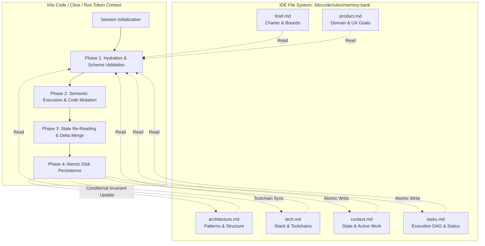
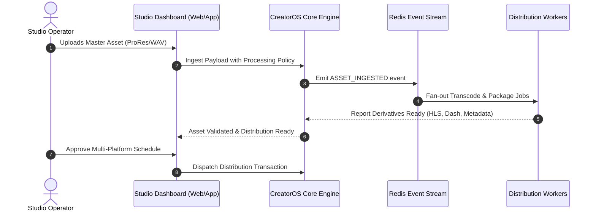
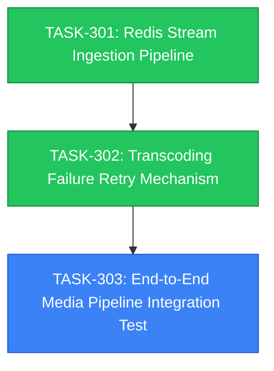
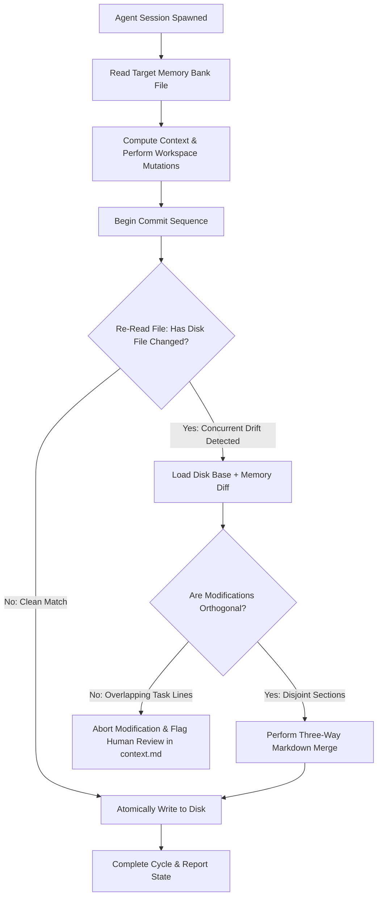

# CreatorOS Memory Bank System Specification

```text
Document ID:     COS-RFC-0028
Status:          MANDATORY / PRODUCTION
Target Engine:   Kilo Code / Cline / Roo Code (VS Code Extension Ecosystem)
Namespace:       @creatoros/memory-bank
Version:         2.4.0
Last Validated:  2025-02-18
```

---

## 1. Executive Overview & System Philosophy

Autonomous AI agents running within IDE environments (Kilo Code, Cline, Roo Code) operate under strict finite context windows. Once an active session context resets, compresses, or exhausts its token limit, the agent experiences complete working memory wipe. 

The **CreatorOS Memory Bank** is a deterministic, file-backed cognitive state store that bridges stateless LLM sessions. By treating the workspace file system as persistent RAM, the Memory Bank guarantees that any autonomous agent instance initialized within `@creatoros` operates with zero context degradation, maintains strategic alignment with project invariants, and eliminates regressive code modifications.

### 1.1 The Golden Invariant: Never Overwrite Without Reading

```
  ┌────────────────────────────────────────────────────────────────────────┐
  │                           MANDATORY DIRECTIVE                          │
  │                                                                        │
  │  NO AGENT MAY MODIFY, TRUNCATE, MUTATE, OR EMIT AN OVERWRITE TO ANY    │
  │  MEMORY BANK FILE WITHOUT EXPLICITLY READING AND PARSING ITS EXISTING  │
  │  CONTENTS INTO THE ACTIVE TOKEN CONTEXT DURING THE CURRENT SESSION.    │
  │                                                                        │
  │  BLIND WRITES, PARTIAL TRUNCATIONS, AND SPECULATIVE RE-INITIALIZATIONS │
  │  ARE SYSTEM-CRITICAL ERRORS AND TRIGGER REPOSITORY REJECTION.          │
  └────────────────────────────────────────────────────────────────────────┘
```

Every agent session must systematically load the canonical memory graph, construct an internal delta map, execute requested code changes, and atomically reconcile that delta map back to disk before terminating.

---

## 2. Memory Bank Topology & Component Roles

The Memory Bank resides at `.kilocode/rules/memory-bank/` (with fallback symlinks/mirrors supported for `.roomodes` and `.cline`). It consists of exactly six orthogonal markdown files. No ad-hoc memory files are permitted.

```
.kilocode/rules/memory-bank/
├── brief.md          # Immutable Charter & Scope Boundaries
├── product.md        # Product Intent, Personas & Functional Boundaries
├── context.md        # Transient Session State, Ephemeral Blockers & Drift
├── architecture.md   # Structural Design, Invariants & Component Topology
├── tech.md           # Runtime Environment, Dependencies, Versions & Gates
└── tasks.md          # Hierarchical Execution Pipeline & Cryptographic Gates
```



### 2.1 Domain Allocation Matrix

| Artifact | Volatility | Scope of Content | Read Requirement | Write Requirement |
| :--- | :--- | :--- | :--- | :--- |
| `brief.md` | Extremely Low | Fundamental project charter, non-negotiable mission constraints, root boundaries. | Mandatory at session init. | Human-directed edits only; agent read-only. |
| `product.md` | Low | Functional features, user journeys, target personas, behavioral models. | Mandatory at session init. | Updates on feature expansion or behavior shifts. |
| `context.md` | Extremely High | Current runtime state, uncommitted hypotheses, immediate blockers, environment quirks. | Mandatory at session init and pre-write. | Updated every session wrap-up or checkpoint. |
| `architecture.md` | Medium | System topology, database schemas, API patterns, cross-module contracts. | Mandatory on structural operations. | Updated when new modules, interfaces, or pipelines merge. |
| `tech.md` | Low–Medium | Language versioning, core libraries, linters, compilation steps, security tooling. | Mandatory on dependency operations. | Updated when deps, engines, or scripts change. |
| `tasks.md` | High | Execution Directed Acyclic Graph (DAG), active tickets, validation steps, phase locks. | Mandatory at every prompt loop. | Updated on task start, step validation, and completion. |

---

## 3. Strict Hydration & Reconciliation Protocols

Agents must operate via a deterministic finite state machine (FSM) spanning four non-negotiable phases.

### 3.1 Phase 1: Context Hydration (Bootstrap)

Upon receiving any human dispatch or prompt, the agent must execute its filesystem read operations in the following sequence before issuing code edits, running terminal commands, or generating solutions:

1. **Hydrate Invariants:** Read `brief.md` and `product.md`. Establish the solution space and reject requirements violating core constraints.
2. **Hydrate Architecture & Tooling:** Read `architecture.md` and `tech.md`. Lock design patterns, active schemas, versions, and validation scripts into working memory.
3. **Hydrate Dynamic Pipeline:** Read `tasks.md` and `context.md`. Parse active tasks, discover uncompleted items, identify blockers, and note previous session wrap-up notes.
4. **Assert Synchronization:** Validate that the current branch and working directory match the states documented in `context.md`. If drift is detected, record it as a context discrepancy.

### 3.2 Phase 2: Directed Execution

1. Locate the topmost active, unblocked item in `tasks.md`.
2. Compare the proposed changes against `architecture.md` rules and `tech.md` toolchain limits.
3. Implement tests, write code, run linters, and verify builds using real terminal runs.
4. If an unexpected architectural change or new dependency is required, pause execution and stage the updates for validation.

### 3.3 Phase 3: Fresh Ingestion & Differential Synthesis (Pre-Write Check)

Before writing changes back to the Memory Bank:

```text
[CRITICAL INVARIANT]
Between the initial hydration in Phase 1 and the completion of Phase 2,
local git branches, human developers, or linter hooks may have modified memory files.
Agents must re-read the targets immediately prior to staging writes.
```

1. **Re-Read:** Execute filesystem reads on `context.md`, `tasks.md`, and any other target memory bank file.
2. **Synthesize:** Compute a deterministic structural diff between the original file, the updated runtime state, and the newly read disk state.
3. **Merge Conflict Detection:** If an item in `tasks.md` was completed by a separate commit, preserve that completion state while appending newly validated items.

### 3.4 Phase 4: Atomic Disk Persistence

1. **Write Sequence:**
   * Step A: Update `tasks.md` (check off verified items, add discovered tasks).
   * Step B: Update `context.md` (record the active state, next steps, and known environment flags).
   * Step C (Conditional): Update `tech.md` or `architecture.md` if structural or dependency contracts evolved.
2. **Integrity Validation:** Inspect written files to ensure that markdown formatting, checklists, tables, and frontmatter conform to project schemas.

---

## 4. Formal Schema Definitions

To prevent context drift, each file must conform to its corresponding TypeScript interface. Agents must preserve these document schemas when updating the files.

### 4.1 Memory Bank Schemas (`memory-bank.types.ts`)

```typescript
/**
 * @file memory-bank.types.ts
 * Type definitions governing the structural integrity of CreatorOS Memory Bank files.
 */

export type ISO8601Date = string;
export type SemanticVersion = string;

export interface MemoryBankFile {
  lastUpdated: ISO8601Date;
  version: SemanticVersion;
  maintainer: string;
}

export interface ProjectBrief extends MemoryBankFile {
  projectScope: {
    coreObjective: string;
    targetPlatforms: string[];
    hardBoundaries: string[];
    nonGoals: string[];
  };
  governance: {
    invariants: string[];
    complianceStandards: string[];
  };
}

export interface ProductContext extends MemoryBankFile {
  problemStatement: string;
  targetAudience: Array<{
    persona: string;
    painPoints: string[];
    valueProposition: string;
  }>;
  coreWorkflows: Array<{
    name: string;
    flow: string[];
    failureModes: string[];
  }>;
  behavioralGuarantees: string[];
}

export interface ActiveContext extends MemoryBankFile {
  activeSession: {
    focusBranch: string;
    workingGoal: string;
    immediateNextSteps: string[];
  };
  runtimeObservations: {
    activeBlockers: string[];
    environmentAnomalies: string[];
    unresolvedHypotheses: string[];
  };
  recentChanges: Array<{
    timestamp: ISO8601Date;
    summary: string;
    affectedPaths: string[];
  }>;
}

export interface ArchitecturalContract extends MemoryBankFile {
  patterns: string[];
  systemTopology: {
    subsystems: Array<{
      name: string;
      responsibility: string;
      boundaries: string[];
    }>;
    eventBusTopology?: string[];
  };
  dataFlowGuarantees: string[];
  interfaceContracts: Array<{
    module: string;
    contractPath: string;
    rules: string[];
  }>;
}

export interface TechProfile extends MemoryBankFile {
  engines: {
    node: string;
    pnpm: string;
    typescript: string;
  };
  coreStack: Record<string, SemanticVersion>;
  infrastructure: {
    database: string;
    cache: string;
    orchestration: string;
  };
  qualityGates: Array<{
    gate: string;
    command: string;
    threshold: string;
  }>;
}

export type TaskStatus = 'PENDING' | 'IN_PROGRESS' | 'VALIDATED' | 'BLOCKED';

export interface TaskItem {
  id: string;
  status: TaskStatus;
  description: string;
  dependencies: string[];
  verificationCriteria: string[];
}

export interface TaskRoadmap extends MemoryBankFile {
  activePhase: string;
  phases: Array<{
    phaseId: string;
    name: string;
    status: TaskStatus;
    tasks: TaskItem[];
  }>;
}
```

---

## 5. Canonical File Specifications & Concrete Templates

The following templates represent the required structure and content baseline for the CreatorOS memory bank files.

### 5.1 `brief.md`

```markdown
# CreatorOS — Core Project Charter (`brief.md`)

## 1. Project Charter & North Star
CreatorOS is the enterprise operating platform designed for high-scale digital creators and distributed media houses. It unifies distributed content orchestration, direct-to-consumer monetization pipelines, digital asset digital-rights management, and dynamic fan engagement into a single, low-latency, sovereign operating platform.

## 2. Invariant Scope Boundaries
* **In-Scope:**
  * Multi-tenant digital asset management with cryptographic provenance (C2PA standard).
  * Real-time distribution engine deploying to YouTube, TikTok, Substack, X, and native CDNs.
  * Local-first edge synchronization supporting air-gapped creator studios.
  * Dynamic micro-billing engine processing fiat (Stripe) and decentralized settlements.
* **Non-Goals / Explicit Exclusions:**
  * No monolithic hosting: Must remain completely decoupled from static multi-tenant hosting silos.
  * No centralized user data resale: Absolute end-to-end zero-knowledge user profile storage.
  * No non-deterministic build tooling: Native scripts only; no unsupported binary dependencies.

## 3. System Constraints
* **Availability Target:** 99.99% for public media access endpoints.
* **Cold Boot Ceiling:** Core microservices must boot in `< 450ms` in containerized environments.
* **Memory Footprint:** Edge daemon memory allocation must not exceed `128MB` under peak load.
* **Deterministic Behavior:** Autonomous code edits must run through clean static type analysis and pass all tests before merge.
```

### 5.2 `product.md`

```markdown
# CreatorOS — Product Blueprint (`product.md`)

## 1. Problem Space & Domain Vision
High-output content studios use fragmented systems (cloud storage, project boards, separate payment systems, multi-platform publishing tools). This fragmentation causes:
1. Significant latency between content editing and multi-platform publishing.
2. Fragmented audience data across different platforms.
3. High financial overhead from multiple SaaS subscriptions.

CreatorOS solves this with an integrated local-first workspace coupled to an edge deployment cluster.

## 2. Target Personas
* **The Studio Operator (Primary):** Runs high-throughput video/audio pipelines. Needs automated asset distribution, automated metadata localization, and continuous revenue tracking.
* **The Platform Engineer (Secondary):** Extends CreatorOS via custom plugins, webhooks, and headless workflows. Requires rigid API contracts and predictable execution.
* **The High-Tier Subscriber (End Consumer):** Consumes gated premium content. Demands zero-buffering playback, strict data privacy, and clean account management.

## 3. Core Functional Workflows



## 4. Behavioral Guarantees
* **Data Portability:** Complete workspace exports must produce standardized JSON metadata alongside an Open Container Initiative (OCI) image layer for all assets.
* **Tenant Isolation:** Tenant boundaries are absolute. No shared caching layer may serve cross-tenant references without explicit public permissions.
```

### 5.3 `architecture.md`

```markdown
# CreatorOS — Architecture Registry (`architecture.md`)

## 1. Foundational Architecture Patterns
* **Hexagonal Architecture (Ports and Adapters):** Domain logic in packages must remain free of external frameworks and third-party dependencies.
* **Local-First with CRDT Sync:** State synchronizes via conflict-free replicated data types using Yjs over authenticated WebSockets, backed by a persistent PostgreSQL event log.
* **Command Query Responsibility Segregation (CQRS):** All state updates route through verified command handlers; fast read models derive asynchronously through materialized event views.

## 2. Monorepo Structural Topology

```text
creatoros/
├── apps/
│   ├── studio/             # Next.js 14 App Router, WebGL, Tailwind, Zustand
│   ├── edge-gateway/       # Cloudflare Workers / Hono reverse proxy
│   └── docs/               # Nextra static documentation
├── packages/
│   ├── core/               # Hexagonal domain logic, zero external deps
│   ├── db/                 # Prisma ORM schemas, migrations, seed configurations
│   ├── events/             # Protobuf schemas, event emitter, consumer interfaces
│   ├── auth/               # Session management, JWT verification, RBAC rules
│   └── ui/                 # Shared React component system (Radix + Tailwind)
└── tools/
    ├── eslint-config/      # Shared ESLint governance
    ├── tsconfig/           # Base tsconfig files across engines
    └── scripts/            # Validation, security, and verification tools
```

## 3. Data Integrity & Persistence Contracts
* **Primary Relational Store:** PostgreSQL 16 with Row-Level Security (RLS) configured for every tenant-owned table.
* **Event Transport:** Redis 7.2 streams for cross-worker task allocation and internal telemetry.
* **Analytical Engine:** ClickHouse for real-time engagement and telemetry data processing.
* **Cache Semantics:** Cache keys must follow strict namespaces: `tenant:{tenant_id}:entity:{entity_name}:{id}`.

## 4. Cross-Module Interface Standard
All cross-boundary communication must rely on strongly typed schemas. Public API payloads and internal events must pass Zod schema validation at runtime:

```typescript
import { z } from 'zod';

export const MediaPublishPayloadSchema = z.object({
  tenantId: z.string().uuid(),
  assetId: z.string().uuid(),
  destinations: z.array(z.enum(['YOUTUBE', 'TIKTOK', 'X', 'CDN'])),
  scheduledFor: z.string().datetime().optional(),
  metadataOverrides: z.record(z.string(), z.string()).default({}),
});

export type MediaPublishPayload = z.infer<typeof MediaPublishPayloadSchema>;
```
```

### 5.4 `tech.md`

```markdown
# CreatorOS — Technology Stack & Quality Gates (`tech.md`)

## 1. Core Toolchain Versions
* **Runtime Engines:**
  * Node.js: `20.11.1` (LTS/iron) — pinned in `.nvmrc`
  * PNPM: `8.15.4` — enforced by `engines` in root `package.json`
* **Compilers & Typing:**
  * TypeScript: `5.4.2` (`strict: true`, `noImplicitAny: true`, `exactOptionalPropertyTypes: true`)
* **Primary Frameworks:**
  * Web Application: Next.js `14.1.3` (App Router, React Server Components enabled)
  * Edge Routing: Hono `4.0.8`
  * State Layer: Zustand `4.5.2` (Studio), Yjs `13.6.14` (CRDTs)
  * Data Mapping: Prisma ORM `5.11.0`

## 2. Infrastructure Dependents
* **Database Target:** PostgreSQL 16.2 on Alpine
* **In-Memory Broker:** Redis 7.2-alpine
* **Blob Object Storage:** MinIO / AWS S3 API compliant, with signature v4 authentication

## 3. Mandatory Quality Validation Gates
Before marking any operational task as complete, an agent must execute and pass each gate command in sequence:

| Gate Identifier | Terminal Command | Success Metric | Enforcement |
| :--- | :--- | :--- | :--- |
| **Type Check** | `pnpm turbo run typecheck` | Clean exit code `0`, no compilation errors | Absolute |
| **Lint Audit** | `pnpm turbo run lint` | Zero warnings, zero errors | Absolute |
| **Unit Verification** | `pnpm turbo run test` | 100% test pass rate | Absolute |
| **Structural Integrity** | `pnpm turbo run build` | Successful build artifacts across all workspaces | Absolute |
| **Database Sync** | `pnpm --filter @creatoros/db prisma validate` | Prisma schema valid and in sync | Condition-based |
```

### 5.5 `tasks.md`

```markdown
# CreatorOS — Task Execution Pipeline (`tasks.md`)

## 1. Execution Pipeline Dashboard
* **Active Working Phase:** Phase 3 — Ingestion Engine Scalability
* **Phase Completion Rate:** 66.6% (2/3 Phase Objectives Complete)
* **Active Blocking Nodes:** NONE

## 2. Phase 3 Roadmap & Execution DAG



### Task Ledger

- [x] **TASK-301: Redis Stream Ingestion Pipeline**
  - *Status:* VALIDATED
  - *Dependencies:* TASK-204 (Prisma Schema update)
  - *Verification:* `pnpm --filter @creatoros/events test` passes with 100% coverage on stream consumers.
  - *Verification Hash:* `4a9f1b2c83d0`

- [x] **TASK-302: Transcoding Failure Retry Mechanism**
  - *Status:* VALIDATED
  - *Dependencies:* TASK-301
  - *Verification:* Exponential backoff functional; dead letter queue captures tasks after 3 failures.
  - *Verification Hash:* `7e3d9a1f2b4c`

- [/] **TASK-303: End-to-End Media Pipeline Integration Test**
  - *Status:* IN_PROGRESS
  - *Dependencies:* TASK-301, TASK-302
  - *Active Focus:* Simulating edge drops during high-concurrency ingestion in Docker test environment.
  - *Verification Criteria:*
    - Integration test suite passes without asset drops.
    - Zero deadlocks detected under load in PostgreSQL.
    - `pnpm turbo run test` completes cleanly.

- [ ] **TASK-304: C2PA Cryptographic Signature Assertion**
  - *Status:* PENDING
  - *Dependencies:* TASK-303
  - *Verification Criteria:* Sign derivative video files using embedded manifest signatures; verify via verify-tooling.
```

### 5.6 `context.md`

```markdown
# CreatorOS — Active Session State (`context.md`)

## 1. Immediate Execution Scope
* **Current Git Branch:** `feature/task-303-e2e-pipeline-verification`
* **Lead System Objective:** Resolve edge drops under concurrent media ingest simulation (`TASK-303`).
* **Active Task Reference:** `TASK-303` in `tasks.md`

## 2. Runtime Environment & Working Observations
* **Working Status:**
  * Fixed an unhandled timeout error in `packages/core/src/transcoder/job-runner.ts` caused by high batch load.
  * Integration test harness currently times out at 30 seconds when processing 50 concurrent mock media items.
* **Active Blockers:**
  * Docker daemon requires expanded shared memory allocations (`--shm-size 2gb`) during multi-stream tests to avoid container crashes.
* **Environment Quirks:**
  * Local Redis instance on macOS development machines requires `vm.overcommit_memory=1` to prevent test-run drops.

## 3. Immediate Next Actions (Resume Point)
1. Patch the integration test suite timeout in `apps/studio/tests/e2e/media-pipeline.test.ts`.
2. Add the shm allocation fix to `docker-compose.test.yml`.
3. Run `pnpm --filter @creatoros/studio test:e2e` to verify the pipeline.
4. Mark `TASK-303` as `VALIDATED` in `tasks.md` and transition `TASK-304` to `IN_PROGRESS`.

## 4. Changelog (Last 3 Iterations)
* `2025-02-18 10:14:22`: Implemented backoff retry logic in `job-runner.ts` (Closed `TASK-302`).
* `2025-02-18 09:30:10`: Added Redis pipeline stream consumer abstractions to `packages/events` (Closed `TASK-301`).
* `2025-02-18 08:00:00`: Initialized session, verified working tree clean, synced branch with origin.
```

---

## 6. The Read-Before-Write Verification Engine

To eliminate blind writes, truncation bugs, and memory bank corruption, agents can invoke or implement this reference programmatic reconciliation utility.

```typescript
/**
 * @file memory-bank-reconciler.ts
 * Deterministic parsing and transactional update engine for CreatorOS Memory Bank.
 */

import { promises as fs } from 'node:fs';
import * as path from 'node:path';

export interface TaskStatusUpdate {
  taskId: string;
  newStatus: 'PENDING' | 'IN_PROGRESS' | 'VALIDATED' | 'BLOCKED';
  verificationHash?: string;
}

export class MemoryBankReconciler {
  private readonly memoryBankDir: string;

  constructor(workspaceRoot: string) {
    this.memoryBankDir = path.join(workspaceRoot, '.kilocode', 'rules', 'memory-bank');
  }

  /**
   * Reads, parses, and safely mutates tasks.md.
   * Guarantees zero truncations: re-reads latest disk content before writing.
   */
  public async updateTaskStatus(update: TaskStatusUpdate): Promise<void> {
    const tasksFilePath = path.join(this.memoryBankDir, 'tasks.md');

    // 1. Mandatory Read Phase: Load fresh content directly from disk
    const rawContent = await fs.readFile(tasksFilePath, 'utf-8');
    if (!rawContent || rawContent.trim().length === 0) {
      throw new Error(`CRITICAL: Read failed or target is empty at ${tasksFilePath}. Aborting update.`);
    }

    // 2. Validate Target Task Exists
    const taskMarker = `**${update.taskId}:`;
    if (!rawContent.includes(taskMarker)) {
      throw new Error(`Target task ${update.taskId} not found in tasks.md.`);
    }

    // 3. Compute Line-by-Line Differential Mutations
    const lines = rawContent.split('\n');
    let insideTargetTask = false;
    const modifiedLines: string[] = [];

    for (let i = 0; i < lines.length; i++) {
      const line = lines[i];

      if (line.includes(taskMarker)) {
        insideTargetTask = true;

        // Mutate checklist state symbol
        let mutatedHeaderLine = line;
        if (update.newStatus === 'VALIDATED') {
          mutatedHeaderLine = line.replace(/- \[[ x/]]/g, '- [x]');
        } else if (update.newStatus === 'IN_PROGRESS') {
          mutatedHeaderLine = line.replace(/- \[[ x/]]/g, '- [/]');
        } else if (update.newStatus === 'PENDING' || update.newStatus === 'BLOCKED') {
          mutatedHeaderLine = line.replace(/- \[[ x/]]/g, '- [ ]');
        }

        modifiedLines.push(mutatedHeaderLine);
        continue;
      }

      if (insideTargetTask) {
        // Update status line
        if (line.trim().startsWith('- *Status:*')) {
          modifiedLines.push(`  - *Status:* ${update.newStatus}`);
          continue;
        }

        // Add verification hash if validated
        if (line.trim().startsWith('- *Verification Hash:*') && update.verificationHash) {
          modifiedLines.push(`  - *Verification Hash:* \`${update.verificationHash}\``);
          continue;
        }

        // Exit task block at the next checklist item or header
        if (line.trim().startsWith('- [') || line.trim().startsWith('#')) {
          insideTargetTask = false;
        }
      }

      modifiedLines.push(line);
    }

    // 4. Atomic Write Phase: Persist to a temporary file, then rename
    const finalContent = modifiedLines.join('\n');
    const tempPath = `${tasksFilePath}.${Date.now()}.tmp`;

    try {
      await fs.writeFile(tempPath, finalContent, 'utf-8');
      await fs.rename(tempPath, tasksFilePath);
    } catch (error) {
      await fs.unlink(tempPath).catch(() => {});
      throw new Error(`Failed to commit atomic write to ${tasksFilePath}: ${(error as Error).message}`);
    }
  }

  /**
   * Safely updates context.md with new entries, preserving all existing sections.
   */
  public async appendSessionContext(
    actionItemCompleted: string,
    nextStep: string,
    encounteredBlocker?: string
  ): Promise<void> {
    const contextPath = path.join(this.memoryBankDir, 'context.md');
    
    // Mandatory Read Phase
    const rawContent = await fs.readFile(contextPath, 'utf-8');
    const timestamp = new Date().toISOString().replace('T', ' ').substring(0, 19);

    let updatedContent = rawContent;

    // Append to changelog section
    const changelogMarker = '## 4. Changelog (Last 3 Iterations)';
    if (updatedContent.includes(changelogMarker)) {
      const entry = `* \`${timestamp}\`: ${actionItemCompleted}`;
      updatedContent = updatedContent.replace(
        changelogMarker,
        `${changelogMarker}\n${entry}`
      );
    }

    // Append blocker if present
    if (encounteredBlocker) {
      const blockerMarker = '* **Active Blockers:**';
      if (updatedContent.includes(blockerMarker)) {
        const blockerEntry = `  * ${encounteredBlocker}`;
        updatedContent = updatedContent.replace(
          blockerMarker,
          `${blockerMarker}\n${blockerEntry}`
        );
      }
    }

    // Update next action items
    const nextActionsMarker = '## 3. Immediate Next Actions (Resume Point)';
    if (updatedContent.includes(nextActionsMarker)) {
      const nextStepEntry = `1. ${nextStep} (Discovered at ${timestamp})`;
      updatedContent = updatedContent.replace(
        nextActionsMarker,
        `${nextActionsMarker}\n${nextStepEntry}`
      );
    }

    // Atomic Write
    const tempPath = `${contextPath}.${Date.now()}.tmp`;
    await fs.writeFile(tempPath, updatedContent, 'utf-8');
    await fs.rename(tempPath, contextPath);
  }
}
```

---

## 7. Multi-Agent Concurrency & Conflict Avoidance

When multiple autonomous agents (e.g., Cline, Roo Code, or CI verification workers) access the same repository simultaneously, file collisions can occur.



### 7.1 Collision Prevention Rules

1. **Non-Overlapping Task Ownership:**
   * No two agents may claim `IN_PROGRESS` status on the same task ID in `tasks.md`.
   * Agents encountering an `IN_PROGRESS` item must either select the next unassigned task (`PENDING`) or await resolution.

2. **Section Isolation:**
   * Context changes must append chronologically using ISO-8601 timestamps rather than updating lines in place.
   * `brief.md` is strictly immutable during agent execution. If changes are needed, file a proposal in `context.md` under `unresolvedHypotheses`.

3. **Re-Read Threshold Rule:**
   * If an agent's active execution loop takes longer than **120 seconds** between its initial file read and its write commit, it must discard its cached memory state and re-read the on-disk memory bank files before writing.

---

## 8. Failure Modes, Drift Indicators & Recovery

Agents must check for the following patterns and resolve them before proceeding.

### 8.1 Common Failure Modes & Fixes

```text
[FAILURE MODE: TRUNCATED_MEMORY_BANK]
SYMPTOM: A file like architecture.md or tech.md loses its detailed sections, leaving behind generic descriptions.
ROOT CAUSE: An agent emitted a rewrite using a summarized LLM context without re-reading the full file from disk.
REMEDY: Revert the file using git checkout:
  git checkout HEAD -- .kilocode/rules/memory-bank/architecture.md
Re-read the restored file completely into context, then apply targeted updates.
```

```text
[FAILURE MODE: TASK_STATE_DESYNCHRONIZATION]
SYMPTOM: Code exists and passes tests, but tasks.md marks the task as PENDING, or tasks.md marks it as VALIDATED without passing tests.
ROOT CAUSE: State was not committed during the session wrap-up.
REMEDY: Run the verification suite directly:
  pnpm turbo run test
If tests pass, append the verification hash and mark the task as VALIDATED. If tests fail, set the task status to BLOCKED in tasks.md.
```

```text
[FAILURE MODE: INVENTED_DEPENDENCY_DRIFT]
SYMPTOM: An agent adds a new external package to package.json without updating tech.md.
ROOT CAUSE: Skipping the dependency validation gate in Phase 2.
REMEDY: Read tech.md, verify that the new dependency matches the allowed architectural patterns, append it to the coreStack registry in tech.md, and run pnpm install.
```

---

## 9. Final Checklist for Autonomous Agents

Before closing an active session, every agent must run through this operational checklist:

- [ ] **Did I read all 6 memory bank files from disk at least once during this session?**
- [ ] **Did I re-read the target files immediately prior to writing changes?**
- [ ] **Are all completed tasks in `tasks.md` verified by passing tests?**
- [ ] **Does `context.md` clearly document where the next session should resume?**
- [ ] **Did I preserve the established schemas, tables, and interfaces across all modified files?**
- [ ] **Are there zero unhandled merge conflicts or half-written temporary files in `.kilocode/rules/memory-bank/`?**

Following these procedures preserves system context across sessions, maintains predictable architectures, and protects long-term project stability in `@creatoros`.
