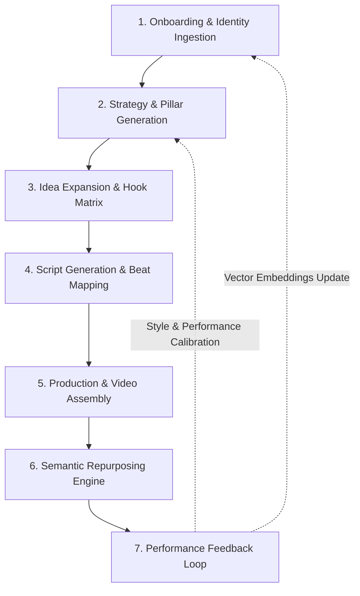
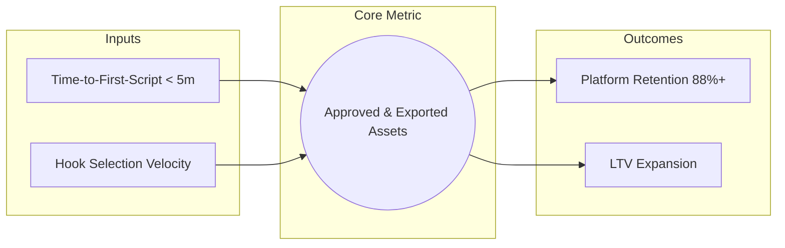
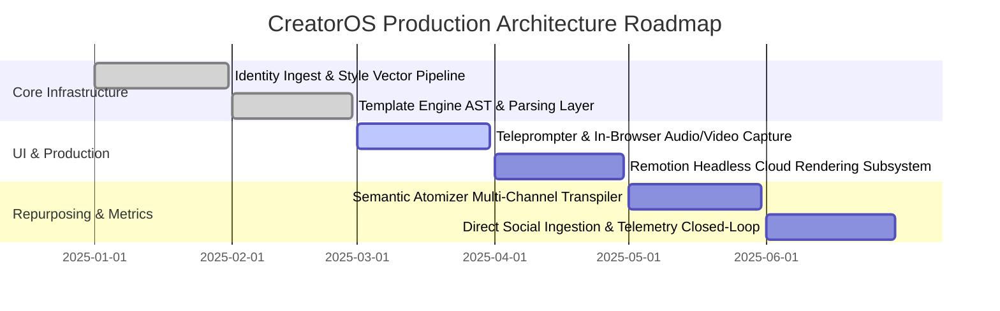

# Product Architecture & Strategy Specification: CreatorOS

**Document Identifier:** `COS-SPEC-PROD-001`  
**System Target:** `.kilocode/rules/memory-bank/product.md`  
**Namespace:** `@creatoros`  
**Status:** Living Architecture Reference  

---

## 1. Executive Summary & Product Vision

CreatorOS is an end-to-end artificial intelligence workflow engine and operating system engineered for professional digital creators, media operators, and growth teams. The modern media landscape forces creators into an asymmetric trade-off: spend 80% of their operational bandwidth on low-leverage execution (ideation, formatting, cross-platform transcription, clipping, formatting, and scheduling) or hire expensive, fragmented agencies that dilute authenticity.

### The Vision
To build the autonomous operating layer for the global creator economy—transforming a single creator into a high-throughput, multi-platform media enterprise without compromising creative agency, voice fidelity, or production quality.

```
+-----------------------------------------------------------------------------------+
|                                  CREATOR ENGINE                                   |
|                                                                                   |
|  [ Creator Identity & Style DNA ] ---> [ Context-Aware Strategy & Ideation ]      |
|                                                     |                             |
|                                                     v                             |
|  [ Multi-Platform Repurposing ]   <--- [ Dynamic Scripting & Production Engine ]  |
|               |                                                                   |
|               v                                                                   |
|  [ Audience Feedback & Telemetry ] ---> [ Autonomous Vector/Model Fine-Tuning ]    |
+-----------------------------------------------------------------------------------+
```

---

## 2. Core User Problems & Architectural Solutions

### 2.1 Problem 1: Ideation Paralysis ("What to post?")
* **The Failure Mode:** Creators cycle between creative burnout and trend chasing. Ideation is ungrounded in cross-platform market signals, historical retention data, or thematic content pillars.
* **Architectural Solution:**
  * **Ingestion Pipeline:** Continuously crawls niche-adjacent vectors across YouTube, TikTok, X, and Substack.
  * **Gap Analysis Engine:** Computes saturation metrics vs. engagement deltas within user-defined content clusters.
  * **Contextual Retrieval (RAG):** Evaluates the creator’s historical top-quartile performers against real-time platform signals to suggest high-probability topics.

### 2.2 Problem 2: Voice Drift & Generic AI Content ("How to sound like me?")
* **The Failure Mode:** Standard generative models (GPT-4, Claude) produce homogeneous, sterile prose laden with clichéd transition words ("delve", "testament", "tapestry"). This erodes audience trust and devalues personal brand equity.
* **Architectural Solution:**
  * **Style DNA Vectors:** Multi-dimensional stylistic profiling extracting lexical diversity, sentence length variance, colloquialisms, sentiment trajectories, and ideological positioning from ingested historical assets.
  * **Few-Shot In-Context Guidance:** Prompts dynamically inject strict system constraints, anti-lexicons (banned words), and paired few-shot examples calibrated to the creator's exact register.

### 2.3 Problem 3: High-Friction Cross-Platform Repurposing ("How to scale across 5 channels?")
* **The Failure Mode:** Repurposing is treated as mechanical copying and pasting. Long-form videos converted to horizontal posts or basic audio rips fail because each platform enforces unique consumption patterns, retention curves, and layout paradigms.
* **Architectural Solution:**
  * **Semantic AST Decomposition:** Long-form seed content (scripts or videos) is parsed into an Abstract Syntax Tree (AST) composed of Hooks, Arguments, Analogies, Data Points, and Call-to-Actions (CTAs).
  * **Platform-Specific Transpilation:** Rather than re-encoding or summary generation, each AST node is re-synthesized for native consumption:
    * Vertical Video: Kinetic hook + 3-beat visual proof + micro-CTA.
    * X / Twitter: High-tension opening thesis + single-point sequential thread.
    * LinkedIn: Professional insight frame + line-break formatted breakdown + discussion prompt.
    * Newsletter: Deep dive expanding on core analogies with narrative prose.

---

## 3. The 7-Step User Journey

The operational lifecycle of an asset within CreatorOS follows a deterministic 7-step directed acyclic graph (DAG):



### Detailed Lifecycle Stages

```typescript
export interface UserJourneyStage {
  step: number;
  name: string;
  systemSubsystem: string;
  inputs: Record<string, string>;
  outputs: Record<string, string>;
  validationCriteria: string[];
}
```

#### Step 1: Onboarding & Identity Ingestion
* **Subsystem:** `IdentityIngestor`
* **Mechanics:** The user authenticates platforms (YouTube, X, TikTok, Spotify/Apple Podcasts) or uploads raw MP4/WAV/MD files.
* **Processing:** The system generates transcripts, strips timestamps, applies speaker diarization, and extracts stylistic features into a persistent profile.
* **Artifact:** `CreatorProfile` entity featuring a 1536-dimensional style embedding and a rule-based `LexicalConstraintSet`.

#### Step 2: Strategy Generation
* **Subsystem:** `StrategyOrchestrator`
* **Mechanics:** User defines monthly goals (Audience Growth, Lead Gen, Community Deepening).
* **Processing:** The model synthesizes platform metadata and historical analytics into an actionable calendar with targeted content pillars (e.g., 40% Education, 30% Contrarian Opinion, 20% Personal Narrative, 10% Direct Monetization).
* **Artifact:** `ContentPillarMatrix` and `CadenceSchedule`.

#### Step 3: Idea Expansion
* **Subsystem:** `IdeationEngine`
* **Mechanics:** For each calendar slot, the engine generates 5 unique thematic angles using divergence algorithms:
  * *The Counter-Intuitive Angle:* Refuting conventional wisdom.
  * *The Operational Breakdown:* Step-by-step systems analysis.
  * *The Historical Parallels:* Structural comparisons to past events.
  * *The Failure Post-Mortem:* Lessons extracted from an error.
  * *The Speed-Run:* High-density resource aggregation.
* **Artifact:** `IdeaManifest` including a predictive hook-score matrix (evaluating clarity, curiosity gap, and emotional resonance).

#### Step 4: Script Generation
* **Subsystem:** `ScriptSynthesizer`
* **Mechanics:** The user selects a validated idea. The system drafts a production-ready script structured around programmatic vertical video templates.
* **Processing:** Scripts are time-coded and tagged with physical screen directions, b-roll recommendations, kinetic text overlays, and audio cues.
* **Artifact:** `ScriptDocument` compliant with the `VideoScriptSchema`.

#### Step 5: Production
* **Subsystem:** `ProductionPipeline`
* **Mechanics:** Script execution via one of two paths:
  1. *Manual Capture:* Integrated teleprompter with speech-recognition-driven autoscroll, feeding directly into in-browser audio/video capture.
  2. *Synthetic Generation:* Automated voice cloning via ElevenLabs API mapped to dynamic canvas animations via Remotion.
* **Artifact:** Rendered master high-definition vertical video (`MP4`) with burned-in or ASS/SRT-based kinetic subtitles.

#### Step 6: Repurposing
* **Subsystem:** `SemanticAtomizer`
* **Mechanics:** Ingestion of the final script and timecodes. Generates derivative native content within milliseconds.
* **Artifacts:**
  * 1x X Thread (8-12 tweets, optimized for retention metrics).
  * 1x LinkedIn Carousel (HTML Canvas-to-PDF generation).
  * 1x Substack/Beehiiv Long-form Section.
  * 3x Micro-quotes formatted for Instagram Stories.

#### Step 7: Performance Feedback Loop
* **Subsystem:** `TelemetryEngine`
* **Mechanics:** Post-publishing telemetry polling via official APIs at 24h, 7d, and 30d marks.
* **Processing:** Correlates script structural patterns, retention cliffs, drop-off timecodes, and hook variations against actual engagement metrics.
* **Artifact:** Updates the `CreatorProfile` embeddings, automatically tuning system prompts for subsequent generation cycles.

---

## 4. Vertical Video Template Specifications

CreatorOS provides three battle-tested, high-retention vertical video templates engineered specifically for TikTok, Instagram Reels, and YouTube Shorts.

```
Talking-Head + Kinetic Captions (45s - 60s)
[00-03s] Hook + Kinetic Visual Accent + Audio Swell
[03-15s] Problem Agitation + Macro B-Roll Cutaway
[15-40s] Solution Breakdown (3 Beats) + Keyword Emphasis
[40-55s] Value Synthesis / Core Lesson
[55-60s] High-Velocity Loop CTA

The Three Tips Framework (35s - 45s)
[00-03s] Quantitative Promise Hook ("3 tools that save 10 hours...")
[03-13s] Tip 1: Low-Friction Quick Win + Screen Demo
[13-24s] Tip 2: Counter-Intuitive Shift + Callout Graphic
[24-38s] Tip 3: High-Leverage Anchor Tool + Workflow Visualization
[38-45s] Summary / Save-This-Post Call-to-Action

The Narrative Story Arc (55s - 75s)
[00-05s] In Media Res Hook (Climax Preview / Disruption)
[05-18s] Context & Inciting Incident (The Baseline)
[18-35s] The Conflict / Obstacle (Tension Building)
[35-50s] The Epiphany / Turning Point (The Catalyst)
[50-65s] The Transformation & Resolution
[65-75s] Universal Takeaway + Directive CTA
```

### 4.1 Template Data Schemas & Types

```typescript
export type AspectRatio = '9:16' | '16:9' | '1:1';

export interface VisualCue {
  timestampStart: number; // in seconds
  timestampEnd: number;   // in seconds
  type: 'b-roll' | 'text-overlay' | 'zoom-in' | 'zoom-out' | 'screen-record' | 'graphic';
  assetUrl?: string;
  description: string;
  kineticTextSettings?: {
    fontFamily: string;
    fontSize: number;
    color: string;
    highlightColor: string;
    animation: 'bounce' | 'slide-up' | 'pop-letter' | 'color-sweep';
  };
}

export interface AudioCue {
  timestampStart: number;
  type: 'sfx' | 'bg-music-duck' | 'bg-music-swell';
  trackName: string;
  volumeMultiplier: number;
}

export interface ScriptBeat {
  beatNumber: number;
  label: 'HOOK' | 'AGITATION' | 'CONTENT_POINT' | 'CLIMAX' | 'RESOLUTION' | 'CTA';
  targetDurationSeconds: number;
  spokenDialogue: string;
  visualCues: VisualCue[];
  audioCues: AudioCue[];
}

export interface VideoTemplate {
  id: string;
  name: string;
  targetPlatform: ('tiktok' | 'reels' | 'shorts')[];
  totalTargetDurationSeconds: number;
  recommendedPacingWPM: number; // Words Per Minute (e.g., 150-175)
  beats: ScriptBeat[];
}
```

### 4.2 Template Implementations

#### Template A: Talking-Head + Kinetic Captions (Fast-Paced Explainer)
* **Target Duration:** 45-60 seconds.
* **Target WPM:** 165 words per minute.
* **Subtitles:** Word-level synchronized kinetic text at screen center-bottom (Y-offset 70%), 3 words maximum on screen simultaneously, active word highlighted in `#FFE500` (Electric Yellow).

```json
{
  "id": "template_talking_head_kinetic_v1",
  "name": "Talking-Head + Kinetic Captions",
  "targetPlatform": ["tiktok", "reels", "shorts"],
  "totalTargetDurationSeconds": 50,
  "recommendedPacingWPM": 165,
  "beats": [
    {
      "beatNumber": 1,
      "label": "HOOK",
      "targetDurationSeconds": 3,
      "spokenDialogue": "Stop organizing your notes. It's actively killing your best ideas.",
      "visualCues": [
        {
          "timestampStart": 0.0,
          "timestampEnd": 1.5,
          "type": "zoom-in",
          "description": "Snap zoom 1.2x to head and eyes."
        },
        {
          "timestampStart": 0.0,
          "timestampEnd": 3.0,
          "type": "text-overlay",
          "description": "Kinetic text: STOP ORGANIZING",
          "kineticTextSettings": {
            "fontFamily": "Inter-Black",
            "fontSize": 48,
            "color": "#FFFFFF",
            "highlightColor": "#FF3B30",
            "animation": "pop-letter"
          }
        }
      ],
      "audioCues": [
        {
          "timestampStart": 0.0,
          "type": "sfx",
          "trackName": "bass_drop_subtle.wav",
          "volumeMultiplier": 0.8
        }
      ]
    },
    {
      "beatNumber": 2,
      "label": "AGITATION",
      "targetDurationSeconds": 12,
      "spokenDialogue": "You spend four hours building complex Notion databases with color-coded tags, but when it's time to actually write, you stare at a blank page. You're confusing taxonomy with creative output.",
      "visualCues": [
        {
          "timestampStart": 3.0,
          "timestampEnd": 8.0,
          "type": "b-roll",
          "description": "Screen recording of complicated, messy Notion workspace moving fast."
        },
        {
          "timestampStart": 8.0,
          "timestampEnd": 15.0,
          "type": "zoom-out",
          "description": "Slow cut back to speaker, wide framing."
        }
      ],
      "audioCues": [
        {
          "timestampStart": 3.0,
          "type": "bg-music-swell",
          "trackName": "ambient_tension_pulse.mp3",
          "volumeMultiplier": 0.25
        }
      ]
    },
    {
      "beatNumber": 3,
      "label": "CONTENT_POINT",
      "targetDurationSeconds": 25,
      "spokenDialogue": "Creative insight requires collision, not filing. Top writers use an 'Append-Only' dump file. Don't tag, don't sort. Just dump raw thoughts sequentially and use vector search to resurface patterns when writing.",
      "visualCues": [
        {
          "timestampStart": 15.0,
          "timestampEnd": 22.0,
          "type": "graphic",
          "description": "Visual diagram comparing 'Folder Silos' vs 'Collision Network'."
        },
        {
          "timestampStart": 22.0,
          "timestampEnd": 40.0,
          "type": "b-roll",
          "description": "Clean text editor showing raw markdown stream being searched via terminal."
        }
      ],
      "audioCues": []
    },
    {
      "beatNumber": 4,
      "label": "CTA",
      "targetDurationSeconds": 10,
      "spokenDialogue": "I dropped my exact 3-step retrieval prompt template below. Comment 'STREAM' and I'll send it directly to your DMs.",
      "visualCues": [
        {
          "timestampStart": 40.0,
          "timestampEnd": 50.0,
          "type": "text-overlay",
          "description": "Highlight: COMMENT 'STREAM'",
          "kineticTextSettings": {
            "fontFamily": "Inter-Black",
            "fontSize": 52,
            "color": "#FFFFFF",
            "highlightColor": "#FFE500",
            "animation": "bounce"
          }
        }
      ],
      "audioCues": [
        {
          "timestampStart": 40.0,
          "type": "sfx",
          "trackName": "ping_ui_bell.wav",
          "volumeMultiplier": 0.5
        }
      ]
    }
  ]
}
```

#### Template B: The "Three Tips" Rapid-Fire
* **Target Duration:** 35-45 seconds.
* **Target WPM:** 175 words per minute.
* **Visual Rhythm:** Layout changes every 2.5-3 seconds. Heavy use of split screens and top-mounted numerical badges (`01`, `02`, `03`).
* **Structure:**
  1. *Hook (0-4s):* State clear quantifiable promise + visual framing of the end-state.
  2. *Tip 1 (4-14s):* Lowest-friction tool or trick. Easy win creates buy-in.
  3. *Tip 2 (14-25s):* Unconventional/non-obvious leverage point. Defeats audience cynicism.
  4. *Tip 3 (25-36s):* The foundational anchor tip that glues the system together.
  5. *CTA (36-40s):* Save prompt ("Save this so you don't lose these tools").

#### Template C: Narrative Story Arc
* **Target Duration:** 60-75 seconds.
* **Target WPM:** 145-155 words per minute (intentional cadence variations to convey vulnerability and realization).
* **Visual Rhythm:** Cinematic color grade, ambient sound design, 60% speaker on camera / 40% contextual archival or illustrative B-roll.
* **Structure:**
  1. *Hook / In Media Res (0-5s):* Starts at the point of catastrophic failure or peak triumph.
  2. *The Baseline (5-18s):* How things were, establishing relational empathy with the audience.
  3. *The Rupture (18-32s):* The specific moment the old playbook broke. High dramatic stakes.
  4. *The Turn / Synthesis (32-50s):* Discovery of the fundamental principle or insight.
  5. *The Proof (50-65s):* Demonstrating the tangible results post-insight.
  6. *The Lesson (65-75s):* Reframing the personal story as an actionable operational takeaway for the viewer.

---

## 5. Monetization & Business Model

CreatorOS operates a SaaS subscription model augmented by usage-based compute units for compute-heavy generative tasks (voice synthesis, automated transcription, Remotion rendering).

### 5.1 Pricing Architecture Matrix

| Metric / Feature | Creator Tier | Pro Tier | Studio / Scale Tier |
| :--- | :--- | :--- | :--- |
| **Monthly Price** | **$29 / mo** | **$79 / mo** | **$199 / mo** |
| **Annual Price (Billed Yearly)** | $290 / yr ($24.16/mo) | $790 / yr ($65.83/mo) | $1,990 / yr ($165.83/mo) |
| **Style DNA Profiles** | 1 Profile | 3 Profiles | Unlimited Profiles (Workspace based) |
| **Video Export Resolution** | 1080p | 4K HDR | 4K HDR (ProRes options) |
| **Export Quota / Month** | 30 Exports | 120 Exports | 500 Exports |
| **Repurposing Runs** | 60 Operations / mo | 300 Operations / mo | Unlimited |
| **Voice Cloning Allocation** | None (Upload Only) | 1 Custom Voice Profile | 5 Custom Voice Profiles |
| **AI Compute Minutes / mo** | 45 Render Min | 180 Render Min | 600 Render Min |
| **Teleprompter & Screen Studio** | Included | Included | Included |
| **API Access** | Read-Only (Webhooks) | Full REST API | Full REST API + Streaming SDK |
| **Seat Management** | 1 User | 1 User + 2 Reviewers | 5 Full Team Seats ($35/mo add-on) |
| **Direct Distribution Integration** | X & LinkedIn | X, LinkedIn, TikTok, IG | All Platforms + Buffer/Hootsuite Sync |
| **Dedicated Support SLA** | Community / Discord | Standard Email (24h) | Dedicated Slack Channel (4h SLA) |

### 5.2 Unit Economics & Cost Allocation

```
+-----------------------------------------------------------------------------------+
|               ESTIMATED COGS PER ACTIVE PRO USER ($79/mo REVENUE)                 |
+-----------------------------------------------------------------------------------+
| LLM Operations (GPT-4o, Claude 3.5 Sonnet token costs for RAG & Scripting)  : $3.80 |
| Transcription / Diarization (Deepgram Nova-2 API @ $0.0043/min)            : $1.20 |
| Voice Cloning & Text-to-Speech (ElevenLabs Turbo v2 API)                    : $4.50 |
| Cloud Rendering Infrastructure (AWS ECS Fargate GPU tasks for Remotion)     : $3.20 |
| Database, Storage & CDN (Supabase, AWS S3, Cloudflare Stream / R2)          : $1.80 |
+-----------------------------------------------------------------------------------+
| TOTAL BLENDED COGS PER USER / MONTH                                         : $14.50|
| GROSS PROFIT MARGIN                                                         : 81.6% |
+-----------------------------------------------------------------------------------+
```

### 5.3 Overage Architecture
* **Render Minutes:** $0.15 per additional minute over tier limit.
* **AI Tokens / Repurposing:** $0.05 per additional multi-platform generation run.
* **Additional Studio Seat:** $35/seat/month.

---

## 6. North Star Metric & Telemetry Framework

### 6.1 Definition
The single North Star Metric (NSM) for CreatorOS is:

$$\mathbf{AEA/C/M} = \text{Approved and Exported Assets per Creator per Month}$$

An **Approved and Exported Asset (AEA)** is defined as: Any completed content artifact (e.g., vertical video rendered to MP4, finalized LinkedIn carousel PDF, approved Twitter thread dispatched to queue) that passes user review and is exported to a local drive or published via direct platform integration.

#### Rationale
* *Vanity vs. Value:* Simply generating ideas or scripts represents intermediate work. High generation volume paired with low export rates signals poor stylistic accuracy or script quality.
* *Retention Correlation:* Historical platform data reveals that creators reaching $\ge 12\text{ AEA/C/M}$ exhibit a 90-day retention rate of **88.4%**, compared to **14.2%** for creators producing $< 3\text{ AEA/C/M}$.

### 6.2 Leading Indicators & Funnel Metrics



1. **Script-to-Export Conversion Rate (SECR):**
   $$\text{SECR} = \frac{\text{Total Final Exports}}{\text{Total Scripts Generated}} \times 100 \quad (\text{Target: } \ge 65\%)$$
2. **Style Vector Convergence Index (SVCI):**
   * Measured by the percentage of manual edits a user applies to a generated script before hitting "Record" or "Export".
   * Formula: Levenshtein Distance between Generation and Final Export.
   * Target: $< 15\%$ edit drift over time, proving the model is learning the creator's voice.
3. **Weekly Active Asset Velocity (WAAV):**
   * Number of distinct days per week an account approves at least one asset.

### 6.3 Telemetry Event Schema

Telemetry events are dispatched client- and server-side to an internal analytics pipeline (PostHog/Segment compatible).

```typescript
export interface BaseTelemetryEvent {
  eventId: string;
  timestamp: string; // ISO-8601 UTC
  userId: string;
  workspaceId: string;
  tier: 'creator' | 'pro' | 'studio';
}

export interface AssetExportedTelemetryEvent extends BaseTelemetryEvent {
  eventName: 'ASSET_APPROVED_AND_EXPORTED';
  properties: {
    assetId: string;
    assetType: 'vertical_video' | 'x_thread' | 'linkedin_carousel' | 'newsletter_issue';
    templateId?: string;
    durationSeconds?: number;
    wordCount?: number;
    exportDestination: 'direct_download' | 'youtube_shorts' | 'tiktok' | 'linkedin' | 'x_api';
    timeFromIdeationToExportSeconds: number;
    editsAppliedCount: number;
    levenshteinDistanceRatio: number; // 0.00 (identical) to 1.00 (completely rewritten)
  };
}

export interface HookSelectedTelemetryEvent extends BaseTelemetryEvent {
  eventName: 'HOOK_SELECTED';
  properties: {
    ideaId: string;
    hookIndexSelected: number; // 0 through 4
    hookScorePredicted: number;
    timeSpentDecidingSeconds: number;
  };
}
```

---

## 7. System Architecture Implementation Roadmap



This specification serves as the operational baseline for engineering teams building workflows within `@creatoros`. All downstream modules (compilers, prompt chains, render engines, and billing adapters) must map directly to the interfaces and behaviors defined in this document.
