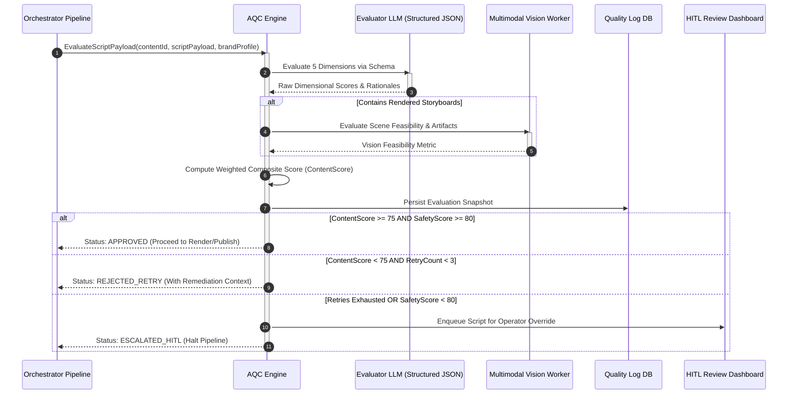
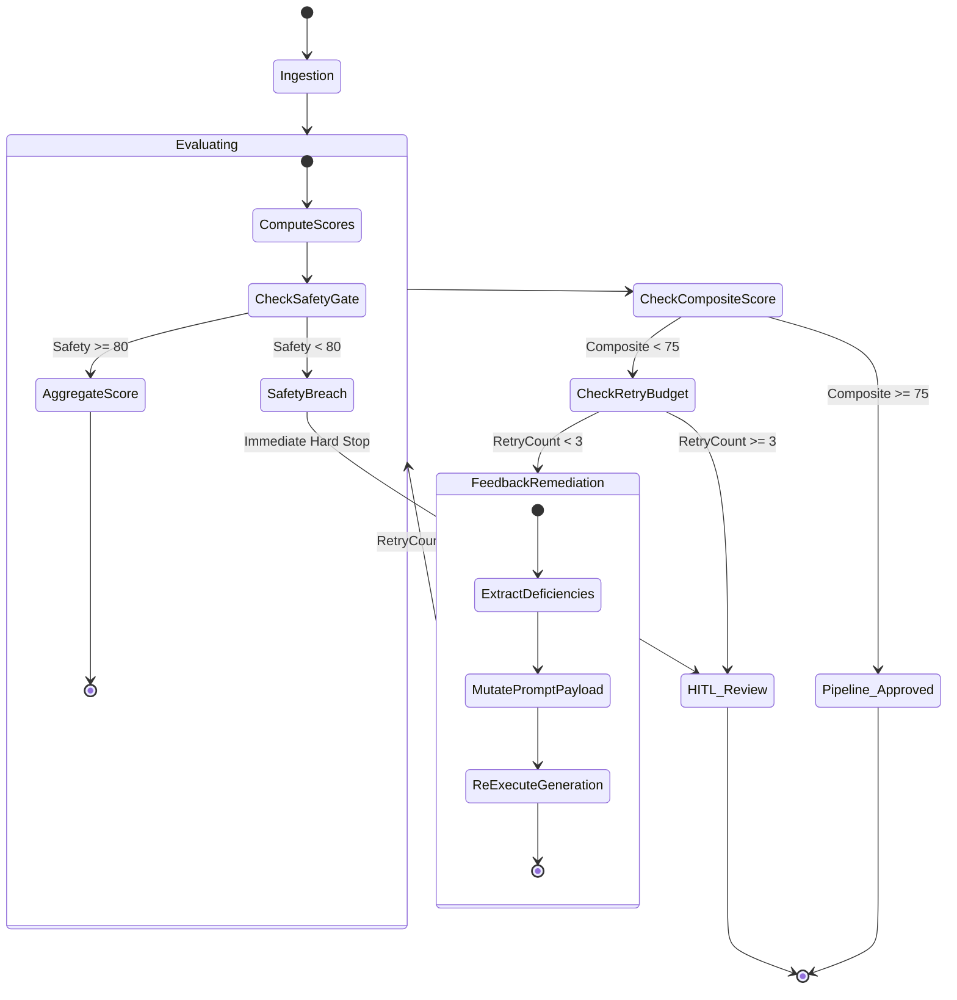

# Quality Control & Scoring System

This specification defines the architecture, evaluation rubrics, automated feedback loops, and human-in-the-loop (HITL) governance mechanisms for the CreatorOS Automated Quality Control (AQC) Engine.

The AQC Engine serves as an automated gatekeeper within the media synthesis pipeline, evaluating generated scripts, scene structures, visual prompts, and rendered assets prior to publishing. Assets failing threshold gates undergo deterministic repair loops or escalate to human review.

---

## 1. System Architecture Overview

The Quality Control subsystem operates immediately downstream of the Script and Storyboard Generation Engine and upstream of the Video Synthesis and Publishing Pipeline. It operates synchronously on draft scripts and asynchronously on compiled multi-track video assemblies.

```
+------------------------------------------------------------------------------------------------+
|                                    CreatorOS Pipeline Context                                  |
|                                                                                                |
|   +-----------------------+      +---------------------------+      +----------------------+   |
|   | Script & Storyboard   | ---> | Automated Quality Control | ---> | Video Rendering /    |   |
|   | Generation Engine     |      | (AQC) Evaluation Pipeline |      | Social Dispatch Engine|  |
|   +-----------------------+      +---------------------------+      +----------------------+   |
+------------------------------------------------|-----------------------------------------------+
                                                 |
                       +-------------------------+-------------------------+
                       |                                                   |
            Score >= 75 (Pass)                                     Score < 75 (Fail)
                       |                                                   |
                       v                                                   v
           +-----------------------+                         +---------------------------+
           | Direct to Production  |                         | Feedback Injection Loop   |
           | Queue                 |                         | (Max 3 Re-generations)    |
           +-----------------------+                         +---------------------------+
                                                                           |
                                                              Retries Exhausted / Safety Breach
                                                                           |
                                                                           v
                                                             +---------------------------+
                                                             | Human-in-the-Loop (HITL)  |
                                                             | Review Queue              |
                                                             +---------------------------+
```

### 1.1 Ingestion and Output Lifecycle



---

## 2. The 5-Dimensional Evaluation Rubric

The ContentScore aggregates five distinct assessment dimensions. Each dimension produces an integer value between `0` and `100`, calculated using strict heuristic criteria, deterministic rule sets, and fine-tuned LLM evaluators.

### 2.1 Dimensional Weights & Mathematical Formulation

The composite score $S_{\text{composite}}$ is defined as:

$$S_{\text{composite}} = \sum_{i=1}^{5} (w_i \cdot s_i)$$

Where $s_i \in [0, 100]$ represents the dimension score and $w_i$ represents the assigned weight, subject to $\sum_{i=1}^{5} w_i = 1.0$.

| Dimension ($i$) | Dimension Identifier (`key`) | Weight ($w_i$) | Minimum Threshold ($s_{\min}$) | Critical Failure Impact |
| :--- | :--- | :--- | :--- | :--- |
| **1. Hook Strength** | `hook_strength` | **0.25** | 70 | High drop-off at $t \le 3\text{s}$ |
| **2. Brand Fit** | `brand_fit` | **0.20** | 70 | Brand guideline divergence |
| **3. Retention Pacing** | `retention_pacing` | **0.20** | 65 | Mid-video viewer churn |
| **4. Scene Feasibility** | `scene_feasibility` | **0.20** | 75 | Synthesis engine render artifacts |
| **5. Safety & Accuracy** | `safety_accuracy` | **0.15** | **80 (Hard Gate)** | Instant fail: composite forced to 0 |

> **Critical Safety Gating Policy**: If $s_{\text{safety\_accuracy}} < 80$, the asset immediately fails evaluation regardless of the calculated composite score. The pipeline marks the asset as `FAILED_SAFETY` and bypasses automated retries directly to the HITL Review Queue.

---

### 2.2 Deep Dive: Dimension Criteria and Scoring Rubrics

#### 1. Hook Strength ($w_1 = 0.25$)
Evaluates the initial 3 seconds (or initial 25 words) of the asset for viewer acquisition efficacy.

*   **Sub-factors Evaluated**:
    *   *Curiosity Gap / Pattern Interrupt*: Disruption of baseline user scroll behavior.
    *   *Payoff Velocity*: Speed at which the opening statement promises tangible utility or resolution.
    *   *Visual-Textual Cohesion*: Alignment between the opening spoken line and the primary visual prompt.
*   **Scoring Rubric**:
    *   `90–100`: High-potency cognitive disruption, instant stakes establishment, sub-10-word punchline or visual shock.
    *   `75–89`: Clear value proposition established within 3 seconds; recognizable hook pattern (e.g., negative framing, contrarian take).
    *   `50–74`: Passive greeting ("Hey guys"), generic statement, or delayed thesis statement ($t > 3\text{s}$).
    *   `0–49`: Silent buffer, boilerplate intros, clichéd intros ("In this video, I will show you..."), zero intrigue.

#### 2. Brand Fit ($w_2 = 0.20$)
Evaluates semantic, tonal, stylistic, and lexical alignment with the creator's configured Brand Voice Profile.

*   **Sub-factors Evaluated**:
    *   *Lexical Congruence*: Adherence to creator-defined vocabulary lists (inclusion of preferred vernacular, absence of blacklisted terminology).
    *   *Tone Metric*: Consistency with target voice markers (e.g., authoritative, cynical, high-energy, deadpan).
    *   *Visual Styling Concordance*: Scene descriptions match defined brand aesthetics (e.g., cinematic dark-mode, high-saturation anime, minimal corporate).
*   **Scoring Rubric**:
    *   `90–100`: Indistinguishable from authentic creator output; precise syntax patterns, rhythm, and domain-native nomenclature.
    *   `75–89`: Adheres to general tone and forbidden word lists, but contains minor generic phrasing.
    *   `50–74`: Noticeable corporate neutrality, over-used LLM tropes ("delve", "testament", "tapestry"), improper slang usage.
    *   `0–49`: Explicitly uses blacklisted words, targets wrong audience demographic, or reverses established creator sentiment.

#### 3. Retention Pacing ($w_3 = 0.20$)
Evaluates the temporal distribution of narrative beats, information density, visual transitions, and rhythm.

*   **Sub-factors Evaluated**:
    *   *Syntactic Cadence*: Variation in sentence length (mixture of short staccato lines and balanced clauses).
    *   *Scene Cut Velocity*: Shot duration distribution ($1.2\text{s} - 3.8\text{s}$ target range for vertical short-form; $4.0\text{s} - 8.0\text{s}$ for long-form).
    *   *Micro-Rehooks*: Mid-script engagement anchors positioned at calculated retention drop points ($25\%$, $50\%$, and $75\%$ duration).
*   **Scoring Rubric**:
    *   `90–100`: Flawless rhythmic variation, natural conversational flow, scene changes timed to narrative inflection points.
    *   `75–89`: Consistent pacing with minor monologues; maintains average cut frequency within acceptable margins.
    *   `50–74`: Monotonous sentence structure, extended dialogue segments without visual transitions ($> 6\text{s}$ static).
    *   `0–49`: Wall-of-text scripts, lack of narrative progression, extreme structural bloat.

#### 4. Scene Feasibility ($w_4 = 0.20$)
Measures the computational and visual likelihood that down-stream generative video/image models (e.g., Sora, Luma, Runway Gen-3, Midjourney v6, ComfyUI pipelines) can accurately synthesize the requested prompts without generating visual hallucinations.

*   **Sub-factors Evaluated**:
    *   *Spatial Logic & Consistency*: Absence of contradictory physical configurations (e.g., "camera zooms out 360 degrees while tracking two distinct faces moving in opposite directions").
    *   *Generative Model Affinity*: Use of concrete visual tokens rather than abstract concepts ("a brass mechanical chronometer clicking" vs "the passing of time and regret").
    *   *Multi-Subject Complexity*: Constraint checks on the number of concurrent interactive actors (maximum 2 primary foreground agents per scene to avoid limb synthesis failures).
*   **Scoring Rubric**:
    *   `90–100`: High-clarity visual descriptions, single or well-isolated subjects, well-defined lighting, composition, camera focal length, and movement parameters.
    *   `75–89`: Synthesizable prompts requiring standard LoRA/motion modules; minor ambiguities in background elements.
    *   `50–74`: Overly complex visual action sequences (e.g., multiple overlapping hands interacting with intricate instruments); high risk of anatomical deformation.
    *   `0–49`: Impossible spatial mechanics, prompt syntax requesting real-time generation of dense legalese or unrenderable abstractions.

#### 5. Safety & Accuracy ($w_5 = 0.15$)
Evaluates factual validity, copyright infringement liability, platform terms of service (ToS) compliance, and automated moderation filters.

*   **Sub-factors Evaluated**:
    *   *Platform Policy Compliance*: TikTok/YouTube/Meta Community Guidelines verification (zero tolerance for self-harm, hate speech, regulated substances, harassment).
    *   *Hallucination / Factuality Index*: Extraction of testable claims and validation against web grounding/retrieval corpora.
    *   *Copyright & Trademark Exposure*: Detection of third-party IP infringements, protected character names, and trade-dress references.
*   **Scoring Rubric**:
    *   `90–100`: Fully verified factual assertions; absolute safety hygiene; no flagged terms or adjacent sensitive themes.
    *   `80–89`: Neutral factual statements; negligible compliance friction; mild contextual ambiguity safely resolved.
    *   `60–79`: Unverified factual claims made definitively; borderline provocative language risking algorithmic downranking.
    *   `0–59`: Explicit platform violation, severe factual inaccuracies, medical/financial misinformation, or direct trademark violations.

---

## 3. Score Evaluation Engine Implementation

The evaluation core executes as a modular TypeScript service, utilizing structured JSON output guarantees from underlying models via schema enforcement.

### 3.1 Type Definitions

```typescript
// types/aqc.ts

export type EvaluationDimensionKey =
  | 'hook_strength'
  | 'brand_fit'
  | 'retention_pacing'
  | 'scene_feasibility'
  | 'safety_accuracy';

export interface DimensionMetric {
  score: number; // 0 - 100
  weight: number; // 0.0 - 1.0
  weightedScore: number;
  reasoning: string;
  violations: string[];
  remediationSuggestions: string[];
}

export interface ContentScoreReport {
  contentId: string;
  version: number;
  timestamp: string;
  compositeScore: number;
  passed: boolean;
  hardGateFailure: boolean;
  dimensions: Record<EvaluationDimensionKey, DimensionMetric>;
  summary: string;
  actionRequired: 'PROCEED' | 'RETRY' | 'ESCALATE_HITL';
}

export interface ScriptScene {
  sceneId: string;
  timestampStart: number;
  timestampEnd: number;
  voiceover: string;
  visualPrompt: string;
  cameraMovement: string;
}

export interface ScriptPayload {
  contentId: string;
  version: number;
  title: string;
  targetDurationSeconds: number;
  scenes: ScriptScene[];
}

export interface BrandProfile {
  brandId: string;
  toneDescriptors: string[];
  lexiconWhitelist: string[];
  lexiconBlacklist: string[];
  targetAudience: string;
  styleGuidelines: string;
}
```

### 3.2 Evaluation Service Engine

```typescript
// services/AqcEvaluationEngine.ts

import { z } from 'zod';
import {
  ScriptPayload,
  BrandProfile,
  ContentScoreReport,
  EvaluationDimensionKey,
  DimensionMetric
} from '../types/aqc';

const EvaluationResponseSchema = z.object({
  hook_strength: z.object({
    score: z.number().min(0).max(100),
    reasoning: z.string(),
    violations: z.array(z.string()),
    remediationSuggestions: z.array(z.string()),
  }),
  brand_fit: z.object({
    score: z.number().min(0).max(100),
    reasoning: z.string(),
    violations: z.array(z.string()),
    remediationSuggestions: z.array(z.string()),
  }),
  retention_pacing: z.object({
    score: z.number().min(0).max(100),
    reasoning: z.string(),
    violations: z.array(z.string()),
    remediationSuggestions: z.array(z.string()),
  }),
  scene_feasibility: z.object({
    score: z.number().min(0).max(100),
    reasoning: z.string(),
    violations: z.array(z.string()),
    remediationSuggestions: z.array(z.string()),
  }),
  safety_accuracy: z.object({
    score: z.number().min(0).max(100),
    reasoning: z.string(),
    violations: z.array(z.string()),
    remediationSuggestions: z.array(z.string()),
  }),
  overall_summary: z.string(),
});

type RawEvaluationResponse = z.infer<typeof EvaluationResponseSchema>;

export class AqcEvaluationEngine {
  private static readonly WEIGHTS: Record<EvaluationDimensionKey, number> = {
    hook_strength: 0.25,
    brand_fit: 0.20,
    retention_pacing: 0.20,
    scene_feasibility: 0.20,
    safety_accuracy: 0.15,
  };

  private static readonly MINIMUM_ACCEPTABLE_SCORE = 75.0;
  private static readonly SAFETY_HARD_GATE_THRESHOLD = 80.0;

  public async evaluate(
    payload: ScriptPayload,
    brand: BrandProfile
  ): Promise<ContentScoreReport> {
    const systemPrompt = this.constructSystemPrompt();
    const userPrompt = this.constructUserPrompt(payload, brand);

    const rawResponse = await this.invokeLlmStructuredEvaluator(systemPrompt, userPrompt);
    return this.compileReport(payload.contentId, payload.version, rawResponse);
  }

  private constructSystemPrompt(): string {
    return `You are the CreatorOS Automated Quality Control Engine (AQC).
Your role is to rigorously evaluate synthesized scripts and storyboards against production-grade distribution criteria.
You must return valid JSON strictly conforming to the requested schema.
Assess the content objectively without leniency across all 5 dimensions:
1. Hook Strength (First 3 seconds / 25 words impact)
2. Brand Fit (Lexicon, tone, and audience alignment)
3. Retention Pacing (Cadence, shot length variance, attention anchors)
4. Scene Feasibility (Generative AI renderability, structural visual coherence)
5. Safety & Accuracy (Platform compliance, facts, zero copyright/safety breaches)

Scoring scale for each dimension is 0 to 100. Be critical. Any flaw must degrade the score.`;
  }

  private constructUserPrompt(payload: ScriptPayload, brand: BrandProfile): string {
    return JSON.stringify({
      targetScript: payload,
      brandGuidelines: {
        tone: brand.toneDescriptors,
        whitelist: brand.lexiconWhitelist,
        blacklist: brand.lexiconBlacklist,
        targetAudience: brand.targetAudience,
        generalStyle: brand.styleGuidelines,
      },
    }, null, 2);
  }

  private async invokeLlmStructuredEvaluator(
    systemPrompt: string,
    userPrompt: string
  ): Promise<RawEvaluationResponse> {
    // Platform agnostic abstraction layer (e.g., Anthropic, OpenAI, or Self-Hosted vLLM)
    // Structured JSON mode enforcement
    const response = await fetch(process.env.AQC_LLM_GATEWAY_URL as string, {
      method: 'POST',
      headers: {
        'Content-Type': 'application/json',
        'Authorization': `Bearer ${process.env.AQC_LLM_API_KEY}`,
      },
      body: JSON.stringify({
        model: 'gpt-4o-2024-08-06',
        temperature: 0.1, // Near-zero deterministic scoring
        response_format: { type: 'json_object' },
        messages: [
          { role: 'system', content: systemPrompt },
          { role: 'user', content: userPrompt },
        ],
      }),
    });

    if (!response.ok) {
      throw new Error(`AQC LLM Gateway failure: ${response.status} ${await response.text()}`);
    }

    const json = await response.json();
    const parsedPayload = JSON.parse(json.choices[0].message.content);
    return EvaluationResponseSchema.parse(parsedPayload);
  }

  private compileReport(
    contentId: string,
    version: number,
    raw: RawEvaluationResponse
  ): ContentScoreReport {
    let compositeScore = 0.0;
    const dimensions = {} as Record<EvaluationDimensionKey, DimensionMetric>;

    const dimensionKeys: EvaluationDimensionKey[] = [
      'hook_strength',
      'brand_fit',
      'retention_pacing',
      'scene_feasibility',
      'safety_accuracy',
    ];

    for (const key of dimensionKeys) {
      const dimData = raw[key];
      const weight = AqcEvaluationEngine.WEIGHTS[key];
      const weightedScore = dimData.score * weight;
      compositeScore += weightedScore;

      dimensions[key] = {
        score: dimData.score,
        weight: weight,
        weightedScore: Number(weightedScore.toFixed(2)),
        reasoning: dimData.reasoning,
        violations: dimData.violations,
        remediationSuggestions: dimData.remediationSuggestions,
      };
    }

    const roundedComposite = Number(compositeScore.toFixed(2));
    const safetyScore = dimensions.safety_accuracy.score;
    const hardGateFailure = safetyScore < AqcEvaluationEngine.SAFETY_HARD_GATE_THRESHOLD;

    let actionRequired: 'PROCEED' | 'RETRY' | 'ESCALATE_HITL';
    let passed = false;

    if (hardGateFailure) {
      actionRequired = 'ESCALATE_HITL';
      passed = false;
    } else if (roundedComposite >= AqcEvaluationEngine.MINIMUM_ACCEPTABLE_SCORE) {
      actionRequired = 'PROCEED';
      passed = true;
    } else {
      actionRequired = 'RETRY';
      passed = false;
    }

    return {
      contentId,
      version,
      timestamp: new Date().toISOString(),
      compositeScore: hardGateFailure ? 0.0 : roundedComposite,
      passed,
      hardGateFailure,
      dimensions,
      summary: raw.overall_summary,
      actionRequired,
    };
  }
}
```

---

## 4. Automated Rejection, Retry, and Convergence Loop

Assets with a ContentScore below 75 are not outright discarded; they are processed by an automated remediation feedback loop. To guarantee computational boundedness, execution is constrained by a retry limit ($N_{\max} = 3$).



### 4.1 Convergence Feedback Injection

When an asset triggers a `RETRY`, the remediation context extracts all negative vectors (`violations` and `remediationSuggestions`) from sub-threshold dimensions. This context is injected directly into the Script Synthesizer via targeted system prompting.

#### Context Injection Payload Schema
```json
{
  "previous_iteration_score": 68.4,
  "failed_dimensions": [
    {
      "dimension": "hook_strength",
      "score": 58,
      "violations": [
        "Hook duration exceeded 4.5 seconds before establishing narrative premise.",
        "Opening phrase contains generic query: 'Have you ever wondered?'"
      ],
      "remediation_directives": [
        "Eliminate opening conversational preamble entirely.",
        "Inject shocking visual action into Scene 1 prompt immediately.",
        "Ensure thesis statement lands under word index 12."
      ]
    },
    {
      "dimension": "scene_feasibility",
      "score": 62,
      "violations": [
        "Scene 3 requires rendering 8 distinct individuals typing on glowing transparent keyboards inside an underwater train."
      ],
      "remediation_directives": [
        "Reduce scene complexity to single subject close-up.",
        "Isolate motion variables to camera push-in only."
      ]
    }
  ]
}
```

### 4.2 Differential Mutation Strategy

To prevent local minima where regenerations produce variations of the same failure:
1. **Dynamic Temperature Scaling**: Initial generation runs at $\tau = 0.7$. Retries scale to $\tau = 0.4$ to reduce token entropy and enforce deterministic adherence to remediation instructions.
2. **Anchor Freezing**: Scenes that scored individual feasibility and pacing ratings $> 85$ are locked (frozen), passing unchanged into the revised script payload. Mutation is restricted solely to defective scenes.

---

## 5. Human-in-the-Loop (HITL) Override Mechanics

When an asset exhausts its automated retry allocation or encounters a critical safety violation, it is sequestered in the HITL Review Queue. Operations managers and creative directors interact with the asset using the CreatorOS Review Dashboard.

### 5.1 Review Queue Decision Matrix

```
                          Composite Score
               0                                    75         100
               +-------------------------------------+-----------+
Safety >= 80   |  Automated Remediation Loop (<=3x)  |  Auto     |
               |  If exhausted -> HITL Review        |  Publish  |
               +-------------------------------------+-----------+
Safety <  80   |  IMMEDIATE CRITICAL HITL REVIEW                 |
               |  (Auto-retry blocked completely)                |
               +-------------------------------------------------+
```

### 5.2 Optimistic Locking & Audit Trail

To avoid race conditions when distributed operators review flagged content concurrently, human review actions require monotonic version validation and produce signed audit logs.

#### Override Execution Flow
1. Operator requests content lock: `POST /api/v1/qc/reviews/{contentId}/claim`.
2. Engine assigns exclusive lease with 15-minute Time-To-Live (TTL) using distributed Redis locks.
3. Operator reviews dimensional reports, visual prompt breakdowns, and direct output.
4. Operator submits an action (`OVERRIDE_APPROVE`, `HARD_REJECT`, or `FORCE_REGENERATE`).

### 5.3 HITL Operations Payload Schema

```typescript
// types/hitl.ts

export type HitlDecisionType = 
  | 'OVERRIDE_APPROVE' 
  | 'HARD_REJECT' 
  | 'FORCE_REGENERATE';

export interface HitlReviewSubmission {
  contentId: string;
  expectedVersion: number;
  operatorId: string;
  decision: HitlDecisionType;
  rationale: string;
  dimensionAdjustments?: Partial<Record<EvaluationDimensionKey, number>>;
  manualScriptEdits?: {
    sceneId: string;
    updatedVoiceover?: string;
    updatedVisualPrompt?: string;
  }[];
}
```

---

## 6. API Schemas & Persistence Models

### 6.1 Database Schema (PostgreSQL DDL)

```sql
-- DDL for Automated Quality Control Subsystem

CREATE TYPE aqc_action_enum AS ENUM (
    'PROCEED',
    'RETRY',
    'ESCALATE_HITL'
);

CREATE TYPE hitl_decision_enum AS ENUM (
    'OVERRIDE_APPROVE',
    'HARD_REJECT',
    'FORCE_REGENERATE'
);

CREATE TABLE IF NOT EXISTS qc_evaluations (
    id UUID PRIMARY KEY DEFAULT gen_random_uuid(),
    content_id VARCHAR(64) NOT NULL,
    version INT NOT NULL,
    composite_score NUMERIC(5, 2) NOT NULL,
    passed BOOLEAN NOT NULL,
    hard_gate_failure BOOLEAN NOT NULL DEFAULT FALSE,
    action_required aqc_action_enum NOT NULL,
    summary TEXT NOT NULL,
    created_at TIMESTAMPTZ NOT NULL DEFAULT NOW(),
    
    CONSTRAINT uq_content_version UNIQUE (content_id, version)
);

CREATE TABLE IF NOT EXISTS qc_dimension_metrics (
    id UUID PRIMARY KEY DEFAULT gen_random_uuid(),
    evaluation_id UUID NOT NULL REFERENCES qc_evaluations(id) ON DELETE CASCADE,
    dimension_key VARCHAR(32) NOT NULL,
    raw_score NUMERIC(5, 2) NOT NULL,
    weight NUMERIC(3, 2) NOT NULL,
    weighted_score NUMERIC(5, 2) NOT NULL,
    reasoning TEXT NOT NULL,
    violations JSONB NOT NULL DEFAULT '[]'::jsonb,
    remediations JSONB NOT NULL DEFAULT '[]'::jsonb,
    
    CONSTRAINT uq_eval_dim UNIQUE (evaluation_id, dimension_key)
);

CREATE TABLE IF NOT EXISTS qc_hitl_reviews (
    id UUID PRIMARY KEY DEFAULT gen_random_uuid(),
    content_id VARCHAR(64) NOT NULL,
    version INT NOT NULL,
    operator_id VARCHAR(64) NOT NULL,
    decision hitl_decision_enum NOT NULL,
    rationale TEXT NOT NULL,
    score_adjustments JSONB DEFAULT NULL,
    script_modifications JSONB DEFAULT NULL,
    created_at TIMESTAMPTZ NOT NULL DEFAULT NOW()
);

CREATE INDEX idx_qc_evals_content_id ON qc_evaluations(content_id);
CREATE INDEX idx_qc_metrics_eval_id ON qc_dimension_metrics(evaluation_id);
CREATE INDEX idx_qc_hitl_content_id ON qc_hitl_reviews(content_id);
```

### 6.2 REST Endpoints Specification

#### Trigger Script Evaluation
```http
POST /api/v1/qc/evaluate
Content-Type: application/json

{
  "contentId": "cnt_9981aef12",
  "version": 1,
  "title": "Top 3 Unsolvable Paradoxes",
  "targetDurationSeconds": 45,
  "scenes": [
    {
      "sceneId": "scn_001",
      "timestampStart": 0,
      "timestampEnd": 3,
      "voiceover": "Stop scrolling: this statement is completely false.",
      "visualPrompt": "Close-up macro of an antique grandfather clock shattering in reverse, studio lighting, hyperrealistic, octane render, 8k",
      "cameraMovement": "Fast crash zoom"
    }
  ],
  "brandId": "brd_creator_tech"
}
```

##### Success Response (`200 OK`)
```json
{
  "contentId": "cnt_9981aef12",
  "version": 1,
  "timestamp": "2025-05-18T10:14:22.182Z",
  "compositeScore": 88.25,
  "passed": true,
  "hardGateFailure": false,
  "actionRequired": "PROCEED",
  "summary": "Asset exhibits outstanding immediate hook potential and high cinematic feasibility. Pacing aligns with short-form benchmarks.",
  "dimensions": {
    "hook_strength": {
      "score": 94,
      "weight": 0.25,
      "weightedScore": 23.50,
      "reasoning": "Classic epistemic paradox used effectively within first 1.5 seconds.",
      "violations": [],
      "remediationSuggestions": []
    },
    "brand_fit": {
      "score": 88,
      "weight": 0.20,
      "weightedScore": 17.60,
      "reasoning": "Fits brand tone: analytical, disruptive, clear.",
      "violations": [],
      "remediationSuggestions": []
    },
    "retention_pacing": {
      "score": 85,
      "weight": 0.20,
      "weightedScore": 17.00,
      "reasoning": "Scene transition fits the 3-second boundary constraint.",
      "violations": [],
      "remediationSuggestions": []
    },
    "scene_feasibility": {
      "score": 86,
      "weight": 0.20,
      "weightedScore": 17.20,
      "reasoning": "Reverse physics easily handled by current diffusion video frameworks.",
      "violations": [],
      "remediationSuggestions": []
    },
    "safety_accuracy": {
      "score": 86,
      "weight": 0.15,
      "weightedScore": 12.90,
      "reasoning": "Compliant with safety parameters; conceptual paradox contains zero safety liabilities.",
      "violations": [],
      "remediationSuggestions": []
    }
  }
}
```

#### Submit HITL Override
```http
POST /api/v1/qc/reviews/override
Content-Type: application/json

{
  "contentId": "cnt_9981aef12",
  "expectedVersion": 1,
  "operatorId": "usr_op_7761",
  "decision": "OVERRIDE_APPROVE",
  "rationale": "Score was 74.2 due to overly strict retention scoring on intentional silence break. Visual design is superior; manual approval granted.",
  "dimensionAdjustments": {
    "retention_pacing": 75
  }
}
```

##### Success Response (`200 OK`)
```json
{
  "status": "OVERRIDE_APPLIED",
  "contentId": "cnt_9981aef12",
  "version": 1,
  "newCompositeScore": 76.25,
  "pipelineUnlocked": true,
  "operatorId": "usr_op_7761",
  "timestamp": "2025-05-18T10:22:04.551Z"
}
```

---

## 7. Telemetry, Monitoring, and Quality Drift Detection

The AQC Engine exposes metrics to track scoring variance, convergence rates, and model drift over time.

### 7.1 Prometheus Metrics

| Metric Key | Type | Labels | Description |
| :--- | :--- | :--- | :--- |
| `aqc_evaluations_total` | Counter | `action`, `status` | Total count of evaluations executed. |
| `aqc_composite_score` | Histogram | `brand_id` | Distribution of computed composite scores. |
| `aqc_dimension_score` | Histogram | `dimension_key` | Granular per-dimension score distribution. |
| `aqc_retry_convergence_rate` | Gauge | `retry_iteration` | Success rate on retry iteration $N \in \{1, 2, 3\}$. |
| `aqc_hitl_escalations_total` | Counter | `reason` | Total escalations routed to human operators. |
| `aqc_hitl_override_rate` | Gauge | `operator_id` | Percentage of automated failures overturned by humans. |

### 7.2 Inter-Rater Reliability (IRR) & Model Drift Detection

To verify that the automated evaluation LLM does not diverge from real human quality expectations:

```
                          Evaluator Drift Engine
+-------------------------------------------------------------------------+
|                                                                         |
|   1. Stratified Sampling Engine (Selects 5% of all passed scripts &     |
|      15% of all failed scripts)                                         |
|                                                                         |
|   2. Blind Human Review (Human operator scores asset on same 0-100       |
|      rubric without seeing automated score)                             |
|                                                                         |
|   3. Cohen's Kappa / Two-Way Mixed Intraclass Correlation (ICC) Compute  |
|                                                                         |
|         Threshold: Target ICC >= 0.82                                   |
|         Action: If ICC < 0.75 across a rolling 7-day window:            |
|                 - Fire PagerDuty alert: LLM_EVALUATOR_DRIFT             |
|                 - Freeze automated deployment updates                   |
|                 - Re-calibrate evaluation few-shot prompts              |
|                                                                         |
+-------------------------------------------------------------------------+
```

### 7.3 Operational Runbook: Managing Persistent Failures

When an asset exhibits unresolvable structural failures:
1. **Locate Evaluation Artifacts**: Fetch the evaluation record from `/api/v1/qc/evaluations/{contentId}`.
2. **Review Dimensional Failure Points**:
   * If `scene_feasibility < 50`: Prompt generator is hallucinating unrenderable geometry. Inspect visual prompt templates.
   * If `safety_accuracy < 80`: Immediate moderation violation. Check raw violation logs against platform policy updates.
3. **Trigger Manual Intervention**:
   * Open CreatorOS Ops Console -> `Quality Assurance` -> `Review Queue`.
   * Directly edit the scene descriptions to simplify render requirements, or select `HARD_REJECT` to completely drop the asset and reclaim the generation budget.
4. **Log Heuristic Drift**: If the failure was an evaluation false-positive, annotate the log using the console's `Flag False Positive` action to ingest the pair into the few-shot regression evaluation dataset.
