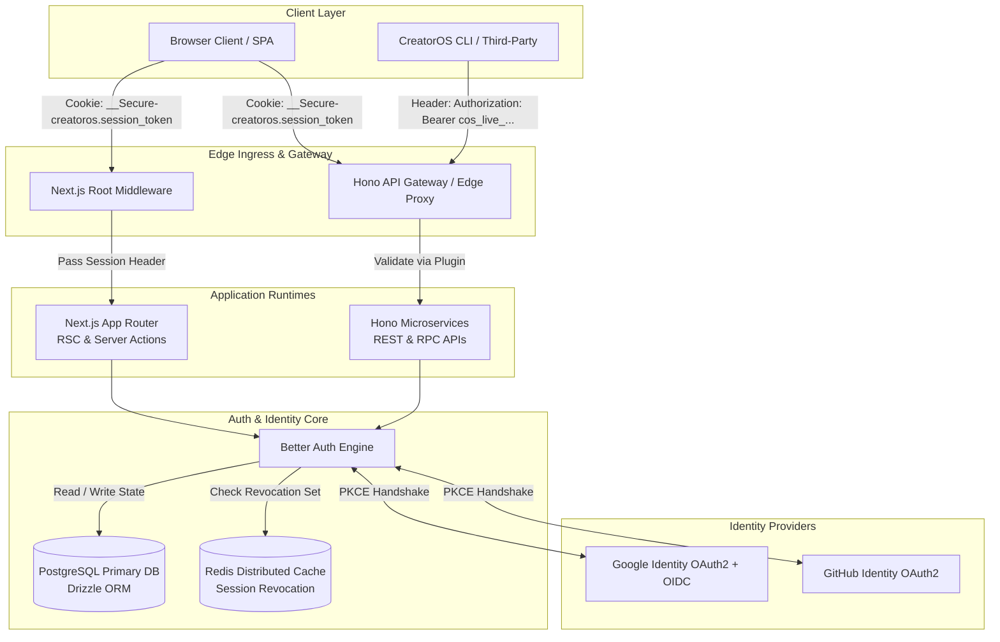
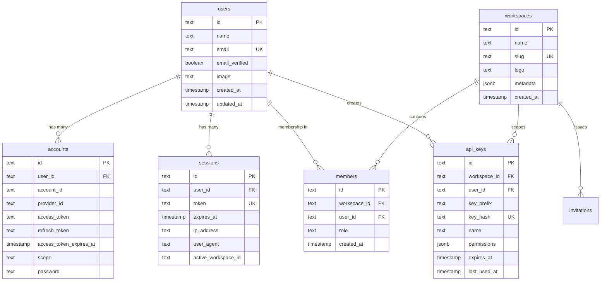
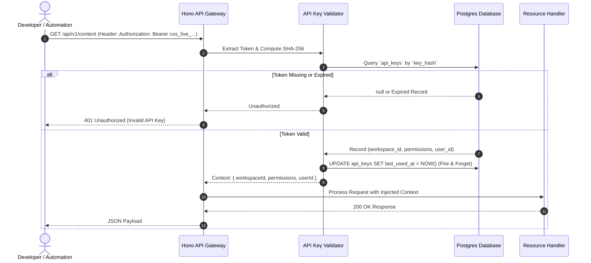

# CreatorOS Architecture: Authentication & Authorization (Better Auth)

This document specifies the technical design, data architecture, execution lifecycles, and security controls for identity, authentication, and authorization within CreatorOS (`@creatoros`).

---

## 1. Executive Overview & System Topology

CreatorOS uses **Better Auth** as its core authentication and identity framework. Better Auth provides a modular, type-safe, database-backed authentication runtime that supports edge execution, multi-tenant organizations, granular Access Control Lists (ACLs), and programmatic API key infrastructure.

### Architectural Drivers

1. **Multi-Tenant Workspace Isolation**: Strict tenant isolation across user-owned personal contexts and shared creator workspaces (agencies, production teams, brand partners).
2. **Unified Edge & Node Support**: Identical session verification primitives executed across Next.js App Router (Node.js runtime and React Server Components) and the Hono API gateway (Cloudflare Workers / Node runtime).
3. **Defense-in-Depth Session Security**: Short-lived, sliding-window database sessions coupled with encrypted, HttpOnly, SameSite cookies with automated token rotation and PKCE-enforced OAuth flows.
4. **Developer & Automation Platform**: First-class support for hashed, scoped, non-repudiable API keys allowing CLI, webhook, and external CI/CD integrations to act on behalf of workspaces.



---

## 2. Database Schema & Data Models

CreatorOS manages identity state via PostgreSQL using **Drizzle ORM**. The schema supports users, verification tokens, linked OAuth accounts, active sessions, multi-tenant workspaces, team memberships, and scoped API keys.



### Production Drizzle Schema Specification

```typescript
// packages/database/src/schema/auth.ts
import { 
  pgTable, 
  text, 
  timestamp, 
  boolean, 
  jsonb, 
  index, 
  uniqueIndex 
} from "drizzle-orm/pg-core";
import { relations } from "drizzle-orm";

export const users = pgTable(
  "users",
  {
    id: text("id").primaryKey(),
    name: text("name").notNull(),
    email: text("email").notNull(),
    emailVerified: boolean("email_verified").notNull().default(false),
    image: text("image"),
    createdAt: timestamp("created_at", { withTimezone: true }).notNull().defaultNow(),
    updatedAt: timestamp("updated_at", { withTimezone: true }).notNull().defaultNow(),
  },
  (table) => ({
    emailIdx: uniqueIndex("users_email_idx").on(table.email),
  })
);

export const sessions = pgTable(
  "sessions",
  {
    id: text("id").primaryKey(),
    userId: text("user_id")
      .notNull()
      .references(() => users.id, { onDelete: "cascade" }),
    token: text("token").notNull(),
    expiresAt: timestamp("expires_at", { withTimezone: true }).notNull(),
    ipAddress: text("ip_address"),
    userAgent: text("user_agent"),
    activeWorkspaceId: text("active_workspace_id"),
    createdAt: timestamp("created_at", { withTimezone: true }).notNull().defaultNow(),
    updatedAt: timestamp("updated_at", { withTimezone: true }).notNull().defaultNow(),
  },
  (table) => ({
    tokenIdx: uniqueIndex("sessions_token_idx").on(table.token),
    userIdIdx: index("sessions_user_id_idx").on(table.userId),
  })
);

export const accounts = pgTable(
  "accounts",
  {
    id: text("id").primaryKey(),
    userId: text("user_id")
      .notNull()
      .references(() => users.id, { onDelete: "cascade" }),
    accountId: text("account_id").notNull(),
    providerId: text("provider_id").notNull(),
    accessToken: text("access_token"),
    refreshToken: text("refresh_token"),
    accessTokenExpiresAt: timestamp("access_token_expires_at", { withTimezone: true }),
    refreshTokenExpiresAt: timestamp("refresh_token_expires_at", { withTimezone: true }),
    scope: text("scope"),
    idToken: text("id_token"),
    password: text("password"),
    createdAt: timestamp("created_at", { withTimezone: true }).notNull().defaultNow(),
    updatedAt: timestamp("updated_at", { withTimezone: true }).notNull().defaultNow(),
  },
  (table) => ({
    providerAccountIdx: uniqueIndex("accounts_provider_account_idx").on(
      table.providerId,
      table.accountId
    ),
    userIdIdx: index("accounts_user_id_idx").on(table.userId),
  })
);

export const verifications = pgTable(
  "verifications",
  {
    id: text("id").primaryKey(),
    identifier: text("identifier").notNull(),
    value: text("value").notNull(),
    expiresAt: timestamp("expires_at", { withTimezone: true }).notNull(),
    createdAt: timestamp("created_at", { withTimezone: true }).notNull().defaultNow(),
    updatedAt: timestamp("updated_at", { withTimezone: true }).notNull().defaultNow(),
  },
  (table) => ({
    identifierIdx: index("verifications_identifier_idx").on(table.identifier),
  })
);

export const workspaces = pgTable(
  "workspaces",
  {
    id: text("id").primaryKey(),
    name: text("name").notNull(),
    slug: text("slug").notNull(),
    logo: text("logo"),
    metadata: jsonb("metadata").$type<Record<string, unknown>>().default({}),
    createdAt: timestamp("created_at", { withTimezone: true }).notNull().defaultNow(),
    updatedAt: timestamp("updated_at", { withTimezone: true }).notNull().defaultNow(),
  },
  (table) => ({
    slugIdx: uniqueIndex("workspaces_slug_idx").on(table.slug),
  })
);

export const members = pgTable(
  "members",
  {
    id: text("id").primaryKey(),
    workspaceId: text("workspace_id")
      .notNull()
      .references(() => workspaces.id, { onDelete: "cascade" }),
    userId: text("user_id")
      .notNull()
      .references(() => users.id, { onDelete: "cascade" }),
    role: text("role").notNull().default("viewer"), // 'owner' | 'editor' | 'viewer'
    createdAt: timestamp("created_at", { withTimezone: true }).notNull().defaultNow(),
    updatedAt: timestamp("updated_at", { withTimezone: true }).notNull().defaultNow(),
  },
  (table) => ({
    workspaceUserIdx: uniqueIndex("members_workspace_user_idx").on(
      table.workspaceId,
      table.userId
    ),
    userIdIdx: index("members_user_id_idx").on(table.userId),
  })
);

export const invitations = pgTable(
  "invitations",
  {
    id: text("id").primaryKey(),
    workspaceId: text("workspace_id")
      .notNull()
      .references(() => workspaces.id, { onDelete: "cascade" }),
    email: text("email").notNull(),
    role: text("role").notNull().default("viewer"),
    status: text("status").notNull().default("pending"), // 'pending' | 'accepted' | 'rejected' | 'canceled'
    inviterId: text("inviter_id")
      .notNull()
      .references(() => users.id, { onDelete: "cascade" }),
    expiresAt: timestamp("expires_at", { withTimezone: true }).notNull(),
    createdAt: timestamp("created_at", { withTimezone: true }).notNull().defaultNow(),
  },
  (table) => ({
    workspaceEmailIdx: index("invitations_workspace_email_idx").on(
      table.workspaceId,
      table.email
    ),
  })
);

export const apiKeys = pgTable(
  "api_keys",
  {
    id: text("id").primaryKey(),
    name: text("name").notNull(),
    keyPrefix: text("key_prefix").notNull(), // First 8 characters (e.g., 'cos_live_abc12345')
    keyHash: text("key_hash").notNull(), // SHA-256 hash of plaintext token
    workspaceId: text("workspace_id")
      .notNull()
      .references(() => workspaces.id, { onDelete: "cascade" }),
    userId: text("user_id")
      .notNull()
      .references(() => users.id, { onDelete: "cascade" }),
    permissions: jsonb("permissions").$type<string[]>().notNull(),
    expiresAt: timestamp("expires_at", { withTimezone: true }),
    lastUsedAt: timestamp("last_used_at", { withTimezone: true }),
    createdAt: timestamp("created_at", { withTimezone: true }).notNull().defaultNow(),
    updatedAt: timestamp("updated_at", { withTimezone: true }).notNull().defaultNow(),
  },
  (table) => ({
    keyHashIdx: uniqueIndex("api_keys_hash_idx").on(table.keyHash),
    workspaceIdx: index("api_keys_workspace_idx").on(table.workspaceId),
  })
);

// Relational Definitions for Drizzle Query Client
export const usersRelations = relations(users, ({ many }) => ({
  sessions: many(sessions),
  accounts: many(accounts),
  members: many(members),
  apiKeys: many(apiKeys),
}));

export const workspacesRelations = relations(workspaces, ({ many }) => ({
  members: many(members),
  invitations: many(invitations),
  apiKeys: many(apiKeys),
}));

export const membersRelations = relations(members, ({ one }) => ({
  workspace: one(workspaces, {
    fields: [members.workspaceId],
    references: [workspaces.id],
  }),
  user: one(users, {
    fields: [members.userId],
    references: [users.id],
  }),
}));
```

---

## 3. Better Auth Core Configuration

The central configuration binds Drizzle ORM to Better Auth, configures OAuth providers, sets strict session lifecycle parameters, and enables organization/workspace management along with API key capabilities.

```typescript
// packages/auth/src/index.ts
import { betterAuth } from "better-auth";
import { drizzleAdapter } from "better-auth/adapters/drizzle";
import { organization } from "better-auth/plugins";
import { db } from "@creatoros/database";
import * as schema from "@creatoros/database/schema";

export const auth = betterAuth({
  appName: "CreatorOS",
  baseURL: process.env.BETTER_AUTH_URL || "https://creatoros.app",
  secret: process.env.BETTER_AUTH_SECRET!,
  database: drizzleAdapter(db, {
    provider: "pg",
    schema: {
      user: schema.users,
      session: schema.sessions,
      account: schema.accounts,
      verification: schema.verifications,
      organization: schema.workspaces,
      member: schema.members,
      invitation: schema.invitations,
    },
    usePlural: true,
  }),
  emailAndPassword: {
    enabled: true,
    requireEmailVerification: true,
    minPasswordLength: 12,
    maxPasswordLength: 128,
    autoSignIn: false,
  },
  socialProviders: {
    google: {
      clientId: process.env.GOOGLE_CLIENT_ID!,
      clientSecret: process.env.GOOGLE_CLIENT_SECRET!,
      accessType: "offline",
      prompt: "consent",
    },
    github: {
      clientId: process.env.GITHUB_CLIENT_ID!,
      clientSecret: process.env.GITHUB_CLIENT_SECRET!,
    },
  },
  session: {
    expiresIn: 60 * 60 * 24 * 7, // 7 days rolling lifetime
    updateAge: 60 * 60 * 24,     // Refresh active expiration once per 24 hours
    cookieCache: {
      enabled: true,
      maxAge: 5 * 60,           // 5 minutes edge cookie cache
    },
  },
  cookies: {
    sessionToken: {
      name: "__Secure-creatoros.session_token",
      options: {
        httpOnly: true,
        sameSite: "lax",
        path: "/",
        secure: process.env.NODE_ENV === "production",
      },
    },
  },
  plugins: [
    organization({
      allowUserToCreateOrganization: true,
      roles: {
        owner: {
          permissions: ["*"],
        },
        editor: {
          permissions: [
            "workspace:read",
            "content:create",
            "content:read",
            "content:update",
            "content:delete",
            "media:upload",
            "media:read",
            "analytics:read",
          ],
        },
        viewer: {
          permissions: [
            "workspace:read",
            "content:read",
            "media:read",
            "analytics:read",
          ],
        },
      },
    }),
  ],
  advanced: {
    crossSubDomainCookies: {
      enabled: process.env.NODE_ENV === "production",
      domain: ".creatoros.app",
    },
    useSecureCookies: process.env.NODE_ENV === "production",
  },
});

export type Auth = typeof auth;
export type Session = typeof auth.$Infer.Session.session;
export type User = typeof auth.$Infer.Session.user;
```

---

## 4. Multi-Tenant Authorization & RBAC Design

CreatorOS enforces tenant isolation at the boundary. Users do not access resources directly; rather, requests operate within an **Active Workspace Scope**.

### 4.1 Granular Permissions Matrix

| Granular Action | Owner | Editor | Viewer | Scope Condition |
| :--- | :---: | :---: | :---: | :--- |
| `workspace:delete` | Yes | No | No | Workspace Tenant Level |
| `workspace:update` | Yes | No | No | Settings, Branding, Slugs |
| `members:manage` | Yes | No | No | Invite, Remove, Role Changes |
| `apikeys:manage` | Yes | No | No | Create/Revoke Integrations |
| `billing:manage` | Yes | No | No | Subscriptions, Invoicing, Limits |
| `content:create` | Yes | Yes | No | Drafts, Scripts, Schedules |
| `content:update` | Yes | Yes | No | Mutate Workspace Artifacts |
| `content:delete` | Yes | Yes | No | Delete Projects & Assets |
| `content:publish` | Yes | Yes | No | Webhook / Platform Dispatch |
| `content:read` | Yes | Yes | Yes | Read-only Artifact Access |
| `analytics:read` | Yes | Yes | Yes | Workspace Telemetry & Metrics |

### 4.2 Programmatic Permission Checking Engine

```typescript
// packages/auth/src/permissions.ts
export type WorkspaceRole = "owner" | "editor" | "viewer";

export const PERMISSIONS = {
  // Workspace Admin Permissions
  WORKSPACE_DELETE: "workspace:delete",
  WORKSPACE_UPDATE: "workspace:update",
  MEMBERS_MANAGE: "members:manage",
  APIKEYS_MANAGE: "apikeys:manage",
  BILLING_MANAGE: "billing:manage",

  // Content Operations
  CONTENT_CREATE: "content:create",
  CONTENT_READ: "content:read",
  CONTENT_UPDATE: "content:update",
  CONTENT_DELETE: "content:delete",
  CONTENT_PUBLISH: "content:publish",

  // Analytics Operations
  ANALYTICS_READ: "analytics:read",
} as const;

export type Permission = (typeof PERMISSIONS)[keyof typeof PERMISSIONS];

const ROLE_PERMISSIONS: Record<WorkspaceRole, readonly Permission[] | ["*"]> = {
  owner: ["*"],
  editor: [
    PERMISSIONS.WORKSPACE_UPDATE,
    PERMISSIONS.CONTENT_CREATE,
    PERMISSIONS.CONTENT_READ,
    PERMISSIONS.CONTENT_UPDATE,
    PERMISSIONS.CONTENT_DELETE,
    PERMISSIONS.CONTENT_PUBLISH,
    PERMISSIONS.ANALYTICS_READ,
  ],
  viewer: [
    PERMISSIONS.CONTENT_READ,
    PERMISSIONS.ANALYTICS_READ,
  ],
};

export class AccessControl {
  public static hasPermission(
    role: WorkspaceRole, 
    permission: Permission
  ): boolean {
    const assigned = ROLE_PERMISSIONS[role];
    if (!assigned) return false;
    if (assigned[0] === "*") return true;
    return (assigned as readonly Permission[]).includes(permission);
  }

  public static assertPermission(
    role: WorkspaceRole, 
    permission: Permission
  ): void {
    if (!this.hasPermission(role, permission)) {
      throw new Error(`Forbidden: Insufficient permissions. Required: ${permission}`);
    }
  }
}
```

---

## 5. API Key Infrastructure for Automation

To empower developer workflows, CLI tooling, and programmatic operations (e.g., CI/CD video rendering pipelines, cross-platform webhook dispatches), CreatorOS incorporates an autonomous API key sub-system.

### 5.1 Architecture and Key Structure

Keys follow a strict syntax: `prefix_environment_entropy_checksum`
- **Prefix**: `cos` (CreatorOS)
- **Environment**: `live` or `test`
- **Entropy**: 32 cryptographically secure bytes base62-encoded
- **Format**: `cos_live_4jK9L...[total 48 chars]`



### 5.2 Key Generation and Verification Primitives

```typescript
// packages/auth/src/api-keys.ts
import { crypto } from "node:crypto";
import { db } from "@creatoros/database";
import { apiKeys } from "@creatoros/database/schema";
import { eq, and } from "drizzle-orm";
import { AccessControl, Permission } from "./permissions";

const KEY_PREFIX = "cos";
const SEPARATOR = "_";

export interface GeneratedKeyPayload {
  plaintextKey: string;
  keyPrefix: string;
  keyHash: string;
}

export class ApiKeyService {
  /**
   * Generates a cryptographically strong API Key and its SHA-256 hash.
   * Only the plaintext key is returned once; the database saves the hash and prefix.
   */
  public static generateKey(env: "live" | "test" = "live"): GeneratedKeyPayload {
    const rawEntropy = crypto.randomBytes(32).toString("base64url");
    const plaintextKey = `${KEY_PREFIX}${SEPARATOR}${env}${SEPARATOR}${rawEntropy}`;
    const keyPrefix = plaintextKey.substring(0, 16);
    const keyHash = this.hashKey(plaintextKey);

    return { plaintextKey, keyPrefix, keyHash };
  }

  public static hashKey(key: string): string {
    return crypto.createHash("sha256").update(key).digest("hex");
  }

  /**
   * Validates a plaintext key against the database and asserts scope.
   */
  public static async authenticateKey(
    plaintextKey: string,
    requiredPermission?: Permission
  ) {
    if (!plaintextKey.startsWith(`${KEY_PREFIX}_`)) {
      return null;
    }

    const keyHash = this.hashKey(plaintextKey);
    const record = await db.query.apiKeys.findFirst({
      where: eq(apiKeys.keyHash, keyHash),
      with: {
        workspace: true,
      },
    });

    if (!record) return null;

    if (record.expiresAt && new Date() > record.expiresAt) {
      return null; // Key expired
    }

    if (requiredPermission) {
      const allowed = record.permissions.includes("*") || 
                      record.permissions.includes(requiredPermission);
      if (!allowed) {
        throw new Error(`Insufficient API Key Scope: Missing ${requiredPermission}`);
      }
    }

    // Non-blocking update to lastUsedAt
    db.update(apiKeys)
      .set({ lastUsedAt: new Date() })
      .where(eq(apiKeys.id, record.id))
      .catch((err) => console.error("Failed to update API key lastUsedAt:", err));

    return {
      apiKeyId: record.id,
      workspaceId: record.workspaceId,
      userId: record.userId,
      permissions: record.permissions,
    };
  }
}
```

---

## 6. Runtime Integration: Next.js & Hono

### 6.1 Next.js App Router Integration

Next.js operates across two distinct execution contexts:
1. **Edge Middleware (`middleware.ts`)**: Fast perimeter check reading session cookies, verifying redirect rules, rewriting tenant hostnames.
2. **React Server Components & Server Actions (`Node.js/RSC`)**: Deep resolution with session hydration and RBAC verification.

#### Root Edge Middleware

```typescript
// apps/web/middleware.ts
import { NextResponse } from "next/server";
import type { NextRequest } from "next/server";

export async function middleware(request: NextRequest) {
  const { pathname } = request.nextUrl;
  const sessionToken = request.cookies.get("__Secure-creatoros.session_token")?.value;

  const isPublicRoute = 
    pathname.startsWith("/login") || 
    pathname.startsWith("/register") || 
    pathname.startsWith("/api/auth") ||
    pathname === "/";

  // Enforce authentication on protected application routes
  if (!sessionToken && !isPublicRoute) {
    const loginUrl = new URL("/login", request.url);
    loginUrl.searchParams.set("callbackUrl", pathname);
    return NextResponse.redirect(loginUrl);
  }

  // Prevent authenticated users from hitting auth routes
  if (sessionToken && (pathname === "/login" || pathname === "/register")) {
    return NextResponse.redirect(new URL("/dashboard", request.url));
  }

  // Forward downstream with request context
  const requestHeaders = new Headers(request.headers);
  requestHeaders.set("x-creatoros-url", request.url);

  return NextResponse.next({
    request: {
      headers: requestHeaders,
    },
  });
}

export const config = {
  matcher: [
    "/((?!_next/static|_next/image|favicon.ico|.*\\.(?:svg|png|jpg|jpeg|gif|webp)$).*)",
  ],
};
```

#### RSC Session Verification Helper

```typescript
// apps/web/lib/server-auth.ts
import { headers } from "next/headers";
import { redirect } from "next/navigation";
import { auth } from "@creatoros/auth";
import { AccessControl, Permission } from "@creatoros/auth/permissions";
import { db } from "@creatoros/database";
import { members } from "@creatoros/database/schema";
import { and, eq } from "drizzle-orm";

export async function getCurrentSession() {
  const incomingHeaders = await headers();
  const session = await auth.api.getSession({
    headers: incomingHeaders,
  });

  if (!session) {
    redirect("/login");
  }

  return session;
}

export async function requireWorkspaceAccess(
  workspaceId: string, 
  requiredPermission?: Permission
) {
  const session = await getCurrentSession();
  
  const membership = await db.query.members.findFirst({
    where: and(
      eq(members.workspaceId, workspaceId),
      eq(members.userId, session.user.id)
    ),
  });

  if (!membership) {
    throw new Error("Unauthorized: Not a member of this workspace");
  }

  if (requiredPermission) {
    AccessControl.assertPermission(membership.role as any, requiredPermission);
  }

  return {
    user: session.user,
    session: session.session,
    membership,
  };
}
```

#### Server Action Mutation Pattern

```typescript
// apps/web/app/actions/content.ts
"use server";

import { z } from "zod";
import { requireWorkspaceAccess } from "@/lib/server-auth";
import { PERMISSIONS } from "@creatoros/auth/permissions";
import { db } from "@creatoros/database";
// Schema definition hypothetical
// import { contentItems } from "@creatoros/database/schema";

const CreateContentSchema = z.object({
  workspaceId: z.string().uuid(),
  title: z.string().min(1).max(255),
  body: z.string(),
});

export async function createContentAction(rawData: unknown) {
  const parsed = CreateContentSchema.parse(rawData);

  // Assert user is an active workspace member with CONTENT_CREATE rights
  const { user } = await requireWorkspaceAccess(
    parsed.workspaceId, 
    PERMISSIONS.CONTENT_CREATE
  );

  // Perform secure database mutation within bounded tenant context
  // const [item] = await db.insert(contentItems).values({
  //   workspaceId: parsed.workspaceId,
  //   title: parsed.title,
  //   authorId: user.id,
  // }).returning();

  return { success: true, workspaceId: parsed.workspaceId };
}
```

---

### 6.2 Hono API Gateway Integration

The Hono microservices / API Gateway evaluates requests by accepting either a **Session Cookie** or a **Bearer Token (API Key)**. The custom middleware handles extraction, verification, error boundaries, and contextual propagation down the handler chain.

```typescript
// apps/api/src/middleware/auth-guard.ts
import { createMiddleware } from "hono/factory";
import { auth } from "@creatoros/auth";
import { ApiKeyService } from "@creatoros/auth/api-keys";
import { db } from "@creatoros/database";
import { members } from "@creatoros/database/schema";
import { eq, and } from "drizzle-orm";
import type { Permission, WorkspaceRole } from "@creatoros/auth/permissions";
import { AccessControl } from "@creatoros/auth/permissions";

export type AuthContext = {
  authType: "session" | "api_key";
  userId: string;
  workspaceId: string;
  role?: WorkspaceRole;
  permissions?: string[];
};

export interface AuthEnv {
  Variables: {
    auth: AuthContext;
  };
}

export function authGuard(options?: { requiredPermission?: Permission }) {
  return createMiddleware<AuthEnv>(async (c, next) => {
    const authHeader = c.req.header("Authorization");
    const workspaceHeader = c.req.header("X-Workspace-Id");

    // Case 1: Machine-to-Machine API Key Authentication
    if (authHeader && authHeader.startsWith("Bearer cos_")) {
      const token = authHeader.substring(7);
      try {
        const keyAuth = await ApiKeyService.authenticateKey(
          token, 
          options?.requiredPermission
        );

        if (!keyAuth) {
          return c.json({ error: "Unauthorized: Invalid API Key" }, 401);
        }

        c.set("auth", {
          authType: "api_key",
          userId: keyAuth.userId,
          workspaceId: keyAuth.workspaceId,
          permissions: keyAuth.permissions,
        });

        return await next();
      } catch (err: any) {
        return c.json({ error: err.message || "Forbidden" }, 403);
      }
    }

    // Case 2: User Cookie Session Authentication
    const session = await auth.api.getSession({
      headers: c.req.raw.headers,
    });

    if (!session) {
      return c.json({ error: "Unauthorized: Invalid or missing session" }, 401);
    }

    const targetWorkspaceId = 
      workspaceHeader || 
      session.session.activeWorkspaceId;

    if (!targetWorkspaceId) {
      return c.json(
        { error: "Bad Request: No active workspace identified in request" }, 
        400
      );
    }

    // Verify tenant membership
    const membership = await db.query.members.findFirst({
      where: and(
        eq(members.workspaceId, targetWorkspaceId),
        eq(members.userId, session.user.id)
      ),
    });

    if (!membership) {
      return c.json({ error: "Forbidden: Not a member of target workspace" }, 403);
    }

    // RBAC Permission Check
    if (options?.requiredPermission) {
      const allowed = AccessControl.hasPermission(
        membership.role as WorkspaceRole,
        options.requiredPermission
      );

      if (!allowed) {
        return c.json({ error: "Forbidden: Insufficient workspace rights" }, 403);
      }
    }

    c.set("auth", {
      authType: "session",
      userId: session.user.id,
      workspaceId: targetWorkspaceId,
      role: membership.role as WorkspaceRole,
    });

    await next();
  });
}
```

#### Hono Route Implementation Example

```typescript
// apps/api/src/routes/content.ts
import { Hono } from "hono";
import { authGuard, type AuthEnv } from "../middleware/auth-guard";
import { PERMISSIONS } from "@creatoros/auth/permissions";

const router = new Hono<AuthEnv>();

router.get(
  "/", 
  authGuard({ requiredPermission: PERMISSIONS.CONTENT_READ }), 
  async (c) => {
    const authState = c.get("auth");
    
    return c.json({
      success: true,
      workspaceId: authState.workspaceId,
      executedBy: authState.userId,
      data: [
        { id: "cnt_123", title: "Automated YouTube Upload", status: "rendered" }
      ],
    });
  }
);

router.post(
  "/", 
  authGuard({ requiredPermission: PERMISSIONS.CONTENT_CREATE }), 
  async (c) => {
    const authState = c.get("auth");
    const payload = await c.req.json();

    return c.json({
      success: true,
      workspaceId: authState.workspaceId,
      createdItem: {
        id: "cnt_999",
        ...payload,
        creator: authState.userId,
      }
    }, 201);
  }
);

export { router as contentRouter };
```

---

## 7. Security Hardening, Audit Logging & Compliance

### 7.1 Security Controls Matrix

| Attack Vector | Countermeasure / Implementation |
| :--- | :--- |
| **CSRF** | `SameSite=Lax` on session cookies, mandatory `Origin` verification for write mutations. |
| **Session Hijacking** | `__Secure-` cookie prefix, `HttpOnly`, TLS termination, IP & User-Agent fingerprint mismatch tracking. |
| **OAuth Impersonation** | State parameter randomization with PKCE (Proof Key for Code Exchange) code verifier exchange. |
| **Credential Stuffing** | Argon2id / bcrypt hashing via Better Auth default implementations, rate limiting on `/api/auth/sign-in`. |
| **API Key Leakage** | SHA-256 one-way storage hashing. Strict prefixing enables automatic detection by GitHub Secret Scanning. |

### 7.2 Structured Audit Logging

Every critical auth/access event publishes a structured audit event to ensure SOC2 Type II compliance and internal forensic capability:

```typescript
// packages/auth/src/audit.ts
import { db } from "@creatoros/database";
import { pgTable, text, timestamp, jsonb } from "drizzle-orm/pg-core";

export const auditLogs = pgTable("audit_logs", {
  id: text("id").primaryKey(),
  workspaceId: text("workspace_id").notNull(),
  actorId: text("actor_id").notNull(),
  actorType: text("actor_type").notNull(), // 'user' | 'api_key'
  action: text("action").notNull(),
  resourceType: text("resource_type").notNull(),
  resourceId: text("resource_id").notNull(),
  ipAddress: text("ip_address"),
  userAgent: text("user_agent"),
  metadata: jsonb("metadata").$type<Record<string, unknown>>().default({}),
  timestamp: timestamp("timestamp", { withTimezone: true }).notNull().defaultNow(),
});

export async function recordAuditEvent(params: {
  workspaceId: string;
  actorId: string;
  actorType: "user" | "api_key";
  action: string;
  resourceType: string;
  resourceId: string;
  ipAddress?: string;
  userAgent?: string;
  metadata?: Record<string, unknown>;
}) {
  await db.insert(auditLogs).values({
    id: `aud_${crypto.randomUUID()}`,
    ...params,
  });
}
```

---

## 8. Failure Modes & Edge Cases

1. **Workspace Context Mismatch**:
   - *Condition*: A user switches to a workspace they were removed from, but their local state or headers reflect the old workspace ID.
   - *Resolution*: Middleware validates user membership dynamically on every request. If invalid, it clears `activeWorkspaceId`, resets the user context to their default personal workspace, or throws an HTTP 403.
2. **Expired Access Token During OAuth Sync**:
   - *Condition*: Long-running offline jobs attempt to publish to Google/YouTube using stale accounts.
   - *Resolution*: Better Auth accounts table contains `refreshToken` and `accessTokenExpiresAt`. Refresh jobs use provider token endpoints to renew access tokens prior to dispatch.
3. **API Key Revocation Propagation**:
   - *Condition*: Compromised programmatic keys must be invalidated instantly across all edge nodes.
   - *Resolution*: API Key verification reads directly from the database without intermediate edge cache holding hashes, providing instant invalidation upon record deletion or hash clearing.
