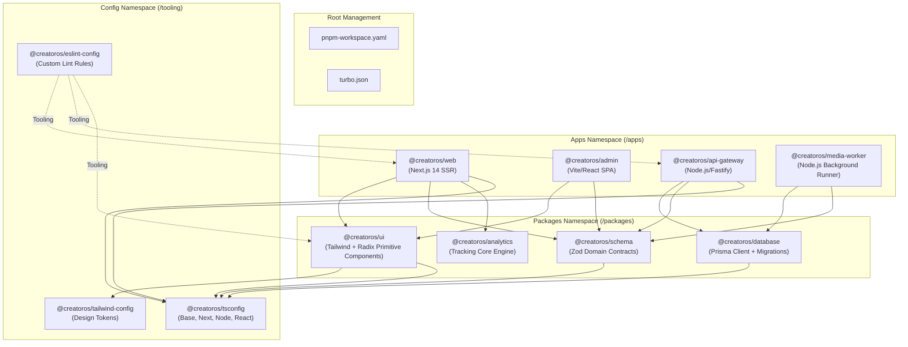
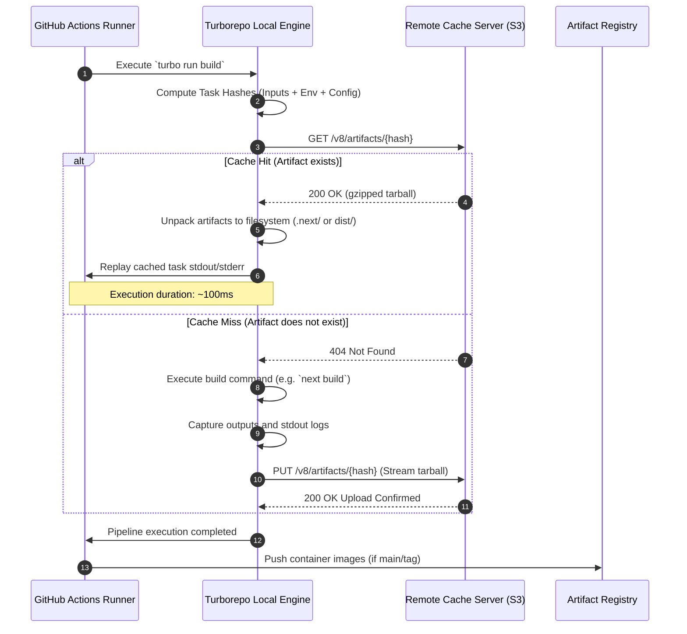

# ADR-0001: Adoption of pnpm Workspaces and Turborepo for Monorepo Architecture

* **Status:** Accepted
* **Date:** 2024-03-15
* **Authors:** 
  * Lead Systems Architect (@creatoros/platform-architecture)
  * Principal Infrastructure Engineer (@creatoros/devops)
* **Deciders:** CreatorOS Architecture Review Board, Core Platform Guild, Engineering Leadership
* **Consulted:** Application Engineering Leads, DevOps/SRE Team, QA Automation Leads
* **Informed:** All Engineering Staff, Product Management

---

## 1. Executive Summary

CreatorOS is an integrated, multi-tenant operating system designed for digital creators, managing high-throughput workflows across creator storefronts, dynamic headless CMS engines, distributed media-processing pipelines, real-time analytics, and billing infrastructure.

To accelerate developer velocity, standardize our software engineering lifecycle, and eliminate cross-dependency version drift, we hereby adopt **`pnpm` Workspaces** as the enterprise package manager alongside **Turborepo** as the monorepo build system and task orchestrator. This supersedes legacy polyrepo architectures and alternative monorepo toolchains (`npm`, `Yarn Classic/Berry`, `Lerna`, and `Nx`).

---

## 2. Context and Problem Statement

Prior to this decision, CreatorOS operated across 14 fragmented repositories (including separate repositories for the core web application, administrative dashboard, public API gateway, shared design system, and utility libraries). This operational model created severe bottlenecks:

1. **Dependency Drift and Incompatibility:** Divergent versions of shared libraries (`@creatoros/ui`, TypeScript, React, Zod, and internal API clients) caused runtime bugs only discovered in staging or production.
2. **Duplicated Operational Overhead:** Tooling configurations (ESLint, TypeScript, Vitest, Prettier, PostCSS) were duplicated across all repositories, requiring redundant manual maintenance.
3. **Impaired Cross-Boundary Refactoring:** Atomic updates spanning the public API gateway and client applications required coordinated multi-PR rollouts across repositories, resulting in broken intermediate states and complex CI/CD orchestration.
4. **Degraded CI/CD Performance:** Each individual repository executed duplicate linting, testing, and compilation steps from scratch without shared cache invalidation, resulting in collective pull request check times exceeding 35 minutes.
5. **Phantom Dependencies:** Using flat `node_modules` structures permitted code to import transitive dependencies that were not explicitly declared in `package.json`, causing non-deterministic production build failures.

CreatorOS requires a unified monorepo infrastructure capable of scaling to over 50 discrete packages and applications, maintaining sub-minute cached builds, strictly isolating dependencies, and ensuring type-safe API boundaries.

---

## 3. Decision Drivers

* **Hermetic and Deterministic Dependency Management:** Total eradication of phantom dependencies and hoisting vulnerabilities.
* **Storage and Bandwidth Optimization:** Minimization of disk footprint across developer machines and ephemeral CI/CD environments.
* **High-Performance Task Graph Orchestration:** Distributed, content-hash-based caching with intelligent topological pipeline scheduling.
* **Configuration Centralization:** Unification of TypeScript (`tsconfig`), linting (`eslint`), formatting, and test runners into shared packages.
* **Low Maintenance Overhead and Developer Ergonomics:** Clean adoption curves avoiding restrictive framework abstractions or high configuration debt.
* **Zero Runtime Overhead:** Tooling must operate strictly at build and orchestrate phases without polluting runtime bundles.

---

## 4. Evaluation and Architectural Comparison

### 4.1 Package Managers: `pnpm` vs. `npm` vs. `Yarn Classic` vs. `Yarn Berry`

| Capability / Metric | `npm` (v10) | `Yarn Classic` (v1.22) | `Yarn Berry` (v4, PnP) | `pnpm` (v9) - **Selected** |
| :--- | :--- | :--- | :--- | :--- |
| **Dependency Layout** | Flat `node_modules` | Flat `node_modules` | Virtual `.pnp.cjs` (Zero-installs) | Isolated symlink structure via content-addressable store |
| **Phantom Dependency Protection** | ❌ None (Uncontrolled hoisting) | ❌ None (Uncontrolled hoisting) |  Strict (Resolutions virtualized) |  Strict (Non-declared packages are unreachable) |
| **Disk Space Efficiency** | ❌ Poor (Clones dependencies per app) | ❌ Poor (Clones dependencies per app) |  High (Zip archives in cache) |  Optimal (Global Content-Addressable Hard Links) |
| **Installation Speed (Clean)** | ⚠️ Medium (~45s) | ⚠️ Medium (~52s) |  Fast (~15s) |  Ultra-Fast (~11s) |
| **Installation Speed (Frozen CI)** | ⚠️ Medium (~28s) | ⚠️ Medium (~34s) |  Instant/Fast (~4s) |  Instant/Fast (~5s via local/CI store) |
| **Workspace Native Support** | ⚠️ Basic | ⚠️ Basic |  Comprehensive |  Comprehensive, enterprise-grade |
| **Ecosystem Compatibility** |  100% Native |  100% Native | ⚠️ Compromised (Requires PnP patches/FSLayer) |  >99% Native (Zero patching for Node resolutions) |

#### Rationale for Package Manager Choice:
`npm` and `Yarn Classic` were eliminated due to pervasive phantom dependency vulnerabilities and inefficient disk utilization. While `Yarn Berry` with Plug'n'Play (PnP) offers strict dependency guarantees, its non-standard filesystem layer breaks multiple mission-critical CreatorOS native binary tools (e.g., `@swc/core`, Prisma engines, sharp). 

`pnpm` achieves identical protection against phantom dependencies through an isolated, nested symlink structure rooted in a global Content-Addressable Store (CAS). Packages can only access modules explicitly listed in their manifest, while dependencies are stored once globally and hard-linked, eliminating redundant I/O and saving tens of gigabytes of disk space across developer workstations and CI runners.

---

### 4.2 Build Orchestrators: `Turborepo` vs. `Nx` vs. `Lerna`

```
┌────────────────────────────────────────────────────────────────────────┐
│                        EVALUATION MATRIX: ORCHESTRATORS                │
├──────────────────────┬─────────────┬─────────────┬─────────────────────┤
│ Dimension            │ Turborepo   │ Nx          │ Lerna (v8)          │
├──────────────────────┼─────────────┼─────────────┼─────────────────────┤
│ Configuration Model  │ Declarative │ Declarative │ Imperative/Script   │
│                      │ (JSON)      │ (JSON/Ext)  │ wrappers            │
├──────────────────────┼─────────────┼─────────────┼─────────────────────┤
│ Remote Cache Backend │ Vercel/S3/  │ Nx Cloud /  │ Custom / Nx backend │
│                      │ Custom HTTP │ S3 plugins  │                     │
├──────────────────────┼─────────────┼─────────────┼─────────────────────┤
│ Framework Coupling   │ None (Zero  │ High        │ Low (Legacy         │
│                      │ abstractions│ (Generators,│ wrappers)           │
│                      │             │ executors)  │                     │
├──────────────────────┼─────────────┼─────────────┼─────────────────────┤
│ Learning Curve       │ < 1 Day     │ 1-2 Weeks   │ Low                 │
├──────────────────────┼─────────────┼─────────────┼─────────────────────┤
│ Core Engine Language │ Go / Rust   │ TypeScript/ │ JavaScript          │
│                      │             │ Rust (Native│ (Delegates to Nx)   │
│                      │             │ engine core)│                     │
├──────────────────────┼─────────────┼─────────────┼─────────────────────┤
│ Computation Overhead │ Minimal     │ Moderate    │ High                │
│ Task Overhead        │ (<15ms/task)│ (~45ms/task)│                     │
└──────────────────────┴─────────────┴─────────────┴─────────────────────┘
```

#### Rationale for Build System Choice:
* **Lerna** historically managed publishing workflows, but its build execution model is fundamentally legacy. Even with modern versions delegating to Nx under the hood, it introduces legacy abstraction layers without distinct benefits over native tools.
* **Nx** provides an advanced enterprise toolset, but enforces high architectural coupling through opinionated project generators, complex configuration schemas, and abstraction layers wrapping underlying frameworks (such as Next.js and Vite). The cognitive overhead and lock-in conflict with our architectural mandate for modularity.
* **Turborepo** adheres directly to Unix philosophy: do one thing and do it with maximum performance. It maps the directed acyclic graph (DAG) of workspace tasks declared in `package.json` scripts, hashes package inputs/outputs deterministically, and executes tasks concurrently with sub-millisecond overhead. Turborepo requires zero changes to application code, operates natively with `pnpm`, and exposes a straightforward HTTP API for distributed remote caching.

---

## 5. Architectural Topology and System Design

The CreatorOS codebase is organized as an integrated monorepo. Applications represent edge consumer deployables, while internal packages provide single-responsibility components and centralized configs.

### 5.1 Workspace Topology Graph



### 5.2 Canonical Directory Layout

```text
creatoros/
├── .github/
│   └── workflows/
│       ├── ci.yml
│       └── release.yml
├── apps/
│   ├── api-gateway/
│   │   ├── package.json
│   │   ├── tsconfig.json
│   │   └── src/
│   ├── media-worker/
│   │   ├── package.json
│   │   ├── tsconfig.json
│   │   └── src/
│   ├── web/
│   │   ├── package.json
│   │   ├── tsconfig.json
│   │   └── src/
│   └── admin/
│       ├── package.json
│       ├── tsconfig.json
│       └── src/
├── packages/
│   ├── analytics/
│   │   ├── package.json
│   │   ├── tsconfig.json
│   │   └── src/
│   ├── database/
│   │   ├── prisma/
│   │   ├── package.json
│   │   ├── tsconfig.json
│   │   └── src/
│   ├── schema/
│   │   ├── package.json
│   │   ├── tsconfig.json
│   │   └── src/
│   └── ui/
│       ├── package.json
│       ├── tsconfig.json
│       └── src/
├── tooling/
│   ├── eslint-config/
│   │   ├── package.json
│   │   └── index.js
│   ├── tailwind-config/
│   │   ├── package.json
│   │   └── tailwind.config.ts
│   └── tsconfig/
│       ├── base.json
│       ├── nextjs.json
│       ├── node.json
│       ├── react-library.json
│       └── package.json
├── .npmrc
├── .pnpmfile.cjs
├── package.json
├── pnpm-lock.yaml
├── pnpm-workspace.yaml
└── turbo.json
```

---

## 6. Implementation Configuration

### 6.1 `pnpm` Workspace Architecture

#### Root: `pnpm-workspace.yaml`
```yaml
packages:
  - 'apps/*'
  - 'packages/*'
  - 'tooling/*'
```

#### Root: `.npmrc`
Ensures strict workspace resolution and deterministic hoisting models across all operating systems.
```ini
auto-install-peers=true
dedupe-peer-dependents=true
engine-strict=true
hoist=false
hoist-pattern[]=*eslint*
hoist-pattern[]=*prettier*
link-workspace-packages=true
node-linker=isolated
package-manager-strict=true
prefer-frozen-lockfile=true
public-hoist-pattern=none
save-workspace-protocol=rolling
shamefully-hoist=false
strict-peer-dependencies=true
```

#### Root: `package.json`
```json
{
  "name": "@creatoros/monorepo",
  "version": "0.0.0",
  "private": true,
  "engines": {
    "node": ">=20.11.0",
    "pnpm": ">=9.0.0"
  },
  "packageManager": "pnpm@9.0.5",
  "scripts": {
    "build": "turbo run build",
    "dev": "turbo run dev --parallel",
    "lint": "turbo run lint",
    "test": "turbo run test",
    "typecheck": "turbo run typecheck",
    "clean": "turbo run clean && rm -rf node_modules",
    "format": "prettier --write \"**/*.{ts,tsx,md,json}\""
  },
  "devDependencies": {
    "@creatoros/eslint-config": "workspace:*",
    "@creatoros/tsconfig": "workspace:*",
    "prettier": "^3.2.5",
    "turbo": "^1.13.3"
  }
}
```

---

### 6.2 Turborepo Task Pipeline: `turbo.json`

The task pipeline defines cache boundary conditions, environment variable fingerprints, dependency relationships, and asset emissions.

```json
{
  "$schema": "https://turbo.build/schema.json",
  "globalDependencies": [
    ".env",
    ".env.local",
    "tsconfig.json"
  ],
  "globalEnv": [
    "NODE_ENV",
    "VERCEL_ENV",
    "CI"
  ],
  "pipeline": {
    "topo": {
      "dependsOn": ["^topo"]
    },
    "@creatoros/database#build": {
      "cache": true,
      "inputs": ["prisma/schema.prisma"],
      "outputs": ["node_modules/.prisma/**", "dist/**"]
    },
    "build": {
      "dependsOn": ["^build"],
      "outputs": [
        ".next/**",
        "!.next/cache/**",
        "dist/**",
        "build/**"
      ],
      "env": [
        "DATABASE_URL",
        "NEXT_PUBLIC_API_URL",
        "STRIPE_SECRET_KEY",
        "AWS_REGION",
        "REDIS_URL"
      ]
    },
    "typecheck": {
      "dependsOn": ["^build"],
      "outputs": []
    },
    "lint": {
      "dependsOn": ["^build"],
      "outputs": []
    },
    "test": {
      "dependsOn": ["^build"],
      "inputs": [
        "src/**/*.ts",
        "src/**/*.tsx",
        "test/**/*.ts",
        "test/**/*.tsx"
      ],
      "outputs": ["coverage/**"]
    },
    "dev": {
      "cache": false,
      "persistent": true
    },
    "clean": {
      "cache": false
    }
  }
}
```

---

### 6.3 Shared TypeScript Infrastructure (`@creatoros/tsconfig`)

TypeScript configurations must balance type safety against compiler performance across diverse execution runtimes (Next.js SSR, Web SPA, Node.js API Gateway, ESM Packages).

#### `tooling/tsconfig/package.json`
```json
{
  "name": "@creatoros/tsconfig",
  "version": "0.1.0",
  "private": true,
  "files": [
    "base.json",
    "node.json",
    "react-library.json",
    "nextjs.json"
  ]
}
```

#### Base Configuration: `tooling/tsconfig/base.json`
```json
{
  "$schema": "https://json.schemastore.org/tsconfig",
  "display": "CreatorOS Base Configuration",
  "compilerOptions": {
    "target": "ES2022",
    "lib": ["ES2022"],
    "module": "NodeNext",
    "moduleResolution": "NodeNext",
    "strict": true,
    "strictNullChecks": true,
    "strictFunctionTypes": true,
    "strictBindCallApply": true,
    "strictPropertyInitialization": true,
    "noImplicitThis": true,
    "alwaysStrict": true,
    "noUnusedLocals": true,
    "noUnusedParameters": true,
    "noImplicitReturns": true,
    "noFallthroughCasesInSwitch": true,
    "noUncheckedIndexedAccess": true,
    "allowUnusedLabels": false,
    "allowUnreachableCode": false,
    "exactOptionalPropertyTypes": true,
    "esModuleInterop": true,
    "skipLibCheck": true,
    "forceConsistentCasingInFileNames": true,
    "isolatedModules": true
  }
}
```

#### Node.js Microservice Variant: `tooling/tsconfig/node.json`
```json
{
  "$schema": "https://json.schemastore.org/tsconfig",
  "display": "CreatorOS Node Service Runtime",
  "extends": "./base.json",
  "compilerOptions": {
    "target": "ES2022",
    "lib": ["ES2022"],
    "module": "NodeNext",
    "moduleResolution": "NodeNext",
    "declaration": true,
    "declarationMap": true,
    "sourceMap": true,
    "composite": true,
    "types": ["node"]
  }
}
```

#### React Component Library Variant: `tooling/tsconfig/react-library.json`
```json
{
  "$schema": "https://json.schemastore.org/tsconfig",
  "display": "CreatorOS React Library Runtime",
  "extends": "./base.json",
  "compilerOptions": {
    "target": "ES2020",
    "lib": ["DOM", "DOM.Iterable", "ES2022"],
    "module": "ESNext",
    "moduleResolution": "Bundler",
    "jsx": "react-jsx",
    "declaration": true,
    "declarationMap": true,
    "sourceMap": true,
    "composite": true
  }
}
```

#### Next.js Application Variant: `tooling/tsconfig/nextjs.json`
```json
{
  "$schema": "https://json.schemastore.org/tsconfig",
  "display": "CreatorOS Next.js Application Runtime",
  "extends": "./base.json",
  "compilerOptions": {
    "target": "ES2020",
    "lib": ["DOM", "DOM.Iterable", "ES2022"],
    "module": "ESNext",
    "moduleResolution": "Bundler",
    "jsx": "preserve",
    "allowJs": true,
    "noEmit": true,
    "incremental": true,
    "plugins": [
      {
        "name": "next"
      }
    ]
  }
}
```

---

### 6.4 Manifest Examples in Workspaces

#### Shared Domain Package Manifest: `packages/schema/package.json`
```json
{
  "name": "@creatoros/schema",
  "version": "1.0.0",
  "private": true,
  "type": "module",
  "exports": {
    ".": {
      "types": "./dist/index.d.ts",
      "import": "./dist/index.js"
    }
  },
  "main": "./dist/index.js",
  "types": "./dist/index.d.ts",
  "scripts": {
    "build": "tsc -b",
    "clean": "rm -rf dist tsconfig.tsbuildinfo",
    "lint": "eslint src/ --ext .ts",
    "test": "vitest run",
    "typecheck": "tsc -b --noEmit"
  },
  "dependencies": {
    "zod": "^3.22.4"
  },
  "devDependencies": {
    "@creatoros/eslint-config": "workspace:*",
    "@creatoros/tsconfig": "workspace:*",
    "typescript": "^5.4.2",
    "vitest": "^1.4.0"
  }
}
```

#### Applications Manifest: `apps/web/package.json`
```json
{
  "name": "@creatoros/web",
  "version": "0.1.0",
  "private": true,
  "type": "module",
  "scripts": {
    "build": "next build",
    "clean": "rm -rf .next dist tsconfig.tsbuildinfo",
    "dev": "next dev -p 3000",
    "lint": "next lint",
    "start": "next start",
    "typecheck": "tsc --noEmit"
  },
  "dependencies": {
    "@creatoros/analytics": "workspace:*",
    "@creatoros/schema": "workspace:*",
    "@creatoros/ui": "workspace:*",
    "next": "14.1.4",
    "react": "^18.2.0",
    "react-dom": "^18.2.0"
  },
  "devDependencies": {
    "@creatoros/eslint-config": "workspace:*",
    "@creatoros/tailwind-config": "workspace:*",
    "@creatoros/tsconfig": "workspace:*",
    "@types/node": "^20.11.24",
    "@types/react": "^18.2.61",
    "@types/react-dom": "^18.2.19",
    "tailwindcss": "^3.4.1",
    "typescript": "^5.4.2"
  }
}
```

---

## 7. Caching Strategy and Continuous Integration (CI/CD)

### 7.1 Remote Cache Architecture

Turborepo produces an input hash based on git commit hashes, matching source file globs, environment variable hashes, and dependency versions. This deterministic SHA-256 hash serves as a look-up key against the Remote Cache (hosted via self-managed S3-compatible object storage or Vercel Remote Cache).



### 7.2 GitHub Actions Enterprise Workflow Pipeline

The integration pipeline executes selective, cache-aware tasks across branches, ensuring that unaffected packages are not rebuilt or tested.

```yaml
name: Continuous Integration

on:
  push:
    branches: [main, release/*]
  pull_request:
    types: [opened, synchronize, reopened]

concurrency:
  group: ${{ github.workflow }}-${{ github.ref }}
  cancel-in-progress: true

env:
  TURBO_TOKEN: ${{ secrets.TURBO_REMOTE_CACHE_TOKEN }}
  TURBO_API: ${{ secrets.TURBO_REMOTE_CACHE_URL }}
  TURBO_TEAM: "creatoros"
  PNPM_CACHE_DIR: "~/.local/share/pnpm/store"

jobs:
  validate:
    name: Validate, Typecheck, Test, and Build
    runs-on: ubuntu-latest
    timeout-minutes: 20
    steps:
      - name: Check out repository
        uses: actions/checkout@v4
        with:
          fetch-depth: 0

      - name: Setup Node.js 20.x
        uses: actions/setup-node@v4
        with:
          node-version: 20.11.0

      - name: Setup pnpm package manager
        uses: pnpm/action-setup@v3
        with:
          version: 9.0.5
          run_install: false

      - name: Fetch pnpm store directory path
        id: pnpm-cache-dir-path
        run: echo "dir=$(pnpm store path --silent)" >> $GITHUB_OUTPUT

      - name: Cache pnpm dependencies
        uses: actions/cache@v4
        with:
          path: ${{ steps.pnpm-cache-dir-path.outputs.dir }}
          key: ${{ runner.os }}-pnpm-store-${{ hashFiles('**/pnpm-lock.yaml') }}
          restore-keys: |
            ${{ runner.os }}-pnpm-store-

      - name: Install Monorepo Dependencies
        run: pnpm install --frozen-lockfile --strict-peer-dependencies

      - name: Audit lockfile security
        run: pnpm audit --prod --audit-level high

      - name: Execute Code Formatting Verification
        run: pnpm format --check

      - name: Turborepo Task Pipeline Execution
        run: >
          pnpm turbo run lint typecheck test build
          --cache-dir=".turbo"
          --remote-only
```

---

## 8. Consequences and Trade-offs

### 8.1 Positive Consequences

* **Deterministic Dependency Resolution:** The symlinked `node_modules` structure generated by `pnpm` prevents imports of undeclared dependencies, catching missing definitions in development rather than after production rollouts.
* **Storage and Network Optimization:** CI pipeline download times are reduced by ~65% via the shared global content-addressable store. Multiple micro-applications across the codebase reference shared libraries without duplicate installations.
* **Build Acceleration via Caching:** Unchanged packages in a pull request evaluate in ~100ms via remote cache hits. Average PR validation times decrease from ~35 minutes to <3 minutes.
* **Atomic Monorepo Refactoring:** Structural changes to shared domain schemas (`@creatoros/schema`) or components (`@creatoros/ui`) can be committed, typechecked, and verified against all dependent consumer applications (`@creatoros/web`, `@creatoros/admin`, `@creatoros/api-gateway`) in a single Git commit.
* **Tooling Consolidation:** Centralized configuration packages for TypeScript, ESLint, and Tailwind streamline updates across the codebase; a tooling patch applies instantly to all consumers.

### 8.2 Negative Consequences and Trade-offs

* **Legacy Tooling Symlink Incompatibilities:** Certain third-party NPM packages assume a flat, unisolated `node_modules` layout. Packages with undeclared peer dependencies can fail to resolve assets.
  * *Mitigation:* We enforce strict curation of external dependencies. When unmaintained third-party dependencies fail to resolve, they must be patched via the `pnpm.packageExtensions` block in the root `package.json` rather than globally degrading monorepo safety via `--shamefully-hoist`.
* **Risk of Cache Poisoning:** A compromised remote cache bucket could permit an attacker to substitute malicious compiled output for a valid task hash, executing supply-chain injection during CI/CD.
  * *Mitigation:* Turborepo remote caching credentials in CI/CD are strictly split: PR execution roles possess read-only permissions (`TURBO_REMOTE_CACHE_READONLY=true`), while write access is restricted solely to protected runs on the `main` branch.
* **Local Developer Mental Model Shift:** Developers accustomed to flat `node_modules` may be confused when attempting to reference transitive dependencies or running manual commands inside subdirectory packages without workspace filters.
  * *Mitigation:* Monorepo runbooks are published in engineering onboarding, standardizing common workflows around workspace filtering commands (e.g., `pnpm --filter @creatoros/web add <pkg>`).

---

## 9. Verification and Rollout Plan

The transition to `pnpm` and Turborepo executes through a four-phase migration plan:

```
┌────────────────────────────────────────────────────────────────────────┐
│                      MONOREPO MIGRATION PHASES                         │
├───────────────┬────────────────────────────────────────────────────────┤
│ Phase 1       │ Create monorepo skeleton, configure `turbo.json`,       │
│ Foundation    │ publish shared `@creatoros/tsconfig`, ESLint presets. │
├───────────────┼────────────────────────────────────────────────────────┤
│ Phase 2       │ Migrate `@creatoros/schema`, `@creatoros/ui`, and      │
│ Shared Libs   │ `@creatoros/database`. Validate internal referencing   │
│               │ using `workspace:*` protocols.                         │
├───────────────┼────────────────────────────────────────────────────────┤
│ Phase 3       │ Ingest `@creatoros/web`, `@creatoros/admin`, and       │
│ Applications  │ `@creatoros/api-gateway`. Deprecate source polyrepos;   │
│               │ point CI/CD pipelines to monorepo execution.           │
├───────────────┼────────────────────────────────────────────────────────┤
│ Phase 4       │ Connect distributed Turborepo S3 Remote Cache backend; │
│ Enforcement   │ enforce pre-commit validation and branch protection.   │
└───────────────┴────────────────────────────────────────────────────────┘
```

### Metrics & KPIs for Success Tracking
1. **CI Pipeline Duration:** P95 PR execution duration must drop from 35m to $\le$ 4m within 14 days of full migration.
2. **Cache Hit Ratios:** Target a $\ge 75\%$ remote cache hit rate across all standard pull request pipelines.
3. **Workspace Drift Incidents:** Cross-application integration issues caused by divergent dependency versions should drop to zero.
