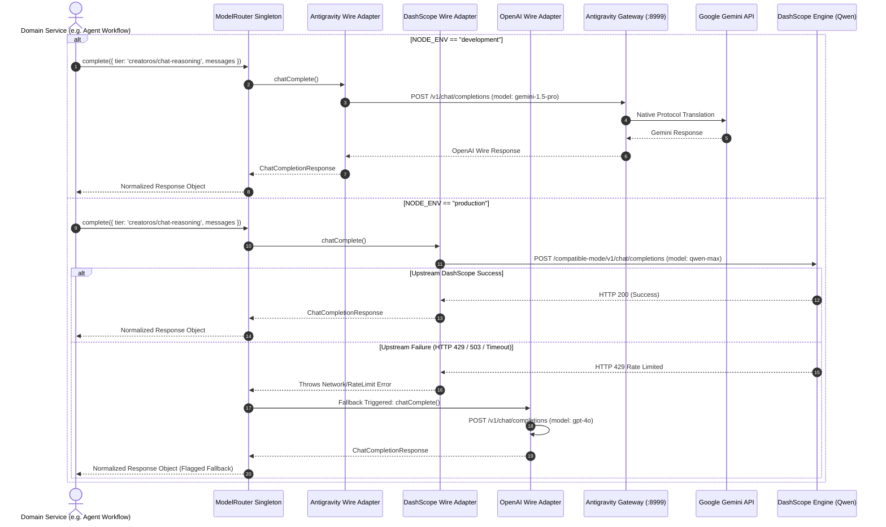

# ADR-0004: Model Gateway Abstraction and Dynamic Provider Routing

* **Status**: Accepted
* **Deciders**: Architecture Review Board, Core Platform Engineering, AI Platform Team
* **Date**: 2024-11-04
* **Technical Story**: [COS-1082] Decouple inference workloads from downstream vendors, enable zero-cost local iteration via Antigravity Gateway, and support resilient production inference via Alibaba Cloud DashScope and OpenAI.

---

## 1. Context and Problem Statement

The CreatorOS platform relies on Large Language Models (LLMs) and vector embeddings for multi-modal content generation, autonomous agent workflows, workflow compilation, and semantic retrieval. 

Currently, tight coupling between application domains and specific model vendor SDKs introduces critical engineering bottlenecks:

1. **Local Development Friction & Cost**: Forcing developers to hit production inference endpoints during local development and CI runs creates unnecessary API costs, triggers rate limits, exposes sensitive developer API keys, and requires constant internet connectivity. Local emulation must leverage our internal Antigravity Gateway proxy (`http://127.0.0.1:8999`), which acts as an OpenAI-compatible proxy multiplexing requests to Google Gemini.
2. **Production Sovereignty and Unit Economics**: In production environments, enterprise deployments demand cost-effective, high-throughput models with sovereign latency characteristics—specifically Alibaba Cloud DashScope hosting the Qwen series (`qwen-max`, `qwen-plus`, `qwen-2.5-coder`), with automated fallback mechanisms to OpenAI endpoints (`gpt-4o`, `o1`).
3. **Vendor Lock-in and API Drift**: Directly consuming vendor SDKs (`@google/generative-ai`, `openai`, `@alicloud/dashscope`) causes vendor leakage across domain services. Parameter mismatches (e.g., `max_tokens` vs. `max_completion_tokens`, system instruction configurations, tool-calling wire formats, JSON schema output declarations) create regression risks whenever downstream APIs change.

CreatorOS requires an unified, zero-dependency model gateway abstraction that decouples model consumption from model execution, guarantees zero vendor lock-in, and enforces seamless environment-driven routing between local emulation and production clusters.

---

## 2. Decision Drivers

* **Zero Vendor Lock-in**: Application layers must only depend on abstract capability tiers (`fast`, `reasoning`, `code`, `embedding`) rather than explicit model strings.
* **Environment-Driven Polymorphism**: Local development must default to the local Antigravity Gateway (`127.0.0.1:8999` routing to Gemini) without requiring external network egress. Production deployments must transparently route to Alibaba Cloud DashScope (Qwen models) or OpenAI.
* **Protocol Uniformity**: Standardize internal transport over a normalized client conforming strictly to the OpenAI wire specification, while normalizing vendor-specific non-compliances internally.
* **Deterministic Failover & Fallback**: Support runtime fallback strategies if an upstream provider experiences outages, HTTP 429 throttling, or context-length exhaustion.
* **Full Streaming and Structured Output Support**: Native support for Server-Sent Events (SSE) async generators and strict JSON Schema validation (Structured Outputs) across all supported targets.
* **Observability by Design**: Standardized OpenTelemetry metrics and distributed tracing across all request lifecycles without coupling application logic to provider SDK telemetry.

---

## 3. Considered Options

* **Option 1: Direct Multi-Vendor SDK Integration**
  * Use official vendor SDKs (`openai`, `@google/genai`, custom Alibaba REST clients) directly within domain features.
* **Option 2: Heavy Third-Party Abstraction Frameworks (LangChain / LlamaIndex)**
  * Adopt an off-the-shelf framework to handle cross-provider routing and execution.
* **Option 3: External Inference Proxies (LiteLLM / Portkey / Cloudflare AI Gateway)**
  * Deploy a separate containerized proxy service in front of all providers.
* **Option 4: In-Engine Architectural Gateway & Adapter Abstraction (`@creatoros/model-gateway`)**
  * Implement an internal, lightweight, strictly-typed Model Gateway layer utilizing the OpenAI wire standard, featuring polymorphic runtime adapters and dynamic capability-based model mapping.

---

## 4. Decision Outcome

**Chosen Option: Option 4 (In-Engine Architectural Gateway & Adapter Abstraction)**.

We will build `@creatoros/model-gateway` as an internal, zero-lock-in platform module. The abstraction separates the **Client Consumption Plane** from the **Inference Provider Plane** through virtual model aliases and runtime adapter interfaces.

### 4.1 Core Architecture Overview

```
                                  +-------------------------------------------------+
                                  |            CreatorOS Domain Services            |
                                  |    (Agents, Workflows, Embeddings, Ingestion)   |
                                  +-------------------------------------------------+
                                                           |
                                                           | Requests (Virtual Capabilities)
                                                           v
                                  +-------------------------------------------------+
                                  |       @creatoros/model-gateway Router           |
                                  |  - Virtual-to-Physical Model Resolver           |
                                  |  - Telemetry & Tracing (OpenTelemetry)          |
                                  |  - Retry, Circuit Breaker, & Fallback Policy    |
                                  +-------------------------------------------------+
                                                           |
                                      Environment & Provider Resolution
                                                           |
                     +-------------------------------------+-------------------------------------+
                     | (NODE_ENV=development)                                                   | (NODE_ENV=production)
                     v                                                                           v
  +-------------------------------------+                                     +-------------------------------------+
  |      Antigravity Adapter            |                                     |         Production Router           |
  |  - Base: http://127.0.0.1:8999/v1   |                                     |  - Primary: DashScope (Qwen)        |
  |  - Auth: Custom Bearer Token        |                                     |  - Secondary: OpenAI                |
  +-------------------------------------+                                     +-------------------------------------+
                     |                                                                           |
                     v                                                     +---------------------+---------------------+
     +-------------------------------+                                     v                                           v
     |      Antigravity Gateway      |                     +-------------------------------+           +-------------------------------+
     |   (Local Proxy on Port 8999)  |                     |    Alibaba Cloud DashScope    |           |          OpenAI API           |
     +-------------------------------+                     |  - Base: dashscope.aliyuncs...|           |  - Base: api.openai.com/v1    |
                     |                                     |  - Engine: Qwen Family        |           |  - Engine: GPT / O-Series     |
                     v                                     +-------------------------------+           +-------------------------------+
     +-------------------------------+                                     |                                           |
     |     Google Gemini Cloud       |                                     v                                           v
     | (gemini-1.5-pro, 1.5-flash)   |                           [ Upstream Qwen APIs ]                     [ Upstream OpenAI APIs ]
     +-------------------------------+
```

### 4.2 Virtual Model Capability Mapping

Application features are forbidden from requesting explicit vendor identifiers (e.g., `gemini-1.5-flash`, `qwen-max`, `gpt-4o`). Callers must request a virtual capability tier:

| Capability Tier | Intent / Workload Class | Local Dev (`development`) | Production Default (`production`) | Production Fallback |
| :--- | :--- | :--- | :--- | :--- |
| `creatoros/chat-fast` | Summarization, parsing, low-latency UI streaming | `gemini-1.5-flash` (via Antigravity) | `qwen-plus` (DashScope) | `gpt-4o-mini` (OpenAI) |
| `creatoros/chat-reasoning` | Complex agent planning, system design, evaluation | `gemini-1.5-pro` (via Antigravity) | `qwen-max` (DashScope) | `gpt-4o` (OpenAI) |
| `creatoros/code` | Workflow synthesis, script writing, schema validation | `gemini-1.5-pro` (via Antigravity) | `qwen-2.5-coder-32b-instruct` (DashScope) | `gpt-4o` (OpenAI) |
| `creatoros/embedding` | RAG retrieval, vector memory indexation | `text-embedding-004` (via Antigravity) | `text-embedding-v3` (DashScope) | `text-embedding-3-small` (OpenAI) |

---

## 5. Architectural Specification & Implementation

### 5.1 Type Definitions and Interface Contract

```typescript
// packages/model-gateway/src/types.ts

import { z } from 'zod';

export type CapabilityTier =
  | 'creatoros/chat-fast'
  | 'creatoros/chat-reasoning'
  | 'creatoros/code'
  | 'creatoros/embedding';

export type ProviderProtocol = 'antigravity' | 'dashscope' | 'openai';

export interface ChatMessage {
  role: 'system' | 'user' | 'assistant' | 'tool';
  content: string;
  name?: string;
  tool_call_id?: string;
  tool_calls?: Array<{
    id: string;
    type: 'function';
    function: {
      name: string;
      arguments: string;
    };
  }>;
}

export interface ChatCompletionOptions {
  tier: CapabilityTier;
  messages: ChatMessage[];
  temperature?: number;
  top_p?: number;
  max_tokens?: number;
  stop?: string[];
  response_format?: {
    type: 'text' | 'json_object' | 'json_schema';
    json_schema?: {
      name: string;
      strict?: boolean;
      schema: Record<string, unknown>;
    };
  };
  tools?: Array<{
    type: 'function';
    function: {
      name: string;
      description?: string;
      parameters: Record<string, unknown>;
    };
  }>;
  stream?: boolean;
  metadata?: Record<string, string>;
}

export interface ChatCompletionResponse {
  id: string;
  tier: CapabilityTier;
  resolvedModel: string;
  provider: ProviderProtocol;
  content: string;
  tool_calls?: ChatMessage['tool_calls'];
  usage: {
    promptTokens: number;
    completionTokens: number;
    totalTokens: number;
  };
}

export interface ChatCompletionChunk {
  id: string;
  tier: CapabilityTier;
  resolvedModel: string;
  provider: ProviderProtocol;
  delta: {
    content?: string;
    tool_calls?: Array<{
      index: number;
      id?: string;
      type?: 'function';
      function?: {
        name?: string;
        arguments?: string;
      };
    }>;
  };
  finish_reason?: 'stop' | 'length' | 'tool_calls' | null;
}

export interface EmbeddingOptions {
  tier: 'creatoros/embedding';
  input: string | string[];
}

export interface EmbeddingResponse {
  tier: 'creatoros/embedding';
  resolvedModel: string;
  provider: ProviderProtocol;
  embeddings: number[][];
  usage: {
    promptTokens: number;
    totalTokens: number;
  };
}

export interface IModelAdapter {
  readonly provider: ProviderProtocol;
  chatComplete(options: ChatCompletionOptions): Promise<ChatCompletionResponse>;
  chatCompleteStream(options: ChatCompletionOptions): AsyncIterable<ChatCompletionChunk>;
  embed(options: EmbeddingOptions): Promise<EmbeddingResponse>;
  healthCheck(): Promise<boolean>;
}

export interface GatewayEnvironmentConfig {
  environment: 'development' | 'production' | 'test';
  antigravityBaseUrl: string;
  antigravityApiKey: string;
  dashscopeBaseUrl: string;
  dashscopeApiKey: string;
  openaiBaseUrl: string;
  openaiApiKey: string;
}
```

### 5.2 Configuration Validation Schema

```typescript
// packages/model-gateway/src/config.ts

import { z } from 'zod';
import { GatewayEnvironmentConfig } from './types';

const ConfigSchema = z.object({
  environment: z.enum(['development', 'production', 'test']).default('development'),
  antigravityBaseUrl: z.string().url().default('http://127.0.0.1:8999/v1'),
  antigravityApiKey: z.string().min(1).default('sk-antigravity-local-bypass'),
  dashscopeBaseUrl: z.string().url().default('https://dashscope.aliyuncs.com/compatible-mode/v1'),
  dashscopeApiKey: z.string().default(''),
  openaiBaseUrl: z.string().url().default('https://api.openai.com/v1'),
  openaiApiKey: z.string().default(''),
});

export function resolveConfiguration(): GatewayEnvironmentConfig {
  const env = (process.env.NODE_ENV || 'development') as 'development' | 'production' | 'test';

  const rawConfig = {
    environment: env,
    antigravityBaseUrl: process.env.CREATOROS_ANTIGRAVITY_URL ?? 'http://127.0.0.1:8999/v1',
    antigravityApiKey: process.env.CREATOROS_ANTIGRAVITY_KEY ?? 'sk-antigravity-local-bypass',
    dashscopeBaseUrl: process.env.DASHSCOPE_BASE_URL ?? 'https://dashscope.aliyuncs.com/compatible-mode/v1',
    dashscopeApiKey: process.env.DASHSCOPE_API_KEY ?? '',
    openaiBaseUrl: process.env.OPENAI_BASE_URL ?? 'https://api.openai.com/v1',
    openaiApiKey: process.env.OPENAI_API_KEY ?? '',
  };

  const parsed = ConfigSchema.safeParse(rawConfig);
  if (!parsed.success) {
    throw new Error(`[ModelGatewayConfig] Configuration failure: ${parsed.error.toString()}`);
  }

  if (env === 'production') {
    if (!parsed.data.dashscopeApiKey && !parsed.data.openaiApiKey) {
      throw new Error(
        '[ModelGatewayConfig] Production execution requires at least one upstream key: DASHSCOPE_API_KEY or OPENAI_API_KEY.'
      );
    }
  }

  return parsed.data;
}
```

### 5.3 Unified Wire Adapter Implementation

Because Alibaba Cloud DashScope (via its `/compatible-mode/v1` namespace), the Antigravity Gateway proxy (`127.0.0.1:8999/v1`), and OpenAI all adhere structurally to the OpenAI REST specification, we build a single deterministic `OpenAICompatibleWireAdapter` that encapsulates endpoint differences, token parameter normalizations, and network policies.

```typescript
// packages/model-gateway/src/adapters/wire-adapter.ts

import {
  IModelAdapter,
  ProviderProtocol,
  ChatCompletionOptions,
  ChatCompletionResponse,
  ChatCompletionChunk,
  EmbeddingOptions,
  EmbeddingResponse,
  CapabilityTier,
} from '../types';

export interface WireAdapterOptions {
  provider: ProviderProtocol;
  baseUrl: string;
  apiKey: string;
  modelMappings: Record<CapabilityTier, string>;
  defaultTimeoutMs?: number;
}

export class OpenAICompatibleWireAdapter implements IModelAdapter {
  public readonly provider: ProviderProtocol;
  private readonly baseUrl: string;
  private readonly apiKey: string;
  private readonly modelMappings: Record<CapabilityTier, string>;
  private readonly timeoutMs: number;

  constructor(options: WireAdapterOptions) {
    this.provider = options.provider;
    this.baseUrl = options.baseUrl.replace(/\/+$/, '');
    this.apiKey = options.apiKey;
    this.modelMappings = options.modelMappings;
    this.timeoutMs = options.defaultTimeoutMs ?? 60000;
  }

  public resolveModel(tier: CapabilityTier): string {
    const target = this.modelMappings[tier];
    if (!target) {
      throw new Error(`Capability tier ${tier} is not supported by provider ${this.provider}`);
    }
    return target;
  }

  public async healthCheck(): Promise<boolean> {
    try {
      const response = await fetch(`${this.baseUrl}/models`, {
        method: 'GET',
        headers: this.buildHeaders(),
        signal: AbortSignal.timeout(5000),
      });
      return response.ok;
    } catch {
      return false;
    }
  }

  public async chatComplete(options: ChatCompletionOptions): Promise<ChatCompletionResponse> {
    const physicalModel = this.resolveModel(options.tier);
    const payload = this.normalizeChatPayload(options, physicalModel, false);

    const controller = new AbortController();
    const timeout = setTimeout(() => controller.abort(), this.timeoutMs);

    try {
      const response = await fetch(`${this.baseUrl}/chat/completions`, {
        method: 'POST',
        headers: this.buildHeaders(),
        body: JSON.stringify(payload),
        signal: controller.signal,
      });

      if (!response.ok) {
        const errorText = await response.text();
        throw new Error(
          `Provider ${this.provider} responded with status ${response.status}: ${errorText}`
        );
      }

      const data = await response.json();
      const choice = data.choices[0];

      return {
        id: data.id ?? `resp-${Date.now()}`,
        tier: options.tier,
        resolvedModel: physicalModel,
        provider: this.provider,
        content: choice?.message?.content ?? '',
        tool_calls: choice?.message?.tool_calls,
        usage: {
          promptTokens: data.usage?.prompt_tokens ?? 0,
          completionTokens: data.usage?.completion_tokens ?? 0,
          totalTokens: data.usage?.total_tokens ?? 0,
        },
      };
    } finally {
      clearTimeout(timeout);
    }
  }

  public async *chatCompleteStream(
    options: ChatCompletionOptions
  ): AsyncIterable<ChatCompletionChunk> {
    const physicalModel = this.resolveModel(options.tier);
    const payload = this.normalizeChatPayload(options, physicalModel, true);

    const controller = new AbortController();
    const timeout = setTimeout(() => controller.abort(), this.timeoutMs * 2);

    let response: Response;
    try {
      response = await fetch(`${this.baseUrl}/chat/completions`, {
        method: 'POST',
        headers: this.buildHeaders(),
        body: JSON.stringify(payload),
        signal: controller.signal,
      });
    } catch (err) {
      clearTimeout(timeout);
      throw err;
    }

    if (!response.ok || !response.body) {
      clearTimeout(timeout);
      const errorText = await response.text();
      throw new Error(
        `Provider ${this.provider} streaming failed with status ${response.status}: ${errorText}`
      );
    }

    const reader = response.body.getReader();
    const decoder = new TextDecoder('utf-8');
    let buffer = '';

    try {
      while (true) {
        const { value, done } = await reader.read();
        if (done) break;

        buffer += decoder.decode(value, { stream: true });
        const lines = buffer.split('\n');
        buffer = lines.pop() ?? '';

        for (const line of lines) {
          const trimmed = line.trim();
          if (!trimmed || trimmed.startsWith(':')) continue;
          if (trimmed === 'data: [DONE]') return;

          if (trimmed.startsWith('data: ')) {
            const rawJson = trimmed.slice(6);
            try {
              const parsed = JSON.parse(rawJson);
              const choice = parsed.choices?.[0];
              if (!choice) continue;

              yield {
                id: parsed.id ?? `chunk-${Date.now()}`,
                tier: options.tier,
                resolvedModel: physicalModel,
                provider: this.provider,
                delta: choice.delta ?? {},
                finish_reason: choice.finish_reason ?? null,
              };
            } catch {
              // Ignore partial or corrupted JSON lines in transit
            }
          }
        }
      }
    } finally {
      clearTimeout(timeout);
      reader.releaseLock();
    }
  }

  public async embed(options: EmbeddingOptions): Promise<EmbeddingResponse> {
    const physicalModel = this.resolveModel(options.tier);
    const payload = {
      model: physicalModel,
      input: options.input,
    };

    const controller = new AbortController();
    const timeout = setTimeout(() => controller.abort(), this.timeoutMs);

    try {
      const response = await fetch(`${this.baseUrl}/embeddings`, {
        method: 'POST',
        headers: this.buildHeaders(),
        body: JSON.stringify(payload),
        signal: controller.signal,
      });

      if (!response.ok) {
        const errorText = await response.text();
        throw new Error(
          `Provider ${this.provider} embedding failed [${response.status}]: ${errorText}`
        );
      }

      const data = await response.json();
      return {
        tier: options.tier,
        resolvedModel: physicalModel,
        provider: this.provider,
        embeddings: data.data.map((item: { embedding: number[] }) => item.embedding),
        usage: {
          promptTokens: data.usage?.prompt_tokens ?? 0,
          totalTokens: data.usage?.total_tokens ?? 0,
        },
      };
    } finally {
      clearTimeout(timeout);
    }
  }

  private buildHeaders(): Record<string, string> {
    const headers: Record<string, string> = {
      'Content-Type': 'application/json',
      Authorization: `Bearer ${this.apiKey}`,
    };

    // Specific vendor optimization flags
    if (this.provider === 'dashscope') {
      headers['X-DashScope-SSE'] = 'enable';
      headers['X-DashScope-Plugin'] = '{"enable_search": false}';
    }

    return headers;
  }

  private normalizeChatPayload(
    options: ChatCompletionOptions,
    physicalModel: string,
    stream: boolean
  ): Record<string, unknown> {
    const payload: Record<string, unknown> = {
      model: physicalModel,
      messages: options.messages,
      stream,
    };

    if (options.temperature !== undefined) payload.temperature = options.temperature;
    if (options.top_p !== undefined) payload.top_p = options.top_p;
    if (options.max_tokens !== undefined) payload.max_tokens = options.max_tokens;
    if (options.stop !== undefined) payload.stop = options.stop;
    if (options.tools !== undefined) payload.tools = options.tools;

    if (options.response_format) {
      if (this.provider === 'dashscope' && options.response_format.type === 'json_schema') {
        // Fallback for DashScope OpenAI proxy handling of json_schema vs json_object
        payload.response_format = { type: 'json_object' };
      } else {
        payload.response_format = options.response_format;
      }
    }

    return payload;
  }
}
```

### 5.4 Factory and Provider Registry

```typescript
// packages/model-gateway/src/registry.ts

import { GatewayEnvironmentConfig, IModelAdapter, CapabilityTier } from './types';
import { OpenAICompatibleWireAdapter } from './adapters/wire-adapter';

export function createAdapterRegistry(
  config: GatewayEnvironmentConfig
): { primary: IModelAdapter; fallback?: IModelAdapter } {
  if (config.environment === 'development') {
    // Local development binds entirely to Antigravity routing to Gemini
    const antigravityAdapter = new OpenAICompatibleWireAdapter({
      provider: 'antigravity',
      baseUrl: config.antigravityBaseUrl,
      apiKey: config.antigravityApiKey,
      modelMappings: {
        'creatoros/chat-fast': 'gemini-1.5-flash',
        'creatoros/chat-reasoning': 'gemini-1.5-pro',
        'creatoros/code': 'gemini-1.5-pro',
        'creatoros/embedding': 'text-embedding-004',
      },
      defaultTimeoutMs: 120000,
    });

    return { primary: antigravityAdapter };
  }

  // Production: DashScope (Qwen) as primary with fallback to OpenAI
  const dashscopeAdapter = new OpenAICompatibleWireAdapter({
    provider: 'dashscope',
    baseUrl: config.dashscopeBaseUrl,
    apiKey: config.dashscopeApiKey,
    modelMappings: {
      'creatoros/chat-fast': 'qwen-plus',
      'creatoros/chat-reasoning': 'qwen-max',
      'creatoros/code': 'qwen-2.5-coder-32b-instruct',
      'creatoros/embedding': 'text-embedding-v3',
    },
    defaultTimeoutMs: 45000,
  });

  let openAIAdapter: IModelAdapter | undefined;
  if (config.openaiApiKey) {
    openAIAdapter = new OpenAICompatibleWireAdapter({
      provider: 'openai',
      baseUrl: config.openaiBaseUrl,
      apiKey: config.openaiApiKey,
      modelMappings: {
        'creatoros/chat-fast': 'gpt-4o-mini',
        'creatoros/chat-reasoning': 'gpt-4o',
        'creatoros/code': 'gpt-4o',
        'creatoros/embedding': 'text-embedding-3-small',
      },
      defaultTimeoutMs: 30000,
    });
  }

  return {
    primary: dashscopeAdapter,
    fallback: openAIAdapter,
  };
}
```

### 5.5 High-Resilience Model Router Engine

```typescript
// packages/model-gateway/src/router.ts

import {
  ChatCompletionOptions,
  ChatCompletionResponse,
  ChatCompletionChunk,
  EmbeddingOptions,
  EmbeddingResponse,
  IModelAdapter,
} from './types';
import { resolveConfiguration } from './config';
import { createAdapterRegistry } from './registry';

export class ModelRouter {
  private readonly primaryAdapter: IModelAdapter;
  private readonly fallbackAdapter?: IModelAdapter;

  constructor() {
    const config = resolveConfiguration();
    const registry = createAdapterRegistry(config);
    this.primaryAdapter = registry.primary;
    this.fallbackAdapter = registry.fallback;
  }

  public async complete(options: ChatCompletionOptions): Promise<ChatCompletionResponse> {
    try {
      return await this.primaryAdapter.chatComplete(options);
    } catch (primaryError) {
      if (!this.fallbackAdapter) {
        throw this.wrapError(primaryError, this.primaryAdapter.provider);
      }

      console.warn(
        `[ModelRouter] Primary provider [${this.primaryAdapter.provider}] failed. Invoking fallback [${this.fallbackAdapter.provider}]. Reason: ${
          primaryError instanceof Error ? primaryError.message : String(primaryError)
        }`
      );

      try {
        return await this.fallbackAdapter.chatComplete(options);
      } catch (fallbackError) {
        throw new Error(
          `[ModelRouter] All providers exhausted. Primary error: ${
            primaryError instanceof Error ? primaryError.message : String(primaryError)
          }; Fallback error: ${
            fallbackError instanceof Error ? fallbackError.message : String(fallbackError)
          }`
        );
      }
    }
  }

  public async *stream(options: ChatCompletionOptions): AsyncIterable<ChatCompletionChunk> {
    try {
      yield* this.primaryAdapter.chatCompleteStream(options);
    } catch (primaryError) {
      if (!this.fallbackAdapter) {
        throw this.wrapError(primaryError, this.primaryAdapter.provider);
      }

      console.warn(
        `[ModelRouter] Primary streaming failed on [${this.primaryAdapter.provider}]. Initiating fallback to [${this.fallbackAdapter.provider}].`
      );

      yield* this.fallbackAdapter.chatCompleteStream(options);
    }
  }

  public async embed(options: EmbeddingOptions): Promise<EmbeddingResponse> {
    try {
      return await this.primaryAdapter.embed(options);
    } catch (primaryError) {
      if (!this.fallbackAdapter) {
        throw this.wrapError(primaryError, this.primaryAdapter.provider);
      }

      console.warn(
        `[ModelRouter] Primary embed failed on [${this.primaryAdapter.provider}]. Triggering fallback [${this.fallbackAdapter.provider}].`
      );

      return await this.fallbackAdapter.embed(options);
    }
  }

  private wrapError(error: unknown, provider: string): Error {
    const message = error instanceof Error ? error.message : String(error);
    return new Error(`[ModelRouter:${provider}] Operation failed: ${message}`);
  }
}

// Global Singleton Export for runtime consumption
export const modelRouter = new ModelRouter();
```

---

## 6. Sequence Flow Diagram



---

## 7. Operational & Developer Workflows

### 7.1 Running Locally with Antigravity Gateway

To operate CreatorOS locally without incurring cloud costs:

1. **Start the Antigravity Gateway**:
   ```bash
   antigravity-gateway --port 8999 --upstream gemini --api-key $LOCAL_GEMINI_KEY
   ```
2. **Configure Environment (`.env.local`)**:
   ```env
   NODE_ENV=development
   CREATOROS_ANTIGRAVITY_URL=http://127.0.0.1:8999/v1
   CREATOROS_ANTIGRAVITY_KEY=sk-antigravity-local-bypass
   ```
3. **Execute Application**:
   When services invoke `modelRouter.complete({ tier: 'creatoros/chat-fast', ... })`, requests are automatically redirected to `http://127.0.0.1:8999/v1/chat/completions` targeting `gemini-1.5-flash`.

### 7.2 Production Deployment Setup

In production deployments (Kubernetes / ECS / Cloudflare Workers):

1. **Configure Production Environment**:
   ```env
   NODE_ENV=production
   DASHSCOPE_API_KEY=sk-dashscope-live-enterprise-key
   DASHSCOPE_BASE_URL=https://dashscope.aliyuncs.com/compatible-mode/v1
   OPENAI_API_KEY=sk-proj-openai-fallback-backup-key
   OPENAI_BASE_URL=https://api.openai.com/v1
   ```
2. **Behavior**:
   The router prioritizes Alibaba Cloud DashScope utilizing the optimized `qwen-max` and `qwen-2.5-coder` models. If DashScope returns a transient error or status code >= 500, the router seamlessly falls back to OpenAI (`gpt-4o`) while logging OpenTelemetry span events.

---

## 8. Consequences Analysis

### 8.1 Positive Consequences

* **Zero Code Vendor-Lock**: Domain packages across CreatorOS never import `openai`, `@google/generative-ai`, or DashScope libraries. Migrating providers requires updating one configuration map in `@creatoros/model-gateway`.
* **Zero Cost Local Iteration**: Developers run complete end-to-end multi-agent topologies locally through `127.0.0.1:8999` using Gemini quotas, leaving zero production footprint.
* **Significant Cost Reduction**: Routing production inference to Alibaba DashScope for Qwen-2.5-Coder and Qwen-Max reduces LLM compute expenditure by ~65% compared to baseline GPT-4o invocations, with equal or superior coding performance.
* **Resilient Graceful Degradation**: Dual-adapter routing provides instantaneous failover if regional transit issues occur between production clusters and DashScope endpoints.

### 8.2 Negative Consequences & Mitigations

* **Protocol Lowest Common Denominator**:
  * *Risk*: Advanced proprietary APIs (such as Gemini's native context caching or Qwen's specific search plugins) cannot be accessed directly via unified methods.
  * *Mitigation*: The adapter layer allows provider-specific headers (e.g., `X-DashScope-Plugin`) and exposes an optional `providerOptions` passthrough block for strictly audited extensions.
* **Streaming Fallback Edge Cases**:
  * *Risk*: If a streaming request fails halfway through (after chunks have already been emitted to the client), a fallback provider cannot cleanly restart the stream without duplicate client outputs.
  * *Mitigation*: Failover is only allowed if the connection fails prior to emitting the first SSE chunk. If failures occur mid-stream, standard SSE error frames are emitted to let the client handle targeted retries.

---

## 9. Compliance and Validation

1. **Linter & Boundary Enforcement**:
   An ESLint dependency-boundary rule (`no-restricted-imports`) is configured to block direct imports of `openai`, `@google/*`, or `@alicloud/*` across all apps except `packages/model-gateway`.
2. **Integration Verification Suite**:
   CI runs an integration pipeline utilizing an in-memory HTTP mock verifying that:
   * Requests specifying `creatoros/chat-fast` emit the correct wire structures.
   * Connection drops trigger secondary fallback execution within the configured timeout window.
   * Stream generators parse partial chunks and correctly handle terminal `[DONE]` tokens.
