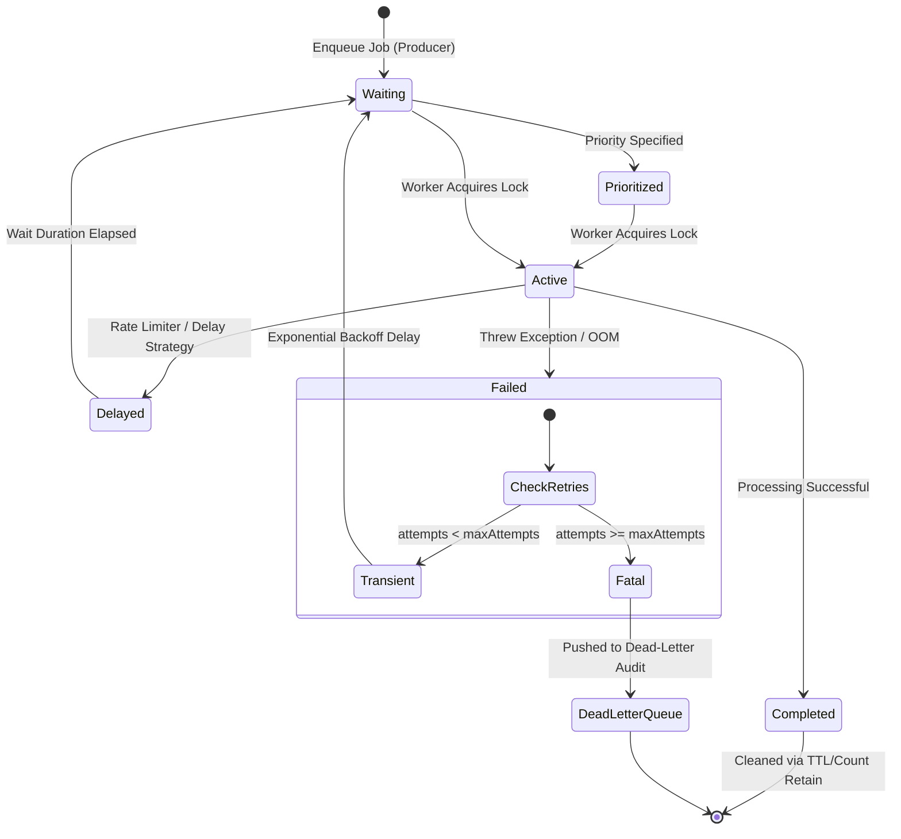

# ADR-0005: Asynchronous Background Job Processing Pipeline via Redis and BullMQ

* **Status:** Accepted
* **Deciders:** CreatorOS Architecture Group, Platform Infrastructure Team, Core Media Processing Team
* **Date:** 2024-03-22
* **Technical Domain:** Distributed Systems, Asynchronous Processing, Media Pipelines

---

## 1. Context and Problem Statement

CreatorOS operations require heavy, asynchronous computational workloads across diverse resource domains. These workloads fall into four distinct operational profiles:

1. **AI Script Generation & Orchestration:** High I/O, network-bound, rate-limited by upstream LLM providers (e.g., Anthropic, OpenAI), variable latency (2–60 seconds).
2. **Audio Extraction & Transcription:** Mixed I/O and GPU/CPU-bound (FFmpeg chunking, Whisper ASR inference), payload sizes between 10MB and 500MB, duration 10–120 seconds.
3. **Remotion & FFmpeg Video Rendering:** Severe CPU and memory constraints, Chromium-based frame rasterization, high disk I/O, job durations ranging from 30 seconds to 20 minutes, prone to out-of-memory (OOM) faults if unconstrained.
4. **Multi-Platform Social Distribution:** Network-bound, strict platform-specific token buckets and rate limits (YouTube Data API, TikTok Content Posting API, Instagram Graph API).

Prior to this decision, CreatorOS utilized ad-hoc HTTP microservice calls and direct process spawning (`child_process.spawn`) inside API container instances. This architecture caused:

* **Resource Contention:** Remotion video rendering starved the Node.js event loop, degrading HTTP API availability and dropping web traffic.
* **Loss of State:** Container restarts (e.g., during deployments or autoscaling events) terminated in-flight renders without recovery, leaving user projects in non-deterministic corrupted states.
* **Cascading Failures:** Third-party API rate-limiting (429 Too Many Requests) caused synchronous request threads to hang, exhausting connection pools.
* **Lack of Visibility:** No centralized mechanism existed to monitor job health, queue latency, throughput, dead-letter rates, or failure provenance.

CreatorOS requires a distributed, highly observable, fault-tolerant message queue and asynchronous task orchestration pipeline with strict concurrency controls, fine-grained retry semantics, and physical worker isolation.

---

## 2. Decision Drivers

* **Workload Isolation:** Prevent high-CPU video encoding from starving I/O-heavy LLM orchestration or latency-sensitive web traffic.
* **Granular Concurrency & Rate Limiting:** Enforce dynamic, per-queue, per-user, and per-external-API rate limits and concurrency ceilings.
* **Failure Recovery & Idempotency:** Support exponential backoff, deterministic failure classifications, and dead-letter handling with zero loss of task state.
* **Node.js/TypeScript Native Integration:** Native serialization and typed interfaces matching CreatorOS's core TypeScript platform to maximize velocity and code reuse across services.
* **Operational Overhead:** Avoid heavy distributed system operations (e.g., running JVM clusters, ZooKeeper, or specialized state machines) where managed options or existing Redis infrastructure suffice.
* **Low Latency Orchestration:** Support millisecond queue transitions for chaining multi-step AI pipelines.

---

## 3. Evaluated Alternatives

| Capability / Attribute | Redis + BullMQ (Selected) | Temporal.io | AWS SQS + EventBridge | RabbitMQ + Celery | Apache Kafka |
| :--- | :--- | :--- | :--- | :--- | :--- |
| **Language/Type Support** | Native TypeScript | TS SDK (Go/Rust engine) | AWS SDK (Generic) | Python native, TS client fragmented | TS Client (KafkaJS) |
| **Concurrency Controls** | Worker, Queue, & Group-level | Dynamic via Workflows | Queue-level only (limited) | Worker prefetch, channel limits | Partition-level only |
| **Rate-Limiting Support** | Built-in (Token bucket / Sliding window) | Dynamic Sleep / Rate-limit blocks | Non-native (requires API Gateway/WAF) | Plugin-dependent | Non-native |
| **Parent/Child Workflows** | Built-in via BullMQ Flows | Comprehensive Event Sourcing | Requires Step Functions | Manual orchestration | Complex stream processing |
| **Operational Overhead** | Low (Managed Redis) | High (Requires DB + Temporal Server) | Extremely Low (Serverless) | Medium (Erlang nodes, clustering) | High (Brokers, storage, schema registry) |
| **Resource Footprint** | In-memory (~low) | Moderate to High | Zero local footprint | Moderate | High (Persistent storage partitions) |

### Rejection Summaries
* **Temporal.io:** While Temporal offers exceptional orchestration via durable execution, the operational complexity of managing Temporal Server instances and its reliance on event-sourcing abstractions added disproportionate overhead for pipelines that are fundamentally directed acyclic graphs (DAGs) rather than open-ended, multi-week human-in-the-loop workflows.
* **AWS SQS + Step Functions:** Step Functions become cost-prohibitive at CreatorOS's targeted rendering volume (millions of state transitions per month) and lack sub-millisecond local development environments, degrading developer experience.
* **RabbitMQ + Celery:** Polyglot maintenance between Python-based Celery and the CreatorOS Node.js core created dual-schema serialization drift and fragile error tracing.
* **Apache Kafka:** Kafka is an append-only log suited for event streaming and pub/sub analytics, not a transient job queue with atomic job locking, stateful retry transitions, and delayed execution semantics.

---

## 4. Architecture & Decision

CreatorOS adopts **Redis (v7.2+ using Redis Cluster or managed AWS ElastiCache for Redis)** coupled with **BullMQ (v5+)** as the unified asynchronous job processing platform.

```
                                      +---------------------------------------------+
                                      |             CreatorOS API Layer             |
                                      +---------------------------------------------+
                                                             |
                                      (Enqueue Jobs via Type-Safe Queue Producers)
                                                             v
+-----------------------------------------------------------------------------------------------------------------------+
|                                                      REDIS CLUSTER                                                    |
|  +------------------------+  +--------------------------+  +----------------------+  +-----------------------------+  |
|  | queue:ai:orchestration |  | queue:media:transcription|  |  queue:media:render  |  |   queue:distribution:publish|  |
|  +------------------------+  +--------------------------+  +----------------------+  +-----------------------------+  |
+-----------------------------------------------------------------------------------------------------------------------+
              |                                     |                           |                        |
              v                                     v                           v                        v
+---------------------------+         +-------------------+         +-------------------+      +------------------------+
|      AI Worker Pool       |         | Audio Worker Pool |         | Render Worker Pool|      | Distribution Workers   |
| (High Network / Medium IO)|         |  (GPU/Disk Bound) |         | (Heavy CPU & RAM) |      | (Rate-Limited Network) |
|  Concurrency: 50/instance |         | Concurrency: 4    |         | Concurrency: 1-2  |      | Concurrency: 20        |
+---------------------------+         +-------------------+         +-------------------+      +------------------------+
              |                                     |                           |                        |
              v                                     v                           v                        v
   Anthropic / OpenAI API                Whisper / Deepgram API          Remotion Chromium          Social Media APIs
```

### 4.1 Topology and Worker Separation

We strictly decouple worker instances into targeted container profiles via dynamic Docker entrypoints:

1. **`queue:ai:orchestration`**: Dedicated to LLM script generation, character persona analysis, and dynamic prompt engineering. Workers run in low-resource Node.js environments (`0.5 vCPU, 512MB RAM`). Concurrency: `50`.
2. **`queue:media:transcription`**: Dedicated to audio extraction via FFmpeg and remote/local Whisper dispatching. Workers run in I/O and network-optimized environments (`2 vCPU, 4GB RAM`). Concurrency: `4`.
3. **`queue:media:render`**: Dedicated to Remotion SSR and H.264/HEVC encoding. Workers operate in isolated, compute-optimized containers (`4–8 vCPU, 16–32GB RAM`) provisioned on bare metal or specialized ECS/Kubernetes nodes. Concurrency: `1` per `4 vCPU` slice. Sandboxed workers are mandatory to prevent V8 memory leaks from crashing the host process.
4. **`queue:distribution:publish`**: Dedicated to third-party uploading and webhooks. Workers run in minimal environments (`0.5 vCPU, 512MB RAM`) governed by BullMQ sliding-window rate limiters. Concurrency: `20`.

---

## 5. Implementation Specifications

### 5.1 Pipeline Type System and Contracts

Every queue payload, metadata, and output must implement strict, shared runtime schemas validated via Zod and static TypeScript types.

```typescript
// packages/shared-types/src/queue/jobs.ts
import { z } from 'zod';

export enum QueueName {
  AI_ORCHESTRATION = 'queue:ai:orchestration',
  MEDIA_TRANSCRIPTION = 'queue:media:transcription',
  MEDIA_RENDER = 'queue:media:render',
  DISTRIBUTION_PUBLISH = 'queue:distribution:publish',
}

// ==========================================
// 1. AI Orchestration Definitions
// ==========================================
export const AiOrchestrationPayloadSchema = z.object({
  projectId: z.string().uuid(),
  userId: z.string().uuid(),
  prompt: z.string().min(1),
  targetDurationSeconds: z.number().int().positive(),
  tone: z.enum(['professional', 'casual', 'dramatic', 'humorous']),
});

export type AiOrchestrationPayload = z.infer<typeof AiOrchestrationPayloadSchema>;

export interface AiOrchestrationResult {
  script: Array<{
    sceneId: string;
    text: string;
    visualDescription: string;
    durationEstimateMs: number;
  }>;
  totalTokensUsed: number;
}

// ==========================================
// 2. Media Render Definitions
// ==========================================
export const MediaRenderPayloadSchema = z.object({
  projectId: z.string().uuid(),
  userId: z.string().uuid(),
  compositionId: z.string(),
  timelineData: z.record(z.unknown()),
  resolution: z.enum(['720p', '1080p', '4k']),
  codec: z.enum(['h264', 'h265', 'prores']),
  outputBucketKey: z.string(),
});

export type MediaRenderPayload = z.infer<typeof MediaRenderPayloadSchema>;

export interface MediaRenderResult {
  storageUrl: string;
  renderDurationMs: number;
  outputSizeBytes: number;
  frameCount: number;
}
```

### 5.2 Redis Connection and Resiliency Factory

BullMQ demands dedicated Redis connections for blocking operations (`blockingConnection`) versus non-blocking metadata access. The factory enforces connection isolation, ping-heartbeats, and graceful failover:

```typescript
// packages/job-pipeline/src/connection.ts
import { Redis, RedisOptions } from 'ioredis';
import { pino } from 'pino';

const logger = pino({ name: 'redis-connection-factory' });

export class RedisConnectionFactory {
  private static instance: RedisConnectionFactory;
  private readonly sharedOptions: RedisOptions;

  private constructor() {
    this.sharedOptions = {
      host: process.env.REDIS_HOST ?? 'localhost',
      port: Number(process.env.REDIS_PORT ?? 6379),
      password: process.env.REDIS_PASSWORD || undefined,
      tls: process.env.REDIS_TLS === 'true' ? {} : undefined,
      maxRetriesPerRequest: null, // Required by BullMQ
      enableReadyCheck: false,
      enableOfflineQueue: true,
      connectTimeout: 10000,
      retryStrategy: (times: number) => {
        const delay = Math.min(times * 150, 5000);
        logger.warn({ attempt: times, nextRetryMs: delay }, 'Redis connection lost. Retrying...');
        return delay;
      },
    };
  }

  public static getInstance(): RedisConnectionFactory {
    if (!RedisConnectionFactory.instance) {
      RedisConnectionFactory.instance = new RedisConnectionFactory();
    }
    return RedisConnectionFactory.instance;
  }

  public createClient(): Redis {
    const client = new Redis(this.sharedOptions);

    client.on('error', (err) => {
      logger.error({ err }, 'Unhandled Redis Client Error');
    });

    client.on('ready', () => {
      logger.info('Redis connection established and ready');
    });

    return client;
  }
}
```

### 5.3 Producer Service (Enqueueing & Flow Dispatching)

Producers are responsible for payload validation, setting idempotency keys, configuring exponential backoffs, and tracking telemetry spans.

```typescript
// packages/job-pipeline/src/producers/render.producer.ts
import { Queue, JobsOptions } from 'bullmq';
import { RedisConnectionFactory } from '../connection';
import { QueueName, MediaRenderPayload, MediaRenderPayloadSchema } from '@creatoros/shared-types';
import { pino } from 'pino';

const logger = pino({ name: 'media-render-producer' });

export class MediaRenderProducer {
  private readonly queue: Queue<MediaRenderPayload>;

  constructor() {
    const connection = RedisConnectionFactory.getInstance().createClient();
    this.queue = new Queue<MediaRenderPayload>(QueueName.MEDIA_RENDER, {
      connection,
      defaultJobOptions: {
        attempts: 3,
        backoff: {
          type: 'exponential',
          delay: 5000, // 5s, 10s, 20s
        },
        removeOnComplete: {
          age: 3600 * 24, // Keep metadata for 24h
          count: 5000,
        },
        removeOnFail: {
          age: 3600 * 24 * 7, // Keep dead jobs 7 days for forensic analysis
        },
      },
    });
  }

  public async dispatchRenderJob(
    payload: MediaRenderPayload,
    priority: 'low' | 'normal' | 'high' = 'normal'
  ): Promise<string> {
    // 1. Runtime schema validation
    const validatedPayload = MediaRenderPayloadSchema.parse(payload);

    // 2. Establish priority mappings (lower integer = higher execution priority in BullMQ)
    const priorityMap = { high: 1, normal: 5, low: 10 };

    // 3. Deterministic Job Deduplication ID (prevents double submits for same timeline render state)
    const jobId = `render:${validatedPayload.projectId}:${validatedPayload.compositionId}`;

    const options: JobsOptions = {
      jobId,
      priority: priorityMap[priority],
    };

    logger.info({ jobId, projectId: payload.projectId }, 'Enqueueing video render job');
    const job = await this.queue.add('render-composition', validatedPayload, options);

    return job.id!;
  }

  public async close(): Promise<void> {
    await this.queue.close();
  }
}
```

### 5.4 Compute Worker Implementation: Sandboxed Remotion Renderer

To protect the main worker runtime from heap fragmentation, native FFmpeg segfaults, and memory leaks from headless Chrome instances, the render worker delegates jobs to a dedicated OS child-process sandbox.

```typescript
// packages/workers/src/render/render.worker.ts
import { Worker, Job } from 'bullmq';
import path from 'path';
import { RedisConnectionFactory } from '@creatoros/job-pipeline/connection';
import { QueueName, MediaRenderPayload, MediaRenderResult } from '@creatoros/shared-types';
import { pino } from 'pino';

const logger = pino({ name: 'media-render-worker-supervisor' });

export function initializeRenderWorker(): Worker<MediaRenderPayload, MediaRenderResult> {
  const connection = RedisConnectionFactory.getInstance().createClient();

  // Reference to the sandboxed execution file
  const processorPath = path.join(__dirname, 'render.processor.js');

  const worker = new Worker<MediaRenderPayload, MediaRenderResult>(
    QueueName.MEDIA_RENDER,
    processorPath,
    {
      connection,
      concurrency: 1, // Strictly 1 heavy render per container to maintain predictability
      lockDuration: 300000, // 5 minutes initial lock
      maxStalledCount: 1, // Do not restart more than once if stalled (prevents OOM death loop)
      useWorkerThreads: false, // Runs in an isolated child process, isolating memory limits
    }
  );

  worker.on('active', (job: Job) => {
    logger.info({ jobId: job.id, projectId: job.data.projectId }, 'Job active');
  });

  worker.on('completed', (job: Job, result: MediaRenderResult) => {
    logger.info({ jobId: job.id, durationMs: result.renderDurationMs }, 'Render successfully finished');
  });

  worker.on('failed', (job: Job | undefined, err: Error) => {
    logger.error(
      { jobId: job?.id, attemptsMade: job?.attemptsMade, err: err.message, stack: err.stack },
      'Job execution permanently or transiently failed'
    );
  });

  worker.on('error', (err) => {
    logger.fatal({ err }, 'Internal BullMQ Worker Infrastructure Error');
  });

  return worker;
}
```

```typescript
// packages/workers/src/render/render.processor.ts
import { SandboxedJob } from 'bullmq';
import { MediaRenderPayload, MediaRenderResult } from '@creatoros/shared-types';
import { performance } from 'perf_hooks';

/**
 * Sandboxed execution file. Runs isolated from supervisor process.
 */
module.exports = async (job: SandboxedJob<MediaRenderPayload>): Promise<MediaRenderResult> => {
  const startTime = performance.now();
  const { projectId, compositionId, resolution } = job.data;

  // Set up initial heartbeat
  await job.updateProgress(5);

  try {
    // Dynamic import to prevent memory consumption on startup
    const { renderMedia } = await import('@remotion/renderer');
    const { selectComposition } = await import('@remotion/renderer');

    // Simulate compositional retrieval and dynamic bundling
    await job.updateProgress(20);

    // Dynamic progress tracking forwarded to Redis
    const onProgress = async ({ progress }: { progress: number }) => {
      const normalizedPercent = Math.min(Math.floor(20 + progress * 75), 95);
      await job.updateProgress(normalizedPercent);
    };

    // Concrete execution invocation
    // Remotion renders video frames and pipes directly into FFmpeg encoding
    /*
      const composition = await selectComposition({ ... });
      await renderMedia({ composition, onProgress, ... });
    */

    const executionDuration = performance.now() - startTime;
    await job.updateProgress(100);

    return {
      storageUrl: `s3://creatoros-production-renders/${projectId}/${compositionId}.mp4`,
      renderDurationMs: Math.round(executionDuration),
      outputSizeBytes: 1024 * 1024 * 42, // ~42MB
      frameCount: 1800,
    };
  } catch (error: any) {
    // Detect memory exhaustion patterns
    if (error.message?.includes('Target closed') || error.message?.includes('out of memory')) {
      throw new Error(`CRITICAL_MEMORY_EXHAUSTION: Chromium node exceeded boundaries: ${error.message}`);
    }
    throw error;
  }
};
```

### 5.5 Distributed Concurrency, Grouping, and Upstream Rate-Limiting

The AI Orchestration Queue interfaces with third-party LLMs that enforce organization-wide Tokens-Per-Minute (TPM) and Requests-Per-Minute (RPM) boundaries. BullMQ's sliding-window rate-limiter prevents HTTP 429 conditions:

```typescript
// packages/workers/src/ai/ai-orchestration.worker.ts
import { Worker, Job } from 'bullmq';
import { RedisConnectionFactory } from '@creatoros/job-pipeline/connection';
import { QueueName, AiOrchestrationPayload, AiOrchestrationResult } from '@creatoros/shared-types';
import { pino } from 'pino';

const logger = pino({ name: 'ai-orchestrator' });

export function initializeAiWorker(): Worker<AiOrchestrationPayload, AiOrchestrationResult> {
  const connection = RedisConnectionFactory.getInstance().createClient();

  return new Worker<AiOrchestrationPayload, AiOrchestrationResult>(
    QueueName.AI_ORCHESTRATION,
    async (job: Job<AiOrchestrationPayload>): Promise<AiOrchestrationResult> => {
      logger.info({ jobId: job.id, userId: job.data.userId }, 'Processing AI Orchestration Script');

      // Concrete execution calling upstream APIs (e.g. Anthropic Client)
      // Implementation automatically delayed if limiter boundaries are breached
      return {
        script: [
          {
            sceneId: 'scene-1',
            text: 'Welcome to CreatorOS, orchestrating content dynamically.',
            visualDescription: 'Kinetic typography moving across high-contrast background.',
            durationEstimateMs: 3500,
          },
        ],
        totalTokensUsed: 842,
      };
    },
    {
      connection,
      concurrency: 50,
      limiter: {
        max: 500,          // Maximum 500 operations
        duration: 60000,   // Per 60,000ms (1 Minute) window
      },
    }
  );
}
```

---

## 6. Job Lifecycle and State Transitions

The following state machine governs the end-to-end lifecycle of every BullMQ job executed within CreatorOS:



### Complex Chained Execution via Flows

Pipelines requiring multi-phase execution (e.g., Audio Transcription $\rightarrow$ AI Script Extraction $\rightarrow$ Final Composition Rendering) must not manually nest callbacks. Instead, they use `FlowProducer`:

```typescript
// packages/job-pipeline/src/flows/video-pipeline.flow.ts
import { FlowProducer } from 'bullmq';
import { RedisConnectionFactory } from '../connection';
import { QueueName } from '@creatoros/shared-types';

export class VideoPipelineFlow {
  private flowProducer: FlowProducer;

  constructor() {
    this.flowProducer = new FlowProducer({
      connection: RedisConnectionFactory.getInstance().createClient(),
    });
  }

  public async createPipelineFlow(projectId: string, userId: string, rawMediaUrl: string) {
    return await this.flowProducer.add({
      name: 'render-composition',
      queueName: QueueName.MEDIA_RENDER,
      data: { projectId, userId },
      children: [
        {
          name: 'orchestrate-script',
          queueName: QueueName.AI_ORCHESTRATION,
          data: { projectId, userId },
          children: [
            {
              name: 'transcribe-audio',
              queueName: QueueName.MEDIA_TRANSCRIPTION,
              data: { projectId, rawMediaUrl },
            },
          ],
        },
      ],
    });
  }
}
```

---

## 7. Error Handling, Retry Semantics, and DLQ Architecture

### 7.1 Retry Classification Strategy

Errors thrown within workers must explicitly define retry semantics. Indiscriminately retrying non-deterministic software bugs wastes compute, while dropping network glitches loses work.

| Error Classification | Example | Policy | Maximum Retries | Backoff Multiplier |
| :--- | :--- | :--- | :--- | :--- |
| **Transient Upstream (Network)** | Cloudflare 502, OpenAI 503, ETIMEDOUT | Retry | 5 | Exponential: `2^attempt * 1000ms` |
| **Upstream Rate Limit (429)** | Anthropic Rate Limit Exceeded | Retry | 8 | Fixed/Dynamic via `retry-after` |
| **Compute Hard Crash (OOM)** | Chromium Render Process Exited (SIGKILL) | Retry Once (Sandbox Isolation) | 1 | Immediate retry on fresh container |
| **Deterministic Data Error** | Invalid Timeline JSON, Corrupt Audio Asset | Fail Instantly (No Retry) | 0 | None (Abort directly to DLQ) |
| **External Auth/Policy** | YouTube Revoked OAuth Token, Revoked Keys | Fail Instantly (Notify User) | 0 | None (Abort directly to DLQ) |

```typescript
// packages/job-pipeline/src/errors/pipeline.error.ts
export class NonRetryableError extends Error {
  public readonly isNonRetryable = true;
  constructor(message: string) {
    super(message);
    this.name = 'NonRetryableError';
  }
}

// In worker execution logic:
if (error instanceof NonRetryableError) {
  // Move directly to fatal failed state by exhausting attempts
  await job.discard();
}
```

### 7.2 Dead-Letter Queue (DLQ) Archival

BullMQ retains failed jobs that have exhausted all retry attempts in the Redis `failed` hash set. To prevent unbounded memory expansion, CreatorOS deploys an automated DLQ Collector Worker that offloads historical failures to persistent cold storage (PostgreSQL/S3) and alerts systems engineers via PagerDuty/Slack:

```typescript
// packages/workers/src/dlq/dlq-auditor.worker.ts
import { QueueEvents } from 'bullmq';
import { RedisConnectionFactory } from '@creatoros/job-pipeline/connection';
import { QueueName } from '@creatoros/shared-types';
import { pino } from 'pino';

const logger = pino({ name: 'dlq-auditor' });

export function initializeDlqAuditor(targetQueueName: QueueName) {
  const connection = RedisConnectionFactory.getInstance().createClient();
  const queueEvents = new QueueEvents(targetQueueName, { connection });

  queueEvents.on('failed', async ({ jobId, failedReason, prev }) => {
    logger.error(
      { queue: targetQueueName, jobId, failedReason, previousState: prev },
      'ALERT: Job permanently exhausted retries. Forwarding to Dead Letter Storage.'
    );

    // 1. Ingest event into transactional database for customer-facing support
    /*
      await db.insertInto('job_failures').values({
        job_id: jobId,
        queue: targetQueueName,
        reason: failedReason,
        failed_at: new Date()
      });
    */

    // 2. Dispatch internal platform telemetry alert
  });
}
```

---

## 8. Observability, Telemetry, and Metrics

To maintain comprehensive platform transparency, the BullMQ cluster implements OpenTelemetry instrumentation alongside Prometheus scraping endpoints.

```
+---------------------------------------------------------------------------------------------------+
|                                     PROMETHEUS SCRAPING TARGET                                    |
|                                                                                                   |
|  creatoros_queue_waiting_jobs{queue="queue:media:render"}                         14              |
|  creatoros_queue_active_jobs{queue="queue:media:render"}                           4              |
|  creatoros_queue_failed_total{queue="queue:media:render", error="OOM"}             2              |
|  creatoros_queue_processing_time_seconds_bucket{le="120.0", ...}                  45             |
+---------------------------------------------------------------------------------------------------+
```

### 8.1 Metric Collection Implementation

```typescript
// packages/job-pipeline/src/metrics/queue-metrics.collector.ts
import { Queue } from 'bullmq';
import { Gauge, Counter, Registry } from 'prom-client';

export class QueueMetricsCollector {
  private waitingGauge: Gauge<string>;
  private activeGauge: Gauge<string>;
  private failedGauge: Gauge<string>;
  private completedCounter: Counter<string>;

  constructor(private queues: Queue[], registry: Registry) {
    this.waitingGauge = new Gauge({
      name: 'creatoros_queue_waiting_jobs',
      help: 'Number of jobs currently waiting in queue',
      labelNames: ['queue'],
      registers: [registry],
    });

    this.activeGauge = new Gauge({
      name: 'creatoros_queue_active_jobs',
      help: 'Number of jobs currently active in worker',
      labelNames: ['queue'],
      registers: [registry],
    });

    this.failedGauge = new Gauge({
      name: 'creatoros_queue_failed_jobs',
      help: 'Number of failed jobs awaiting triage',
      labelNames: ['queue'],
      registers: [registry],
    });

    this.completedCounter = new Counter({
      name: 'creatoros_queue_completed_total',
      help: 'Total completed jobs processed by queue',
      labelNames: ['queue'],
      registers: [registry],
    });
  }

  public async collect(): Promise<void> {
    for (const queue of this.queues) {
      const counts = await queue.getJobCounts('waiting', 'active', 'failed', 'completed');
      this.waitingGauge.set({ queue: queue.name }, counts.waiting);
      this.activeGauge.set({ queue: queue.name }, counts.active);
      this.failedGauge.set({ queue: queue.name }, counts.failed);
      this.completedCounter.inc({ queue: queue.name }, 0); // Synchronize labels
    }
  }
}
```

### 8.2 Operational Admin Dashboard

Bull Board (`@bull-board/fastify`) is mounted internally behind an administrative zero-trust identity layer (Cloudflare Access + internal role verification) to provide engineers with manual inspection, stall clearing, and retry execution capabilities:

```typescript
// apps/admin-portal/src/plugins/bull-board.ts
import { createBullBoard } from '@bull-board/api';
import { BullMQAdapter } from '@bull-board/api/bullMQAdapter';
import { FastifyAdapter } from '@bull-board/fastify';
import { FastifyInstance } from 'fastify';
import { Queue } from 'bullmq';

export async function registerAdminJobDashboard(
  server: FastifyInstance,
  queues: Queue[]
) {
  const serverAdapter = new FastifyAdapter();
  serverAdapter.setBasePath('/admin/queues');

  createBullBoard({
    queues: queues.map((q) => new BullMQAdapter(q)),
    serverAdapter,
  });

  await server.register(serverAdapter.registerPlugin(), {
    prefix: '/admin/queues',
  });
}
```

---

## 9. Consequences

### 9.1 Positive Consequences

* **Isolation of Critical Resources:** Chromium and FFmpeg operations are completely isolated in dedicated compute containers, protecting API endpoints from memory degradation or CPU starvation.
* **Predictable Upstream Integrations:** Granular token-bucket rate limiters prevent API rate-limit violations across external vendors (OpenAI, Anthropic, TikTok, Meta).
* **Guaranteed Job Progression:** Chained `FlowProducer` workflows ensure multi-step jobs fail gracefully at the exact failed node without executing downstream steps on invalid state.
* **Zero Lost Jobs Across Restarts:** Every transition is backed by atomic Redis Lua scripts; aborted containers release locks for clean recovery on healthy workers.
* **End-to-End TypeScript Validation:** Shared Zod payloads establish strict typing across both the API producers and the worker runtimes, preventing serialization drift.

### 9.2 Negative Consequences and Risks

* **Redis as a Critical Failure Point:** Redis becomes an indispensable operational dependency. If Redis fails or saturates its RAM, all background execution stops.
  * *Mitigation:* Deploy Redis in a multi-AZ cluster configuration with automatic failover, append-only file (AOF) persistence every second (`appendfsync everysec`), and memory evacuation alarms configured at 75% max memory.
* **Risk of Redis Connection Exhaustion:** High concurrency settings and blocking connections can exhaust the Redis connection pool if left unconstrained.
  * *Mitigation:* The `RedisConnectionFactory` strictly reuses clients across non-blocking activities and calculates connection budgets via $(N_{\text{workers}} \times 2) + N_{\text{producers}}$.
* **At-Least-Once Processing Idempotency Requirements:** In the event of network partition or worker stall, tasks may be handed to an alternate worker before the previous worker cleans up.
  * *Mitigation:* The video and audio render processors write outputs to immutable S3 object keys hashed by job and composition IDs (e.g., `s3://.../{projectId}/{hash(timelineData)}.mp4`). This ensures subsequent runs overwrite output idempotently without duplicating files.

---

## 10. References & Artifacts

* [ADR-0002: Service Boundaries and Module Monorepo Strategy](./ADR-0002-service-boundaries.md)
* [ADR-0003: Remotion Unified Rendering Infrastructure](./ADR-0003-remotion-unified-rendering.md)
* [BullMQ v5 Architecture Guide](https://docs.bullmq.io/)
* [Redis Persistence and Reliability Standard Operation Procedures (SOP)](../runbooks/redis-clustering.md)
