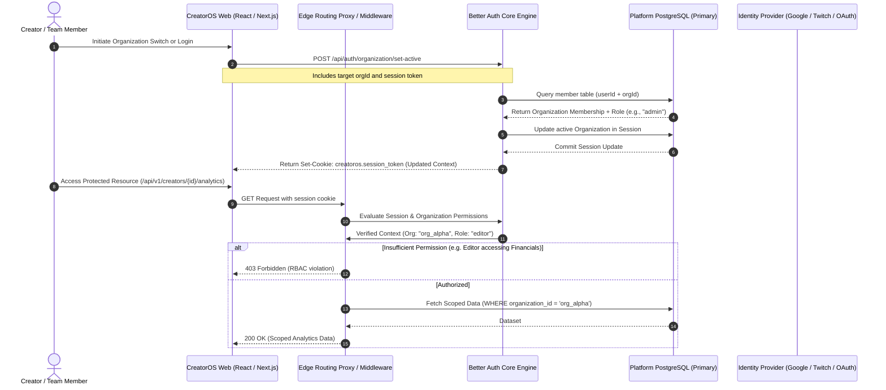

# ADR-0006: Adoption of Better Auth for Authentication and Multi-Tenant Access Control

* **Status:** Accepted
* **Deciders:** Principal Systems Architect, Lead Security Engineer, Core Platform Team
* **Date:** 2024-11-15
* **Technical Domain:** Identity, Authentication, Multi-Tenant Authorization, Platform Security

---

## 1. Context and Problem Statement

CreatorOS is an enterprise-grade operating system designed for content creators, talent agencies, media companies, and production networks. The platform aggregates asset pipelines, revenue telemetry, publishing integrations (YouTube, TikTok, Meta, Twitch), and automated financial distributions. 

The core architectural requirement is strict multi-tenancy with dynamic role-based access control (RBAC). A single identity (e.g., an agency manager or video editor) may belong to dozens of distinct workspaces ("Organizations"), each possessing independent role assignments, billing lifecycles, and data classification boundaries. For instance, a video editor requires upload permissions on a creator's channel assets but must be restricted from viewing Stripe-backed payouts or tax documents.

### Key Architectural Challenges:
1. **Multi-Tenant Organization Hierarchy:** Native support for multi-organization tenancy, team invitations, dynamic member scoping, and role switching without re-authenticating.
2. **Data Residency and Sovereign Ownership:** Enterprise agency clients require strict isolation and ownership of auth databases to satisfy GDPR, CCPA, and SOC 2 Type II compliance. Creator asset rights demand zero third-party leakage of identity metadata.
3. **End-to-End Type Safety:** Strict compile-time validation spanning server configuration, database schema definitions, and client-side access control checks.
4. **Edge and Node.js Runtime Parity:** The system must execute consistently across serverless Edge middlewares (Next.js/Cloudflare Workers) and persistent Node.js background processors.
5. **Operational Unit Economics:** Mitigating variable SaaS identity costs that scale non-linearly with Monthly Active Users (MAU).

---

## 2. Evaluation of Alternatives

We conducted architectural spikes and security evaluations across three contenders: **Better Auth**, **Auth.js (NextAuth v5)**, and **Clerk**.

### 2.1 Structural Comparison Matrix

| Evaluation Dimension | Better Auth | Auth.js (NextAuth v5) | Clerk |
| :--- | :--- | :--- | :--- |
| **Hosting Model** | Self-Hosted / Zero External Dependencies | Self-Hosted / Zero External Dependencies | Proprietary Third-Party SaaS |
| **Data Ownership** | 100% Postgres DB Sovereign Control | 100% Postgres DB Sovereign Control | Vendor-Hosted (Export limitations, Lock-in) |
| **Native Multi-Tenant / Orgs** | **First-Class Plugin** (Teams, Roles, Invites) | Manual Implementation Required | First-Class Built-in |
| **TypeScript Architecture** | End-to-end inferred types; schema-driven | Loose typing; generic overrides required | Strongly typed client SDKs; proprietary types |
| **Session Model** | Database Sessions & Stateless JWT | Mixed (JWT-first / Adapter Sessions) | Cookie-synced proprietary short-lived JWT |
| **Database Adapter Overhead** | Native Drizzle/Prisma, zero translation cost | Heavy adapter abstractions, schema drift | N/A (Proprietary remote storage) |
| **Two-Factor Authentication (2FA)** | Native (TOTP, Backup Codes) | Community plugins / custom logic | Built-in out of the box |
| **Rate Limiting & Security** | In-engine rate limiting & CSRF guards | Basic CSRF; external rate limiting needed | Cloudflare-backed proprietary shield |
| **Cost Dynamics (100k MAU)** | **$0** (Compute & DB baseline only) | **$0** (Compute & DB baseline only) | **~$2,500 - $4,000 / month** |

### 2.2 Deep-Dive Analysis of Rejected Alternatives

#### Clerk (Rejected)
* **Vendor Lock-In and Data Gravity:** Clerk stores users, credentials, passkeys, and organization bindings inside its managed infrastructure. Offboarding requires complex migration scripts and password reset ceremonies for non-social users.
* **Cost Scaling Disconnect:** CreatorOS supports large audiences entering client portals. A spike in casual collaborators scales MAU rapidly. Clerk’s per-MAU monetization model introduces an unsustainable variable cost profile that penalizes platform growth.
* **Latency Overhead:** Edge authentication routes encounter network round-trips to Clerk’s external API during token exchanges and synchronization hooks, violating our P99 50ms API response target.

#### Auth.js / NextAuth v5 (Rejected)
* **Multi-Tenancy Friction:** Auth.js lacks an opinionated, built-in multi-tenant organization primitive. Implementing organizational contexts requires designing custom invitation tables, workspace switches, permission caches, and session patchers from scratch.
* **Release Instability:** The migration path between v4 and v5 experienced prolonged API drift, documentation divergence, and structural breaking changes.
* **Session and Adapter Typings:** Typing sessions with custom user metadata and multi-tenant claims requires extensive module augmentation (`declare module "next-auth"`) that is prone to type erasure and maintenance overhead.

---

## 3. Decision

We will adopt **Better Auth** as the unified platform standard for identity, session management, and multi-tenant organization access control across all CreatorOS infrastructure.

### Architectural Drivers:
1. **Native Organization & RBAC Plugin:** Better Auth provides a production-grade `@better-auth/plugins/organization` system that handles workspace switching, team invitations, access tokens, and role hierarchies natively within the primary database schema.
2. **True Data Sovereignty:** Identity tables live directly within the CreatorOS primary PostgreSQL instance alongside business domain models, allowing transactional foreign key cascading (`ON DELETE CASCADE`) and cross-table joins without network hops.
3. **Bi-directional Inference:** Defining the server configuration yields a strongly-typed client (`createAuthClient`), eliminating runtime schema validation mismatches between frontend React components and backend routes.
4. **Native Plugin Architecture:** Two-factor authentication (TOTP), magic links, passkeys, session invalidation, and custom access controls operate as unified first-party plugins without fragmented third-party libraries.

---

## 4. System Architecture

The following diagram details the authentication and multi-tenant authorization topology under Better Auth within CreatorOS:



---

## 5. Implementation Specifications

### 5.1 Relational Database Schema (Drizzle ORM Engine)

Better Auth maps directly to our PostgreSQL database via Drizzle ORM. The following production-grade schema implements core identity, sessions, and the multi-tenant organization structures.

```typescript
// src/lib/db/schema/auth.schema.ts

import { pgTable, text, timestamp, boolean, index, uniqueIndex } from "drizzle-orm/pg-core";
import { sql } from "drizzle-orm";

export const users = pgTable("users", {
  id: text("id").primaryKey(),
  name: text("name").notNull(),
  email: text("email").notNull().unique(),
  emailVerified: boolean("email_verified").default(false).notNull(),
  image: text("image"),
  createdAt: timestamp("created_at", { withTimezone: true }).defaultNow().notNull(),
  updatedAt: timestamp("updated_at", { withTimezone: true })
    .defaultNow()
    .notNull()
    .$onUpdate(() => new Date()),
});

export const sessions = pgTable("sessions", {
  id: text("id").primaryKey(),
  userId: text("user_id")
    .notNull()
    .references(() => users.id, { onDelete: "cascade" }),
  token: text("token").notNull().unique(),
  expiresAt: timestamp("expires_at", { withTimezone: true }).notNull(),
  ipAddress: text("ip_address"),
  userAgent: text("user_agent"),
  activeOrganizationId: text("active_organization_id"),
  createdAt: timestamp("created_at", { withTimezone: true }).defaultNow().notNull(),
  updatedAt: timestamp("updated_at", { withTimezone: true })
    .defaultNow()
    .notNull()
    .$onUpdate(() => new Date()),
}, (table) => ({
  userIdIdx: index("sessions_user_id_idx").on(table.userId),
  tokenIdx: index("sessions_token_idx").on(table.token),
}));

export const accounts = pgTable("accounts", {
  id: text("id").primaryKey(),
  userId: text("user_id")
    .notNull()
    .references(() => users.id, { onDelete: "cascade" }),
  accountId: text("account_id").notNull(),
  providerId: text("provider_id").notNull(),
  accessToken: text("access_token"),
  refreshToken: text("refresh_token"),
  idToken: text("id_token"),
  accessTokenExpiresAt: timestamp("access_token_expires_at", { withTimezone: true }),
  refreshTokenExpiresAt: timestamp("refresh_token_expires_at", { withTimezone: true }),
  scope: text("scope"),
  password: text("password"),
  createdAt: timestamp("created_at", { withTimezone: true }).defaultNow().notNull(),
  updatedAt: timestamp("updated_at", { withTimezone: true })
    .defaultNow()
    .notNull()
    .$onUpdate(() => new Date()),
}, (table) => ({
  userIdIdx: index("accounts_user_id_idx").on(table.userId),
  providerLookupIdx: index("accounts_provider_lookup_idx").on(table.providerId, table.accountId),
}));

export const verifications = pgTable("verifications", {
  id: text("id").primaryKey(),
  identifier: text("identifier").notNull(),
  value: text("value").notNull(),
  expiresAt: timestamp("expires_at", { withTimezone: true }).notNull(),
  createdAt: timestamp("created_at", { withTimezone: true }).defaultNow().notNull(),
  updatedAt: timestamp("updated_at", { withTimezone: true })
    .defaultNow()
    .notNull()
    .$onUpdate(() => new Date()),
}, (table) => ({
  identifierIdx: index("verifications_identifier_idx").on(table.identifier),
}));

export const organizations = pgTable("organizations", {
  id: text("id").primaryKey(),
  name: text("name").notNull(),
  slug: text("slug").notNull().unique(),
  logo: text("logo"),
  metadata: text("metadata"), // JSON-stringified enterprise configuration
  createdAt: timestamp("created_at", { withTimezone: true }).defaultNow().notNull(),
  updatedAt: timestamp("updated_at", { withTimezone: true })
    .defaultNow()
    .notNull()
    .$onUpdate(() => new Date()),
}, (table) => ({
  slugIdx: uniqueIndex("organizations_slug_idx").on(table.slug),
}));

export const members = pgTable("members", {
  id: text("id").primaryKey(),
  organizationId: text("organization_id")
    .notNull()
    .references(() => organizations.id, { onDelete: "cascade" }),
  userId: text("user_id")
    .notNull()
    .references(() => users.id, { onDelete: "cascade" }),
  role: text("role").notNull(), // "owner" | "admin" | "editor" | "billing_manager" | "viewer"
  createdAt: timestamp("created_at", { withTimezone: true }).defaultNow().notNull(),
  updatedAt: timestamp("updated_at", { withTimezone: true })
    .defaultNow()
    .notNull()
    .$onUpdate(() => new Date()),
}, (table) => ({
  orgUserUniqueIdx: uniqueIndex("members_org_user_idx").on(table.organizationId, table.userId),
  orgIdIdx: index("members_org_id_idx").on(table.organizationId),
  userIdIdx: index("members_user_id_idx").on(table.userId),
}));

export const invitations = pgTable("invitations", {
  id: text("id").primaryKey(),
  organizationId: text("organization_id")
    .notNull()
    .references(() => organizations.id, { onDelete: "cascade" }),
  email: text("email").notNull(),
  role: text("role").notNull(),
  status: text("status").notNull(), // "pending" | "accepted" | "rejected" | "canceled"
  expiresAt: timestamp("expires_at", { withTimezone: true }).notNull(),
  inviterId: text("inviter_id")
    .notNull()
    .references(() => users.id, { onDelete: "cascade" }),
  createdAt: timestamp("created_at", { withTimezone: true }).defaultNow().notNull(),
  updatedAt: timestamp("updated_at", { withTimezone: true })
    .defaultNow()
    .notNull()
    .$onUpdate(() => new Date()),
}, (table) => ({
  orgEmailIdx: index("invitations_org_email_idx").on(table.organizationId, table.email),
}));
```

---

### 5.2 Server Configuration and RBAC Definition

The server configuration encapsulates role hierarchies and permission matrices. CreatorOS uses an RBAC system enforcing least privilege across organizational assets.

```typescript
// src/lib/auth/auth.ts

import { betterAuth } from "better-auth";
import { drizzleAdapter } from "better-auth/adapters/drizzle";
import { organization } from "better-auth/plugins";
import { db } from "@/lib/db";
import * as schema from "@/lib/db/schema/auth.schema";

export const ROLE_PERMISSIONS = {
  owner: [
    "org:delete",
    "org:update",
    "members:create",
    "members:read",
    "members:update",
    "members:delete",
    "assets:create",
    "assets:read",
    "assets:update",
    "assets:delete",
    "financials:read",
    "financials:manage",
  ],
  admin: [
    "org:update",
    "members:create",
    "members:read",
    "members:update",
    "assets:create",
    "assets:read",
    "assets:update",
    "assets:delete",
    "financials:read",
  ],
  editor: [
    "members:read",
    "assets:create",
    "assets:read",
    "assets:update",
  ],
  billing_manager: [
    "members:read",
    "financials:read",
    "financials:manage",
  ],
  viewer: [
    "members:read",
    "assets:read",
  ],
} as const;

export type PlatformRole = keyof typeof ROLE_PERMISSIONS;
export type PlatformPermission = typeof ROLE_PERMISSIONS[PlatformRole][number];

export const auth = betterAuth({
  appName: "CreatorOS",
  baseURL: process.env.BETTER_AUTH_URL,
  secret: process.env.BETTER_AUTH_SECRET,
  database: drizzleAdapter(db, {
    provider: "pg",
    schema: {
      user: schema.users,
      session: schema.sessions,
      account: schema.accounts,
      verification: schema.verifications,
      organization: schema.organizations,
      member: schema.members,
      invitation: schema.invitations,
    },
  }),
  emailAndPassword: {
    enabled: true,
    requireEmailVerification: true,
    minPasswordLength: 12,
    maxPasswordLength: 128,
  },
  socialProviders: {
    google: {
      clientId: process.env.GOOGLE_CLIENT_ID!,
      clientSecret: process.env.GOOGLE_CLIENT_SECRET!,
    },
    github: {
      clientId: process.env.GITHUB_CLIENT_ID!,
      clientSecret: process.env.GITHUB_CLIENT_SECRET!,
    },
  },
  session: {
    expiresIn: 60 * 60 * 24 * 7, // 7 days
    updateAge: 60 * 60 * 24, // Update session once per day
    cookieCache: {
      enabled: true,
      maxAge: 5 * 60, // 5 minutes edge cache validation
    },
  },
  plugins: [
    organization({
      allowUserToCreateOrganization: true,
      creatorRole: "owner",
      membershipLimit: 250,
      invitationExpiresIn: 60 * 60 * 24 * 3, // 3 days
    }),
  ],
});

export type Auth = typeof auth;
```

---

### 5.3 Type-Safe Client Setup

The client exposes typed commands for session queries, workspace creation, switching, and member role allocations.

```typescript
// src/lib/auth/auth-client.ts

import { createAuthClient } from "better-auth/react";
import { organizationClient } from "better-auth/client/plugins";

export const authClient = createAuthClient({
  baseURL: process.env.NEXT_PUBLIC_APP_URL,
  plugins: [
    organizationClient(),
  ],
});

export const {
  signIn,
  signOut,
  signUp,
  useSession,
  organization: orgClientMethods,
} = authClient;
```

---

### 5.4 High-Performance Edge Session Validation & RBAC Guard

To avoid database queries on every sub-resource request, we utilize an edge middleware pattern that performs session token authentication, extracts the active organization context, and validates permissions using the typed configuration matrix.

```typescript
// src/lib/auth/guard.ts

import { headers } from "next/headers";
import { auth, ROLE_PERMISSIONS, type PlatformPermission, type PlatformRole } from "./auth";

export interface SessionContext {
  userId: string;
  email: string;
  organizationId: string;
  role: PlatformRole;
  permissions: readonly PlatformPermission[];
}

export class AuthenticationError extends Error {
  constructor(message = "Unauthorized") {
    super(message);
    this.name = "AuthenticationError";
  }
}

export class AuthorizationError extends Error {
  constructor(message = "Forbidden: Insufficient privileges") {
    super(message);
    this.name = "AuthorizationError";
  }
}

/**
 * Validates request context against Better Auth and enforces RBAC constraints.
 */
export async function enforceAuthorization(
  requiredPermission?: PlatformPermission
): Promise<SessionContext> {
  const requestHeaders = await headers();
  
  const session = await auth.api.getSession({
    headers: requestHeaders,
  });

  if (!session || !session.user || !session.session) {
    throw new AuthenticationError();
  }

  const activeOrgId = session.session.activeOrganizationId;

  if (!activeOrgId) {
    throw new AuthorizationError("No active organization context selected.");
  }

  // Retrieve organization member association
  const member = await auth.api.getActiveMember({
    headers: requestHeaders,
  });

  if (!member || member.organizationId !== activeOrgId) {
    throw new AuthorizationError("Active credentials do not match organization scope.");
  }

  const userRole = member.role as PlatformRole;
  const permissions = ROLE_PERMISSIONS[userRole] ?? [];

  if (requiredPermission && !permissions.includes(requiredPermission as never)) {
    throw new AuthorizationError(
      `Role '${userRole}' lacks required privilege: '${requiredPermission}'`
    );
  }

  return {
    userId: session.user.id,
    email: session.user.email,
    organizationId: activeOrgId,
    role: userRole,
    permissions,
  };
}
```

---

### 5.5 Protected API Route Implementation

The following production route demonstrates the end-to-end integration: validating permission boundaries before executing transactional updates on workspace assets.

```typescript
// src/app/api/v1/creators/financials/route.ts

import { NextRequest, NextResponse } from "next/server";
import { enforceAuthorization, AuthenticationError, AuthorizationError } from "@/lib/auth/guard";
import { db } from "@/lib/db";
import { sql } from "drizzle-orm";

export async function GET(req: NextRequest) {
  try {
    // Strict Guard: Must belong to active org and hold 'financials:read' permission
    const sessionContext = await enforceAuthorization("financials:read");

    // Scope query precisely by the active organization context derived from session
    const payouts = await db.execute(sql`
      SELECT 
        id, 
        amount_cents, 
        currency, 
        status, 
        scheduled_for 
      FROM payout_ledger 
      WHERE organization_id = ${sessionContext.organizationId}
      ORDER BY scheduled_for DESC 
      LIMIT 50
    `);

    return NextResponse.json({
      data: payouts.rows,
      meta: {
        organizationId: sessionContext.organizationId,
        caller: sessionContext.userId,
      },
    });
  } catch (error) {
    if (error instanceof AuthenticationError) {
      return NextResponse.json({ error: error.message }, { status: 401 });
    }
    if (error instanceof AuthorizationError) {
      return NextResponse.json({ error: error.message }, { status: 403 });
    }
    return NextResponse.json({ error: "Internal Server Error" }, { status: 500 });
  }
}
```

---

## 6. Access Control Architecture

The platform maps system roles to the following deterministic permission assignments:

```
[Owner] ------------------------------------------------------------+
   |                                                                |
   v                                                                |
[Admin] ---------------------------------------+                    |
   |                                           |                    |
   +--------------------+                      |                    |
   |                    |                      |                    |
   v                    v                      v                    v
[Editor]       [Billing Manager]      [Audit Logs]          [Org Deletion]
   |                    |
   v                    v
(Asset Mutation)  (Ledger & Payouts)
   \                    /
    v                  v
     [Common Viewer] (Read-Only Workspace Discovery)
```

### Role & Domain Permission Matrix

| Operation Area | Action Token | Owner | Admin | Editor | Billing Manager | Viewer |
| :--- | :--- | :---: | :---: | :---: | :---: | :---: |
| **Workspace Settings** | `org:update` | Yes | Yes | No | No | No |
| | `org:delete` | Yes | No | No | No | No |
| **Identity & Access** | `members:create` | Yes | Yes | No | No | No |
| | `members:read` | Yes | Yes | Yes | Yes | Yes |
| | `members:update` | Yes | Yes | No | No | No |
| | `members:delete` | Yes | No | No | No | No |
| **Creator Assets** | `assets:create` | Yes | Yes | Yes | No | No |
| | `assets:read` | Yes | Yes | Yes | No | Yes |
| | `assets:update` | Yes | Yes | Yes | No | No |
| | `assets:delete` | Yes | Yes | No | No | No |
| **Revenue & Payouts**| `financials:read` | Yes | Yes | No | Yes | No |
| | `financials:manage` | Yes | No | No | Yes | No |

---

## 7. Security and Compliance Analysis

### 7.1 Cross-Tenant Data Isolation
The database utilizes foreign-key-level organization isolation. Better Auth updates `active_organization_id` on the authenticated session state only when verifying that an entry in the `members` table joins `sessions.user_id` to the target `organizations.id`. Any direct DB manipulation request that attempts to supply an arbitrary `organization_id` will fail our database constraint checks.

### 7.2 Session Invalidation and Hijack Defenses
* **Rotation Policy:** Session tokens rotate across privilege transitions (such as organization context switches or password updates).
* **Fingerprint Tracking:** `ip_address` and `user_agent` are validated on session fetch. Mismatched user-agent fingerprints mark sessions for step-up verification.
* **Revocation Velocity:** In the event of a compromised collaborator credential, deleting the record from `sessions` or setting the member assignment to inactive immediately blocks API access across Edge checks via DB cache TTL bounds (max 300 seconds).

### 7.3 Compliance Assertions (SOC 2, GDPR)
* **Right to Be Forgotten:** Better Auth's schema design guarantees that `users.id` cascading cascades downward to `accounts`, `sessions`, and `members`. Invoking user deletion purges personal data without orphaned authorization records.
* **Auditability:** Modifications to organization compositions generate immutable log records via triggers linked directly to mutations on `members` and `invitations`.

---

## 8. Consequences and Trade-Offs

### 8.1 Positive Consequences
* **Sovereign Single-Store Architecture:** Eliminates network boundaries, multi-region synchronization issues, and webhooks between third-party auth platforms and CreatorOS databases.
* **Deterministic Unit Economics:** Eliminates per-MAU subscription tiers; operational costs scale solely with Postgres read/write query capacity and server compute.
* **Strong Typing Guarantees:** Compilation fails if frontend route hooks invoke non-existent organization actions or invalid schema configurations.
* **Zero Cold-Start Dependency Outages:** Uptime directly tracks platform core infrastructure SLA, avoiding cascading service outages from external identity clouds.

### 8.2 Negative Consequences and Mitigations

#### Ecosystem Maturity
* *Consequence:* Better Auth is newer than legacy libraries (NextAuth/Passport).
* *Mitigation:* The underlying code is self-contained and auditable. Critical functionality is strictly tested under unit and end-to-end integration suites (`@playwright/test`) running in GitHub CI.

#### Operational Infrastructure Burden
* *Consequence:* Platform engineering retains responsibility for securing credential hashes, managing rate limits, tracking IP reputation, and handling provider OAuth regressions.
* *Mitigation:* We use standard secure algorithms (argon2id for local passwords), deploy database-level read replicas, and protect public auth routes (`/api/auth/*`) behind Cloudflare managed security challenges and rate limit rules.

---

## 9. Validation and Testing Strategy

The implementation is verified across three testing tiers:

1. **Unit Testing:** In-memory validation of the `enforceAuthorization` guard validating matrix permissions across mock user states.
2. **Integration Testing:** Direct database tests executing the full authentication lifecycle:
   * User registers via password/OAuth.
   * User initializes an organization (auto-assigned `owner`).
   * User invites a collaborator with an `editor` role.
   * Collaborator accepts invitation and invokes `setActiveOrganization`.
   * Assert collaborator can access video endpoints but receives `403 Forbidden` on financial ledger queries.
3. **Session Revocation Stress Testing:** Verifying that programmatic deletion of a session token via backend invalidation drops active edge requests within the cache window.
