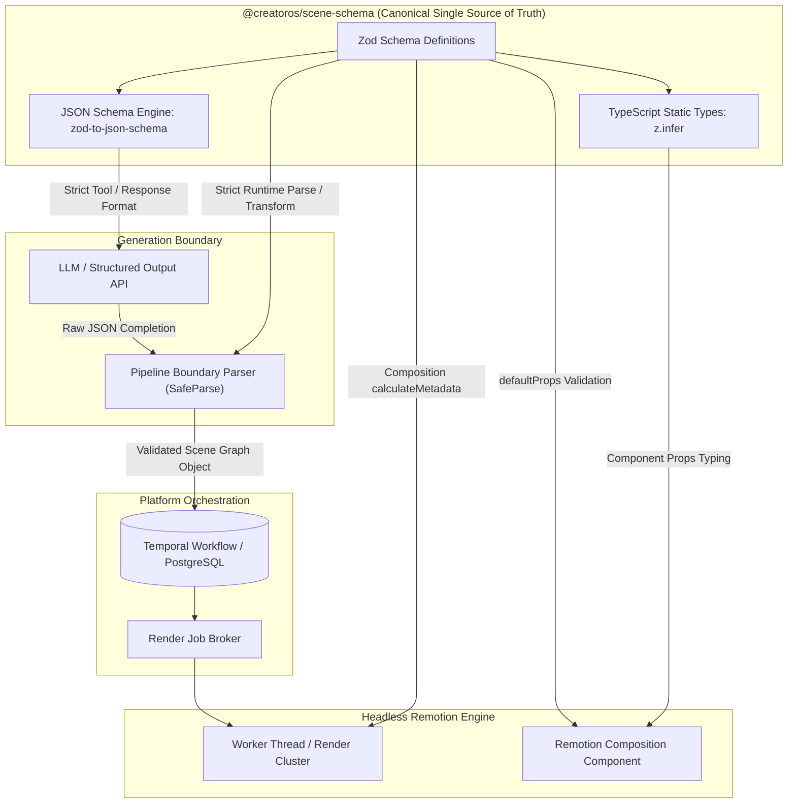

# ADR-0007: Zod-First Contract Schemas for Generation Boundaries and Remotion Compositions

- **Status**: Accepted
- **Date**: 2024-03-24
- **Deciders**: Principal Systems Architect, Lead Video Engineer, Core Platform Team
- **Consulted**: AI Pipeline Engineers, Frontend Infrastructure Team
- **Informed**: Full Engineering Organization

---

## 1. Context and Problem Statement

CreatorOS operates a distributed generative pipeline where non-deterministic Artificial Intelligence (AI) generation boundaries—such as Large Language Model (LLM) script outputs, Text-to-Speech (TTS) audio markers, and dynamic diffusion asset generations—feed directly into a deterministic rendering pipeline powered by Remotion.

Historically, this architecture suffered from three failure modes:

1. **Silent Runtime Desynchronization**: LLMs frequently produce near-conformant JSON payloads that omit fields, alternate between casing conventions (e.g., `camelCase` vs `snake_case`), or inject unexpected types (e.g., returning numeric values as string literals). When consumed by Remotion canvas renderers, these anomalies bypass standard TypeScript static checks, producing silent render crashes, broken video keyframes, or layout regressions mid-encode.
2. **Type Drift Across Monorepo Boundaries**: TypeScript definitions were duplicated across the backend generation microservices (`services/generation-orchestrator`), the client orchestration layer (`apps/studio`), and the headless render cluster (`services/render-engine`). Hand-written TypeScript interfaces drifted over time, creating false-positive compile states where downstream renderers assumed interface shapes that upstream generators no longer respected.
3. **Double-Parsing and Dual-Declaration Overhead**: Engineers maintained JSON Schema artifacts for LLM structured outputs (via OpenAI Functions/Structured Outputs and Anthropic Tool Use) alongside manual TypeScript interfaces for React/Remotion props, and manual runtime assertion logic (e.g., `typeof`, custom guards) inside components. Maintaining this triangular definition structure introduced operational overhead, slowed feature velocity, and introduced regressions.

CreatorOS requires a single source of truth that guarantees strict compile-time types and non-negotiable runtime integrity across network and model boundaries, while mapping to Remotion's parametrization system.

---

## 2. Decision Drivers

* **Fail-Fast Ingestion**: Generation errors must be trapped at the pipeline ingestion boundary before reaching queue states or scheduling compute on GPU render clusters.
* **Single Source of Truth (SSOT)**: A single canonical declaration must provide the runtime parsing logic, the static TypeScript types, the JSON Schemas fed to model APIs, and the Remotion input properties.
* **Deterministic Layout Guarantees**: Remotion relies on mathematically pure frame rendering functions. Render components must never manage fallback parsing or null-coalescing for malformed structural payloads.
* **Strict Immutability and Schema Versioning**: Video templates must remain reproducible over time. Older schema revisions must remain resolvable by the render pipeline.
* **Developer Velocity**: Writing a schema once must expose fully typed, zero-overhead interfaces across the entire TypeScript monorepo.

---

## 3. Considered Options

* **Option 1: JSON Schema + `json-schema-to-ts`**: Define root schemas in standard draft-07/2020-12 JSON Schema, generating static TypeScript types through utility libraries, and performing runtime validation using `ajv`.
* **Option 2: TypeScript Interfaces + Typebox**: Use Typebox to create JSON-schema-compatible definitions that yield runtime validators and static types simultaneously.
* **Option 3: Manual TypeScript Types + Custom Type Guards**: Maintain pure TypeScript definitions and construct ad-hoc validator functions at ingest boundaries.
* **Option 4: Zod-First Unified Schemas (`@creatoros/scene-schema`)**: Define all pipeline models, component props, and payload structures exclusively using Zod within an isolated, framework-agnostic package. Derive static types via `z.infer<T>`, derive LLM structured generation constraints via `zod-to-json-schema`, and configure Remotion compositions directly using Zod schemas.

---

## 4. Decision Outcome

**Chosen Option**: **Option 4: Zod-First Unified Schemas (`@creatoros/scene-schema`)**.

We establish `@creatoros/scene-schema` as the single canonical library governing data models across the entire lifecycle of a video composition. No TypeScript type describing an external input, an AI output, or a Remotion composition prop may be hand-authored without a backing Zod schema.

### Architectural Blueprint



---

## 5. Detailed Technical Specifications

### 5.1 Package Architecture: `@creatoros/scene-schema`

The package is published internally to the monorepo workspace at `packages/scene-schema`. It has zero dependencies on React, Remotion, or database drivers. It depends exclusively on `zod` and `zod-to-json-schema`.

#### Schema Definitions

```typescript
// packages/scene-schema/src/primitives.ts
import { z } from 'zod';

export const HexColorSchema = z
  .string()
  .regex(/^#(?:[0-9a-fA-F]{3}){1,2}$/, 'Must be a valid hex color code (e.g. #FFFFFF or #FFF)')
  .brand<'HexColor'>();

export const AssetIdSchema = z
  .string()
  .uuid('Asset ID must be a canonical UUIDv4')
  .brand<'AssetId'>();

export const FrameRateSchema = z
  .union([z.literal(24), z.literal(30), z.literal(60)])
  .default(30);

export const TimeUnitsSchema = z.object({
  frame: z.number().int().nonnegative(),
  durationInFrames: z.number().int().positive(),
  fps: FrameRateSchema,
});
```

```typescript
// packages/scene-schema/src/scene.ts
import { z } from 'zod';
import { HexColorSchema, AssetIdSchema, TimeUnitsSchema } from './primitives';

export const LayerTypeSchema = z.enum(['video', 'audio', 'text', 'kinetic-typography', 'shape']);

export const BaseLayerSchema = z.object({
  id: z.string().cuid2(),
  type: LayerTypeSchema,
  startFrame: z.number().int().nonnegative(),
  durationInFrames: z.number().int().positive(),
  zIndex: z.number().int().default(0),
  opacity: z.number().min(0).max(1).default(1),
});

export const KineticTypographyLayerSchema = BaseLayerSchema.extend({
  type: z.literal('kinetic-typography'),
  text: z.string().min(1).max(280),
  fontFamily: z.enum(['Inter', 'Playfair Display', 'JetBrains Mono', 'Cinzel']),
  fontSize: z.number().positive().default(48),
  color: HexColorSchema.default('#FFFFFF' as z.infer<typeof HexColorSchema>),
  animationStyle: z.enum(['fade', 'typewriter', 'slide-up', 'pop']),
  align: z.enum(['left', 'center', 'right']).default('center'),
});

export const VideoLayerSchema = BaseLayerSchema.extend({
  type: z.literal('video'),
  assetId: AssetIdSchema,
  playbackRate: z.number().positive().max(4).default(1),
  muted: z.boolean().default(false),
  volume: z.number().min(0).max(1).default(1),
  panZoom: z.object({
    startScale: z.number().positive().default(1),
    endScale: z.number().positive().default(1),
  }).default({}),
});

export const LayerSchema = z.discriminatedUnion('type', [
  KineticTypographyLayerSchema,
  VideoLayerSchema,
]);

export const SceneSchema = z.object({
  id: z.string().cuid2(),
  name: z.string().min(1).max(64),
  durationInFrames: z.number().int().positive(),
  backgroundColor: HexColorSchema.default('#000000' as z.infer<typeof HexColorSchema>),
  layers: z.array(LayerSchema).min(1),
  transitionIn: z.object({
    type: z.enum(['none', 'crossfade', 'slide', 'wipe']),
    durationInFrames: z.number().int().nonnegative().default(15),
  }).default({ type: 'none', durationInFrames: 0 }),
});

export const VideoCompositionSchema = z.object({
  compositionId: z.string().min(1),
  version: z.literal(1),
  meta: z.object({
    title: z.string().min(1),
    description: z.string().optional(),
    aspectRatio: z.enum(['16:9', '9:16', '1:1']).default('16:9'),
    width: z.number().int().positive(),
    height: z.number().int().positive(),
    fps: z.number().int().positive().default(30),
  }),
  scenes: z.array(SceneSchema).min(1),
});

// Infer Static Types Directly
export type HexColor = z.infer<typeof HexColorSchema>;
export type AssetId = z.infer<typeof AssetIdSchema>;
export type Layer = z.infer<typeof LayerSchema>;
export type KineticTypographyLayer = z.infer<typeof KineticTypographyLayerSchema>;
export type VideoLayer = z.infer<typeof VideoLayerSchema>;
export type Scene = z.infer<typeof SceneSchema>;
export type VideoCompositionPayload = z.infer<typeof VideoCompositionSchema>;
```

### 5.2 AI Generation Boundary Enforcement

Upstream LLM orchestration pipelines must not pass raw JSON payloads directly down the platform. All generation pipelines must convert Zod schemas to strict JSON Schemas for tool definitions, followed by immediate execution of `.safeParse()` on outputs.

```typescript
// services/generation-orchestrator/src/llm/scene-generator.ts
import { zodToJsonSchema } from 'zod-to-json-schema';
import OpenAI from 'openai';
import { 
  VideoCompositionSchema, 
  VideoCompositionPayload 
} from '@creatoros/scene-schema';

const openai = new OpenAI();

export class PipelineValidationException extends Error {
  constructor(public errors: unknown, message: string) {
    super(message);
    this.name = 'PipelineValidationException';
  }
}

export async function generateScenesFromPrompt(
  prompt: string
): Promise<VideoCompositionPayload> {
  // Translate Zod to JSON Schema directly for OpenAI Strict Mode
  const schemaTarget = zodToJsonSchema(VideoCompositionSchema, {
    name: 'VideoCompositionPayload',
    target: 'openAi',
  });

  const response = await openai.chat.completions.create({
    model: 'gpt-4o-2024-08-06',
    messages: [
      {
        role: 'system',
        content: 'You are an elite video composition agent. Produce deterministic compositions conforming precisely to schema.'
      },
      {
        role: 'user',
        content: prompt
      }
    ],
    response_format: {
      type: 'json_schema',
      json_schema: {
        name: 'video_composition',
        strict: true,
        schema: schemaTarget.definitions!['VideoCompositionPayload'] as Record<string, unknown>,
      },
    },
  });

  const rawJson = response.choices[0]?.message?.content;
  if (!rawJson) {
    throw new Error('LLM output returned an empty content body.');
  }

  let unverifiedPayload: unknown;
  try {
    unverifiedPayload = JSON.parse(rawJson);
  } catch (err) {
    throw new PipelineValidationException(err, 'Failed to parse LLM raw response as JSON.');
  }

  // Runtime enforcement barrier
  const parseResult = VideoCompositionSchema.safeParse(unverifiedPayload);

  if (!parseResult.success) {
    // Collect and aggregate all path-specific errors
    const errorDetails = parseResult.error.flatten();
    throw new PipelineValidationException(
      errorDetails,
      `Schema divergence encountered at boundary. Invalidation details: ${JSON.stringify(errorDetails)}`
    );
  }

  // Guaranteed strictly-typed payload downstream
  return parseResult.data;
}
```

### 5.3 Remotion Composition Ingestion and Component Typing

The Remotion render engine consumes these schemas directly using Remotion's parametrization mechanisms. This removes the need for manual prop-type validations, assertions, or component defaults.

```typescript
// packages/remotion-compositions/src/compositions/MainVideo.tsx
import React from 'react';
import { Composition, calculateMetadata } from 'remotion';
import { VideoCompositionSchema, VideoCompositionPayload } from '@creatoros/scene-schema';
import { SceneSequenceRenderer } from '../components/SceneSequenceRenderer';

const DEFAULT_COMPOSITION: VideoCompositionPayload = {
  compositionId: 'preview-draft',
  version: 1,
  meta: {
    title: 'Default Draft',
    aspectRatio: '16:9',
    width: 1920,
    height: 1080,
    fps: 30,
  },
  scenes: [
    {
      id: 'default-scene-001',
      name: 'Establishing Shot',
      durationInFrames: 90,
      backgroundColor: '#000000' as any,
      transitionIn: { type: 'none', durationInFrames: 0 },
      layers: [
        {
          id: 'layer-intro-txt',
          type: 'kinetic-typography',
          startFrame: 0,
          durationInFrames: 90,
          zIndex: 1,
          opacity: 1,
          text: 'CreatorOS Engine Initialization',
          fontFamily: 'Inter',
          fontSize: 64,
          color: '#FFFFFF' as any,
          animationStyle: 'typewriter',
          align: 'center',
        },
      ],
    },
  ],
};

export const MainVideoComposition: React.FC = () => {
  return (
    <Composition
      id="DynamicSceneEngine"
      component={SceneSequenceRenderer}
      // Direct pass-through of schema to Remotion runner
      schema={VideoCompositionSchema}
      defaultProps={DEFAULT_COMPOSITION}
      calculateMetadata={async ({ props }) => {
        // Validation executes automatically before calculateMetadata executes
        const totalDuration = props.scenes.reduce(
          (acc, scene) => acc + scene.durationInFrames,
          0
        );

        return {
          durationInFrames: totalDuration,
          fps: props.meta.fps,
          width: props.meta.width,
          height: props.meta.height,
          props, // Strictly typed through VideoCompositionPayload
        };
      }}
    />
  );
};
```

```typescript
// packages/remotion-compositions/src/components/SceneSequenceRenderer.tsx
import React from 'react';
import { AbsoluteFill, Series } from 'remotion';
import { VideoCompositionPayload, Scene } from '@creatoros/scene-schema';
import { LayerRenderer } from './LayerRenderer';

export const SceneSequenceRenderer: React.FC<VideoCompositionPayload> = ({ scenes }) => {
  return (
    <AbsoluteFill style={{ backgroundColor: '#000000' }}>
      <Series>
        {scenes.map((scene: Scene) => (
          <Series.Sequence
            key={scene.id}
            durationInFrames={scene.durationInFrames}
            style={{ backgroundColor: scene.backgroundColor }}
          >
            <AbsoluteFill>
              {scene.layers.map((layer) => (
                <LayerRenderer key={layer.id} layer={layer} />
              ))}
            </AbsoluteFill>
          </Series.Sequence>
        ))}
      </Series>
    </AbsoluteFill>
  );
};
```

```typescript
// packages/remotion-compositions/src/components/LayerRenderer.tsx
import React from 'react';
import { Layer } from '@creatoros/scene-schema';
import { KineticTypography } from './KineticTypography';
import { VideoLayerPlayer } from './VideoLayerPlayer';

export const LayerRenderer: React.FC<{ layer: Layer }> = ({ layer }) => {
  // Discriminated union allows type narrowing without type assertions
  switch (layer.type) {
    case 'kinetic-typography':
      return <KineticTypography layer={layer} />;
    case 'video':
      return <VideoLayerPlayer layer={layer} />;
    default: {
      const _exhaustiveCheck: never = layer;
      throw new Error(`Unhandled layer type: ${JSON.stringify(_exhaustiveCheck)}`);
    }
  }
};
```

---

## 6. Consequences

### Positive Consequences

* **Zero Frame-Drop/Render Failures**: Upstream failures stay upstream. An invalid generation terminates at the orchestrator boundary, preventing malformed jobs from entering render clusters.
* **Single Source of Truth**: Updating a schema property instantly updates runtime API validation, JSON Schemas passed to the AI models, and Remotion's internal layout engines.
* **Elimination of Defensive Coding in Compositions**: Remotion render components can bypass internal defensive checks (`if (!props.text) return null;`). Props are guaranteed to match their schema before rendering starts.
* **Compile-Time Exhaustiveness Guarantees**: TypeScript enforces complete coverage over discriminated unions (such as `LayerSchema`). Adding a new layer type to the Zod registry causes compilation to fail until all renderers implement the corresponding handler.
* **Automated Documentation**: Schemas yield machine-readable documentation, descriptions, and defaults without secondary maintenance.

### Negative Consequences and Trade-offs

* **Runtime Serialization Overhead**: Invoking `.safeParse()` on deeply nested composition trees introduces negligible CPU overhead (sub-millisecond for typical trees of 50-100 scenes), but can scale under massive dynamic batch scenarios.
* **Bundle-Size Boundary in Embeds**: Bundling `zod` into micro-client render packages introduces a ~13KB (gzipped) footprint. This is acceptable for CreatorOS workloads, but requires monitoring for embedded lightweight web players.
* **Strict Mode Schema Constraints**: OpenAI's structured outputs engine supports a strict subset of JSON Schema. Complex Zod primitives (such as `.transform()`, `.refine()`, or advanced regular expressions) cannot be converted to OpenAI-compatible schemas automatically.

---

## 7. Operational Rules and Governance

1. **No Bare Interfaces**: Engineers must not declare raw TypeScript `interface` or `type` blocks for payload schemas, event payloads, or composition props. All types must be inferred using `z.infer<typeof ConcreteSchema>`.
2. **OpenAI Compatibility Check**: Schemas used for LLM structured output generations must not use `.transform()`, `.refine()`, or unbounded union maps that produce invalid JSON Schemas. Transformations must occur in downstream parse chains.
3. **No Dynamic Casting in Compositions**: Casting via `as unknown as Type` inside Remotion rendering trees is strictly prohibited and enforced via ESLint rules (`@typescript-eslint/consistent-type-assertions`).
4. **SemVer and Schema Deprecation**: All modifications to schemas under `@creatoros/scene-schema` are governed by Semantic Versioning:
   * **PATCH**: Relaxing a constraint (e.g., widening a string length restriction).
   * **MINOR**: Adding optional fields or introducing an entirely new Discriminated Union branch with safe defaults.
   * **MAJOR**: Removing a field, renaming a field, or introducing required fields to an existing schema.

---

## 8. Validation and Verification

Validation of this ADR's enforcement is verified in the build and integration test suites:

* **Schema Generation Tests**: Unit tests confirm that all exported scene schemas compile into valid draft-07/OpenAI JSON Schemas using `zod-to-json-schema`.
* **Negative Mutation Fuzzing**: Fuzz testing passes mutated, malformed JSON objects into orchestrator parsers to verify that `.safeParse()` catches and rejects every malformed branch without uncaught runtime exceptions.
* **Remotion Composition Dry-Run**: Build-time verification executes `npx remotion compositions` across test payloads to confirm zero validation drift before CI image builds succeed.
