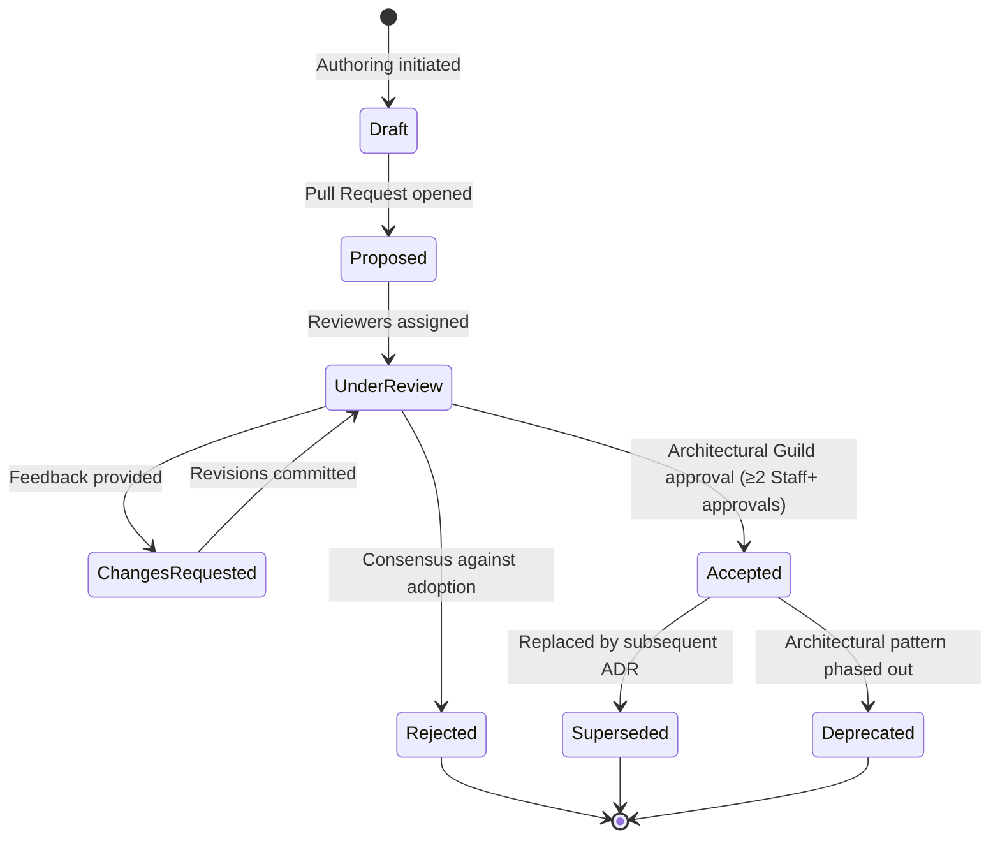
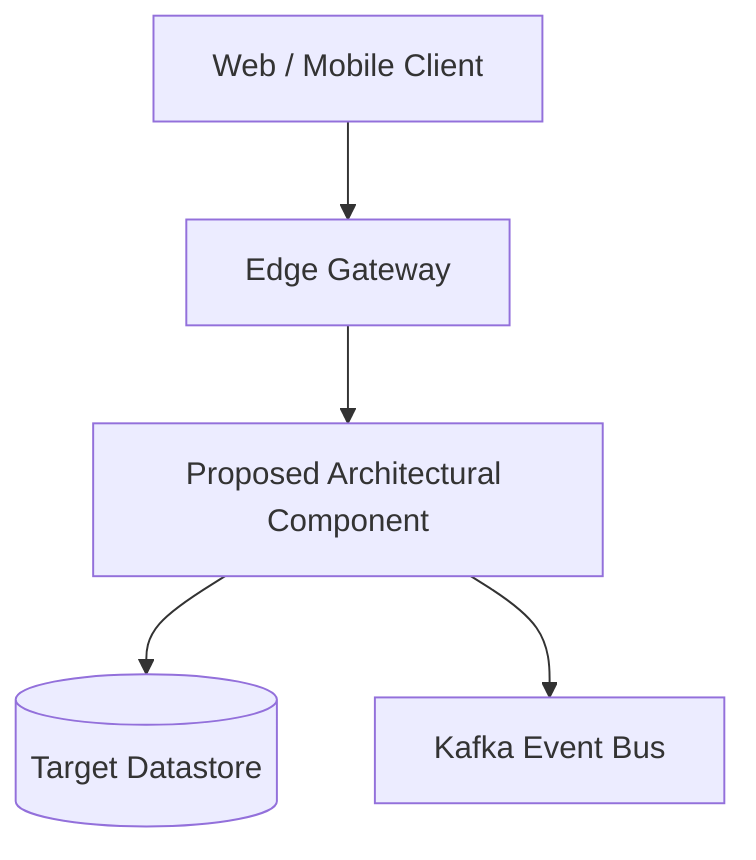

# CreatorOS Architecture Decision Records (ADRs)

## 1. Architecture Decision Framework

### 1.1 Purpose and Guiding Principles

The Architecture Decision Record (ADR) framework at CreatorOS captures critical software design choices, structural conventions, infrastructural dependencies, and trade-offs made across the platform lifecycle. Architecture decisions represent choices that are historically costly to change, impose systemic constraints on downstream subsystems, or alter cross-functional non-functional requirements (NFRs) such as throughput, latency, security, operational overhead, and compliance.

All software engineers, engineering managers, and technical leads operating within `@creatoros` adhere to these foundational principles:

- **Immutability:** Once an ADR reaches the `Accepted` state and is merged into the canonical repository branch, it is immutable. Any modification to the decision requires a new ADR that explicitly references and supersedes the historical record.
- **Traceability:** Structural choices in infrastructure code, microservices, domain APIs, and schema migrations must trace back to an accepted ADR number within commit messages and pull request descriptions (e.g., `Refs: ADR-0004`).
- **Completeness over Brevity:** ADRs must document the non-chosen alternatives, negative trade-offs, operational failure modes, and long-term tech debt obligations introduced by the decision.
- **Democratic Proposal, Authoritative Sign-Off:** Any engineer may propose an ADR. Ratification requires formal consensus by the CreatorOS Architecture Guild and Platform Core leads.

---

### 1.2 Decision Lifecycle and Workflow

Every architectural transition adheres to a finite state machine governed by continuous integration checks and GitHub pull request reviews.



#### Lifecycle Phase Definitions

| Status | Definition | Operational Consequence |
| :--- | :--- | :--- |
| **Draft** | The document is currently being drafted by the author. Not ready for platform-wide evaluation. | Exists solely on feature branches; no technical dependencies may be introduced. |
| **Proposed** | A complete ADR has been submitted via Pull Request to `docs/decisions/`. Open for guild review. | Triggers Request for Comments (RFC) period (minimum 7 calendar days). |
| **Under Review** | Formal evaluation underway. Assigned to Guild Reviewers. | Dedicated discussion within the weekly Architecture Guild sync. |
| **Changes Requested** | Flaws, missing trade-offs, or unmitigated security/performance risks identified. | Author must revise the proposal or provide quantitative benchmarks addressing concerns. |
| **Accepted** | Formal consensus achieved. The ADR is merged into `main`. | Becomes normative engineering policy across all `@creatoros` services. |
| **Rejected** | The architecture proposal was not adopted due to excessive risk, cost, or misalignment. | Preserved permanently in the repository as a historical record to prevent repeated evaluation. |
| **Deprecated** | An accepted decision is marked for phased removal without a direct replacement. | Triggers migration alerts; new services are barred from using the documented pattern. |
| **Superseded** | An accepted decision has been replaced entirely by a newer record (e.g., ADR-0009 supersedes ADR-0002). | The obsolete ADR header is updated to link directly to the superseding record. |

---

## 2. Decision Register

The following register indexes all foundational architectural decisions governing CreatorOS core infrastructure, data persistence, communications, and runtime systems.

| Identifier | Title | Status | Date Accepted | Impacted Subsystems |
| :--- | :--- | :--- | :--- | :--- |
| [ADR-0001](#adr-0001-micro-frontend-architecture-via-module-federation) | Micro-Frontend Architecture via Module Federation | `Accepted` | 2024-01-15 | `web-shell`, `creator-studio-ui`, `analytics-ui` |
| [ADR-0002](#adr-0002-event-driven-backbone-via-apache-kafka-and-debezium) | Event-Driven Backbone via Apache Kafka and Debezium | `Accepted` | 2024-02-01 | `event-bus`, `data-pipeline`, `audit-logging` |
| [ADR-0003](#adr-0003-polyglot-persistence-strategy-postgresql-clickhouse-and-redis) | Polyglot Persistence Strategy (PostgreSQL, ClickHouse, Redis) | `Accepted` | 2024-02-20 | `core-db`, `telemetry-store`, `distributed-cache` |
| [ADR-0004](#adr-0004-orchestration-engine-temporalio-for-media-and-publishing-pipelines) | Orchestration Engine: Temporal.io for Media and Publishing | `Accepted` | 2024-03-10 | `transcoder`, `social-publisher`, `payout-engine` |
| [ADR-0005](#adr-0005-federated-graphql-gateway-using-apollo-router-and-rust) | Federated GraphQL Gateway Using Apollo Router | `Accepted` | 2024-04-02 | `api-gateway`, `subgraph-services`, `mobile-clients` |
| [ADR-0006](#adr-0006-fine-grained-authorization-using-openfga-google-zanzibar-model) | Fine-Grained Authorization Using OpenFGA (Zanzibar Model) | `Accepted` | 2024-04-28 | `identity-service`, `iam-evaluator`, `resource-server` |
| [ADR-0007](#adr-0007-edge-media-processing-and-content-delivery-routing) | Edge Media Processing and Content Delivery Routing | `Accepted` | 2024-05-18 | `cdn-routing`, `image-resizer`, `video-packager` |
| [ADR-0008](#adr-0008-end-to-end-observability-with-opentelemetry-and-distributed-tracing) | End-to-End Observability with OpenTelemetry and Distributed Tracing | `Accepted` | 2024-06-05 | `platform-wide`, `instrumentation`, `collector-mesh` |

---

### ADR Summaries

#### ADR-0001: Micro-Frontend Architecture via Module Federation
- **Context:** The CreatorOS web console previously operated as an monolithic Next.js repository. As distinct teams scaled around Content Creation, Financial Operations/Payouts, and Creator Analytics, coordinate deployments became a critical bottleneck. Cross-boundary deployments routinely broke unrelated features, while bundle sizes exceeded 12 MB on initial loads.
- **Decision:** Adopt an asynchronous Micro-Frontend (MFE) architecture utilizing Webpack 5 Module Federation orchestrated by an un-opinionated host application shell (`@creatoros/shell`). Sub-applications (`@creatoros/studio`, `@creatoros/analytics`, `@creatoros/payouts`) deploy completely out of band to isolated S3/CloudFront buckets. Shared dependencies (`react`, `react-dom`, `@creatoros/design-system`) are pinned and resolved at runtime as shared singletons.
- **Consequences:**
  - *Positive:* Deployments decoupled across autonomous feature squads; time-to-first-meaningful-paint reduced by 48% via lazy-loaded remotes; independent CI/CD pipelines cut build times from 18 minutes to 90 seconds.
  - *Negative:* Increased local development setup complexity; dynamic federated loading requires strict contract-testing pipelines via TypeScript ambient declaration syndication to prevent remote-runtime interface mismatches.

#### ADR-0002: Event-Driven Backbone via Apache Kafka and Debezium
- **Context:** Initial iterations relied on direct synchronous HTTP calls and transactional outboxes implemented via custom PostgreSQL polling loops. Polling overhead created database locks at scale (10,000+ operations/sec), while inter-service HTTP chains introduced cascading degradation during peak creator broadcast hours.
- **Decision:** Deploy Apache Kafka (managed via Strimzi on Kubernetes) as the single authoritative event streaming spine. Couple Kafka with Debezium for continuous Change Data Capture (CDC) directly from PostgreSQL write-ahead logs (WAL). All state changes emit strictly typed events validated against an Apicurio Schema Registry enforcing Avro schema compatibility.
- **Consequences:**
  - *Positive:* Eliminated database polling locks; decouples downstream consumers; provides a reliable 7-day replay log for auditing, system rebuilds, and disaster recovery.
  - *Negative:* Requires engineering compliance around distributed event ordering, idempotency strategies on consumers, and Kafka consumer group lag monitoring overhead.

#### ADR-0003: Polyglot Persistence Strategy (PostgreSQL, ClickHouse, Redis)
- **Context:** The CreatorOS data domain requires transactional integrity for monetary processing and identity, real-time analytics over billions of fan engagement metrics (video views, link clicks, live-chat events), and sub-millisecond cached state for active creator sessions. A single relational database engine failed under concurrent analytical aggregation and high-frequency writes.
- **Decision:** Establish a strict three-tier polyglot persistence model:
  1. **PostgreSQL 16:** Authoritative relational store for user identity, contract configurations, billing, monetization models, and RBAC policies.
  2. **ClickHouse:** Columnar analytical store ingesting CDC events directly from Kafka for all high-volume creator engagement metrics, telemetry, and time-series aggregation.
  3. **Redis Enterprise Cluster:** Low-latency in-memory cache and ephemeral state layer for distributed session storage, token revoking, and real-time rate limiting.
- **Consequences:**
  - *Positive:* ClickHouse aggregates billions of events with sub-second query latency without burdening relational engines; PostgreSQL remains protected and focused strictly on high-integrity ACID domains.
  - *Negative:* Absence of cross-engine joins requires application-level stitching; duplicate entities across databases require robust eventual consistency reconciler cron jobs.

#### ADR-0004: Orchestration Engine: Temporal.io for Media and Publishing Pipelines
- **Context:** Media ingestion, AI-based auto-captioning, transcode fan-out, and cross-platform publishing (YouTube, TikTok, Instagram, X) represent complex, asynchronous, failure-prone, long-running transactions. Initial attempts using standard queue architectures (BullMQ / RabbitMQ) resulted in custom state-machine codebases prone to silent drop-outs, unhandled network partition failures, and race conditions during third-party rate limiting.
- **Decision:** Standardize all distributed long-running workflows on Temporal.io. Encapsulate business logic into deterministic TypeScript and Go Temporal Workflows, with non-deterministic actions (transcoding invocations, external API network calls) strictly executed within Temporal Activities that implement custom retry policies, exponential backoffs, and heartbeat tracking.
- **Consequences:**
  - *Positive:* Eliminates custom state machine code; native handling of workflows taking days or weeks (e.g., DMCA escalation windows or scheduled publishing); full determinism and execution history replay for auditability.
  - *Negative:* Temporal server deployment and Cassandra/PostgreSQL persistence backend require rigorous operational tuning; engineers must understand workflow determinism constraints (e.g., no native non-deterministic calls like `Date.now()` or random uuid generation within workflow code).

#### ADR-0005: Federated GraphQL Gateway Using Apollo Router and Rust
- **Context:** Mobile apps, web consoles, and third-party partner portals required data from a fragmented network of 14 back-end microservices. Exposing discrete REST services created excessive network round-trips over mobile connections, while an in-house Node.js GraphQL gateway became a high-CPU, high-memory bottleneck under load.
- **Decision:** Implement an enterprise Federated GraphQL architecture with **Apollo Router** (written in Rust) acting as the centralized edge orchestrator. Microservices expose localized GraphQL schemas as Federation v2 subgraphs. Apollo Studio and CI pipelines run schema composition checks, preventing any breaking schema changes from deploying.
- **Consequences:**
  - *Positive:* Sub-millisecond gateway latency routing via Apollo Router; clients query exactly what they need in a single round trip; subgraph schemas are independently developed and deployed by domain teams.
  - *Negative:* Complex deployment sequence; errors within federated subgraph schemas can stall gateway composition updates; teams must maintain strict Federation entity key mappings (`@key`, `@shareable`, `@external`).

#### ADR-0006: Fine-Grained Authorization Using OpenFGA (Zanzibar Model)
- **Context:** Creator organizations operate on complex nested team structures (Creators, Editors, Production Houses, Business Managers, Brand Partners). Standard Role-Based Access Control (RBAC) was fundamentally inadequate for modeling object-level permissions, such as allowing a contract editor to edit video drafts only within a specific project folder while denying access to revenue metrics for that same project.
- **Decision:** Implement Relationship-Based Access Control (ReBAC) using **OpenFGA** (an open-source engine based on Google's Zanzibar paper). Access evaluations occur via gRPC calls to the local OpenFGA cluster, evaluating contextual tuples (e.g., `user:editor_123` is `editor` of `folder:project_abc`).
- **Consequences:**
  - *Positive:* True granular access control capable of arbitrary nesting and inheritance; centralized, provable security model across every API endpoint.
  - *Negative:* Adds a high-frequency network call to the critical read/write path (mitigated via local in-memory caching and sidecar deployments); teams must translate legacy flat roles into relational tuple mappings.

#### ADR-0007: Edge Media Processing and Content Delivery Routing
- **Context:** Delivering video previews, localized thumbnails, dynamic watermarks, and personalized content to global fans requires ultra-low latency. Routing all image manipulation and asset requests back to the primary Kubernetes cluster caused latency spikes (300-800ms) for international users and saturated ingress bandwidth.
- **Decision:** Push dynamic media processing and delivery routing directly to the Edge using **Cloudflare Workers** integrated with Cloudflare Images and Fastly Compute. Dynamic thumbnail transformations, image format negotiation (AVIF/WebP), geoblocking validation, and dynamic signed URL authorization execute at edge points of presence (PoPs).
- **Consequences:**
  - *Positive:* Cache hit ratios increased to 94%; media delivery latency dropped globally to under 45ms; compute overhead on core Kubernetes clusters reduced by 35%.
  - *Negative:* Edge runtime relies on V8 isolates, restricting the use of heavy native binaries (e.g., arbitrary C-based FFmpeg execution must still be handled via asynchronous core worker queues); distributed debugging requires vendor-specific tracing tooling.

#### ADR-0008: End-to-End Observability with OpenTelemetry and Distributed Tracing
- **Context:** As CreatorOS scaled into a distributed ecosystem across micro-frontends, edge workers, Rust API routers, and polyglot microservices, root-cause analysis of transaction latency degradation became intractable. Teams utilized disjointed observability tooling (fragmented logs, non-correlated Datadog metrics, and missing spans).
- **Decision:** Mandate the **OpenTelemetry (OTel)** standard across the entire platform. Every service must incorporate language-appropriate OTel SDKs, propagating W3C `traceparent` headers through all HTTP, gRPC, and Kafka messages. Standardize instrumentation collectors via an in-cluster OpenTelemetry Collector mesh routing spans and metrics to a unified Grafana Tempo, Prometheus, and Loki backend.
- **Consequences:**
  - *Positive:* Complete correlation between metrics, logs, and distributed traces; vendor-neutral tracing pipeline prevents enterprise lock-in; immediate identification of distributed latency bottlenecks.
  - *Negative:* Trace context propagation must be manually guaranteed across complex asynchronous boundary jumps (e.g., Kafka producers/consumers, Temporal activity workers); telemetry collection generates significant network and storage overhead, requiring head-based and tail-based sampling rules.

---

## 3. Governance and Submission Process

The process of moving an architecture proposal from conceptualization to adoption is strictly enforced.

### 3.1 Step-by-Step Submission Lifecycle

```
[1. Formulate] -> [2. Prototype & Measure] -> [3. Branch & Author] -> [4. Pull Request] -> [5. Guild Review] -> [6. Ratification]
```

1. **Formulate:** Identify an architectural requirement, unaddressed technical debt, or systemic failure mode that cannot be resolved within localized service boundaries.
2. **Prototype & Measure:** Validate the proposal with working technical spikes. Quantitative metrics (p99 latency, CPU efficiency, schema migrations) must be captured to justify the change.
3. **Branch & Author:**
   - Create a git branch: `docs/adr-proposal-<short-name>`.
   - Copy the template from [Section 4](#4-standard-adr-template) to `docs/decisions/ADR-XXXX-<short-title>.md`.
   - Assign the next sequential ADR number (verify current highest ID in the repository index). Set state to `Proposed`.
4. **Pull Request:** Open an RFC Pull Request using the label `architecture:adr`. Include a link to the prototype repository and technical justification.
5. **Guild Review:**
   - The Pull Request is presented by the author at the weekly Architecture Guild meeting.
   - The review period remains open for a minimum of 7 calendar days to allow asynchronous feedback from all time zones.
6. **Ratification:**
   - Requires formal sign-off from at least **two Staff+ Engineers** or **Principal Architects**.
   - If consensus is reached, the status is changed to `Accepted`, the branch is merged into `main`, and the index in `docs/decisions/README.md` is updated.
   - If consensus is not reached, the document is updated to `Rejected` with a comprehensive rationale, merged into `main` for historical reference, and the PR is closed.

---

## 4. Standard ADR Template

*Authors must copy the raw Markdown block below when initiating a new ADR proposal. Do not remove any sections. If a section is non-applicable, provide a rigorous justification for why it does not apply.*

```markdown
# ADR-XXXX: [Short, Imperative Title Summarizing the Decision]

- **Status:** [Proposed | Accepted | Rejected | Deprecated | Superseded]
- **Date:** YYYY-MM-DD
- **Author(s):** Full Name (@github_handle), Role/Team
- **Sponsor(s):** Staff+ Engineer / Architect (@github_handle)
- **Supersedes:** [ADR-YYYY | N/A]
- **Superseded By:** [ADR-ZZZZ | N/A]
- **Impacted Components:** [e.g., @creatoros/core-api, @creatoros/transcoder, Infrastructure/K8s]

---

## 1. Context and Problem Statement

[Provide a comprehensive explanation of the operational, architectural, or business context driving this proposal. What specific problem are we solving? What is breaking or failing to scale under current operating parameters? Avoid speculative requirements—anchor the problem statement in production telemetry, infrastructure expenditure, engineering friction, or clear roadmap deliverables.]

### 1.1 Technical Drivers
- **Driver 1:** [e.g., Database write throughput saturation during live creator launches]
- **Driver 2:** [e.g., Inability to enforce zero-trust resource-level access control on nested assets]
- **Driver 3:** [e.g., Mean Time to Resolution (MTTR) degradation due to un-correlated async logs]

---

## 2. Decision Drivers and Evaluation Criteria

Decisions must balance competing technical constraints. The proposed options were evaluated using the following weighted criteria:

| Identifier | Evaluation Criteria | Description / Metric | Weight |
| :--- | :--- | :--- | :--- |
| **CRIT-01** | Scalability & Latency | Must support 50,000 requests/sec with p99 < 15ms | High |
| **CRIT-02** | Operational Simplicity | Maintenance overhead on Kubernetes, Day-2 operations | Medium |
| **CRIT-03** | Developer Ergonomics | Local iteration speed, type safety, documentation | High |
| **CRIT-04** | Vendor Neutrality | Minimization of proprietary API / infrastructure lock-in | Low |
| **CRIT-05** | Financial Feasibility | Infrastructure and licensing costs within budget limits | Medium |

---

## 3. Considered Architectural Options

### Option 1: [Option Name - The Proposed Approach]
- **High-Level Description:** [Concise description of the architecture pattern, library, or tool]
- **Mechanism:** [Technical breakdown of how this operates within the CreatorOS environment]

### Option 2: [Alternative Option Name]
- **High-Level Description:** [Alternative considered]
- **Mechanism:** [Why this approach was considered]

### Option 3: [Status Quo / Do Nothing / Naive Approach]
- **High-Level Description:** [Retain current operational pattern]
- **Mechanism:** [Impact of maintaining current system behavior]

---

## 4. Comparative Evaluation Matrix

| Criteria | Option 1 (Proposed) | Option 2 | Option 3 (Status Quo) |
| :--- | :--- | :--- | :--- |
| **CRIT-01: Scalability** | Excellent (Native distributed) | Poor (Single-node bottleneck) | Failing (Production risk) |
| **CRIT-02: Operations** | Medium (Requires dedicated operator) | High (Fully managed) | Low (Already running) |
| **CRIT-03: Ergonomics** | High (First-party TypeScript SDKs) | Medium (Generic REST client) | Poor (Manual boilerplate) |
| **CRIT-04: Portability** | High (Open Source / OCI standard) | Low (Proprietary cloud API) | High (Internal codebase) |
| **CRIT-05: Cost Factor** | Neutral (Within projected cloud tier)| High (Usage-based pricing spikes) | Low (Technical debt cost) |
| **Composite Score** | **9.2 / 10** | **6.8 / 10** | **3.5 / 10** |

---

## 5. Decision Outcome

**Chosen Solution:** **Option 1: [Option Name]**

### 5.1 Justification
[Articulate clearly why the selected option best satisfies the technical drivers and decision criteria. Address explicitly why the rejected options failed to meet the bar. Detail why the associated trade-offs are acceptable given the operational realities of the CreatorOS platform.]

---

## 6. Target Architecture Specification

### 6.1 Architectural Topology
[Embed a complete Mermaid diagram illustrating how the proposed component interfaces with existing platform components.]



### 6.2 Data Model / Schema / Interface Definition
[Provide production-grade code, configurations, schemas, or interface definitions. Do not leave placeholder comments.]

```typescript
// Example Interface Definition validating the architecture boundary
export interface ArchitecturalSpecification {
  id: string;
  deterministicIdentifier: string;
  executionMode: 'synchronous' | 'event-driven';
  telemetryContext: {
    traceId: string;
    spanId: string;
  };
  payload: Record<string, unknown>;
}
```

---

## 7. Consequences and Trade-offs

### 7.1 Positive Consequences
- **Capability 1:** [Detail exact capability unlocked]
- **Performance:** [Detail measurable efficiency gains: throughput, p95/p99 latency, concurrency]
- **Reliability:** [Detail failover behaviors, blast-radius mitigation, circuit breakers]

### 7.2 Negative Consequences and Mitigations
- **Operational Complexity:** [Identify specific Day-2 maintenance challenges]
  - *Mitigation:* [Detail operational runs, runbooks, metrics alerts to handle this]
- **Skill-Gap / Learning Curve:** [Identify tooling unfamiliarity across engineering squads]
  - *Mitigation:* [Detail planned internal workshops, platform templates, documentation]
- **Migration Cost:** [Detail legacy code paths that must be updated]
  - *Mitigation:* [Detail parallel-run validation phases, feature flag rollout plans]

---

## 8. Implementation, Rollout, and Migration Strategy

### 8.1 Execution Milestones
1. **Phase 1: Proof-of-Concept & In-Cluster Sandbox Validation** (Target Date: YYYY-MM-DD)
   - Deploy isolated instance within the `staging-sandbox` Kubernetes cluster.
   - Execute load testing up to 2x projected production peak.
2. **Phase 2: Dark Launch & Shadow Traffic Evaluation** (Target Date: YYYY-MM-DD)
   - Mirror 10% of production traffic to the new component via Envoy service mesh route cloning.
   - Validate zero-divergence outputs across 1,000,000 real operations.
3. **Phase 3: Phased Production Cutover** (Target Date: YYYY-MM-DD)
   - Promote to production via LaunchDarkly feature flag: 5% -> 25% -> 50% -> 100%.
   - Monitor p99 latency alerts and distributed trace error rate metrics.
4. **Phase 4: Deprecation and Teardown of Obsolete System** (Target Date: YYYY-MM-DD)
   - Remove legacy infrastructure modules and purge unused datastore instances.

### 8.2 Rollback Criteria
The migration must be aborted and rolled back immediately if any of the following occur during deployment:
- End-to-end transaction latency (p99) increases by $> 15\%$ over baseline for $> 3$ consecutive minutes.
- Error budget consumption rates exceed $> 2\%$ of the monthly allocation within any 1-hour window.
- Ingestion data loss is observed on any primary Kafka partition.

---

## 9. Compliance, Security, and Operational Readiness

- **Data Privacy & GDPR:** [How does this decision affect user data retention, PII protection, and the right to be forgotten?]
- **Security Posture:** [What authentication, mTLS encryption, network isolation policies, or OpenFGA permissions apply?]
- **Disaster Recovery (DR):** [RPO (Recovery Point Objective) and RTO (Recovery Time Objective) impact]
- **Runbooks & Alerting:** [Links to PagerDuty services, Grafana dashboard URLs, and internal incident response playbooks]

---

## 10. References and Research Material

- [1] Internal Architecture Spike Repository: `https://github.com/creatoros/spikes/tree/adr-xxxx`
- [2] Industry Precedent / Whitepaper Reference
- [3] Benchmarking Results & Performance Artifacts
```

---

## 5. Architectural Review Board (ARB) & Guild Directory

The Architecture Review Board operates as a specialized working group of the CreatorOS Engineering Guild. The board meets weekly to evaluate open ADR pull requests.

### Core Reviewers

- **Chief Architect / Staff Systems Architect:** Final authority on platform-level cross-cutting architectural bounds.
- **Data Infrastructure Lead:** Review authority for datastore expansions, streaming topology changes, and schema models.
- **Platform Infrastructure & SRE Lead:** Review authority for Kubernetes, ingress, networking, edge routing, and cloud capacity planning.
- **Security & Compliance Architect:** Mandatory sign-off for identity changes, cryptography, and access governance systems.

To submit an item for the weekly ARB agenda, open a Pull Request containing your populated ADR using the template above, and tag `@creatoros/architecture-guild` in the review request panel. Proposals must be submitted at least **48 hours prior** to the scheduled sync to ensure sufficient asynchronous review time.
