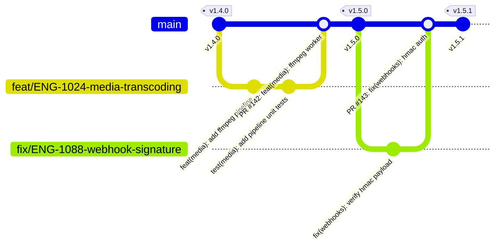
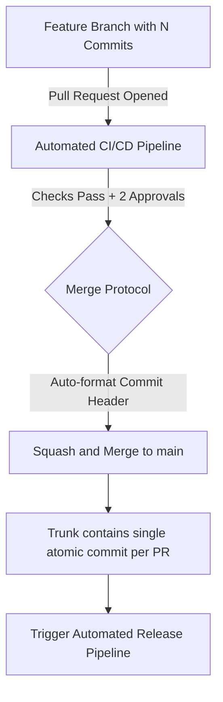
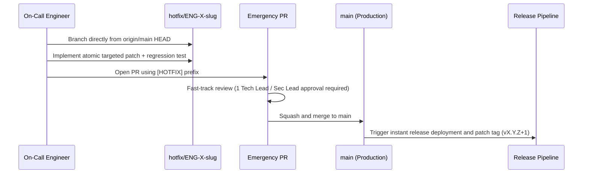

# Git Workflow and Version Control Standards

This specification defines the version control protocols, branch lifecycle policies, semantic commit standards, Pull Request (PR) procedures, and automated release tagging pipelines for CreatorOS (`@creatoros`). Adherence to these standards is strictly enforced via automated pre-commit hooks, continuous integration (CI) linting, and branch protection rules.

---

## 1. Branching Strategy

CreatorOS operates on a **Scaled Trunk-Based Development** model. The `main` branch serves as the single source of truth for deployable, production-ready code. Long-lived feature branches are strictly prohibited. All work must be partitioned into short-lived, isolated branches that merge into `main` via linear history or squash merges within 48 to 72 hours of inception.



### 1.1 Branch Taxonomy and Naming Conventions

Every branch created within the `@creatoros` repositories must match the canonical regular expression:

```regex
^(feat|fix|chore|refactor|perf|test|docs|hotfix)\/([A-Z]+-[0-9]+)-([a-z0-9-]+)$
```

Where:
- **`prefix`**: The functional intent of the branch.
- **`ticket-id`**: The issue tracker identifier (e.g., Linear/Jira issue key such as `ENG-1024`).
- **`slug`**: A hyphen-separated, lowercase description under 40 characters.

| Prefix | Description | Example Target Branch |
| :--- | :--- | :--- |
| `feat/` | A new end-user feature, platform service, or API endpoint | `feat/ENG-891-payout-stripe-connect` |
| `fix/` | A bug fix targeting an existing defect | `fix/ENG-902-auth-session-leak` |
| `chore/` | Maintenance tasks, dependency upgrades, build tooling changes | `chore/ENG-940-bump-pnpm-v9` |
| `refactor/` | Code modifications that neither fix bugs nor add functionality | `refactor/ENG-955-extract-media-domain` |
| `perf/` | Performance optimizations and query latency reductions | `perf/ENG-978-redis-pipeline-analytics` |
| `test/` | Adding missing integration tests, mocks, or unit tests | `test/ENG-980-billing-reconciliation` |
| `docs/` | Documentation changes, API specs, architectural diagrams | `docs/ENG-991-webhook-architecture` |
| `hotfix/` | Urgent production fixes patching an active critical vulnerability | `hotfix/ENG-1100-patch-ssrf-vector` |

### 1.2 Branch Governance Rules

1. **Direct Commits Prohibited**: Commits cannot be pushed directly to `main`. All mutations must occur via Pull Requests.
2. **Short-Lived Iterations**: Branch lifespan must not exceed three working days. Features exceeding this scope must be broken down or deployed dark behind an internal feature flag (`@creatoros/flags`).
3. **Branch Deletion**: Branches must be configured to automatically delete upon merge via GitHub repository settings.
4. **Up-to-Date Requirement**: Branches must be rebased onto `main` before merging. Merge conflicts must be resolved locally by the author.

---

## 2. Commit Message Specification

CreatorOS strictly adheres to the [Conventional Commits v1.0.0](https://www.conventionalcommits.org/en/v1.0.0/) specification. Commit messages are parsed by automated release tools to calculate Semantic Version bumps, generate changelogs, and notify observability platforms.

### 2.1 Commit Message Structure

```text
<type>(<scope>): <subject>

[optional body]

[optional footer(s)]
```

#### Structural Elements
- **Type**: Must be one of the registered engineering types.
- **Scope**: Must reflect the bounded context, package, or application modified (lowercase, alphanumeric).
- **Subject**: Imperative, present-tense phrasing (e.g., "add", not "added" or "adds"). No capitalization at the start. No trailing period. Maximum 72 characters.
- **Body**: Detailed context explaining *why* the change was made and any operational risks. Wrapped at 72 characters.
- **Footer**: Breaking changes, ticket references, co-authors, and security tracking.

### 2.2 Standard Type Registry

| Type | SemVer Impact | Description |
| :--- | :--- | :--- |
| `feat` | **MINOR** | Introduces new functionality to the codebase. |
| `fix` | **PATCH** | Fixes an issue, bug, or unexpected behavior. |
| `perf` | **PATCH** | Performance improvements (e.g., optimized SQL query, caching). |
| `refactor` | None | Code restructuring without behavioral alterations. |
| `docs` | None | Documentation updates only. |
| `test` | None | Adding or correcting automated tests; no production code changes. |
| `chore` | None | Auxiliary tool changes, build scripts, library upgrades without feature impact. |
| `ci` | None | CI/CD infrastructure, workflows, and deployment pipeline changes. |
| `build` | None | Build system changes, package exports, Docker manifests. |
| `revert` | **Varies** | Reverts a previous commit. Subject must match the reverted commit. |

### 2.3 CreatorOS Monorepo Scopes

When committing in the monorepo, scopes must correspond to workspace packages or domain boundaries:

- **Applications**: `web`, `api`, `worker`, `admin`, `docs`
- **Core Packages**: `auth`, `db`, `ui`, `logger`, `flags`, `events`, `types`
- **Domain Contexts**: `creator`, `billing`, `analytics`, `media`, `payouts`, `webhooks`

### 2.4 Breaking Changes

Breaking changes require an exclamation mark (`!`) before the colon, along with an explicit `BREAKING CHANGE:` footer. A breaking change triggers a **MAJOR** version bump.

```text
feat(api)!: migrate workspace invitation endpoint to v2

The v1 invitation payload structure has been deprecated. The `role_id` parameter
is now required and replaces the legacy `permissions` array.

BREAKING CHANGE: POST /v1/workspaces/{id}/invitations is removed.
Clients must consume POST /v2/workspaces/{id}/invitations with `role_id`.

Closes: ENG-1045
```

### 2.5 Commit Message Examples

#### Standard Feature Commit
```text
feat(media): implement chunked multi-part upload for s3

Add support for uploading raw video files exceeding 500MB via chunked
presigned URLs. Handles abort signals and lifecycle expiration.

Closes: ENG-842
```

#### Bug Fix with Detailed Body
```text
fix(billing): correct stripe tax inclusive rounding error

Micro-cent division within the billing reconciliation worker resulted
in off-by-one discrepancies for localized EU VAT invoices. This updates
the currency math module to enforce Banker's Rounding (round-half-to-even).

Closes: ENG-921
```

#### Monorepo Maintenance
```text
chore(deps): update prisma ORM to v5.12.0

Upgrade Prisma packages across @creatoros/db and dependent applications.
Runs schema generation and revalidates relation engine types.
```

---

## 3. Local Git Hook Enforcement

Local verification is enforced via [Husky](https://typicode.github.io/husky/) and [@commitlint/cli](https://commitlint.js.org/). Commits and pushes that fail validation are rejected before touching remote branches.

### 3.1 Commitlint Configuration (`commitlint.config.ts`)

```typescript
import type { UserConfig } from '@commitlint/types';

const Configuration: UserConfig = {
  extends: ['@commitlint/config-conventional'],
  parserPreset: 'conventional-changelog-atom',
  formatter: '@commitlint/format',
  rules: {
    'type-enum': [
      2,
      'always',
      [
        'feat',
        'fix',
        'docs',
        'refactor',
        'perf',
        'test',
        'chore',
        'ci',
        'build',
        'revert',
      ],
    ],
    'scope-enum': [
      2,
      'always',
      [
        // Applications
        'web',
        'api',
        'worker',
        'admin',
        'docs',
        // Packages
        'auth',
        'db',
        'ui',
        'logger',
        'flags',
        'events',
        'types',
        // Domains
        'creator',
        'billing',
        'analytics',
        'media',
        'payouts',
        'webhooks',
        'infra',
      ],
    ],
    'scope-case': [2, 'always', 'kebab-case'],
    'subject-case': [
      2,
      'never',
      ['sentence-case', 'start-case', 'pascal-case', 'upper-case'],
    ],
    'subject-empty': [2, 'never'],
    'subject-full-stop': [2, 'never', '.'],
    'subject-max-length': [2, 'always', 72],
    'body-leading-blank': [2, 'always'],
    'body-max-line-length': [2, 'always', 80],
    'footer-leading-blank': [2, 'always'],
    'footer-max-line-length': [2, 'always', 100],
  },
};

export default Configuration;
```

### 3.2 Husky Hook Manifests

#### Hook: `.husky/commit-msg`
```bash
#!/usr/bin/env sh
. "$(dirname -- "$0")/_/husky.sh"

# Validate commit message structure against commitlint specification
pnpm exec commitlint --edit "$1"
```

#### Hook: `.husky/pre-commit`
```bash
#!/usr/bin/env sh
. "$(dirname -- "$0")/_/husky.sh"

# Run staged linter, formatting, and structural checks
pnpm exec lint-staged
```

#### Hook: `.husky/pre-push`
```bash
#!/usr/bin/env sh
. "$(dirname -- "$0")/_/husky.sh"

# Disallow pushing directly to production protected branches
current_branch=$(git symbolic-ref --short HEAD)

if [ "$current_branch" = "main" ]; then
  echo "CRITICAL: Direct push to the [main] branch is prohibited by CreatorOS policy."
  echo "Open a pull request from a validated feature/fix branch."
  exit 1
fi

# Run static type verification across workspaces before pushing
pnpm turbo run typecheck --cache-dir=".turbo"
```

### 3.3 Lint-Staged Pipeline (`.lintstagedrc.json`)

```json
{
  "*.{js,jsx,ts,tsx}": [
    "biome check --write --no-errors-on-unmatched",
    "prettier --write"
  ],
  "*.{json,yaml,yml,md}": [
    "prettier --write"
  ],
  "*.prisma": [
    "prisma format"
  ]
}
```

---

## 4. Pull Request Standards and Governance

Pull Requests represent the audit boundary between development environments and production deployments. 

### 4.1 Prerequisites for Merge

All PRs must meet the following criteria before the merge gate unlocks:

1. **Reviewer Approvals**: Minimum of two approvals from code owners defined in `.github/CODEOWNERS`.
2. **Clean CI Pipeline**:
   - Monorepo matrix build passes.
   - Comprehensive test suite (unit + integration) passes with zero flakes.
   - Static analysis: Typecheck (0 errors), Biome lint/format, and SonarCloud quality gates pass.
3. **Linear History / Freshness**: The branch must be up to date with `main`.
4. **Size Constraint**: PRs should not exceed 400 net modified lines of code, excluding lockfiles and autogenerated schema definitions.

### 4.2 Pull Request Template

The following template must be located at `.github/pull_request_template.md`:

```markdown
## Description
<!-- Provide a high-level summary of the architectural changes and functional goals of this PR. -->

Fixes/Relates to: **ENG-XXXX**

## Type of Change
<!-- Select all relevant check boxes using 'x'. -->
- [ ] `feat`: Non-breaking feature additions
- [ ] `fix`: Non-breaking bug remediation
- [ ] `perf`: Non-breaking performance optimizations
- [ ] `refactor`: Structural changes with zero behavioral deviation
- [ ] `breaking`: Breaking behavioral API, Schema, or contract change

## Scope
<!-- Check the primary monorepo domains affected. -->
- [ ] `apps/web`
- [ ] `apps/api`
- [ ] `apps/worker`
- [ ] `packages/db` (Includes Prisma Schema mutations)
- [ ] `packages/auth`
- [ ] `infra/platform`

## Database & Data Migration
<!-- Answer only if changes mutate schema or existing records. -->
- [ ] This PR introduces a database migration (`packages/db`).
- [ ] Backward compatibility verified (Expand/Contract model followed).
- [ ] Zero-downtime execution verified against shadow database.
- [ ] Reversible migration logic supplied or emergency rollback script documented.

## Security & Reliability Assessment
- [ ] RBAC / Tenant Isolation verified (No horizontal cross-tenant access possible).
- [ ] PII and sensitive parameters are masked from application logs.
- [ ] New external endpoints have rate-limiting and input validation schemas attached.
- [ ] Circuit breakers or fallbacks configured for external service dependencies.

## Verification Checklist
- [ ] Local tests executed and passing (`pnpm run test`).
- [ ] Static type check passes locally (`pnpm run typecheck`).
- [ ] Integration tests added/updated covering critical success/failure paths.
- [ ] Telemetry and metrics events added for new operational workflows.

## Deployment Strategy
<!-- Detail if this requires specific sequence: e.g., deploy worker before API, apply flags. -->
- [ ] Standard blue/green automated deployment.
- [ ] Requires runtime feature flag enablement via `@creatoros/flags`.
- [ ] Requires environment variable updates in AWS Parameter Store/Secrets Manager.
```

---

## 5. Merging Protocol

To preserve a readable, traceable git log, CreatorOS enforces the **Squash and Merge** strategy for all Pull Requests into `main`.



### 5.1 Squash Commit Formatting Rules

When squashing via GitHub, the repository configuration dictates the format of the resulting squash commit:

1. **Commit Subject**: Matches the PR Title, which must adhere strictly to the Conventional Commits specification:
   ```text
   feat(billing): implement idempotency check on stripe webhook processing (#1024)
   ```
2. **Commit Body**: The PR description summary, referencing the approved pull request number and linked tickets.
3. Individual intermediate development commits (e.g., `fix typo`, `wip`, `rebase main`) are compressed into an atomic unit.

---

## 6. Semantic Versioning and Automated Release Pipelines

CreatorOS follows strict [Semantic Versioning (SemVer 2.0.0)](https://semver.org/). Version management, package changelog generation, and Git tag publication are fully automated via our CI infrastructure using Changesets and GitHub Actions.

### 6.1 Semantic Version Schema

```text
MAJOR.MINOR.PATCH
  │     │     └─ Incremented by: fix, perf (backward-compatible bug remediation)
  │     └─────── Incremented by: feat (backward-compatible feature additions)
  └───────────── Incremented by: BREAKING CHANGE footers or '!' decorators
```

### 6.2 Tagging Namespace Standards

Tags must be generated exclusively by the automated release pipeline. Manual tag creation via git CLI is prohibited.

- **Unified Core Releases**: Releases deploying the root platform are tagged with simple semver:
  ```text
  v1.24.0
  ```
- **Monorepo Package Isolation**: Independent library updates inside `packages/*` use scoped tagging:
  ```text
  @creatoros/auth@2.1.0
  @creatoros/db@4.18.2
  ```

### 6.3 Automated CI Release Workflow

The deployment automation workflow inspects commits on `main`, checks for `@changesets/cli` release payloads, resolves version bumps, generates release tags, and produces GitHub Releases.

```yaml
# .github/workflows/release.yml
name: Release Pipeline

on:
  push:
    branches:
      - main

concurrency:
  group: ${{ github.workflow }}-${{ github.ref }}
  cancel-in-progress: false

permissions:
  contents: write
  pull-requests: write
  id-token: write

jobs:
  release:
    name: Evaluate and Publish Release
    runs-on: ubuntu-latest
    timeout-minutes: 15

    steps:
      - name: Checkout Source Code
        uses: actions/checkout@v4
        with:
          fetch-depth: 0
          token: ${{ secrets.CREATOROS_BOT_PAT }}

      - name: Setup Node.js Runtime
        uses: actions/setup-node@v4
        with:
          node-version: 20.x

      - name: Setup Corepack and PNPM
        run: |
          corepack enable
          corepack prepare pnpm@9.0.6 --activate

      - name: Install Monorepo Dependencies
        run: pnpm install --frozen-lockfile

      - name: Verify Workspace Integrity
        run: |
          pnpm turbo run build --filter=...^main
          pnpm turbo run test --filter=...^main

      - name: Process Releases and Version Bumps
        id: changesets
        uses: changesets/action@v1
        with:
          publish: pnpm exec changeset publish
          version: pnpm exec changeset version
          commit: "chore(release): version packages and synchronize changelogs"
          title: "chore(release): automated platform versioning"
        env:
          GITHUB_TOKEN: ${{ secrets.CREATOROS_BOT_PAT }}
          NPM_TOKEN: ${{ secrets.NPM_AUTOMATION_TOKEN }}

      - name: Emit Automated GitHub Release Notes
        if: steps.changesets.outputs.published == 'true'
        run: |
          echo "Packages successfully bumped and tags published."
          # Metrics collection or datadog release tracking can be bound here
```

---

## 7. Emergency Hotfix Procedure

When a severity-1 production vulnerability or data corruption issue bypasses deployment gates, teams must follow this protocol:



1. **Origin Point**: Create a branch off the current `main` HEAD:
   ```bash
   git checkout main
   git pull origin main
   git checkout -b hotfix/ENG-1201-remediation-jwt-validation
   ```
2. **Minimal Surface Area**: Do not bundle refactoring, dependency updates, or unassociated changes. The diff must be minimal and strictly targeted at resolving the incident.
3. **Emergency PR Labeling**: Apply the `emergency-hotfix` label. This overrides standard two-approval constraints, permitting merge with a single approval from the Engineering Lead or Security Lead on-call.
4. **Merge and Verify**: The merge must trigger the release pipeline immediately. Monitor APM and error budgets across all production regions to verify remediation before closing the incident ticket.
