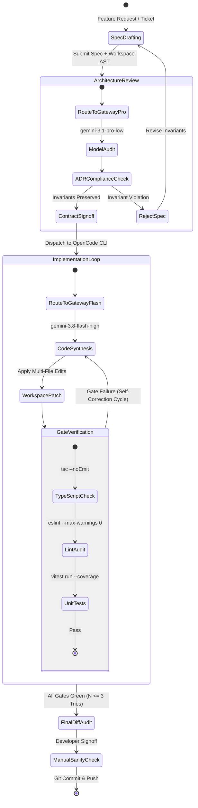

# CreatorOS Engineering Guide: Autonomous Coding Agent Workflow

**Document ID:** `DOC-ENG-004`  
**Path:** `docs/engineering/04-opencode-gemini-workflow.md`  
**Status:** ACTIVE / PRODUCTION  
**Owner:** Core Architecture & Platform Engineering (@creatoros/platform-eng)  

---

## 1. Executive Overview & Architectural Topology

This document details the configuration, invocation patterns, and operational safety boundaries for CreatorOS's autonomous agent-driven development workflow. We utilize the OpenCode CLI orchestrator coupled with specialized Google Gemini models routed through our local Antigravity Gateway proxy (`http://127.0.0.1:8999`).

The engineering workflow relies on a dual-model division of labor:
1. **`gemini-3.1-pro-low` (Architecture & Review Gate):** Deployed for high-level system topology verification, architectural decision record (ADR) compliance, invariant enforcement, and structural interface analysis. It operates with low reasoning latency overhead while leveraging deep structural comprehension.
2. **`gemini-3.8-flash-high` (Implementation & Coding Loop):** Deployed for rapid iterative synthesis, AST refactoring, multi-file source patching, unit-test authoring, and deterministic self-healing loops. It operates with a high token-generation velocity and maximum internal scratchpad/reasoning depth.

```
+---------------------------------------------------------------------------------------------------------+
|                                        LOCAL DEVELOPER WORKSPACE                                        |
|                                                                                                         |
|   +-----------------------+           +-----------------------+           +-----------------------+     |
|   |  VS Code Command /    |           |    OpenCode CLI       |           |   Quality Gates       |     |
|   |  Automated Task       | --------> |    Core Orchestrator  | --------> |   (tsc, lint, vitest) |     |
|   +-----------------------+           +-----------+-----------+           +-----------+-----------+     |
|                                                   |                                   |                 |
|                                                   v                                   |                 |
|                               +---------------------------------------+               | Feedback        |
|                               |       Antigravity Gateway Proxy       |               | Loop            |
|                               |       (http://127.0.0.1:8999)         | <-------------+                 |
|                               +-------------------+-------------------+                                 |
|                                                   |                                                     |
+---------------------------------------------------|-----------------------------------------------------+
                                                    |
                                                    | Authenticated Upstream Routing
                                                    v
                    +---------------------------------------------------------------+
                    |                      Google GenAI API                         |
                    |                                                               |
                    |   +--------------------------+    +-----------------------+   |
                    |   |  gemini-3.1-pro-low      |    | gemini-3.8-flash-high |   |
                    |   |  [Architecture Review]   |    | [Code Synthesis]      |   |
                    |   +--------------------------+    +-----------------------+   |
                    +---------------------------------------------------------------+
```

### Architectural Pipeline State Machine



---

## 2. Infrastructure & Gateway Configuration

The Antigravity Gateway is an internal enterprise proxy deployed on every developer machine at `http://127.0.0.1:8999`. It serves four functional purposes:
1. **Protocol Normalization:** Translates OpenCode OpenAI-compatible payloads into the Google GenAI REST/gRPC API structures.
2. **Context Compression & Redaction:** Intercepts sensitive environment secrets (`.env*`, private certificates) before external dispatch.
3. **Model Alias Mapping:** Maps logical identifiers (`gemini-review`, `gemini-code`) to exact deployment strings (`gemini-3.1-pro-low`, `gemini-3.8-flash-high`).
4. **Local Metrics Collection:** Tracks prompt tokens, completion tokens, latency percentiles, and cache hit rates.

### Gateway Health and Catalog Schema

The gateway enforces the following JSON payload contract on health and configuration endpoints:

```typescript
/**
 * Gateway Contract Types: @creatoros/gateway-types
 */
export interface GatewayStatusResponse {
  status: 'ONLINE' | 'DEGRADED' | 'OFFLINE';
  uptimeSeconds: number;
  listenAddress: string;
  activePort: number;
  routes: ModelRouteDefinition[];
  tokenBucket: {
    capacity: number;
    tokensRemaining: number;
    refillRatePerMinute: number;
  };
}

export interface ModelRouteDefinition {
  logicalAlias: 'gemini-review' | 'gemini-code';
  upstreamModelId: 'gemini-3.1-pro-low' | 'gemini-3.8-flash-high';
  provider: 'google-genai';
  temperature: number;
  maxOutputTokens: number;
  thinkingBudget: number; // 0 represents minimal/low, dynamic range up to 32768
  contextWindow: number;
  stream: boolean;
}

export interface OpenCodeExecutionOptions {
  workingDirectory: string;
  targetModel: 'gemini-review' | 'gemini-code';
  maxAutonomousIterations: number;
  dryRun: boolean;
  failFast: boolean;
  approvalMode: 'headless' | 'interactive' | 'review-only';
  strictGates: {
    runTypecheck: boolean;
    runLint: boolean;
    runTests: boolean;
  };
}
```

### OpenCode Core Configuration (`.opencoderc.json`)

Place this file in the root of the CreatorOS repository to bind the OpenCode CLI engine to the Antigravity Gateway:

```json
{
  "$schema": "https://opencode.creatoros.internal/schemas/v2/config.json",
  "version": "2.4.0",
  "proxy": {
    "baseUrl": "http://127.0.0.1:8999/v1",
    "timeoutMs": 180000,
    "retryCount": 3,
    "headers": {
      "X-CreatorOS-Client": "OpenCode-CLI",
      "X-CreatorOS-Env": "local-development"
    }
  },
  "models": {
    "gemini-review": {
      "model": "gemini-3.1-pro-low",
      "parameters": {
        "temperature": 0.1,
        "topP": 0.8,
        "maxOutputTokens": 8192,
        "thinking": {
          "budget": 1024
        }
      },
      "systemPromptFile": "docs/engineering/prompts/architecture-review.system.md"
    },
    "gemini-code": {
      "model": "gemini-3.8-flash-high",
      "parameters": {
        "temperature": 0.2,
        "topP": 0.95,
        "maxOutputTokens": 16384,
        "thinking": {
          "budget": 16384
        }
      },
      "systemPromptFile": "docs/engineering/prompts/code-implementation.system.md"
    }
  },
  "execution": {
    "defaultApprovalMode": "interactive",
    "diffContextLines": 5,
    "fileExclusions": [
      "**/node_modules/**",
      "**/.git/**",
      "**/dist/**",
      "**/build/**",
      "**/.turbo/**",
      "**/*.min.js",
      "**/.env*",
      "**/credentials.json"
    ],
    "telemetry": {
      "enabled": true,
      "sinkUrl": "http://127.0.0.1:8999/telemetry"
    }
  }
}
```

---

## 3. Dual-Model Execution Roles & Model Matrix

The table below delineates the strict division of concerns between the Pro and Flash model classes:

| Operational Dimension | Architecture Review Model | Code Synthesis Model |
| :--- | :--- | :--- |
| **Model Identifier** | `gemini-3.1-pro-low` | `gemini-3.8-flash-high` |
| **Logical Gateway Alias** | `gemini-review` | `gemini-code` |
| **Reasoning / Thinking Profile** | Low thinking budget (`1024` tokens) | High thinking budget (`16384` tokens) |
| **Primary Domain** | System design, schema compatibility, security auditing, boundary integrity | Code patching, unit-test construction, type alignment, self-healing iteration |
| **Context Window Capacity** | 1,000,000 tokens | 1,000,000 tokens |
| **Temperature** | `0.05` - `0.1` (Strict Determinism) | `0.15` - `0.25` (Controlled Generative Execution) |
| **AST Mutability Access** | Read-Only (`verify`, `audit`, `advising`) | Read/Write (`read`, `patch`, `create`, `delete`) |
| **Target Execution Time** | < 15 seconds | < 45 seconds (including scratchpad reasoning) |
| **Upstream Fallback** | Manual Architect Intervention | `gemini-3.1-pro-low` (escalated synthesis) |

### System Prompts Architecture

#### Architecture Review Prompt (`docs/engineering/prompts/architecture-review.system.md`)

```markdown
You are the CreatorOS Principal Systems Architect. Your mandate is verifying proposed changes against repository standards:
1. Strict Hexagonal Architecture: Domain logic must remain clean of framework coupling.
2. Invariant Enforcement: Validate state transitions, database access abstractions, and concurrency locks.
3. Type Safety: Zero tolerance for `any`, non-null assertions (`!`), or ambiguous interface declarations.
4. Security: No insecure deserialization, raw SQL execution, or unvalidated input paths.
Review the structural plan or code diff provided. Output a strict PASS or FAIL determination accompanied by precise AST locations and concrete recommendations.
```

#### Code Implementation Prompt (`docs/engineering/prompts/code-implementation.system.md`)

```markdown
You are the CreatorOS Autonomous Software Engineer. Your mandate is producing production-grade, highly optimized TypeScript implementations:
1. Write minimal, clean, type-safe, and self-documenting code.
2. Comply with the existing directory structure and patterns established in the repository.
3. Automatically generate co-located Vitest unit tests achieving minimum 90% branch coverage.
4. Correct all syntax, linting, and type compilation errors immediately prior to declaring task completion.
```

---

## 4. Command Patterns & CLI Orchestration

All commands execute from the monorepo root via the standard OpenCode CLI executable (`opencode`).

### Primary Command Patterns

#### 1. Architecture Audit of Proposed Specification
Audits a feature specification against existing domain contracts using `gemini-3.1-pro-low`:
```bash
opencode run \
  --model gemini-review \
  --prompt "Perform architectural review on RFC-012: Event bus subscription redesign" \
  --context docs/rfcs/rfc-012-event-bus.md \
  --context packages/core-events/src/index.ts \
  --fail-fast \
  --mode review-only
```

#### 2. Direct Feature Implementation
Dispatches feature generation directly to `gemini-3.8-flash-high`:
```bash
opencode run \
  --model gemini-code \
  --prompt "Implement DistributedLockProvider in packages/kv-store utilizing Redis primitives. Include exhaustive unit tests." \
  --context packages/kv-store/src/types.ts \
  --context packages/kv-store/src/base-adapter.ts \
  --auto-patch \
  --mode interactive
```

#### 3. Continuous Self-Correction Cycle
Orchestrates autonomous iteration until compilation, linting, and unit tests pass:
```bash
opencode iterate \
  --model gemini-code \
  --target-files "packages/audio-engine/src/**/*.ts" \
  --verification-cmd "pnpm --filter @creatoros/audio-engine run test:ci" \
  --max-retries 5 \
  --bail-on-timeout
```

### Production Orchestration Script: `scripts/dev/agent-runner.sh`

This script bridges CLI invocation, gateway checks, and quality gates into an atomic operational pipeline.

```bash
#!/usr/bin/env bash
set -euo pipefail

GATEWAY_ENDPOINT="http://127.0.0.1:8999"
TASK_FILE="${1:-}"
TASK_PROMPT="${2:-}"

# Colors for standard terminal output
readonly COLOR_INFO="\033[0;34m"
readonly COLOR_SUCCESS="\033[0;32m"
readonly COLOR_WARN="\033[0;33m"
readonly COLOR_ERROR="\033[0;31m"
readonly COLOR_RESET="\033[0m"

log_info() { echo -e "${COLOR_INFO}[INFO] $(date +'%H:%M:%S') - $1${COLOR_RESET}"; }
log_success() { echo -e "${COLOR_SUCCESS}[SUCCESS] $(date +'%H:%M:%S') - $1${COLOR_RESET}"; }
log_warn() { echo -e "${COLOR_WARN}[WARN] $(date +'%H:%M:%S') - $1${COLOR_RESET}"; }
log_error() { echo -e "${COLOR_ERROR}[ERROR] $(date +'%H:%M:%S') - $1${COLOR_RESET}"; }

# 1. Healthcheck: Validate Antigravity Gateway Availability
log_info "Verifying Antigravity Gateway reachability at ${GATEWAY_ENDPOINT}..."
if ! curl -sf "${GATEWAY_ENDPOINT}/healthz" > /dev/null; then
    log_error "Gateway unavailable at ${GATEWAY_ENDPOINT}. Ensure system daemon 'antigravity-gw' is running."
    exit 1
fi
log_success "Gateway status: Healthy."

if [[ -z "$TASK_FILE" || -z "$TASK_PROMPT" ]]; then
    log_error "Usage: ./agent-runner.sh <target-spec-file.md> <prompt-string>"
    exit 1
fi

if [[ ! -f "$TASK_FILE" ]]; then
    log_error "Target spec file ${TASK_FILE} does not exist."
    exit 1
fi

# 2. Phase One: Architectural Sign-off via gemini-3.1-pro-low
log_info "Initiating Architectural Gate via model: gemini-3.1-pro-low..."
ARCH_AUDIT_LOG=$(mktemp)

if ! opencode run \
  --model gemini-review \
  --context "$TASK_FILE" \
  --prompt "Review specification in ${TASK_FILE} for invariants and schema compliance. Output PASS or detail blocking architectural defects." \
  --mode review-only > "$ARCH_AUDIT_LOG" 2>&1; then
    log_error "Architecture Review encountered internal CLI error. Logs:"
    cat "$ARCH_AUDIT_LOG"
    rm -f "$ARCH_AUDIT_LOG"
    exit 1
fi

if grep -q "FAIL" "$ARCH_AUDIT_LOG"; then
    log_error "Architecture Review: BLOCKED. Defect report:"
    cat "$ARCH_AUDIT_LOG"
    rm -f "$ARCH_AUDIT_LOG"
    exit 2
fi

log_success "Architecture Gate: APPROVED."
rm -f "$ARCH_AUDIT_LOG"

# 3. Phase Two: Implementation Loop via gemini-3.8-flash-high
log_info "Initiating Code Synthesis Loop via model: gemini-3.8-flash-high..."

MAX_ITERATIONS=3
CURRENT_ITERATION=1
PIPELINE_SUCCESS=false

while [ "$CURRENT_ITERATION" -le "$MAX_ITERATIONS" ]; do
    log_info "Starting Synthesis Iteration ${CURRENT_ITERATION}/${MAX_ITERATIONS}..."

    # Execute coding agent
    opencode run \
      --model gemini-code \
      --context "$TASK_FILE" \
      --prompt "$TASK_PROMPT" \
      --auto-patch \
      --mode headless

    log_info "Running Verification Gates: Typecheck, Lint, Test..."

    # Quality Gate Phase
    if pnpm run check:types && pnpm run lint && pnpm run test:fast; then
        log_success "Iteration ${CURRENT_ITERATION} passed all deterministic verification gates."
        PIPELINE_SUCCESS=true
        break
    else
        log_warn "Verification gates failed on iteration ${CURRENT_ITERATION}. Prompting agent self-correction..."
        LAST_ERROR=$(pnpm run check:types 2>&1 || true)
        opencode run \
          --model gemini-code \
          --prompt "Fix the following TypeScript compilation errors without modifying external public interfaces: ${LAST_ERROR}" \
          --auto-patch \
          --mode headless
    fi
    CURRENT_ITERATION=$((CURRENT_ITERATION + 1))
done

if [ "$PIPELINE_SUCCESS" = false ]; then
    log_error "Autonomous implementation failed to satisfy quality gates after ${MAX_ITERATIONS} iterations."
    exit 3
fi

log_success "Pipeline complete. Code modifications are staged and verified."
```

---

## 5. VS Code Task Integration

To ensure seamless developer interaction within the editor, save the following definitions inside `.vscode/tasks.json`.

```json
{
  "version": "2.0.0",
  "tasks": [
    {
      "label": "Agent: Architecture Review (Gemini Pro)",
      "type": "shell",
      "command": "opencode",
      "args": [
        "run",
        "--model",
        "gemini-review",
        "--context",
        "${file}",
        "--prompt",
        "Perform architectural compliance analysis on this file and its direct dependencies. Validate hexagonal abstractions, concurrency constraints, and public API safety.",
        "--mode",
        "review-only"
      ],
      "group": {
        "kind": "build",
        "isDefault": false
      },
      "presentation": {
        "echo": true,
        "reveal": "always",
        "focus": true,
        "panel": "dedicated",
        "showReuseMessage": false,
        "clear": true
      },
      "problemMatcher": []
    },
    {
      "label": "Agent: Implement Feature (Gemini Flash)",
      "type": "shell",
      "command": "opencode",
      "args": [
        "run",
        "--model",
        "gemini-code",
        "--context",
        "${file}",
        "--prompt",
        "${input:featurePrompt}",
        "--auto-patch",
        "--mode",
        "interactive"
      ],
      "group": {
        "kind": "build",
        "isDefault": false
      },
      "presentation": {
        "echo": true,
        "reveal": "always",
        "focus": true,
        "panel": "shared",
        "clear": false
      },
      "problemMatcher": []
    },
    {
      "label": "Agent: Run Strict Quality Gates",
      "type": "shell",
      "command": "pnpm run check:types && pnpm run lint && pnpm test",
      "group": {
        "kind": "test",
        "isDefault": true
      },
      "presentation": {
        "echo": true,
        "reveal": "always",
        "focus": false,
        "panel": "shared"
      },
      "problemMatcher": ["$tsc", "$eslint-stylish"]
    },
    {
      "label": "Agent: Full Autonomous Pipeline",
      "dependsOrder": "sequence",
      "dependsOn": [
        "Agent: Architecture Review (Gemini Pro)",
        "Agent: Implement Feature (Gemini Flash)",
        "Agent: Run Strict Quality Gates"
      ],
      "problemMatcher": []
    }
  ],
  "inputs": [
    {
      "id": "featurePrompt",
      "description": "Enter the precise implementation directive for the coding agent:",
      "default": "Implement missing functionality and accompanying unit tests according to the active specification.",
      "type": "promptString"
    }
  ]
}
```

### Keybinding Configuration (`.vscode/keybindings.json`)

Map these tasks directly to key combinations for high-efficiency terminal-free loops:

```json
[
  {
    "key": "ctrl+alt+a",
    "command": "workbench.action.tasks.runTask",
    "args": "Agent: Architecture Review (Gemini Pro)"
  },
  {
    "key": "ctrl+alt+i",
    "command": "workbench.action.tasks.runTask",
    "args": "Agent: Implement Feature (Gemini Flash)"
  },
  {
    "key": "ctrl+alt+v",
    "command": "workbench.action.tasks.runTask",
    "args": "Agent: Run Strict Quality Gates"
  }
]
```

---

## 6. Deterministic Testing & Quality Gates

The autonomous loop is only as reliable as its automated boundaries. The model is barred from mutating verification scripts, test runner setups, or CI pipelines.

```
       +-----------------------------------------------------------+
       |             Deterministic Verification Gate               |
       |                                                           |
       |  [Gate 1: Static Type Check]                              |
       |  pnpm tsc --noEmit --project tsconfig.json                |
       |                   |                                       |
       |                   v                                       |
       |  [Gate 2: AST Linter & Standards]                         |
       |  pnpm eslint . --ext .ts,.tsx --max-warnings 0            |
       |                   |                                       |
       |                   v                                       |
       |  [Gate 3: Fast Unit & Isolation Tests]                    |
       |  vitest run --coverage --passWithNoTests                  |
       |                   |                                       |
       |                   v                                       |
       |  [Gate 4: Architectural AST Diff Boundary]                |
       |  ts-node scripts/dev/verify-agent-diff.ts                 |
       |                                                           |
       +-----------------------------------------------------------+
```

### Diff Boundary Verification Script (`scripts/dev/verify-agent-diff.ts`)

This script audits the uncommitted git changes to guarantee the agent did not exceed safe modification boundaries.

```typescript
import { execSync } from 'node:child_process';
import * as path from 'node:path';

interface DiffViolation {
  file: string;
  reason: string;
}

const FORBIDDEN_FILE_PATTERNS: RegExp[] = [
  /package\.json$/,
  /pnpm-lock\.yaml$/,
  /\.github\/.*/,
  /scripts\/dev\/.*/,
  /tsconfig.*\.json$/,
  /\.env(\..+)?$/,
];

const MAX_CHANGED_LINES = 750;

function runVerification(): void {
  console.log('[DiffGuard] Verifying uncommitted agent modifications...');

  const rawDiffOutput = execSync('git diff --name-only --staged', { encoding: 'utf-8' });
  const unstagedDiffOutput = execSync('git diff --name-only', { encoding: 'utf-8' });
  
  const allChangedFiles = Array.from(
    new Set([...rawDiffOutput.split('\n'), ...unstagedDiffOutput.split('\n')])
  ).filter((f) => f.trim().length > 0);

  const violations: DiffViolation[] = [];

  for (const file of allChangedFiles) {
    const normalizedPath = path.normalize(file).replace(/\\/g, '/');
    for (const pattern of FORBIDDEN_FILE_PATTERNS) {
      if (pattern.test(normalizedPath)) {
        violations.push({
          file: normalizedPath,
          reason: `Violates isolation rule: File matches protected pattern ${pattern.toString()}`,
        });
      }
    }
  }

  // Check line modification volume
  const lineStats = execSync('git diff --shortstat', { encoding: 'utf-8' }).trim();
  console.log(`[DiffGuard] Diff Scope: ${lineStats || '0 files changed'}`);

  const match = lineStats.match(/(\d+) insertions?\(\+\), (\d+) deletions?\(-\)/);
  if (match) {
    const insertions = parseInt(match[1], 10);
    const deletions = parseInt(match[2], 10);
    const totalChanges = insertions + deletions;

    if (totalChanges > MAX_CHANGED_LINES) {
      violations.push({
        file: 'GLOBAL',
        reason: `Blast radius exceeded: ${totalChanges} line modifications (Threshold: ${MAX_CHANGED_LINES})`,
      });
    }
  }

  if (violations.length > 0) {
    console.error('\n[DiffGuard] CRITICAL: Autonomous Agent Isolation Violations Encountered:');
    for (const violation of violations) {
      console.error(` - [${violation.file}]: ${violation.reason}`);
    }
    process.exit(1);
  }

  console.log('[DiffGuard] Verification Passed. Structural delta is inside permitted boundaries.\n');
}

runVerification();
```

---

## 7. Step-by-Step Autonomous Workflow Walkthrough

Follow this operational flow when developing new subsystems within CreatorOS:

### Step 1: Formulate Specification & Architecture Intent
Create or open the operational markdown spec, for example: `packages/vault/docs/specs/secure-enclave.md`.

### Step 2: Run Architectural Gate via Antigravity Gateway
Run the VS Code task `Agent: Architecture Review (Gemini Pro)`. The gateway routes the request:
- **Upstream:** `http://127.0.0.1:8999/v1/chat/completions`
- **Engine:** `gemini-3.1-pro-low`
- **Output:** Structured report analyzing consistency, domain coupling, error structures, and ADR alignment.
- **Decision:** If marked `FAIL`, amend the specification. If `PASS`, proceed to Step 3.

### Step 3: Trigger Implementation Task
Focus the active spec or file and run `Agent: Implement Feature (Gemini Flash)`. Enter the specific prompt via the VS Code task input:
```text
Implement the SecureEnclaveProvider according to the spec, utilizing AES-256-GCM. 
Ensure tests are added to test/secure-enclave.spec.ts with mock crypto providers.
```
- OpenCode uses `gemini-3.8-flash-high` to apply modifications across `.ts` files.

### Step 4: Deterministic Self-Correction
The execution pipeline triggers the testing gates.
- If `vitest` encounters failing assertions, OpenCode captures the output trace and issues a focused healing prompt back to `gemini-3.8-flash-high`.
- Up to 3 automatic iterations are run to achieve clean compile and passing tests.

### Step 5: Diff Audit and Local Signoff
Execute the diff verification script:
```bash
ts-node scripts/dev/verify-agent-diff.ts
```
Inspect the patch locally using Git:
```bash
git diff
```

---

## 8. Verification Checklist & Failure Mode Recovery

### Pre-Commit Verification Checklist

Developers must verify all checks pass before staging changes generated by the autonomous agent:

- [ ] **Gateway Health Confirmed:** Antigravity Gateway is operating locally with zero drop rate (`curl http://127.0.0.1:8999/healthz`).
- [ ] **Architecture Model Signoff:** `gemini-3.1-pro-low` issued an explicit `PASS` evaluation for design invariants.
- [ ] **Blast Radius Bound Checked:** Total file modifications do not exceed 750 lines across all diffs.
- [ ] **Protected Configuration Untouched:** No alterations were made to package manifests, CI workflows, or tsconfigs.
- [ ] **Strict Typing Compliance:** `pnpm run check:types` passes without assertions, suppresses, or `any` coercions.
- [ ] **Zero Linter Warnings:** `pnpm run lint` yields zero errors and zero warnings.
- [ ] **Test Coverage Baseline:** Unit tests cover at least 90% of branches for new business logic files.
- [ ] **No Secret Spills:** No private tokens, sandbox keys, or local test certs are committed.

### Standard Operating Procedures (SOP) for Failure Modes

```
+-----------------------------------+-----------------------------------+-----------------------------------+
| Failure Mode                      | Root Cause                        | Recovery Action                   |
+-----------------------------------+-----------------------------------+-----------------------------------+
| GATEWAY_CONN_REFUSED              | Gateway daemon not running on     | Run `systemctl --user restart     |
| (127.0.0.1:8999)                  | port 8999; port conflict.         | antigravity-gw` or execute        |
|                                   |                                   | `antigravity-gw --port 8999`.     |
+-----------------------------------+-----------------------------------+-----------------------------------+
| CONTEXT_WINDOW_EXCEEDED           | Agent injected huge build outputs | Verify `.opencoderc.json`         |
|                                   | or bundles into context window.   | exclusions. Run `git clean -fdx`  |
|                                   |                                   | on transient build output folders.|
+-----------------------------------+-----------------------------------+-----------------------------------+
| LOOP_LIMIT_REACHED                | Model oscillating between two     | Abort task with Ctrl+C. Revert    |
| (Max Retries Exhausted)           | contradictory type signatures     | dirty changes via `git checkout   |
|                                   | or circular imports.              | .`. Provide explicit signature    |
|                                   |                                   | instructions in the prompt.       |
+-----------------------------------+-----------------------------------+-----------------------------------+
| PROTECTED_DIFF_MUTATION           | Coding model modified package     | Discard unwanted diff:            |
| (DiffGuard Failure)               | dependencies or lockfiles.        | `git checkout HEAD --             |
|                                   |                                   | package.json pnpm-lock.yaml`.     |
|                                   |                                   | Re-run implementation without     |
|                                   |                                   | dependency modifications.         |
+-----------------------------------+-----------------------------------+-----------------------------------+
| REASONING_STALL_TIMEOUT           | Thinking budget is high but API   | Verify model routing parameters;  |
|                                   | quota is throttled upstream.      | decrease thinking budget from     |
|                                   |                                   | 16384 to 8192 in configuration.   |
+-----------------------------------+-----------------------------------+-----------------------------------+
```

---

## 9. Monorepo Integration Reference

To verify that the agent workflow configurations and runtime environments are installed properly across the CreatorOS workspace, run the self-diagnostic suite:

```bash
# Verify the entire OpenCode and Antigravity toolchain
pnpm exec opencode doctor --config .opencoderc.json

# Test Antigravity Gateway proxy model routes
curl -X POST http://127.0.0.1:8999/v1/chat/completions \
  -H "Content-Type: application/json" \
  -d '{
    "model": "gemini-3.8-flash-high",
    "messages": [{"role": "user", "content": "ping"}],
    "max_tokens": 5
  }'
```

Successful infrastructure output will return a valid OpenAI-compatible JSON schema response with the upstream metadata headers attached:

```json
{
  "id": "chatcmpl-agent-diag-001",
  "object": "chat.completion",
  "created": 1740698400,
  "model": "gemini-3.8-flash-high",
  "choices": [
    {
      "index": 0,
      "message": {
        "role": "assistant",
        "content": "pong"
      },
      "finish_reason": "stop"
    }
  ],
  "usage": {
    "prompt_tokens": 1,
    "completion_tokens": 1,
    "total_tokens": 2
  }
}
```
