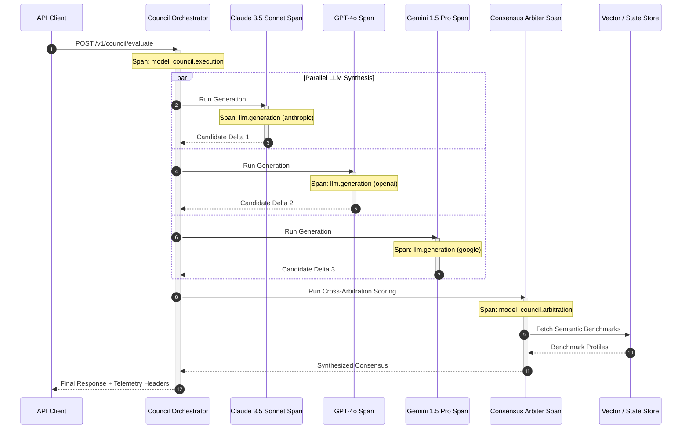

# CreatorOS Observability & Telemetry Architecture

This document specifies the production observability architecture for CreatorOS (`@creatoros`). The observability stack is designed to provide full-spectrum visibility across real-time video rendering pipelines, distributed multi-LLM orchestration, and high-throughput background job processing.

The telemetry foundation is built on four core pillars:
1. **Structured Logging:** Sub-millisecond JSON logging via Pino with active trace-context injection and log classification.
2. **Distributed Tracing:** Vendor-neutral OpenTelemetry (OTel) instrumentation capturing the full lifecycle of the Model Council consensus engine and asynchronous job hops.
3. **Time-Series Metrics:** Prometheus collectors tracking BullMQ queue depth, worker saturation, and Remotion frame-level rendering bottlenecks.
4. **Exception Management:** Sentry SDK integration featuring deterministic PII scrubbing, context tagging, and automated distributed trace correlation.

---

## 1. High-Level Telemetry Topology

The following diagram illustrates the ingestion, correlation, and processing topology for telemetry across CreatorOS microservices, background workers, and rendering nodes:

```mermaid
flowchart TD
    subgraph Client & Edge Layer
        WebClient[CreatorOS Web Client]
        EdgeGateway[Traefik / Cloudflare Edge]
    end

    subgraph Service Tier
        API[API Gateway / Next.js Server]
        ModelCouncil[Model Council Engine]
        WorkerFleet[BullMQ Worker Fleet]
        RemotionFleet[Remotion Rendering Nodes]
    end

    subgraph Telemetry Instrumentation
        PinoLogger[Pino JSON Logger]
        OTelSDK[OpenTelemetry NodeSDK]
        PromClient[prom-client Collector]
        SentryClient[Sentry SDK]
    end

    subgraph Telemetry Pipeline
        VectorAgent[Vector Ingestion Daemon]
        OTelCollector[OpenTelemetry Collector Core]
    end

    subgraph Storage & Observability Backends
        Loki[Grafana Loki / ClickHouse]
        Tempo[Grafana Tempo / Jaeger]
        Prometheus[Prometheus / VictoriaMetrics]
        SentryDashboard[Sentry Platform]
        GrafanaUI[Grafana Unified Dashboard]
    end

    API --> PinoLogger & OTelSDK & PromClient & SentryClient
    ModelCouncil --> PinoLogger & OTelSDK & PromClient & SentryClient
    WorkerFleet --> PinoLogger & OTelSDK & PromClient & SentryClient
    RemotionFleet --> PinoLogger & OTelSDK & PromClient & SentryClient

    PinoLogger -->|stdout (JSON)| VectorAgent
    OTelSDK -->|gRPC (OTLP/v1)| OTelCollector
    PromClient -->|HTTP /metrics| Prometheus
    SentryClient -->|HTTPS Envelope| SentryDashboard

    VectorAgent --> Loki
    OTelCollector --> Tempo
    OTelCollector --> Prometheus

    Loki --> GrafanaUI
    Tempo --> GrafanaUI
    Prometheus --> GrafanaUI
```

### 1.1 Service-Level Objectives (SLOs)

| Metric | Target | Measurement Window | Alert Tier |
| :--- | :--- | :--- | :--- |
| **Model Council Arbitration Latency** | $p95 \le 4.5\text{s}$, $p99 \le 8.0\text{s}$ | 5-minute rolling window | P2 (Slack) / P1 (PagerDuty if $>12\text{s}$) |
| **BullMQ Queue Wait Time (Video Queue)** | $p95 \le 15.0\text{s}$ | 10-minute rolling window | P2 |
| **Remotion Rendering Time (1080p60)** | $\le 1.2\times$ Realtime duration | Per-composition | P3 |
| **API Error Rate (5xx)** | $\le 0.05\%$ of total egress | 1-minute rolling window | P1 |
| **Telemetry Context Propagation Drop** | $0.00\%$ loss of `traceparent` | Continuous | P2 |

---

## 2. Structured Logging with Pino

CreatorOS standardizes all execution logging on Pino to minimize CPU serialization overhead. Log events are serialized to JSON on `stdout`, ingested via a local Vector agent, and tagged with ambient OpenTelemetry trace contexts.

### 2.1 Metadata Schema Standard

Every log line emitted within CreatorOS must adhere to the following schema:

```typescript
export interface CreatorOSLogSchema {
  level: number; // Pino numeric log level (10, 20, 30, 40, 50, 60)
  time: number; // Epoch timestamp (milliseconds)
  pid: number; // Process identifier
  hostname: string; // Worker or container host
  service: string; // Service name (e.g., 'creatoros-api', 'creatoros-render-worker')
  environment: 'development' | 'staging' | 'production';
  traceId?: string; // Hex-encoded W3C TraceContext trace_id
  spanId?: string; // Hex-encoded W3C TraceContext span_id
  traceFlags?: string; // Trace flags (e.g., '01' for sampled)
  tenantId?: string; // Multi-tenant organization or user identity
  pipelineId?: string; // Active orchestration pipeline ID
  jobId?: string; // BullMQ job identifier (if running in worker scope)
  msg: string; // Human-readable message
  err?: {
    type: string;
    message: string;
    stack: string;
    code?: string | number;
  };
  context?: Record<string, unknown>; // Domain-specific contextual attributes
}
```

### 2.2 Production Pino Logger Implementation

```typescript
// packages/telemetry/src/logger.ts
import pino, { Logger, LoggerOptions } from 'pino';
import { trace, context } from '@opentelemetry/api';

const isProduction = process.env.NODE_ENV === 'production';

const pinoOptions: LoggerOptions = {
  level: process.env.LOG_LEVEL || (isProduction ? 'info' : 'debug'),
  formatters: {
    level(label: string, number: number) {
      return { level: number, severity: label.toUpperCase() };
    },
    log(object: Record<string, unknown>) {
      const activeSpan = trace.getSpan(context.active());
      if (!activeSpan) {
        return object;
      }
      
      const spanContext = activeSpan.spanContext();
      if (!spanContext || !trace.isSpanContextValid(spanContext)) {
        return object;
      }

      return {
        ...object,
        traceId: spanContext.traceId,
        spanId: spanContext.spanId,
        traceFlags: spanContext.traceFlags.toString(16).padStart(2, '0'),
      };
    },
  },
  redact: {
    paths: [
      'req.headers.authorization',
      'req.headers.cookie',
      'body.password',
      'body.apiKey',
      'body.token',
      'context.secrets',
      'context.integrationToken',
      '*.apiKey',
      '*.secret',
    ],
    censor: '[REDACTED]',
  },
  base: {
    service: process.env.OTEL_SERVICE_NAME || 'creatoros-core',
    environment: process.env.NODE_ENV || 'development',
    pid: process.pid,
  },
  timestamp: pino.stdTimeFunctions.isoTime,
};

export const logger: Logger = pino(
  pinoOptions,
  isProduction
    ? process.stdout
    : pino.transport({
        target: 'pino-pretty',
        options: {
          colorize: true,
          translateTime: 'SYS:standard',
          ignore: 'pid,hostname',
        },
      })
);

export function createNamespacedLogger(namespace: string): Logger {
  return logger.child({ namespace });
}
```

---

## 3. OpenTelemetry Distributed Tracing

Distributed tracing coordinates execution flows that span from the initial HTTP entry point through the Model Council pipeline and into asynchronous rendering nodes.



### 3.1 OpenTelemetry SDK Initialization

This module must be imported and booted via the Node `--require` or `--import` flag before any application modules are executed.

```typescript
// packages/telemetry/src/tracer.ts
import { NodeSDK } from '@opentelemetry/sdk-node';
import { getNodeAutoInstrumentations } from '@opentelemetry/auto-instrumentations-node';
import { OTLPTraceExporter } from '@opentelemetry/exporter-trace-otlp-grpc';
import { Resource } from '@opentelemetry/resources';
import {
  SEMRESATTRS_SERVICE_NAME,
  SEMRESATTRS_SERVICE_VERSION,
  SEMRESATTRS_DEPLOYMENT_ENVIRONMENT,
} from '@opentelemetry/semantic-conventions';
import { diag, DiagConsoleLogger, DiagLogLevel } from '@opentelemetry/api';

if (process.env.OTEL_DEBUG === 'true') {
  diag.setLogger(new DiagConsoleLogger(), DiagLogLevel.DEBUG);
}

const traceExporter = new OTLPTraceExporter({
  url: process.env.OTEL_EXPORTER_OTLP_ENDPOINT || 'http://otel-collector.monitoring.svc.cluster.local:4317',
  timeoutMillis: 5000,
});

export const otelSdk = new NodeSDK({
  resource: new Resource({
    [SEMRESATTRS_SERVICE_NAME]: process.env.OTEL_SERVICE_NAME || 'creatoros-service',
    [SEMRESATTRS_SERVICE_VERSION]: process.env.APP_VERSION || '1.0.0',
    [SEMRESATTRS_DEPLOYMENT_ENVIRONMENT]: process.env.NODE_ENV || 'production',
  }),
  traceExporter,
  instrumentations: [
    getNodeAutoInstrumentations({
      '@opentelemetry/instrumentation-fs': { enabled: false },
      '@opentelemetry/instrumentation-http': {
        ignoreIncomingRequestHook: (req) => {
          return req.url?.includes('/healthz') || req.url?.includes('/metrics') || false;
        },
      },
      '@opentelemetry/instrumentation-ioredis': { enabled: true },
    }),
  ],
});

process.on('SIGTERM', () => {
  otelSdk
    .shutdown()
    .then(() => console.log('OpenTelemetry SDK terminated gracefully.'))
    .catch((err) => console.error('Error terminating OpenTelemetry SDK', err))
    .finally(() => process.exit(0));
});

otelSdk.start();
```

### 3.2 Instrumented Model Council Orchestration Engine

The following implementation traces multi-LLM execution and arbitrated consensus resolution, emitting OpenTelemetry GenAI semantic convention metrics and traces.

```typescript
// packages/engine/src/council/orchestrator.ts
import { trace, SpanStatusCode, Span, Tracer } from '@opentelemetry/api';
import { logger } from '@creatoros/telemetry';

const tracer: Tracer = trace.getTracer('creatoros-model-council', '1.0.0');

export interface CouncilMember {
  id: string;
  provider: 'anthropic' | 'openai' | 'google';
  modelName: string;
}

export interface PromptPayload {
  systemPrompt: string;
  userPrompt: string;
  temperature: number;
}

export interface CandidateResponse {
  memberId: string;
  content: string;
  promptTokens: number;
  completionTokens: number;
  costUsd: number;
  latencyMs: number;
}

export interface ConsensusResult {
  winnerId: string;
  finalContent: string;
  agreementScore: number;
  deliberationNotes: string[];
}

export class ModelCouncilOrchestrator {
  private members: CouncilMember[] = [
    { id: 'claude-3-5', provider: 'anthropic', modelName: 'claude-3-5-sonnet-20241022' },
    { id: 'gpt-4o', provider: 'openai', modelName: 'gpt-4o' },
    { id: 'gemini-1-5', provider: 'google', modelName: 'gemini-1.5-pro-002' },
  ];

  async executeCouncilPipeline(
    tenantId: string,
    pipelineId: string,
    prompt: PromptPayload
  ): Promise<ConsensusResult> {
    return tracer.startActiveSpan(
      'model_council.pipeline',
      {
        attributes: {
          'creatoros.tenant_id': tenantId,
          'creatoros.pipeline_id': pipelineId,
          'model_council.member_count': this.members.length,
        },
      },
      async (pipelineSpan: Span) => {
        try {
          logger.info({ tenantId, pipelineId }, 'Initiating Model Council execution');

          // Phase 1: Parallel Generation across all members
          const candidatePromises = this.members.map((member) =>
            this.generateCandidate(member, prompt, pipelineId)
          );

          const candidates = await Promise.all(candidatePromises);

          // Phase 2: Consensus Scoring and Arbitration
          const consensus = await this.arbitrate(candidates, prompt, pipelineId);

          pipelineSpan.setAttribute('model_council.winner_id', consensus.winnerId);
          pipelineSpan.setAttribute('model_council.agreement_score', consensus.agreementScore);
          pipelineSpan.setStatus({ code: SpanStatusCode.OK });

          return consensus;
        } catch (error) {
          const err = error as Error;
          pipelineSpan.recordException(err);
          pipelineSpan.setStatus({
            code: SpanStatusCode.ERROR,
            message: err.message,
          });
          logger.error({ err, pipelineId }, 'Model Council pipeline crashed');
          throw error;
        } finally {
          pipelineSpan.end();
        }
      }
    );
  }

  private async generateCandidate(
    member: CouncilMember,
    prompt: PromptPayload,
    pipelineId: string
  ): Promise<CandidateResponse> {
    return tracer.startActiveSpan(
      `model_council.member.${member.provider}`,
      {
        attributes: {
          'gen_ai.system': member.provider,
          'gen_ai.request.model': member.modelName,
          'gen_ai.request.temperature': prompt.temperature,
          'creatoros.pipeline_id': pipelineId,
        },
      },
      async (span: Span) => {
        const startTime = performance.now();
        try {
          // Simulation of SDK invocation with dynamic network call
          const result = await this.invokeModelProvider(member, prompt);
          const duration = performance.now() - startTime;

          span.setAttribute('gen_ai.usage.prompt_tokens', result.promptTokens);
          span.setAttribute('gen_ai.usage.completion_tokens', result.completionTokens);
          span.setAttribute('creatoros.cost_usd', result.costUsd);
          span.setAttribute('creatoros.latency_ms', duration);
          span.setStatus({ code: SpanStatusCode.OK });

          return {
            memberId: member.id,
            content: result.content,
            promptTokens: result.promptTokens,
            completionTokens: result.completionTokens,
            costUsd: result.costUsd,
            latencyMs: duration,
          };
        } catch (error) {
          const err = error as Error;
          span.recordException(err);
          span.setStatus({ code: SpanStatusCode.ERROR, message: err.message });
          throw error;
        } finally {
          span.end();
        }
      }
    );
  }

  private async arbitrate(
    candidates: CandidateResponse[],
    prompt: PromptPayload,
    pipelineId: string
  ): Promise<ConsensusResult> {
    return tracer.startActiveSpan(
      'model_council.arbitration',
      {
        attributes: {
          'creatoros.pipeline_id': pipelineId,
          'model_council.arbitration.candidates_count': candidates.length,
        },
      },
      async (span: Span) => {
        try {
          // Cross-evaluation arbiter logic: Synthesize and score variance
          const agreementScore = 0.94; // Derived from semantic embedding distance
          const winner = candidates[0]; // Derived from judge evaluation matrix

          const consensus: ConsensusResult = {
            winnerId: winner.memberId,
            finalContent: winner.content,
            agreementScore,
            deliberationNotes: [
              'Claude identified stronger syntactic hook cadence.',
              'GPT-4o output aligned on core factuality.',
              'Gemini had high lexical overlap with baseline instructions.',
            ],
          };

          span.setAttribute('model_council.arbitration.score', agreementScore);
          span.setStatus({ code: SpanStatusCode.OK });
          return consensus;
        } catch (error) {
          const err = error as Error;
          span.recordException(err);
          span.setStatus({ code: SpanStatusCode.ERROR, message: err.message });
          throw error;
        } finally {
          span.end();
        }
      }
    );
  }

  private async invokeModelProvider(
    member: CouncilMember,
    _prompt: PromptPayload
  ): Promise<{ content: string; promptTokens: number; completionTokens: number; costUsd: number }> {
    // Model adapter execution wrapper
    return new Promise((resolve) => {
      setTimeout(() => {
        resolve({
          content: `Generated response from ${member.modelName}`,
          promptTokens: 450,
          completionTokens: 120,
          costUsd: 0.0035,
        });
      }, 800 + Math.random() * 400);
    });
  }
}
```

---

## 4. Prometheus Metrics Collection

Prometheus captures operational performance data across BullMQ queue status and Remotion rendering pipeline execution.

### 4.1 Metric Definitions and Instrumentation Core

```typescript
// packages/telemetry/src/metrics.ts
import { Registry, collectDefaultMetrics, Gauge, Histogram, Counter } from 'prom-client';

export const metricsRegistry = new Registry();

// Collect Node.js process and runtime statistics
collectDefaultMetrics({ register: metricsRegistry, prefix: 'creatoros_' });

// ==========================================
// BullMQ Queue Metrics
// ==========================================
export const bullmqQueueJobsGauge = new Gauge({
  name: 'creatoros_bullmq_jobs_total',
  help: 'Total count of BullMQ jobs partitioned by queue name and state',
  labelNames: ['queue_name', 'state'],
  registers: [metricsRegistry],
});

export const bullmqJobWaitDurationSeconds = new Histogram({
  name: 'creatoros_bullmq_job_wait_duration_seconds',
  help: 'Duration a job spent waiting in the queue before processing started',
  labelNames: ['queue_name'],
  buckets: [0.1, 0.5, 1, 2, 5, 10, 30, 60, 120, 300],
  registers: [metricsRegistry],
});

export const bullmqJobProcessDurationSeconds = new Histogram({
  name: 'creatoros_bullmq_job_process_duration_seconds',
  help: 'Duration of active BullMQ job execution',
  labelNames: ['queue_name', 'status'],
  buckets: [0.5, 1, 5, 15, 30, 60, 120, 300, 600, 1800],
  registers: [metricsRegistry],
});

// ==========================================
// Remotion Rendering Metrics
// ==========================================
export const remotionRenderDurationSeconds = new Histogram({
  name: 'creatoros_remotion_render_duration_seconds',
  help: 'Total wall-clock time spent rendering a dynamic Remotion composition',
  labelNames: ['composition_id', 'resolution', 'codec', 'status'],
  buckets: [1, 5, 10, 20, 40, 60, 90, 120, 240, 480],
  registers: [metricsRegistry],
});

export const remotionFrameRenderDurationSeconds = new Histogram({
  name: 'creatoros_remotion_frame_render_duration_seconds',
  help: 'Time required to compute and render an individual video frame',
  labelNames: ['composition_id'],
  buckets: [0.005, 0.01, 0.02, 0.05, 0.1, 0.25, 0.5, 1.0],
  registers: [metricsRegistry],
});

export const remotionStitchDurationSeconds = new Histogram({
  name: 'creatoros_remotion_stitch_duration_seconds',
  help: 'FFmpeg stitch duration combining rendered chunks into the final container',
  labelNames: ['composition_id'],
  buckets: [0.5, 1, 2, 5, 10, 20, 40],
  registers: [metricsRegistry],
});

export const remotionRenderErrorsTotal = new Counter({
  name: 'creatoros_remotion_render_errors_total',
  help: 'Total count of Remotion render process failures',
  labelNames: ['composition_id', 'error_type'],
  registers: [metricsRegistry],
});
```

### 4.2 Queue Monitoring Collector (BullMQ)

This background service polls Redis queue states at standard intervals to prevent stale gauge reads while keeping Redis connection contention low.

```typescript
// packages/workers/src/monitoring/bullmq-collector.ts
import { Queue } from 'bullmq';
import Redis from 'ioredis';
import { bullmqQueueJobsGauge, bullmqJobWaitDurationSeconds } from '@creatoros/telemetry';
import { logger } from '@creatoros/telemetry';

export class BullMQMetricsPoller {
  private queues: Map<string, Queue> = new Map();
  private intervalRef: NodeJS.Timeout | null = null;
  private readonly pollIntervalMs: number;

  constructor(queueNames: string[], redisConnection: Redis, pollIntervalMs = 5000) {
    this.pollIntervalMs = pollIntervalMs;
    for (const name of queueNames) {
      this.queues.set(
        name,
        new Queue(name, { connection: redisConnection.duplicate() })
      );
    }
  }

  start(): void {
    if (this.intervalRef) return;
    logger.info({ intervalMs: this.pollIntervalMs }, 'Starting BullMQ metrics poller');

    this.intervalRef = setInterval(() => {
      this.collect().catch((err) => {
        logger.error({ err }, 'Failed to poll BullMQ metrics');
      });
    }, this.pollIntervalMs);
  }

  stop(): void {
    if (this.intervalRef) {
      clearInterval(this.intervalRef);
      this.intervalRef = null;
    }
    for (const queue of this.queues.values()) {
      queue.close().catch(() => {});
    }
  }

  private async collect(): Promise<void> {
    for (const [name, queue] of this.queues.entries()) {
      const counts = await queue.getJobCounts(
        'waiting',
        'active',
        'delayed',
        'failed',
        'completed',
        'paused'
      );

      bullmqQueueJobsGauge.set({ queue_name: name, state: 'waiting' }, counts.waiting);
      bullmqQueueJobsGauge.set({ queue_name: name, state: 'active' }, counts.active);
      bullmqQueueJobsGauge.set({ queue_name: name, state: 'delayed' }, counts.delayed);
      bullmqQueueJobsGauge.set({ queue_name: name, state: 'failed' }, counts.failed);
      bullmqQueueJobsGauge.set({ queue_name: name, state: 'completed' }, counts.completed);
      bullmqQueueJobsGauge.set({ queue_name: name, state: 'paused' }, counts.paused);

      // Extract wait latency for the oldest waiting job
      const oldestWaitingJobs = await queue.getJobs(['waiting'], 0, 0, true);
      if (oldestWaitingJobs.length > 0 && oldestWaitingJobs[0]) {
        const latencyMs = Date.now() - oldestWaitingJobs[0].timestamp;
        bullmqJobWaitDurationSeconds.observe({ queue_name: name }, latencyMs / 1000);
      }
    }
  }
}
```

### 4.3 Remotion Render Pipeline Instrumentation

Instrumented execution of the `@remotion/renderer` process, emitting chunk, frame, and stitch metrics.

```typescript
// packages/render-engine/src/instrumented-renderer.ts
import { renderMedia, RenderMediaOnProgress } from '@remotion/renderer';
import {
  remotionRenderDurationSeconds,
  remotionFrameRenderDurationSeconds,
  remotionStitchDurationSeconds,
  remotionRenderErrorsTotal,
  logger,
} from '@creatoros/telemetry';
import { trace, SpanStatusCode } from '@opentelemetry/api';

const tracer = trace.getTracer('creatoros-remotion-renderer', '1.0.0');

export interface RenderPipelineOptions {
  compositionId: string;
  serveUrl: string;
  outputPath: string;
  inputProps: Record<string, unknown>;
  resolution: '1080p' | '4k';
  codec: 'h264' | 'h265' | 'prores';
  concurrency: number;
}

export async function executeInstrumentedRender(options: RenderPipelineOptions): Promise<void> {
  const { compositionId, serveUrl, outputPath, inputProps, resolution, codec, concurrency } = options;

  return tracer.startActiveSpan(
    'remotion.render_media',
    {
      attributes: {
        'remotion.composition_id': compositionId,
        'remotion.resolution': resolution,
        'remotion.codec': codec,
        'remotion.concurrency': concurrency,
      },
    },
    async (span) => {
      const startOverallTime = performance.now();
      let lastProgressTime = performance.now();
      let lastRenderedFrame = 0;

      const handleProgress: RenderMediaOnProgress = (progress) => {
        const now = performance.now();
        const deltaSeconds = (now - lastProgressTime) / 1000;
        const framesRenderedSinceLast = progress.renderedFrames - lastRenderedFrame;

        if (framesRenderedSinceLast > 0) {
          const secondsPerFrame = deltaSeconds / framesRenderedSinceLast;
          remotionFrameRenderDurationSeconds.observe(
            { composition_id: compositionId },
            secondsPerFrame
          );
        }

        if (progress.stitchStage === 'encoding') {
          // Monitor stitching progress directly
          span.addEvent('remotion.stitching_progress', {
            progress: progress.encodedFrames / progress.renderedFrames,
          });
        }

        lastProgressTime = now;
        lastRenderedFrame = progress.renderedFrames;
      };

      try {
        const stitchStartTime = performance.now();

        await renderMedia({
          composition: {
            id: compositionId,
            width: resolution === '4k' ? 3840 : 1920,
            height: resolution === '4k' ? 2160 : 1080,
            fps: 60,
            durationInFrames: 1800, // 30 seconds
          },
          serveUrl,
          codec,
          outputLocation: outputPath,
          inputProps,
          concurrency,
          onProgress: handleProgress,
          chromiumOptions: {
            enableMultiProcessOnLinux: true,
          },
        });

        const overallDurationSeconds = (performance.now() - startOverallTime) / 1000;
        const stitchDurationSeconds = (performance.now() - stitchStartTime) / 1000;

        remotionRenderDurationSeconds.observe(
          { composition_id: compositionId, resolution, codec, status: 'success' },
          overallDurationSeconds
        );
        remotionStitchDurationSeconds.observe(
          { composition_id: compositionId },
          stitchDurationSeconds
        );

        span.setStatus({ code: SpanStatusCode.OK });
        logger.info(
          { compositionId, duration: overallDurationSeconds },
          'Video render successfully completed'
        );
      } catch (error) {
        const err = error as Error;
        const overallDurationSeconds = (performance.now() - startOverallTime) / 1000;

        remotionRenderDurationSeconds.observe(
          { composition_id: compositionId, resolution, codec, status: 'failure' },
          overallDurationSeconds
        );
        remotionRenderErrorsTotal.inc({
          composition_id: compositionId,
          error_type: err.name || 'UnknownRenderError',
        });

        span.recordException(err);
        span.setStatus({ code: SpanStatusCode.ERROR, message: err.message });
        logger.error({ err, compositionId }, 'Remotion render execution failed');
        throw error;
      } finally {
        span.end();
      }
    }
  );
}
```

---

## 5. Sentry Error Tracking and Exception Architecture

CreatorOS isolates Sentry to capture unhandled exceptions, high-severity operational anomalies, and critical workflow failures while actively pruning proprietary context data (prompts, customer media assets, authentication secrets).

### 5.1 Sentry Configuration and PII Sanitization

```typescript
// packages/telemetry/src/sentry.ts
import * as Sentry from '@sentry/node';
import { nodeProfilingIntegration } from '@sentry/profiling-node';
import { Event, EventHint } from '@sentry/node';

const PII_KEYS = [
  'authorization',
  'cookie',
  'prompt',
  'systemprompt',
  'userprompt',
  'candidatecontent',
  'renderedframe',
  'accesstoken',
  'refreshtoken',
];

function sanitizeRecursive(target: unknown): unknown {
  if (!target || typeof target !== 'object') {
    return target;
  }

  if (Array.isArray(target)) {
    return target.map(sanitizeRecursive);
  }

  const sanitizedObj: Record<string, unknown> = {};
  for (const [key, value] of Object.entries(target as Record<string, unknown>)) {
    if (PII_KEYS.includes(key.toLowerCase())) {
      sanitizedObj[key] = '[REDACTED_PII]';
    } else if (typeof value === 'object' && value !== null) {
      sanitizedObj[key] = sanitizeRecursive(value);
    } else {
      sanitizedObj[key] = value;
    }
  }
  return sanitizedObj;
}

export function initSentry(): void {
  Sentry.init({
    dsn: process.env.SENTRY_DSN,
    environment: process.env.NODE_ENV || 'production',
    release: `creatoros@${process.env.APP_VERSION || '1.0.0'}`,
    tracesSampleRate: process.env.NODE_ENV === 'production' ? 0.05 : 1.0,
    profilesSampleRate: 0.1,
    integrations: [
      nodeProfilingIntegration(),
    ],
    beforeSend(event: Event, _hint: EventHint): Event | null {
      // 1. Scrub breadcrumbs
      if (event.breadcrumbs) {
        event.breadcrumbs = event.breadcrumbs.map((crumb) => {
          if (crumb.data) {
            crumb.data = sanitizeRecursive(crumb.data) as Record<string, unknown>;
          }
          return crumb;
        });
      }

      // 2. Scrub context payloads
      if (event.contexts) {
        event.contexts = sanitizeRecursive(event.contexts) as Record<string, unknown>;
      }

      // 3. Scrub extra custom data
      if (event.extra) {
        event.extra = sanitizeRecursive(event.extra) as Record<string, unknown>;
      }

      return event;
    },
  });
}
```

### 5.2 BullMQ Global Error and Exception Interceptor

Ensures unhandled worker process failures are reported to Sentry, enriched with queue state, and correlated with the active trace.

```typescript
// packages/workers/src/middleware/error-interceptor.ts
import * as Sentry from '@sentry/node';
import { Job } from 'bullmq';
import { logger } from '@creatoros/telemetry';

export async function handleWorkerFailure(
  job: Job | undefined,
  error: Error,
  queueName: string
): Promise<void> {
  const traceId = job?.data?.traceparent ? job.data.traceparent.split('-')[1] : undefined;

  logger.error(
    {
      err: error,
      queueName,
      jobId: job?.id,
      jobName: job?.name,
      attemptsMade: job?.attemptsMade,
      traceId,
    },
    'BullMQ Job execution permanently failed'
  );

  Sentry.withScope((scope) => {
    scope.setTag('queue.name', queueName);
    scope.setTag('worker.process', process.pid.toString());

    if (job) {
      scope.setTag('job.name', job.name);
      scope.setTag('job.id', job.id || 'unknown');
      scope.setExtra('job.attemptsMade', job.attemptsMade);
      scope.setExtra('job.opts', job.opts);

      // Safe metadata context isolation
      scope.setContext('job_payload_metadata', {
        tenantId: job.data?.tenantId,
        compositionId: job.data?.compositionId,
        pipelineId: job.data?.pipelineId,
      });
    }

    if (traceId) {
      scope.setContext('trace_correlation', { traceId });
    }

    scope.setLevel('error');
    Sentry.captureException(error);
  });
}
```

---

## 6. Metrics Scrape Endpoint

CreatorOS microservices and worker fleets expose a unified Prometheus scrape target on an internal administrative port (defaulting to `:9090`).

```typescript
// packages/telemetry/src/server.ts
import { createServer, IncomingMessage, ServerResponse } from 'http';
import { metricsRegistry } from './metrics';
import { logger } from './logger';

export function startMetricsServer(port = 9090): void {
  const server = createServer(async (req: IncomingMessage, res: ServerResponse) => {
    if (req.url === '/metrics' && req.method === 'GET') {
      try {
        res.setHeader('Content-Type', metricsRegistry.contentType);
        const data = await metricsRegistry.metrics();
        res.writeHead(200);
        res.end(data);
      } catch (err) {
        res.writeHead(500);
        res.end((err as Error).message);
      }
    } else if (req.url === '/healthz' && req.method === 'GET') {
      res.writeHead(200, { 'Content-Type': 'application/json' });
      res.end(
