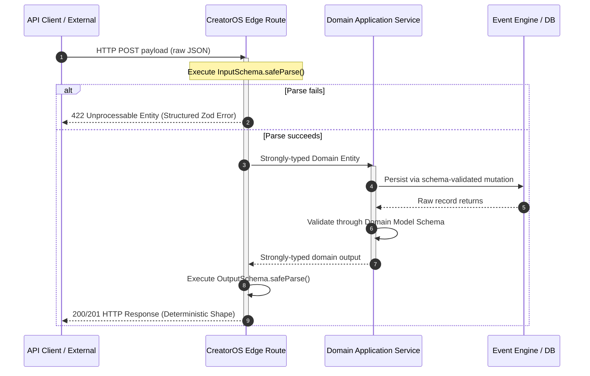
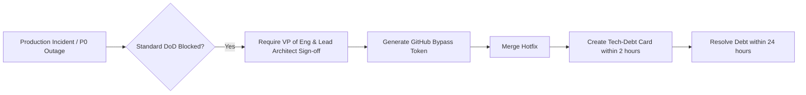

# CreatorOS Engineering Standards: Definition of Done (DoD)

```
Document ID:     COS-ENG-007
Status:          MANDATORY / CANONICAL
Classification:  Internal Technical Standard
Owner:           Architecture Review Board (@creatoros/core-arch)
Effective Date:  2025-01-15
Last Audit:      2025-02-10
```

---

## 1. Philosophy & Purpose

The CreatorOS platform operates under a zero-regression, contract-first engineering model. The Definition of Done (DoD) is an unyielding quality threshold applied to all pull requests, micro-frontends, core libraries, and distributed services across the CreatorOS monorepo.

A task, feature, or bugfix within CreatorOS is never marked as "Done" simply because code has been written and manually verified. A deliverable reaches completion **only** when it satisfies deterministic verification gates across five architectural dimensions:

```
[Type Determinism] ──> [Deterministic I/O] ──> [Hermetic Tests] ──> [Documentation] ──> [Build Verification]
  (Zero Warnings)        (Zod Contracts)       (>85% Core Cov)       (Specs & ADRs)        (Turborepo Cache)
```

No engineer—regardless of seniority or tenure—possesses the unilateral authority to bypass these criteria. Non-compliance results in automatic pull request rejection at the CI gate.

---

## 2. DoD Tiered Enforcement Matrix

Compliance is verified progressively through four concentric quality gates:

| Tier | Gate Point | Enforcement Mechanism | Failure Action | SLA / Overhead Target |
| :--- | :--- | :--- | :--- | :--- |
| **L1** | Local Pre-commit / Pre-push | Git hooks (Lefthook), Biome, `tsc` | Block commit or push locally | < 15 seconds |
| **L2** | Pull Request Pipeline | GitHub Actions Engine | Block merge; require approval reset | < 6 minutes |
| **L3** | Staging Promotion | Automated synthetic runs, e2e suite | Abort artifact deployment | < 15 minutes |
| **L4** | Production Observability | Canary checks, automated rollbacks | Rollback deployment, page on-call | Real-time (0–5 min) |

```mermaid
flowchart TD
    A[Local Development] -->|Git Commit| B(L1: Lefthook Hooks)
    B -->|Fast Lint + Fast Typecheck| C{Pass L1?}
    C -- No --> A
    C -- Yes -->|Git Push| D[PR Creation]
    D --> E(L2: Monorepo CI Matrix)
    E --> F[Turborepo Pipeline]
    F --> F1[tsc --noEmit: Zero Errors]
    F --> F2[Vitest: >85% Core Coverage]
    F --> F3[Contract Check: Zod at I/O]
    F --> F4[Hermetic Build & Package]
    F --> F5[Docs / OpenAPI / ADR Check]
    F1 & F2 & F3 & F4 & F5 --> G{Pass L2?}
    G -- No --> D
    G -- Yes --> H[Peer & Architectural Review]
    H --> I[Merge to main]
    I --> J(L3: Ephemeral Staging Deployment)
    J --> K(L4: Canary Validation)
```

---

## 3. Strict Criteria & Verification Checklist

To move an issue or feature to **Done**, every box in this checklist must be satisfied without deviation.

- [ ] **Type Determinism:** Complete monorepo compilation via `pnpm typecheck` (`tsc --noEmit`) with **zero errors and zero warnings**.
- [ ] **Type Soundness:** Zero usage of `any`. Explicit typing on all exported interfaces, methods, and schemas.
- [ ] **Universal Runtime Validation:** Every system boundary (HTTP input, HTTP response, server action, webhook, cross-service event payload, database deserialization) is protected by a dual-sided runtime schema implemented with `zod`.
- [ ] **Unit & Regression Testing:** Unit and domain tests run green via `pnpm test:run`. Code coverage meets or exceeds **85% line, function, and branch coverage** on core packages (`@creatoros/core`, `@creatoros/billing`, `@creatoros/auth`, `@creatoros/analytics`).
- [ ] **Deterministic Packaging:** Production artifacts build locally via `pnpm build` without workspace cache pollution, side effects, or circular dependency warnings.
- [ ] **Living Documentation:** API routes updated in OpenAPI definitions; internal packages documented via TSDoc; any structural changes paired with an accepted Architectural Decision Record (ADR).
- [ ] **Static Code Analysis:** Code passes all linting, formatting, and structural checks via Biome/ESLint with zero suppressions (`// biome-ignore` or `// eslint-disable`) unless explicitly counter-signed by a Staff Architect.

---

## 4. Architectural Deep Dive

### 4.1. TypeScript Compiler & Static Typing Integrity

The TypeScript compiler is configured in ultra-strict mode throughout the workspace. Compilation is treated as an immutable binary state: it either compiles completely, or it is broken.

#### Baseline `tsconfig.base.json` Compiler Settings
All child packages in `packages/*` and `apps/*` extend this configuration:

```json
{
  "$schema": "https://json.schemastore.org/tsconfig",
  "compilerOptions": {
    "target": "ES2022",
    "module": "NodeNext",
    "moduleResolution": "NodeNext",
    "lib": ["ES2022"],
    "strict": true,
    "noImplicitAny": true,
    "strictNullChecks": true,
    "strictFunctionTypes": true,
    "strictBindCallApply": true,
    "strictPropertyInitialization": true,
    "noImplicitThis": true,
    "alwaysStrict": true,
    "noUnusedLocals": true,
    "noUnusedParameters": true,
    "exactOptionalPropertyTypes": true,
    "noImplicitReturns": true,
    "noFallthroughCasesInSwitch": true,
    "noUncheckedIndexedAccess": true,
    "noImplicitOverride": true,
    "noPropertyAccessFromIndexSignature": true,
    "allowUnusedLabels": false,
    "allowUnreachableCode": false,
    "skipLibCheck": false,
    "declaration": true,
    "declarationMap": true,
    "sourceMap": true,
    "isolatedModules": true,
    "verbatimModuleSyntax": true
  }
}
```

#### Banned Type Patterns

```typescript
// VIOLATION: Never use 'any' under any circumstance.
export async function ingestEvent(data: any): Promise<any> { ... }

// VIOLATION: Never use untyped Record without specific index keys
export const context: Record<string, any> = {};

// VIOLATION: Type assertion casting to bypass compiler analysis
const user = fetchUser() as User;

// COMPLIANT: Schema-driven inference with strong unknown containment
import { z } from 'zod';

export async function ingestEvent<TOutput>(
  rawPayload: unknown,
  parser: z.ZodType<TOutput>
): Promise<TOutput> {
  return parser.parse(rawPayload);
}
```

---

### 4.2. Universal Input/Output Zod Validation

Every entry and exit point across the system must be governed by dynamic schema validation. If an untyped boundary exists, the feature is not Done.



#### Production Reference Pattern: API Route Schema Guard

```typescript
// packages/core/src/schemas/creator-payout.schema.ts
import { z } from 'zod';

export const CurrencyCodeSchema = z.enum(['USD', 'EUR', 'GBP', 'CAD']);

export const MicroAmountSchema = z
  .bigint()
  .positive({ message: "Payout amount must be greater than zero." });

export const CreatorPayoutRequestSchema = z.object({
  creatorId: z.string().uuid({ message: "creatorId must be a valid RFC 4122 UUID." }),
  amountInMicros: MicroAmountSchema,
  currency: CurrencyCodeSchema,
  idempotencyKey: z.string().min(16).max(128),
  metadata: z.record(z.string(), z.string()).optional(),
}).strict(); // Enforce strict mode to prevent prototype pollution or unrecognized payload injection

export const CreatorPayoutResponseSchema = z.object({
  transactionId: z.string().uuid(),
  creatorId: z.string().uuid(),
  amountInMicros: MicroAmountSchema,
  currency: CurrencyCodeSchema,
  status: z.enum(['QUEUED', 'PROCESSED', 'FAILED']),
  createdAt: z.string().datetime(),
}).strict();

export type CreatorPayoutRequest = z.infer<typeof CreatorPayoutRequestSchema>;
export type CreatorPayoutResponse = z.infer<typeof CreatorPayoutResponseSchema>;
```

#### HTTP Endpoint Implementation

```typescript
// apps/api/src/routes/payouts.ts
import { Request, Response } from 'express';
import { 
  CreatorPayoutRequestSchema, 
  CreatorPayoutResponseSchema 
} from '@creatoros/core/schemas/creator-payout.schema';
import { PayoutDomainService } from '../services/payout.service';

export async function handlePayoutRequest(req: Request, res: Response): Promise<void> {
  // 1. Inbound validation
  const inputResult = CreatorPayoutRequestSchema.safeParse(req.body);
  if (!inputResult.success) {
    res.status(422).json({
      error: 'UNPROCESSABLE_ENTITY',
      issues: inputResult.error.flatten(),
    });
    return;
  }

  // 2. Business Execution
  const service = new PayoutDomainService();
  const domainResult = await service.execute(inputResult.data);

  // 3. Outbound validation
  const outputResult = CreatorPayoutResponseSchema.safeParse(domainResult);
  if (!outputResult.success) {
    // Log fatal schema deviation internally, never leak internal trace to consumer
    console.error('Fatal: Outbound payload violated contract', outputResult.error);
    res.status(500).json({
      error: 'INTERNAL_SERVER_ERROR',
      message: 'Contract deviation detected in outbound response.',
    });
    return;
  }

  res.status(201).json(outputResult.data);
}
```

---

### 4.3. Unit Testing Standards & Coverage Floors

Features are tested through behavioral specifications, boundary analysis, and property-based verification. Coverage is strictly enforced at continuous integration:

| Package Scope | Target Lines | Target Branches | Target Functions |
| :--- | :--- | :--- | :--- |
| Core Domain (`packages/core`) | **≥ 90%** | **≥ 85%** | **≥ 90%** |
| Billing & Ledgers (`packages/billing`) | **100%** | **100%** | **100%** |
| Infrastructure Clients (`packages/infra`) | **≥ 85%** | **≥ 80%** | **≥ 85%** |
| Edge Apps & UI Composables (`apps/*`) | **≥ 80%** | **≥ 75%** | **≥ 80%** |

#### Vitest Enforced Configuration
Vitest enforces this via configuration in `vitest.config.ts`:

```typescript
// vitest.config.ts
import { defineConfig } from 'vitest/config';

export default defineConfig({
  test: {
    globals: true,
    environment: 'node',
    coverage: {
      provider: 'v8',
      reporter: ['text', 'json', 'html', 'lcov'],
      exclude: [
        '**/node_modules/**',
        '**/dist/**',
        '**/*.d.ts',
        '**/test/**',
        '**/__mocks__/**',
      ],
      thresholds: {
        lines: 85,
        functions: 85,
        branches: 85,
        statements: 85,
      },
    },
  },
});
```

#### Production Reference Pattern: Comprehensive Vitest Suite

```typescript
// packages/core/src/domain/payout-calculator.spec.ts
import { describe, it, expect } from 'vitest';
import { calculateCreatorCut } from './payout-calculator';

describe('PayoutCalculator Domain Service', () => {
  it('correctly calculates default standard platform take-rate (10%)', () => {
    const grossMicros = 100_000_000n; // $100.00
    const takeRateBps = 1000n;        // 10% (1000 basis points)

    const result = calculateCreatorCut({ grossMicros, takeRateBps });

    expect(result.creatorShareMicros).toBe(90_000_000n);
    expect(result.platformFeeMicros).toBe(10_000_000n);
  });

  it('rejects values that cause integer overflow or invalid basis points', () => {
    const grossMicros = 100_000_000n;
    const excessiveBps = 10_001n; // > 100%

    expect(() => {
      calculateCreatorCut({ grossMicros, takeRateBps: excessiveBps });
    }).toThrowError('Basis points cannot exceed 10000 (100%).');
  });

  it('preserves precision without float rounding errors at minimum unit values', () => {
    const grossMicros = 1n; // 1 micro-cent
    const takeRateBps = 1500n; // 15%

    // (1 * 1500) / 10000 = 0 (integer division floor)
    const result = calculateCreatorCut({ grossMicros, takeRateBps });

    expect(result.platformFeeMicros).toBe(0n);
    expect(result.creatorShareMicros).toBe(1n);
  });
});
```

---

### 4.4. Hermetic Local Build & Workspace Pipeline

The workspace uses [Turborepo](https://turbo.build/repo) and `pnpm`. Local and CI executions must be fully deterministic and reproducible.

#### Pipeline Configuration (`turbo.json`)
Every task must specify its input surfaces and cached outputs to eliminate phantom local passes caused by uncommitted files or unstaged changes.

```json
{
  "$schema": "https://turbo.build/schema.json",
  "globalDependencies": [".env.example", "tsconfig.base.json"],
  "tasks": {
    "typecheck": {
      "dependsOn": ["^typecheck"],
      "outputs": ["dist/**", ".turbo/**"],
      "inputs": ["src/**/*.ts", "src/**/*.tsx", "tsconfig.json"]
    },
    "test:run": {
      "dependsOn": ["typecheck"],
      "outputs": ["coverage/**"],
      "inputs": ["src/**/*.ts", "src/**/*.tsx", "vitest.config.ts"]
    },
    "lint": {
      "outputs": []
    },
    "build": {
      "dependsOn": ["^build"],
      "outputs": ["dist/**", ".next/**", "public/dist/**"],
      "inputs": ["src/**", "package.json", "tsconfig.json"]
    }
  }
}
```

---

### 4.5. Documentation Parity Requirements

Code without documentation is considered incomplete. The PR must deliver updates to:

1. **TSDoc Coverage:** All newly exposed modules, interfaces, and function exports must carry clear TSDoc comments explaining parameters, thrown errors, and algorithmic complexity:
    ```typescript
    /**
     * Reconciles external ledger balances against internal creator double-entry journal.
     *
     * @param accountId - RFC 4122 UUID representing the ledger account.
     * @param transactionWindow - The chronological period over which ledger balances are integrated.
     * @returns A validated `ReconciliationReport` verifying zero fractional balance divergence.
     * @throws {LedgerAccountNotFoundException} When the supplied account ID does not map to a ledger node.
     * @throws {LedgerDriftDetectedException} When debit/credit parity fails consistency invariants.
     */
    export async function reconcileAccount(
      accountId: string,
      transactionWindow: LedgerWindow
    ): Promise<ReconciliationReport> { ... }
    ```
2. **OpenAPI Definitions:** If an API endpoint is introduced or altered, the typed definitions under `docs/api/v1/openapi.yaml` must pass the validation sweep:
    ```bash
    pnpm exec redocly lint docs/api/v1/openapi.yaml
    ```
3. **Architectural Decision Records (ADR):** If a feature alters database topologies, caching invalidation schemes, cross-service schemas, or external critical vendors, an ADR must be submitted under `docs/architecture/adr/ADR-XXXX.md` following the [Nygard format](https://cognitect.com/blog/2011/11/15/documenting-architecture-decisions).

---

## 5. Local Pre-Flight Verification Script

Engineers must run and complete this verification runbook sequentially before submitting any PR for review.

```bash
#!/usr/bin/env bash
# scripts/verify-local-dod.sh
# CreatorOS Definition of Done Pre-Flight Script
set -euo pipefail

echo "=========================================="
echo " Starting CreatorOS Local DoD Verification "
echo "=========================================="

echo "[1/5] Code Style and Lint Verification..."
pnpm biome check .

echo "[2/5] Static Typecheck (tsc --noEmit)..."
pnpm turbo run typecheck

echo "[3/5] Unit Testing & Threshold Validation..."
pnpm turbo run test:run -- --coverage

echo "[4/5] Hermetic Build Execution..."
pnpm turbo run build

echo "[5/5] Checking OpenAPI Schema Consistency..."
pnpm redocly lint docs/api/v1/openapi.yaml

echo "=========================================="
echo "  All Quality Gates Passed Deterministically "
echo "=========================================="
```

---

## 6. Continuous Integration Gate Configuration

The verification script is mirrored in our GitHub Actions pipeline (`.github/workflows/definition-of-done.yml`). A pull request cannot be merged if any of these jobs fail.

```yaml
name: CI Engine - Definition of Done

on:
  pull_request:
    branches: [main, release/*]
    types: [opened, synchronize, reopened]

concurrency:
  group: ${{ github.workflow }}-${{ github.ref }}
  cancel-in-progress: true

jobs:
  static-typing:
    name: Type Integrity (tsc)
    runs-on: ubuntu-latest
    steps:
      - uses: actions/checkout@v4
      - uses: pnpm/action-setup@v3
        with:
          version: 9.1.0
      - uses: actions/setup-node@v4
        with:
          node-version: 22
          cache: 'pnpm'
      - name: Install Dependencies
        run: pnpm install --frozen-lockfile
      - name: Turborepo Typecheck Gate
        run: pnpm turbo run typecheck

  test-and-coverage:
    name: Vitest Core Coverage Gate
    runs-on: ubuntu-latest
    steps:
      - uses: actions/checkout@v4
      - uses: pnpm/action-setup@v3
        with:
          version: 9.1.0
      - uses: actions/setup-node@v4
        with:
          node-version: 22
          cache: 'pnpm'
      - name: Install Dependencies
        run: pnpm install --frozen-lockfile
      - name: Execute Tests with Coverage
        run: pnpm turbo run test:run -- --coverage
      - name: Validate Core Coverage Floors
        run: |
          pnpm exec nyc check-coverage \
            --lines 85 \
            --functions 85 \
            --branches 85 \
            --per-file packages/core/coverage/coverage-final.json

  hermetic-build:
    name: Build & Artifact Validation
    runs-on: ubuntu-latest
    steps:
      - uses: actions/checkout@v4
      - uses: pnpm/action-setup@v3
        with:
          version: 9.1.0
      - uses: actions/setup-node@v4
        with:
          node-version: 22
          cache: 'pnpm'
      - name: Install Dependencies
        run: pnpm install --frozen-lockfile
      - name: Production Build
        run: pnpm turbo run build

  docs-and-contracts:
    name: Documentation & OpenAPI Parity
    runs-on: ubuntu-latest
    steps:
      - uses: actions/checkout@v4
      - uses: pnpm/action-setup@v3
        with:
          version: 9.1.0
      - uses: actions/setup-node@v4
        with:
          node-version: 22
          cache: 'pnpm'
      - name: Install Dependencies
        run: pnpm install --frozen-lockfile
      - name: Redocly OpenAPI Lint
        run: pnpm exec redocly lint docs/api/v1/openapi.yaml
```

---

## 7. Exception Handling & Break-Glass Protocols

Bypassing these rules is rare and strictly regulated.



1. **Qualification for Bypass:**
   A bypass can only be requested for **P0 live production outages** where mitigating the incident requires an emergency hotfix.
2. **Approval Threshold:**
   A bypass requires cryptographically verifiable approval from both the **VP of Engineering** and the **Staff Systems Architect** on the pull request.
3. **Remediation SLA:**
   An emergency merge without full DoD compliance automatically creates a tracking ticket labeled `debt:architectural-exception` with a **24-hour SLA**. If the tests, type checks, and documentation are not backfilled within 24 hours, the `main` branch deployment freezes for all non-hotfix pull requests until resolution.
