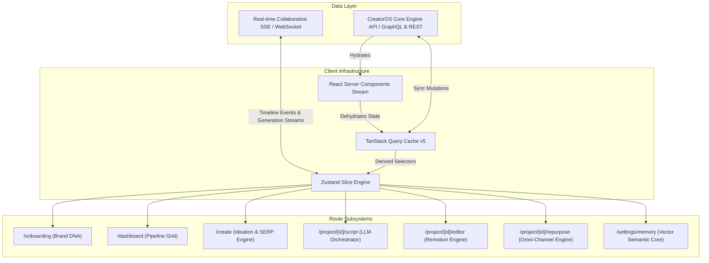

# CreatorOS Frontend Architecture: Screens & Routes Specification

This document provides the exhaustive architectural and functional specifications for the core application routes within CreatorOS. The frontend is built on the Next.js App Router (v14.2+) utilizing React Server Components (RSC), TanStack Query v5 for server-state synchronization, Zustand for local/ephemeral client state, and Radix UI primitives with Tailwind CSS.

---

## 1. Application Routing Architecture & Layout Matrix

### 1.1 App Router Directory Layout

```
apps/web/src/app/
├── (auth)/
│   └── onboarding/
│       ├── layout.tsx
│       └── page.tsx
├── (workspace)/
│   ├── layout.tsx
│   ├── dashboard/
│   │   ├── loading.tsx
│   │   └── page.tsx
│   ├── create/
│   │   ├── loading.tsx
│   │   └── page.tsx
│   ├── project/
│   │   └── [id]/
│   │       ├── layout.tsx
│   │       ├── script/
│   │       │   ├── loading.tsx
│   │       │   └── page.tsx
│   │       ├── editor/
│   │       │   ├── loading.tsx
│   │       │   └── page.tsx
│   │       └── repurpose/
│   │           ├── loading.tsx
│   │           └── page.tsx
│   └── settings/
│       └── memory/
│           ├── loading.tsx
│           └── page.tsx
├── api/
│   └── ...
├── layout.tsx
└── providers.tsx
```

### 1.2 Layout & Guard Matrix

| Route Path | Layout Group | Auth Guard Level | Hydration Strategy | Key Local State Slices |
| :--- | :--- | :--- | :--- | :--- |
| `/onboarding` | `(auth)` | Authenticated (No Brand Profile) | Client-driven multi-step wizard | `useOnboardingStore` |
| `/dashboard` | `(workspace)` | Authenticated + Active Org | RSC Streamed + TanStack prefetch | `useDashboardFilterStore` |
| `/create` | `(workspace)` | Authenticated + Active Org | Dynamic Client Components | `useIdeaGenerationStore` |
| `/project/[id]/script` | `(workspace)` | Project Read/Write RBAC | RSC Frame + Query Hydration | `useScriptEditorStore` |
| `/project/[id]/editor` | `(workspace)` | Project Read/Write RBAC | Client-Side SPA (Remotion Core) | `useTimelineStore`, `usePlayerStore` |
| `/project/[id]/repurpose` | `(workspace)` | Project Read/Write RBAC | Hydrated Query Dehydration | `useRepurposeStore` |
| `/settings/memory` | `(workspace)` | Org Admin / Owner | Hybrid RSC + Optimistic Query | `useMemoryStore` |

### 1.3 State Management & Data Flow Architecture



---

## 2. Route Specification: `/onboarding`

### 2.1 Screen Architecture & Intent
The Onboarding Wizard captures the creator’s foundational Brand DNA. It establishes linguistic preferences, content archetypes, production targets, and executes the initial semantic ingest required by the Creator Memory Core.

```
+-------------------------------------------------------------------------+
| CreatorOS Brand Wizard                        Step [ 2 / 5 ]: Archetype |
+-------------------------------------------------------------------------+
|                                                                         |
|   Select Your Primary Creator Archetype                                 |
|   This primes our multi-model pipelines to match your intrinsic style.  |
|                                                                         |
|   +-------------------+  +-------------------+  +-------------------+   |
|   | [X] The Contrarian|  | [ ] The Researcher|  | [ ] The Storyteller|  |
|   | Challenges status |  | High-density, data|  | Narrative-first,  |   |
|   | quo with friction |  | driven breakdowns |  | emotion-led arc   |   |
|   +-------------------+  +-------------------+  +-------------------+   |
|                                                                         |
|   Style Anchors (Select top 3):                                         |
|   [ Direct ] [ Analytical ] [ Provocative ] [ Cynical ] [ Academic ]    |
|                                                                         |
|   Sample Voice Injection (Optional text or YouTube/Audio link):         |
|   +-----------------------------------------------------------------+   |
|   | Paste 300+ words of prior writing, or enter channel URL...      |   |
|   +-----------------------------------------------------------------+   |
|                                                                         |
|   [ Back ]                                              [ Continue -> ] |
+-------------------------------------------------------------------------+
```

### 2.2 Component Hierarchy
```
apps/web/src/app/(auth)/onboarding/page.tsx
├── OnboardingProgressHeader
└── WizardStepContainer (AnimatePresence)
    ├── Step1Identity (Name, Handle, Primary Platform)
    ├── Step2Archetype (Archetype Matrix, Style Anchors)
    ├── Step3VoiceIngest (Raw Text Corpus, Scraping Hook, File Dropzone)
    ├── Step4DistributionTargets (Aspect Ratios, Publishing Channels)
    └── Step5VectorizationSummary (Live Progress of Initial Semantic Parse)
```

### 2.3 TypeScript Interfaces & Data Contracts

```typescript
export type CreatorArchetype = 
  | 'CONTRARIAN' 
  | 'RESEARCHER' 
  | 'STORYTELLER' 
  | 'TACTICIAN' 
  | 'ENTERTAINER';

export type StyleAnchor = 
  | 'direct' 
  | 'provocative' 
  | 'analytical' 
  | 'cynical' 
  | 'academic' 
  | 'empathetic' 
  | 'hyperbolic';

export interface BrandDnaPayload {
  organizationName: string;
  creatorHandle: string;
  primaryArchetype: CreatorArchetype;
  secondaryArchetypes: CreatorArchetype[];
  styleAnchors: StyleAnchor[];
  rawCorpusSamples: string[];
  ingestUrls: string[];
  targetPlatforms: Array<'TIKTOK' | 'YOUTUBE_SHORTS' | 'X_THREADS' | 'LINKEDIN' | 'SUBSTACK'>;
  forbiddenTerms: string[];
}

export interface OnboardingState {
  currentStep: number;
  payload: Partial<BrandDnaPayload>;
  isVectorizing: boolean;
  vectorizationProgress: number;
  setStep: (step: number) => void;
  updatePayload: (data: Partial<BrandDnaPayload>) => void;
  submitOnboarding: () => Promise<{ success: boolean; organizationId: string }>;
}
```

### 2.4 State Implementation & Data Fetching

```typescript
// apps/web/src/features/onboarding/store/useOnboardingStore.ts
import { create } from 'zustand';
import { persist, createJSONStorage } from 'zustand/middleware';
import { OnboardingState, BrandDnaPayload } from '../types';

export const useOnboardingStore = create<OnboardingState>()(
  persist(
    (set, get) => ({
      currentStep: 1,
      payload: {
        styleAnchors: [],
        rawCorpusSamples: [],
        ingestUrls: [],
        targetPlatforms: ['TIKTOK', 'YOUTUBE_SHORTS'],
        forbiddenTerms: [],
      },
      isVectorizing: false,
      vectorizationProgress: 0,
      setStep: (step) => set({ currentStep: step }),
      updatePayload: (data) =>
        set((state) => ({ payload: { ...state.payload, ...data } })),
      submitOnboarding: async () => {
        set({ isVectorizing: true, vectorizationProgress: 10 });
        const res = await fetch('/api/v1/onboarding/brand-dna', {
          method: 'POST',
          headers: { 'Content-Type': 'application/json' },
          body: JSON.stringify(get().payload),
        });
        
        if (!res.ok) throw new Error('Failed to vectorize Brand DNA');
        
        const data = await res.json();
        set({ vectorizationProgress: 100, isVectorizing: false });
        return data;
      },
    }),
    {
      name: 'creatoros-onboarding-cache',
      storage: createJSONStorage(() => sessionStorage),
    }
  )
);
```

---

## 3. Route Specification: `/dashboard`

### 3.1 Screen Architecture & Intent
The dashboard serves as the command center for multi-platform content pipelines. It visualizes asset progression through status swimlanes, surfaces generation metrics, and hosts global orchestration controls.

```
+----------------------------------------------------------------------------------------------------+
| CreatorOS Workspace: [ Default Org v ]                  [ Global Search (Cmd+K) ]  [(+) New Project]|
+----------------------------------------------------------------------------------------------------+
| PIPELINE METRICS                                                                                   |
| [ In Production: 8 ]   [ Rendering: 2 ]   [ Scheduled: 14 ]   [ Weekly Velocity: +28% ]            |
+----------------------------------------------------------------------------------------------------+
| Content Pipeline                                              [Filter: All] [Sort: Updated Date v] |
|                                                                                                    |
| [DRAFTING / IDEATION]   [SCRIPT REVIEW]         [TIMELINE EDITOR]       [READY TO EXPORT]          |
| +---------------------+ +---------------------+ +---------------------+ +------------------------+|
| | The GPU Squeeze     | | Stop Using Docker   | | Rust vs Zig Engine  | | Why Clean Code Fails   ||
| | 3 Angles Found      | | Model: Claude 3.5   | | Remotion: 82% ready | | Formats: 9 Generated   ||
| | Updated 2h ago      | | Updated 45m ago     | | Updated 10m ago     | | Updated 4h ago         ||
| +---------------------+ +---------------------+ +---------------------+ +------------------------+|
| +---------------------+ +---------------------+                                                    |
| | Micro-SaaS Playbook | | VectorDB Latency    |                                                    |
| | 5 Angles Found      | | Model: GPT-4o       |                                                    |
| +---------------------+ +---------------------+                                                    |
+----------------------------------------------------------------------------------------------------+
```

### 3.2 Component Hierarchy
```
apps/web/src/app/(workspace)/dashboard/page.tsx
├── DashboardMetricStrip
│   └── MetricCard (Velocity, Active Jobs, GPU Compute Usage)
├── DashboardFilterToolbar
│   ├── PlatformFilterDropdown
│   ├── SearchInput
│   └── ViewModeToggle (Kanban | Table View)
└── PipelineStageContainer
    ├── KanbanBoard
    │   ├── KanbanColumn (Drafting)
    │   ├── KanbanColumn (Scripting)
    │   ├── KanbanColumn (Editor)
    │   └── KanbanColumn (Complete)
    │       └── ProjectCard
    │           ├── PlatformBadgeGroup
    │           ├── ProjectProgressIndicator
    │           └── ProjectContextMenu
    └── ProjectTableView (Alternative virtualized table using @tanstack/react-table)
```

### 3.3 TypeScript Interfaces

```typescript
export type ProjectStage = 'DRAFT' | 'SCRIPTING' | 'EDITING' | 'REPURPOSING' | 'COMPLETED';

export interface ProjectSummary {
  id: string;
  title: string;
  slug: string;
  currentStage: ProjectStage;
  primaryTarget: 'TIKTOK' | 'YOUTUBE_SHORTS' | 'X_THREADS' | 'LINKEDIN';
  targetDurationSeconds: number;
  modelsUsed: string[];
  thumbnailUrl?: string;
  renderProgressPercentage: number;
  createdAt: string;
  updatedAt: string;
  creatorId: string;
}

export interface PipelineStats {
  inProductionCount: number;
  renderingCount: number;
  scheduledCount: number;
  weeklyVelocityDelta: number;
  gpuMinutesConsumedThisBillingPeriod: number;
}
```

### 3.4 Data Fetching & Server Components Pattern

```typescript
// apps/web/src/app/(workspace)/dashboard/page.tsx
import { Suspense } from 'react';
import { dehydrate, HydrationBoundary } from '@tanstack/react-query';
import { getQueryClient } from '@/shared/lib/get-query-client';
import { dashboardQueryOptions } from '@/features/dashboard/queries';
import { DashboardView } from '@/features/dashboard/components/DashboardView';
import { DashboardSkeleton } from '@/features/dashboard/components/DashboardSkeleton';

export default async function DashboardPage() {
  const queryClient = getQueryClient();

  // Prefetch pipeline graph and workspace metrics server-side
  await Promise.all([
    queryClient.prefetchQuery(dashboardQueryOptions.projects()),
    queryClient.prefetchQuery(dashboardQueryOptions.stats()),
  ]);

  return (
    <HydrationBoundary state={dehydrate(queryClient)}>
      <div className="flex flex-col h-full w-full p-8 gap-6 overflow-hidden">
        <Suspense fallback={<DashboardSkeleton />}>
          <DashboardView />
        </Suspense>
      </div>
    </HydrationBoundary>
  );
}
```

---

## 4. Route Specification: `/create`

### 4.1 Screen Architecture & Intent
The Ideation & Angle Selector route parses unformatted user prompts, scrapes SERP/trend context, executes real-time semantic analysis against past content, and computes distinct framing angles (e.g., Contrarian, Case-Study, Cynical Breakdown).

```
+----------------------------------------------------------------------------------------------------+
| Ideation Engine                                                                                    |
+----------------------------------------------------------------------------------------------------+
| ENTER TOPIC, ARTICLE URL, OR RAW THOUGHT                                                           |
| +------------------------------------------------------------------------------------------------+ |
| | The modern enterprise software sales cycle is dead because engineering teams hold the budget.  | |
| +------------------------------------------------------------------------------------------------+ |
| [x] Live Context Augmentation (Perplexity SERP Engine)    Brand Consistency Enforcement: [Strict v]|
|                                                                                                    |
| [ Generate Angle Matrix (Cmd + Enter) ]                                                            |
|                                                                                                    |
| GENERATED ANGLES (5 Variants Produced)                                                             |
| +------------------------------------------------------------------------------------------------+ |
| | [Angle 1: Contrarian Disruption] Hook Score: 94/100                       Select & Build Script | |
| | Hook: "Your VP of Sales is lying to you: Developers killed enterprise SaaS deals in 2024."    | |
| | Target Emotion: Paranoia / Urgency | Est. Retention: High | Competitive Density: Low          | |
| +------------------------------------------------------------------------------------------------+ |
| | [Angle 2: Data-Driven Postmortem] Hook Score: 88/100                      Select & Build Script | |
| | Hook: "We parsed 1,400 failed enterprise seed pitches. Only one common metric mattered."       | |
| | Target Emotion: Intellectual Validation | Est. Retention: Medium | Competitive Density: High   | |
| +------------------------------------------------------------------------------------------------+ |
+----------------------------------------------------------------------------------------------------+
```

### 4.2 Component Hierarchy
```
apps/web/src/app/(workspace)/create/page.tsx
├── CreateHeader
└── IdeationWorkspace
    ├── PromptEngineSection
    │   ├── ContextInputArea (Custom auto-expanding textarea)
    │   ├── TrendSourceSelector (SERP, HackerNews, X Trends, YouTube)
    │   └── MemoryBiasSlider (Balancing between past viral content vs. new angles)
    ├── AngleGenerationFeed
    │   ├── AngleCardSkeletonLoader
    │   └── AngleVariantCard
    │       ├── HookScoreBadge (Radial progress with score telemetry)
    │       ├── AngleMetricsBreakdown (Retention prediction, controversy index)
    │       ├── SupportingEvidenceAccordion
    │       └── TransitionToScriptButton
```

### 4.3 TypeScript Interfaces

```typescript
export interface AngleVariant {
  id: string;
  name: string;
  archetypeMatch: string;
  hook: string;
  premise: string;
  targetEmotion: 'urgency' | 'paranoia' | 'curiosity' | 'schadenfreude' | 'awe';
  hookScore: number;
  retentionPrediction: 'LOW' | 'MEDIUM' | 'HIGH';
  evidencePoints: string[];
  suggestedDurationSeconds: number;
}

export interface IdeationPayload {
  rawIdea: string;
  useLiveWebContext: boolean;
  selectedSources: Array<'google_serp' | 'reddit' | 'hacker_news' | 'x_pulse'>;
  memoryStrictness: number; // 0.0 to 1.0
}
```

### 4.4 Data Fetching & Stream Parsing Implementation

```typescript
// apps/web/src/features/create/hooks/useAngleGeneration.ts
import { useState } from 'react';
import { useMutation } from '@tanstack/react-query';
import { AngleVariant, IdeationPayload } from '../types';

export function useAngleGeneration() {
  const [angles, setAngles] = useState<AngleVariant[]>([]);
  const [isStreaming, setIsStreaming] = useState(false);

  const mutation = useMutation({
    mutationFn: async (payload: IdeationPayload) => {
      setAngles([]);
      setIsStreaming(true);

      const response = await fetch('/api/v1/ideation/generate-angles', {
        method: 'POST',
        headers: { 'Content-Type': 'application/json' },
        body: JSON.stringify(payload),
      });

      if (!response.body) throw new Error('ReadableStream not supported.');

      const reader = response.body.getReader();
      const decoder = new TextDecoder();
      let buffer = '';

      while (true) {
        const { value, done } = await reader.read();
        if (done) break;
        
        buffer += decoder.decode(value, { stream: true });
        const lines = buffer.split('\n\n');
        buffer = lines.pop() ?? '';

        for (const line of lines) {
          if (line.startsWith('data: ')) {
            const rawJson = line.replace('data: ', '').trim();
            if (rawJson === '[DONE]') continue;
            
            try {
              const incomingAngle: AngleVariant = JSON.parse(rawJson);
              setAngles((prev) => [...prev, incomingAngle]);
            } catch (err) {
              console.error('Malformed stream chunk', err);
            }
          }
        }
      }
      setIsStreaming(false);
    },
  });

  return {
    generateAngles: mutation.mutate,
    isGenerating: mutation.isPending || isStreaming,
    angles,
    error: mutation.error,
  };
}
```

---

## 5. Route Specification: `/project/[id]/script`

### 5.1 Screen Architecture & Intent
The Multi-Model Script Review surface provides side-by-side comparative script synthesis across diverse LLM engines (e.g., Anthropic Claude 3.5 Sonnet, OpenAI GPT-4o, and DeepSeek-V3). Creators inspect word-count-to-pacing metrics, review dynamic scene boundaries, and lock down segments for timeline handoff.

```
+----------------------------------------------------------------------------------------------------+
| Script Studio: "The GPU Squeeze"                     [Target Duration: 60s] [Auto-Calculate Beats] |
+----------------------------------------------------------------------------------------------------+
| Model Engine A: [Claude 3.5 Sonnet v]  | Model Engine B: [GPT-4o v]            | Scene Inspector   |
+----------------------------------------+---------------------------------------+-------------------+
| # SCENE 1: THE HOOK (0.00s - 4.50s)    | # SCENE 1: THE HOOK (0.00s - 5.00s)   | Selected: Scene 1 |
| [VISUAL: Fast-cut data center B-roll]  | [VISUAL: Talking head with text card] | Model: Claude 3.5 |
| "Your cloud compute invoice isn't high | "Cloud providers are charging you 3x  | Beats: 1          |
| because of traffic. It's high because  | what compute actually costs."         | Target FPS: 30    |
| your engineers are lazy."              |                                       | Word Count: 18    |
|                                        |                                       | Pacing: 240 WPM   |
| Words: 18 | Est: 4.1s | Sentiment: Agg | Words: 11 | Est: 3.2s | Sentiment: Dir| (Slightly fast)   |
|                                        |                                       +-------------------+
| # SCENE 2: EXPOSITION (4.50s - 14.00s) | # SCENE 2: EXPOSITION (5.00s - 16.00s)| Visual Asset:     |
| [VISUAL: Terminal recording of H100]   | [VISUAL: Diagram of GPU clusters]     | [Upload Asset]    |
| "Last month, 4,000 clusters spun down  | "Over 4,000 GPUs sat idle while       | [Generate via AI] |
| completely unutilized..."              | startups burned their runways..."     | Prompt:           |
|                                        |                                       | "Server room glow |
| [ <- Promote Model A to Timeline ]     | [ <- Promote Model B to Timeline ]    | in neon cyan"     |
+----------------------------------------------------------------------------------------------------+
```

### 5.2 Component Hierarchy
```
apps/web/src/app/(workspace)/project/[id]/script/page.tsx
├── ScriptReviewHeader
│   ├── ScriptMetricsPill (Pacing, Duration, Token Cost)
│   └── MergeToTimelineButton
├── ModelComparisonSplitPane
│   ├── ScriptColumn (Left Model Engine - e.g., Claude 3.5)
│   │   ├── ColumnModelSelector
│   │   ├── SceneBlockList
│   │   │   └── SceneBlockItem (Inline Edit, Audio Pacing Counter, Visual Cue)
│   │   └── ColumnTelemetryFooter (Inference latency, Prompt Tokens)
│   ├── ScriptColumn (Right Model Engine - e.g., GPT-4o)
│   └── DiffHighlightOverlay (Optional visual token diff)
└── SceneInspectorDrawer
    ├── SceneTimingForm
    ├── VisualPromptDirector
    └── BrollRecommendationPicker
```

### 5.3 TypeScript Interfaces

```typescript
export interface ScriptScene {
  id: string;
  order: number;
  slug: string;
  visualPrompt: string;
  narrationText: string;
  durationSeconds: number;
  wordCount: number;
  estimatedSpeakingPaceWpm: number;
  shotType: 'A_ROLL' | 'B_ROLL' | 'MOTION_GRAPHIC' | 'UI_CAPTURE';
  transitionToNext: 'CUT' | 'FADE' | 'SLIDE_LEFT' | 'ZOOM_IN';
}

export interface ModelScriptVariant {
  modelIdentifier: 'claude-3-5-sonnet-20241022' | 'gpt-4o' | 'deepseek-chat';
  generationLatencyMs: number;
  totalTokensUsed: number;
  scenes: ScriptScene[];
}

export interface ScriptReviewState {
  activeProjectId: string;
  leftModelVariant: ModelScriptVariant | null;
  rightModelVariant: ModelScriptVariant | null;
  selectedSceneId: string | null;
  activeModelBranch: 'LEFT' | 'RIGHT';
  updateScene: (modelBranch: 'LEFT' | 'RIGHT', sceneId: string, updates: Partial<ScriptScene>) => void;
  promoteBranchToProject: (modelBranch: 'LEFT' | 'RIGHT') => Promise<void>;
}
```

### 5.4 State Store Implementation

```typescript
// apps/web/src/features/script/store/useScriptEditorStore.ts
import { create } from 'zustand';
import { ScriptReviewState, ScriptScene } from '../types';

export const useScriptEditorStore = create<ScriptReviewState>((set, get) => ({
  activeProjectId: '',
  leftModelVariant: null,
  rightModelVariant: null,
  selectedSceneId: null,
  activeModelBranch: 'LEFT',

  updateScene: (branch, sceneId, updates) => {
    set((state) => {
      const targetKey = branch === 'LEFT' ? 'leftModelVariant' : 'rightModelVariant';
      const variant = state[targetKey];
      if (!variant) return state;

      const nextScenes = variant.scenes.map((sc) =>
        sc.id === sceneId ? { ...sc, ...updates } : sc
      );

      return {
        ...state,
        [targetKey]: {
          ...variant,
          scenes: nextScenes,
        },
      };
    });
  },

  promoteBranchToProject: async (branch) => {
    const { activeProjectId, leftModelVariant, rightModelVariant } = get();
    const winningVariant = branch === 'LEFT' ? leftModelVariant : rightModelVariant;
    
    if (!winningVariant) throw new Error('Target variant cannot be null.');

    const res = await fetch(`/api/v1/projects/${activeProjectId}/promote-script`, {
      method: 'POST',
      headers: { 'Content-Type': 'application/json' },
      body: JSON.stringify(winningVariant),
    });

    if (!res.ok) throw new Error('Script branch promotion failed.');
  },
}));
```

---

## 6. Route Specification: `/project/[id]/editor`

### 6.1 Screen Architecture & Intent
The Editor route is the production hub of CreatorOS. It embeds the Remotion Player with synchronized canvas overlays, an interactive multi-track timeline, keyframe-accurate scrubbing, asset dropzones, and real-time scene property modification.

```
+----------------------------------------------------------------------------------------------------+
| Project Editor: "The GPU Squeeze"  [ 00:04.12 / 00:60.00 ]  [ Play (Space) ] [ Render Video (4K) ] |
+-------------------------------------------------------------+--------------------------------------+
|                                                             | SCENE PROPERTIES                     |
|                                                             +--------------------------------------+
|                     REMOTION CANVAS                         | Scene ID: scene-01                   |
|                                                             | Duration: 4.12s (124 frames)         |
|             +-----------------------------+                 | Visual Source: Local Video (1080p)   |
|             |                             |                 | Scale: 1.05                          |
|             |   [Preview: Video Playback] |                 |                                      |
|             |                             |                 | Narration / TTS Voice:               |
|             |   "Your cloud compute       |                 | [ElevenLabs: Adam (Turbo v2.5)   v]  |
|             |    invoice isn't high..."   |                 |                                      |
|             |                             |                 | Caption Animation:                   |
|             +-----------------------------+                 | [ x ] Kinetic Word-by-Word           |
|                          9:16                               | Fill: #FFFF00   Stroke: #000000      |
+-------------------------------------------------------------+--------------------------------------+
| TIMELINE TRACKS (Snap: On, Scale: 100%)                                       [Zoom -]  [Zoom +]   |
| Playhead: Frame 124 -------------------|---------------------------------------------------------  |
| Track 1 (Visuals)   | [ Scene 1: Server Room 4.1s ] | [ Scene 2: Terminal Capture 9.8s ]         | |
| Track 2 (Audio TTS) | [ TTS Voiceover 4.1s        ] | [ TTS Voiceover 9.8s             ]         | |
| Track 3 (Captions)  | [ Kinetic Subtitles         ] | [ Kinetic Subtitles              ]         | |
| Track 4 (BGM)       | [ Cyberpunk Undercurrent 120BPM -0.18dB                                  ] | |
+----------------------------------------------------------------------------------------------------+
```

### 6.2 Component Hierarchy
```
apps/web/src/app/(workspace)/project/[id]/editor/page.tsx
├── EditorGlobalHeader (Render Actions, Export Profiles, Resolution Switcher)
├── EditorCentralWorkspace
│   ├── RemotionPlayerSurface
│   │   ├── PlayerWrapper (@remotion/player Player instance)
│   │   ├── OverlayTransformControls (Bounding boxes, text safe guides)
│   │   └── FloatingTransportToolbar (Play/Pause, Step 1 Frame, Volume)
│   └── SceneInspectorPanel
│       ├── SceneAssetUploader
│       ├── AudioVoiceSelector
│       └── TypographyStylePicker
└── TimelineContainer
    ├── TimelineRuler (Timecode, Frame Counter, Zoom Scale)
    ├── TimelinePlayhead (Draggable dynamic cursor)
    └── TimelineTrackView
        ├── TrackRow (Visual Layer)
        ├── TrackRow (Voiceover Narration Layer)
        ├── TrackRow (Kinetic Subtitles Layer)
        └── TrackRow (Background Music Layer)
```

### 6.3 TypeScript Interfaces

```typescript
export interface TimelineTrackItem {
  id: string;
  sceneId: string;
  startFrame: number;
  durationInFrames: number;
  type: 'video' | 'audio' | 'caption' | 'music';
  sourceUrl: string;
  label: string;
  volume?: number;
  speedMultiplier?: number;
}

export interface CompositionSchema {
  fps: 30;
  width: number;
  height: number;
  durationInFrames: number;
  tracks: {
    visuals: TimelineTrackItem[];
    voiceover: TimelineTrackItem[];
    captions: TimelineTrackItem[];
    bgm: TimelineTrackItem[];
  };
}

export interface TimelineStoreState {
  currentFrame: number;
  isPlaying: boolean;
  zoomLevel: number; // Pixels per frame
  composition: CompositionSchema;
  selectedTrackItemId: string | null;
  setCurrentFrame: (frame: number) => void;
  setIsPlaying: (isPlaying: boolean) => void;
  setZoomLevel: (zoom: number) => void;
  updateTrackItem: (trackType: keyof CompositionSchema['tracks'], id: string, data: Partial<TimelineTrackItem>) => void;
}
```

### 6.4 Remotion Integration Implementation

```tsx
// apps/web/src/features/editor/components/RemotionPlayerSurface.tsx
'use client';

import React, { useRef, useEffect } from 'react';
import { Player, PlayerRef } from '@remotion/player';
import { useTimelineStore } from '../store/useTimelineStore';
import { MasterComposition } from '@/remotion/MasterComposition';

export const RemotionPlayerSurface: React.FC = () => {
  const playerRef = useRef<PlayerRef>(null);
  const { currentFrame, isPlaying, composition, setCurrentFrame, setIsPlaying } =
    useTimelineStore();

  // Sync external state changes to Player instance
  useEffect(() => {
    const player = playerRef.current;
    if (!player) return;

    if (isPlaying && !player.isPlaying()) {
      player.play();
    } else if (!isPlaying && player.isPlaying()) {
      player.pause();
    }
  }, [isPlaying]);

  useEffect(() => {
    const player = playerRef.current;
    if (!player) return;

    if (Math.abs(player.getCurrentFrame() - currentFrame) > 1) {
      player.seekTo(currentFrame);
    }
  }, [currentFrame]);

  return (
    <div className="relative flex flex-1 items-center justify-center bg-black/90 p-4">
      <div className="relative aspect-[9/16] h-full max-h-[720px] rounded-lg overflow-hidden border border-zinc-800 shadow-2xl">
        <Player
          ref={playerRef}
          component={MasterComposition}
          inputProps={{ composition }}
          durationInFrames={composition.durationInFrames}
          fps={composition.fps}
          compositionWidth={composition.width}
          compositionHeight={composition.height}
          style={{ width: '100%', height: '100%' }}
          controls={false}
          onFrameUpdate={(frame) => setCurrentFrame(frame)}
          onPlay={() => setIsPlaying(true)}
          onPause={() => setIsPlaying(false)}
        />
      </div>
    </div>
  );
};
```

---

## 7. Route Specification: `/project/[id]/repurpose`

### 7.1 Screen Architecture & Intent
The Repurposing Hub executes cross-platform atomization. It takes the validated video and script assets and expands them into channel-native outputs: TikTok/Shorts vertical cuts, X (Twitter) threads, LinkedIn technical carousels, Substack long-form deep dives, and condensed audiograms.

```
+----------------------------------------------------------------------------------------------------+
| Repurposing Hub: "The GPU Squeeze"                      [ Regenerate All ] [ Push to Schedule Queue]|
+----------------------------------------------------------------------------------------------------+
| Platforms:  [X] TikTok/Shorts  [X] X Thread  [X] LinkedIn Carousel  [X] Substack  [ ] Audiogram    |
+----------------------------------------------------------------------------------------------------+
| [CHANNEL: X (TWITTER) THREAD]                         | [CHANNEL: LINKEDIN DOCUMENT CAROUSEL]      |
| Thread Count: 6 Tweets | Character Checks: Valid      | Slides: 5 Pages | Export Type: PDF         |
|                                                       |                                            |
| [Tweet 1 (Hook)]                                      | +----------------------------------------+ |
| Your cloud compute invoice isn't high because of      | | THE GPU SQUEEZE:                       | |
| traffic.                                              | | Why Modern Architectures Bleed Cash    | |
|                                                       | |                                        | |
| It's high because developers are lazy with idle       | | Slide 1 of 5                           | |
| compute clusters.                                     | +----------------------------------------+ |
|                                                       | [Page 1 Direct Edit]                       |
| Here is the postmortem of 4,000 GPU setups: [Thread]  | Headline: The GPU Squeeze                  |
| ----------------------------------------------------- | Subtext: Why Architectures Bleed Cash      |
| [Tweet 2]                                             |                                            |
| Compute clusters spin up in seconds, but auto-down-   | [Regenerate Slide Design (AI Typography)]  |
| scaling requires rigorous architectural checks.       |                                            |
| Most seed/Series A teams skip this.                   |                                            |
| +---------------------------------------------------+ |                                            |
| | Inline Regenerate Tweet | Split Tweet | Add Media | |                                            |
| +---------------------------------------------------+ |                                            |
+----------------------------------------------------------------------------------------------------+
```

### 7.2 Component Hierarchy
```
apps/web/src/app/(workspace)/project/[id]/repurpose/page.tsx
├── RepurposeGlobalHeader
│   ├── TargetPlatformToggleStrip
│   └── GlobalPublishButton
└── RepurposeMasonryGrid
    ├── TwitterThreadChannelCard
    │   ├── TweetStreamList
    │   │   └── TweetNodeItem (Character limiter, variable tags, image slot)
    │   └── TweetMetricsValidator
    ├── LinkedInCarouselChannelCard
    │   ├── CarouselSlideViewport (PDF/SVG preview)
    │   ├── SlideControls (Add page, change canvas theme)
    │   └── CarouselContentEditor
    └── SubstackArticleChannelCard
        ├── MarkdownEditorSurface
        └── AssetEmbedSlot
```

### 7.3 TypeScript Interfaces

```typescript
export type TargetPlatform = 'X_THREAD' | 'LINKEDIN_CAROUSEL' | 'SUBSTACK_NEWSLETTER' | 'TIKTOK_REELS';

export interface XThreadPost {
  id: string;
  order: number;
  content: string;
  characterCount: number;
  mediaUrls: string[];
}

export interface LinkedInCarouselSlide {
  id: string;
  order: number;
  title: string;
  body: string;
  accentColor: string;
  bgImageUrl?: string;
}

export interface RepurposeManifest {
  projectId: string;
  xThread: {
    enabled: boolean;
    posts: XThreadPost[];
  };
  linkedInCarousel: {
    enabled: boolean;
    slides: LinkedInCarouselSlide[];
  };
  substackArticle: {
    enabled: boolean;
    markdownBody: string;
    readingTimeMinutes: number;
  };
}
```

### 7.4 Mutation & Revalidation Hook

```typescript
// apps/web/src/features/repurpose/hooks/useRepurposeManifest.ts
import { useQuery, useMutation, useQueryClient } from '@tanstack/react-query';
import { RepurposeManifest } from '../types';

export function useRepurposeManifest(projectId: string) {
  const queryClient = useQueryClient();

  const queryKey = ['project', projectId, 'repurpose'];

  const manifestQuery = useQuery<RepurposeManifest>({
    queryKey,
    queryFn: async () => {
      const res = await fetch(`/api/v1/projects/${projectId}/repurpose`);
      if (!res.ok) throw new Error('Could not retrieve repurposing manifest');
      return res.json();
    },
  });

  const mutation = useMutation({
    mutationFn: async (updated
