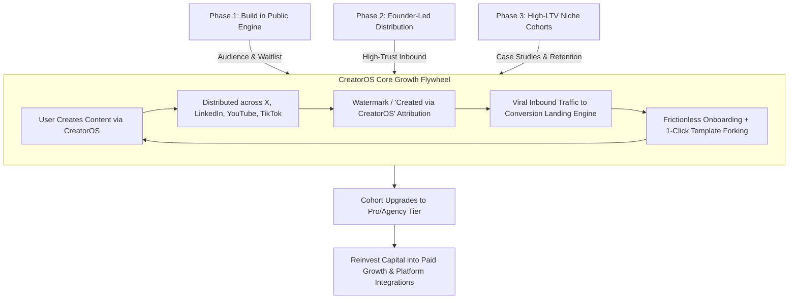
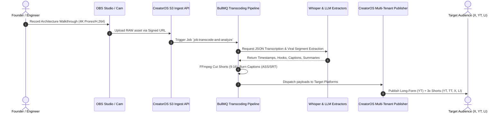
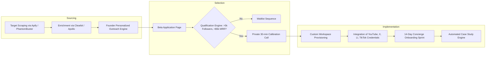

# CreatorOS Go-To-Market (GTM) Strategy

This document details the complete Go-to-Market engine for CreatorOS (`@creatoros`), matching Section 13 of the architectural blueprint. It defines the phased acquisition lifecycle, organic content pipelines, conversion infrastructure, referral mechanics, and technical telemetry required to take CreatorOS from zero to initial scale.

---

## 1. Executive Summary & Growth Flywheel

CreatorOS is an automated, multimodal content operating system built for solo creators, corporate founders, and agency operators. The GTM motion leverages the software's native outputs to fuel its customer acquisition pipeline. By employing our own internal workflows—content repurposing, multi-platform scheduling, automated analytics, and AI clip generation—the product operates as the primary marketing asset.



---

## 2. Phase 1: Build in Public Engine

Phase 1 focuses on technical transparency and transparent product development to cultivate a core audience of power users, engineering-minded creators, and early adopters.

### 2.1 Core Video Series Concepts

The video production engine is broken down into three episodic formats published across YouTube, X, and LinkedIn:

| Series Title | Target Audience | Format & Length | Core Hook / Narrative Arc | Primary CTA |
| :--- | :--- | :--- | :--- | :--- |
| **Architecting CreatorOS** | Technical Founders, Indie Hackers, System Architects | 12–18 min, 4K screen capture + talking head | Deconstructing complex engineering challenges (e.g., distributed video rendering, BullMQ queues, multi-tenant database partitioning). | Star GitHub / Join Developer Alpha Waitlist |
| **The Solo Creator Bottleneck** | Content Creators, Solopreneurs | 60–90 sec vertical video (TikTok, Reels, Shorts) | Diagnosing production inefficiencies (e.g., "Why spending 4 hours in Premiere is killing your channel"). Live software solutions. | Access Free Workflow Blueprint |
| **From $0 to 10k MRR: Zero Ad Spend** | SaaS Founders, Agency Owners | 8–12 min, transparent metrics review | Unfiltered revenue dashboards, churn analyses, CAC/LTV retrospectives, and infrastructure cost breakdowns. | Join Product Waitlist |

### 2.2 Production Architecture & Automation Pipeline

Phase 1 content is produced using a dogfooding workflow: raw recordings are captured, processed by the CreatorOS pipeline, split into vertical clips, transcribed, and distributed automatically.



---

## 3. Phase 2: Founder-Led Content

Phase 2 scales distribution through direct founder channels across X and LinkedIn. The founder operates as the tip of the spear, publishing high-signal industry analysis, failure logs, and technical breakdowns daily.

### 3.1 Daily Publishing Cadence

| Time (EST) | Channel | Format | Focus Area | Success Metric |
| :--- | :--- | :--- | :--- | :--- |
| **08:15 AM** | LinkedIn | Document Carousel / PDF Deck | High-level systems architecture, creator operations, SOPs. | Downloads, Profile Views, DMs |
| **11:30 AM** | X (Twitter) | Long-Form Text Thread (8–12 tweets) | Deep technical breakdown, benchmark results, database schemas. | Bookmarks, Retweets, Link Clicks |
| **02:00 PM** | YouTube Shorts / TikTok | Vertical Video (45–60s) | Single high-impact feature reveal, terminal demo, code snippet. | Watch Time Completion > 85% |
| **05:30 PM** | X (Twitter) | Single-Media Post (UI/UX Teaser or Chart) | Product velocity updates, customer wins, metric updates. | Engagement Rate > 4.5% |

### 3.2 Content Taxonomy & Editorial Calendar

```
Sprint Week (Monday - Sunday):
├── Monday: Systems Architecture & Systems Theory
│   ├── LI: Modern Data Stack for High-Throughput Media Apps
│   └── X: Building resilient distributed task queues with BullMQ and Redis
├── Tuesday: The Business of Content (Tactical Monopolies)
│   ├── LI: Why most media production pipelines fail at 50 videos/mo
│   └── X: Unit economics of our dynamic video rendering engine
├── Wednesday: Engineering Deep-Dives
│   ├── LI: Eliminating Node.js Event Loop Blockers during Video Rendering
│   └── X: Zero-copy streaming pipelines using Rust, FFmpeg, and S3
├── Thursday: Product Teardown / Competitive Positioning
│   ├── LI: The Death of Legacy Scheduling Tools: Why OS-Level Integrations Win
│   └── X: Native APIs vs. Scraping: Building an enterprise-grade social integration
├── Friday: Metrics, Revenue & Failure Dissections
│   ├── LI: Week In Review: Server costs, MRR growth, and system outages
│   └── X: Post-mortem on our database connection pool saturation
└── Weekend: Strategic Philosophies & Solopreneur Leverage
    ├── LI: How technical creators build asset-light holding companies
    └── X: The single-engineer, 8-figure architecture: A realistic stack
```

---

## 4. Phase 3: Niche Creator Beta Recruitment

The beta cohort is intentionally constrained to 20–50 high-leverage creators within three distinct verticals: Business Coaching, Real Estate, and B2B SaaS Founders. This phase is designed to validate retention, test programmatic workflows, and secure verifiable case studies.

### 4.1 Target Vertical Profiles

```
Creator Profile Matrix:
├── Vertical A: High-Ticket Business Coaches
│   ├── Profile: 10k–100k audience, selling $3k–$10k masterminds/consulting
│   ├── Bottleneck: High manual overhead repurposing Zoom calls & client webinars
│   └── Desired Outcome: Generate 30 days of multi-channel authority content from 1 weekly call
├── Vertical B: Luxury Real Estate Operators
│   ├── Profile: Producing listing walkthroughs, market analyses, local insight videos
│   ├── Bottleneck: Costly agency retainers ($4k–$8k/mo) for low-variance video edits
│   └── Desired Outcome: Automated template generation for property tours with synchronized CRM data
└── Vertical C: B2B SaaS Founders & Engineers
    ├── Profile: Technical founders looking to maintain a personal brand
    ├── Bottleneck: Zero bandwidth to manually edit code tutorials, releases, and text posts
    └── Desired Outcome: Git-integrated content releases (e.g., CHANGELOG-to-video pipelines)
```

### 4.2 Cohort Recruitment & Onboarding Architecture



### 4.3 Personalized Outreach Sequences

#### Cold Outreach Script: Vertical C (B2B SaaS Founders)

```markdown
Subject: quick question on your {{repo_name}} changelog

Hey {{first_name}},

Loved your recent breakdown on {{specific_technical_topic}}. Noticed you're shipping updates to {{company_name}} almost daily, but your personal channels and LinkedIn aren't showcasing the sheer volume of engineering output.

We built CreatorOS to automate this: it parses your Git commits/PR releases, extracts customer-facing value, generates vertical code teardowns, and queues them across X and LinkedIn without manual overhead.

We are onboarding a closed group of 10 SaaS founders for our private beta this month (completely free, direct Slack channel with me and our core engineers).

Open to trying it out for 14 days? If so, I'll set up your workspace and provision your accounts: {{custom_onboarding_link}}

Best,
Founder, CreatorOS
```

---

## 5. Conversion Funnel Engineering

To capture, qualify, and convert inbound interest generated by Phases 1–3, CreatorOS implements a high-performance conversion engine. The funnel features real-time validation, dynamic UTM attribution tracking, automated workflow deployment, and webhook synchronization across our CRM infrastructure.

### 5.1 Funnel Architecture

```
Landing Page (creatoros.com)
  │
  ├── Traffic Attribution: Dynamic UTM & Click Tracking Engine
  │
  ├── Hero Product Interactive Sandbox (Interactive WebAssembly Demo)
  │     │
  │     └── [ Action: Fork Workflow Template ]
  │
  └── Qualification Micro-Funnel (Typeform/Custom React Form)
        │
        ├── Score > 80: High-Value Prospect ──> Instant OAuth Onboarding & Pro Trial
        └── Score < 80: General Waitlist ─────> Nurture Sequence & Product Updates
```

### 5.2 Waitlist and Application Engine

The following schema defines the core conversion event captured across all inbound endpoints:

```typescript
// schemas/onboarding.ts
import { z } from "zod";

export const BetaApplicationSchema = z.object({
  fullName: z.string().min(2, "Full name must be at least 2 characters."),
  email: z.string().email("Valid commercial email required."),
  primaryPlatform: z.enum(["x", "linkedin", "youtube", "tiktok", "instagram"]),
  platformHandle: z.string().min(1, "Primary handle is required."),
  audienceSizeBand: z.enum(["0-5k", "5k-25k", "25k-100k", "100k+"]),
  vertical: z.enum([
    "business_coaching",
    "real_estate",
    "b2b_saas",
    "developer_advocacy",
    "other",
  ]),
  monthlyContentVolume: z.number().int().min(1),
  currentTechStack: z.array(z.string()).default([]),
  utmSource: z.string().optional().default("direct"),
  utmMedium: z.string().optional().default("none"),
  utmCampaign: z.string().optional().default("none"),
  referralCode: z.string().optional(),
});

export type BetaApplication = z.infer<typeof BetaApplicationSchema>;
```

### 5.3 Conversion Endpoint Implementation

```typescript
// pages/api/v1/beta/apply.ts
import type { NextApiRequest, NextApiResponse } from "next";
import { BetaApplicationSchema } from "@/schemas/onboarding";
import { prisma } from "@/lib/prisma";
import { calculateLeadScore } from "@/lib/scoring";
import { sendSlackNotification } from "@/lib/slack";
import { queueEnrichmentJob } from "@/lib/queues";

interface APIResponse {
  success: boolean;
  leadTier?: "vip" | "standard" | "nurture";
  message: string;
  redirectUrl?: string;
}

export default async function handleBetaApplication(
  req: NextApiRequest,
  res: NextApiResponse<APIResponse>
) {
  if (req.method !== "POST") {
    return res.status(405).json({ success: false, message: "Method Not Allowed" });
  }

  try {
    const validatedData = BetaApplicationSchema.parse(req.body);
    const score = calculateLeadScore(validatedData);

    const leadTier = score >= 80 ? "vip" : score >= 50 ? "standard" : "nurture";

    const applicant = await prisma.lead.create({
      data: {
        fullName: validatedData.fullName,
        email: validatedData.email,
        primaryPlatform: validatedData.primaryPlatform,
        platformHandle: validatedData.platformHandle,
        audienceBand: validatedData.audienceSizeBand,
        vertical: validatedData.vertical,
        monthlyVolume: validatedData.monthlyContentVolume,
        techStack: validatedData.currentTechStack,
        score,
        tier: leadTier,
        utmSource: validatedData.utmSource,
        utmMedium: validatedData.utmMedium,
        utmCampaign: validatedData.utmCampaign,
        referralCode: validatedData.referralCode,
      },
    });

    // Enqueue background identity and follower verification
    await queueEnrichmentJob({ leadId: applicant.id, email: applicant.email });

    if (leadTier === "vip") {
      await sendSlackNotification({
        channel: "#vip-leads",
        text: `🔥 High-Value Lead Secured: ${applicant.fullName} (${applicant.vertical}) | Score: ${score}`,
      });

      return res.status(201).json({
        success: true,
        leadTier: "vip",
        message: "Application accepted. Redirecting to onboarding schedule.",
        redirectUrl: `/onboarding/schedule?leadId=${applicant.id}`,
      });
    }

    return res.status(201).json({
      success: true,
      leadTier,
      message: "Application processed. Added to priority batch.",
      redirectUrl: `/waitlist/status?leadId=${applicant.id}`,
    });
  } catch (error: any) {
    return res.status(400).json({ success: false, message: error.message });
  }
}
```

---

## 6. Viral Loops & Product-Led Growth (PLG)

To lower Customer Acquisition Cost (CAC) toward asymptotic zero, CreatorOS implements three viral expansion loops built directly into product workflows: programmatic attribution footers, shareable workflow recipes, and usage-incentivized referral structures.

### 6.1 The Triple-Loop Mechanics

```
Viral Loops:
├── Loop 1: Watermarking & Public Footers
│   ├── Free Tier Exports include subtle programmatic attribution.
│   │   ├── Shorts/Reels: Dynamic watermarks embedded via FFmpeg overlay filters.
│   │   └── Text/Threads: Single-line signature ("Orchestrated via @creatoros").
│   └── Inbound Hook: Viewers click/search the attribution handle to access the same tool.
│
├── Loop 2: Template & Workflow Forking
│   ├── Users export content recipes (e.g., "Podcast-to-10x-Shorts Flow").
│   ├── Public URLs preview step-by-step logic nodes.
│   └── Forking the workflow requires the visitor to launch a CreatorOS workspace.
│
└── Loop 3: Dual-Sided Credit Mechanics
    ├── Referral Links give invited users $20 in AI Compute Credits.
    ├── The referrer unlocks 10 hours of video rendering per successful activation.
    └── System upgrades free accounts to Pro when 3 activations are reached.
```

### 6.2 Programmatic Attribution Engine: Video Watermark Injection

The video rendering pipeline inserts unobtrusive brand watermarks onto output files processed on non-enterprise tiers.

```typescript
// services/video/WatermarkProcessor.ts
import { spawn } from "child_process";
import path from "path";
import fs from "fs";

interface WatermarkOptions {
  inputPath: string;
  outputPath: string;
  watermarkPath: string;
  tier: "free" | "pro" | "enterprise";
}

export class WatermarkProcessor {
  /**
   * Applies programmatic overlays using hardware-accelerated FFmpeg filters.
   * Pro and Enterprise tiers bypass processing and maintain a bit-for-bit clean pipeline.
   */
  public static async processVideo(options: WatermarkOptions): Promise<string> {
    const { inputPath, outputPath, watermarkPath, tier } = options;

    if (tier === "pro" || tier === "enterprise") {
      // Bypass: Link directly without modification
      await fs.promises.copyFile(inputPath, outputPath);
      return outputPath;
    }

    return new Promise((resolve, reject) => {
      // Bottom-right overlay with 12px margins and 75% alpha compositing
      const filterComplex = 
        "[1:v]format=rgba,colorchannelmixer=aa=0.75[logo];" +
        "[0:v][logo]overlay=W-w-12:H-h-12:format=auto[outv]";

      const ffmpegArgs = [
        "-y",
        "-i", inputPath,
        "-i", watermarkPath,
        "-filter_complex", filterComplex,
        "-map", "[outv]",
        "-map", "0:a?",
        "-c:v", "libx264",
        "-preset", "veryfast",
        "-crf", "22",
        "-c:a", "copy",
        outputPath,
      ];

      const ffmpegProcess = spawn("ffmpeg", ffmpegArgs);

      ffmpegProcess.stderr.on("data", (data) => {
        // Telemetry/Debug logs pipe
      });

      ffmpegProcess.on("close", (code) => {
        if (code === 0) {
          resolve(outputPath);
        } else {
          reject(new Error(`FFmpeg processing failed with exit code: ${code}`));
        }
      });

      ffmpegProcess.on("error", (err) => {
        reject(err);
      });
    });
  }
}
```

### 6.3 Template & Recipe Share Infrastructure

Shared workflow templates allow prospects to inspect an automation pipeline visually before creating an account.

```typescript
// pages/api/v1/workflows/[id]/fork.ts
import type { NextApiRequest, NextApiResponse } from "next";
import { prisma } from "@/lib/prisma";
import { getSession } from "@/lib/auth";

export default async function forkWorkflow(req: NextApiRequest, res: NextApiResponse) {
  if (req.method !== "POST") {
    return res.status(405).json({ error: "Method not allowed" });
  }

  const { id: workflowId } = req.query;
  const session = await getSession(req);

  if (!session) {
    return res.status(401).json({
      error: "Authentication required",
      redirect: `/signup?returnTo=/workflows/${workflowId}/fork`,
    });
  }

  try {
    const sourceWorkflow = await prisma.workflow.findUnique({
      where: { id: String(workflowId), isPublic: true },
      include: { nodes: true, edges: true },
    });

    if (!sourceWorkflow) {
      return res.status(404).json({ error: "Public workflow template not found" });
    }

    const clonedWorkflow = await prisma.$transaction(async (tx) => {
      // Increment attribution metrics on source
      await tx.workflow.update({
        where: { id: sourceWorkflow.id },
        data: { forkCount: { increment: 1 } },
      });

      // Clone workflow into destination workspace
      return tx.workflow.create({
        data: {
          name: `${sourceWorkflow.name} (Forked)`,
          userId: session.user.id,
          isPublic: false,
          nodes: {
            createMany: {
              data: sourceWorkflow.nodes.map((node) => ({
                type: node.type,
                config: node.config,
                positionX: node.positionX,
                positionY: node.positionY,
              })),
            },
          },
          forkedFromId: sourceWorkflow.id,
        },
      });
    });

    return res.status(201).json({ success: true, workflowId: clonedWorkflow.id });
  } catch (error: any) {
    return res.status(500).json({ error: error.message });
  }
}
```

---

## 7. Metrics, Conversion KPIs, and Attribution

To verify funnel efficiency, growth is measured against defined performance indicators across every lifecycle stage.

### 7.1 Quantitative GTM Milestones

| Target Phase | Timeline | Primary Objective | Metric Target | Telemetry Verification Event |
| :--- | :--- | :--- | :--- | :--- |
| **Phase 1: Build in Public** | Weeks 1–4 | Audience Building & List Size | 2,500 Waitlist Leads | `analytics.track('waitlist_submitted')` |
| **Phase 2: Founder Cadence** | Weeks 5–8 | High-Intent Inbound Generation | 500k Organic Impressions/mo | Twitter/LinkedIn API Aggregators |
| **Phase 3: Niche Cohort** | Weeks 9–12 | Retention & Usage Validation | 50 Active Beta Users (DAU/MAU > 0.6) | `mixpanel.track('pipeline_run_completed')` |
| **Scale: Viral Loops** | Ongoing | Self-Sustaining Referral Engine | K-Factor $\ge 0.35$ | $K = i \times c$ (Invites $\times$ Conversion Rate) |

### 7.2 Tracking & Attribution Implementation

The client and server engines enforce full-lineage UTM capture:

```typescript
// lib/telemetry/attribution.ts
export interface GrowthAttributionPayload {
  anonymousId: string;
  userId?: string;
  utmSource: string;
  utmMedium: string;
  utmCampaign: string;
  referrer: string;
  landingPage: string;
  timestamp: string;
}

export function extractAttributionContext(): GrowthAttributionPayload {
  if (typeof window === "undefined") {
    return {
      anonymousId: "server-context",
      utmSource: "direct",
      utmMedium: "none",
      utmCampaign: "none",
      referrer: "",
      landingPage: "",
      timestamp: new Date().toISOString(),
    };
  }

  const urlParams = new URLSearchParams(window.location.search);
  
  return {
    anonymousId: getOrCreateAnonymousUUID(),
    utmSource: urlParams.get("utm_source") || "direct",
    utmMedium: urlParams.get("utm_medium") || "none",
    utmCampaign: urlParams.get("utm_campaign") || "none",
    referrer: document.referrer || "direct",
    landingPage: window.location.pathname,
    timestamp: new Date().toISOString(),
  };
}

function getOrCreateAnonymousUUID(): string {
  let aid = localStorage.getItem("__cros_aid");
  if (!aid) {
    aid = crypto.randomUUID();
    localStorage.setItem("__cros_aid", aid);
  }
  return aid;
}
```

---

## 8. 90-Day Execution Timeline

```
Week  1 - 2: Setup Phase 1 recording pipeline; launch "Architecting CreatorOS" Ep. 1.
Week  3 - 4: Deploy Conversion Landing Page & Lead Scoring microservice; reach 1,000 waitlist signups.
Week  5 - 6: Launch Founder daily content distribution (LinkedIn carousel + X threads cadence).
Week  7 - 8: Initiate Apify targeted scrapers; start cold outreach to 250 qualified creators.
Week  9 - 10: Onboard Beta Cohort (Group A: 15 Business Coaches, Group B: 15 Real Estate Operators).
Week 11 - 12: Onboard Group C (20 B2B SaaS Founders); publish 3 deep-dive case studies; enable PLG viral loops.
```

By coupling transparent, systems-focused building with targeted cohort recruitment and automated viral distribution loops, CreatorOS builds a defensible, product-led customer acquisition engine that lowers CAC while scaling predictable revenue.
