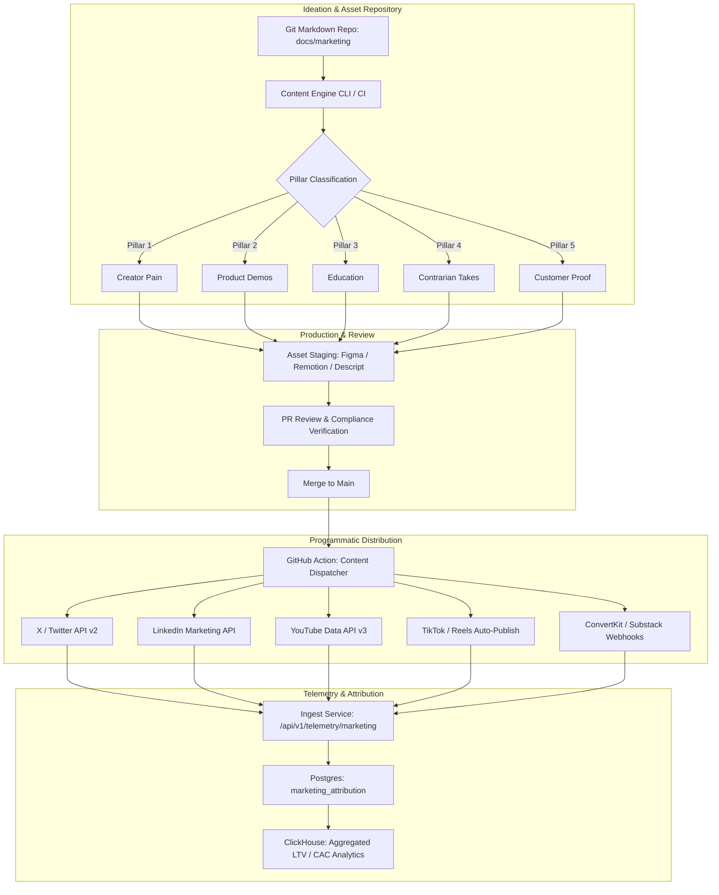
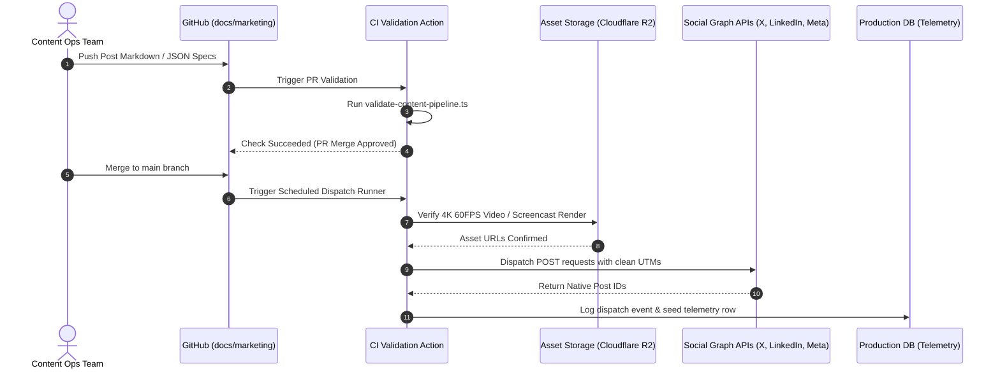

# CreatorOS Launch Content System

This document outlines the marketing and content distribution system for CreatorOS (`@creatoros`). It defines the content architecture, programmatic workflows, the five primary messaging pillars, the cadence matrix across all distribution channels, production-ready automation schemas, and promotional video scripts—including the primary 45-second launch trailer.

---

## 1. System Architecture & Content Pipeline

The CreatorOS launch engine operates as a deterministic, version-controlled system. Content is drafted, reviewed, tagged, and scheduled as code assets, linking directly to platform feature releases, analytics instrumentation, and conversion telemetry.



### 1.1 Data Contracts & TypeScript Schemas

All scheduled content adheres to strict type contracts to ensure programmatic dispatch, tracking, and attribution parity.

```typescript
// types/marketing-content.ts

export type ContentPillar =
  | 'CREATOR_PAIN'
  | 'PRODUCT_DEMO'
  | 'EDUCATION'
  | 'CONTRARIAN_OPINION'
  | 'CUSTOMER_PROOF';

export type DistributionChannel =
  | 'TWITTER_X'
  | 'LINKEDIN'
  | 'YOUTUBE_SHORTS'
  | 'TIKTOK'
  | 'INSTAGRAM_REELS'
  | 'YOUTUBE_LONG'
  | 'NEWSLETTER';

export interface ScriptScene {
  timecodeStart: number; // in seconds
  timecodeEnd: number;   // in seconds
  visualCue: string;
  audioVoiceover: string;
  soundEffects: string;
  uiOverlayOrText: string;
}

export interface VideoScript {
  id: string;
  title: string;
  targetDurationSeconds: number;
  pillar: ContentPillar;
  callToAction: string;
  scenes: ScriptScene[];
}

export interface ContentAsset {
  id: string;
  slug: string;
  pillar: ContentPillar;
  primaryChannel: DistributionChannel;
  supportingChannels: DistributionChannel[];
  scheduledPublishUtc: string; // ISO 8601
  copyPayload: {
    hook: string;
    body: string;
    callToAction: string;
    utmCampaign: string;
    utmSource: DistributionChannel;
    utmMedium: 'social' | 'video' | 'newsletter';
  };
  mediaReferences: {
    storageBucketKey: string;
    aspectRatio: '16:9' | '9:16' | '1:1';
    durationSeconds?: number;
    mimeType: string;
  }[];
  attribution: {
    referralCode: string;
    landingPageVariant: 'hero_direct' | 'interactive_demo' | 'case_study';
  };
}

export interface TelemetryAttributionEvent {
  eventId: string;
  contentAssetId: string;
  channel: DistributionChannel;
  timestamp: string;
  impressions: number;
  clicks: number;
  signups: number;
  upgradesToPaid: number;
  attributedMrrUsd: number;
}
```

---

## 2. The 5 Core Content Pillars

Each pillar serves a functional step in the conversion funnel. Content must match the exact angle, archetypes, and tone guidelines defined below.

```
+-----------------------------------------------------------------------------------------+
|                                    CONTENT PILLARS                                      |
+---------------------+-------------------+---------------------+-------------------------+
| PILLAR              | FUNNEL POSITION   | TARGET COGNITIVE STATE| PRIMARY OBJECTIVE       |
+---------------------+-------------------+---------------------+-------------------------+
| 1. Creator Pain     | Top-of-Funnel     | Visceral resonance  | Stop the scroll, build  |
|                     |                   | ("They get me")     | shared frustration      |
| 2. Product Demos    | Mid-to-Bottom     | Tactical clarity    | Prove immediate utility |
|                     |                   | ("Show, don't tell")| and eliminate friction  |
| 3. Education        | Top-to-Mid        | Respect & authority | Provide ROI before any  |
|                     |                   | ("I learned this")  | commercial exchange     |
| 4. Contrarian Takes | Top-of-Funnel     | Critical debate     | Polarize and establish  |
|                     |                   | ("Is this true?")   | category authority      |
| 5. Customer Proof   | Bottom-of-Funnel  | Risk mitigation     | Social proof and hard   |
|                     |                   | ("It worked here")  | revenue benchmarks      |
+---------------------+-------------------+---------------------+-------------------------+
```

---

### Pillar 1: Creator Pain (Operational Chaos)

* **Objective:** Articulate the silent operational drag creators endure when balancing fractured platforms.
* **Target Emotion:** Overwhelmed, disorganized, leaking revenue through the cracks.
* **Primary Angles:**
  * Tab fatigue (14 open browser tabs to run a one-person media company).
  * Late brand payments and uncollected receivables.
  * Disjointed community data spread across Discord, Circle, and Substack.
  * Lack of unit economics: high GMV, zero net profit margin.

#### Copy Execution: Twitter/X Hook & Thread

```text
Hook:
You made $300k on YouTube last year.
You worked 75 hours a week.
Your bank account says you made $42k.

Where did the other $258k go?

It went to software taxes, ghost agency retainers, and manual data entry.
Here is the autopsy of a 7-figure creator running a 5-figure operation (and how to fix it): 🧵👇

1/ Tab Fatigue is killing your output.
Average creator stack:
- Notion (docs that fall out of date)
- Asana (tasks no one checks)
- QuickBooks (where invoices go to die)
- Stan Store / Gumroad (fragmented customer data)
- ConvertKit (audience disconnected from revenue)

You aren't a creator. You are an unpaid full-time systems integration intern.

2/ The "Invisible Unpaid Invoices" leak.
43% of brand deal invoices take 60+ days to resolve without automation.
If you don't run automated net-30 reminders with late-fee triggers, you are financing multi-million dollar brands at 0% APR.

3/ Fragmentation breaks your LTV.
A fan buys your $50 PDF.
Two weeks later, you pitch them the $1,000 cohort via email—and your system doesn't know they already bought the PDF.
Result: Spam complaints, churn, burned trust.

Fix the machine before you buy more cameras.
```

---

### Pillar 2: Product Demos (Uncompromising Velocity)

* **Objective:** Demonstrate end-to-end operational execution within CreatorOS in under 30 seconds. No slide decks; only high-DPI UI screencasts running real tasks.
* **Target Emotion:** Relief, efficiency, immediate comprehension.
* **Primary Angles:**
  * Real-time automated brand deal invoicing with embedded payment links.
  * Multi-platform revenue unified in a single telemetry stream.
  * Drag-and-drop sponsor deck creation with verified, live-updated Google/Meta API metrics.

#### Copy Execution: LinkedIn Native Post

```text
Stop manually exporting CSVs to prove your audience size to brands.

Media kits built in Canva are static, unverified, and outdated 48 hours after you publish them.

Here is how CreatorOS handles brand partnerships end-to-end:

1. Click "Generate Live Deal Room"
2. CreatorOS pulls verified YouTube, TikTok, and Substack retention metrics via zero-auth read tokens.
3. Pricing is automatically calculated using your trailing 30-day CPM dynamic floor.
4. The brand signs the MSA, approves the deliverable, and deposits escrow in one window.

No back-and-forth emails. No "Can you send updated analytics?" No 90-day invoice delays.

Watch the 24-second workflow breakdown below. 

Run your media company on code, not spreadsheets.
[VIDEO EMBED: Live Deal Room Generation Screencast]
```

---

### Pillar 3: Education & Playbooks (Engineering the Creator Stack)

* **Objective:** Give away step-by-step Standard Operating Procedures (SOPs) that position CreatorOS as the definitive business architecture.
* **Target Emotion:** Empowerment, structural clarity.
* **Primary Angles:**
  * How to construct an operational S-Corp stack for single-operator media businesses.
  * Calculating True Creator LTV: `LTV = (Sponsorship ARPU + Digital Product ARR - Churn) / CAC`.
  * The production sprint checklist: Ideation to production in 48 hours.

#### Copy Execution: Newsletter / Substack Blueprint

```markdown
# Blueprint: The Single-Operator Media Architecture (SOMA v1.0)

Most media operations run into a scalability bottleneck at $250k ARR. To scale past this ceiling without adding 40 hours of payroll administrative drag, use the following operational blueprint:

### 1. Ingestion Automation
Every inbound brand sponsorship request must hit an edge-verified validation endpoint. 
- Discard cold pitch templates with less than $5,000 committed budget.
- Automatically route brands with sufficient budget to an automated calendar with programmatic scope locks.

### 2. Audience Asset Disaggregation
Never couple your email list directly to a single monetization provider.
Maintain an isolated customer datastore where audience records contain:
- Unified ID across platforms
- Total Historical Spend (USD)
- Brand Deal Engagement Vector
- Engagement Frequency Score (1-100)

### 3. Systematic Cash Flow Rules
- Retainers: Invoiced on the 1st, auto-billed via Stripe API with auto-pause webhooks for missed deliverables.
- Dynamic CPM pricing: Never accept flat-rate sponsorships during Q4 demand surges. Set your minimum floor to `Trailing_90_Day_Median_Views * $0.038`.
```

---

### Pillar 4: Contrarian Opinions (Deconstructing Industry Tropes)

* **Objective:** Challenge vanity-metric dogma. Point out the flaws in typical creator economy advice to spark debate and stand out.
* **Target Emotion:** Intellectual engagement, skepticism turned to conviction.
* **Primary Angles:**
  * "Follower count is an unsecured liability, not an asset."
  * "The 'Link-in-Bio' model is an operational failure that degrades margins."
  * "Stop hiring video editors before you fix your back-office data pipeline."

#### Copy Execution: Twitter/X Short-Form Hook

```text
Contrarian take: Having 1,000,000 followers on TikTok with no centralized operating system is worse than having a 9-to-5 job.

At a 9-to-5, your employer handles:
- Health insurance infrastructure
- Payment collection & invoicing
- Legal contracts & indemnification
- Technical tooling

With 1M followers and 0 systems:
- You are a low-margin contractor for ByteDance.
- You bear 100% of the operational risk.
- You spend 80% of your time on administrative work.
- You can be wiped out by an unannounced algorithm change.

If you don't own your data, your tooling, and your cash flow engine, you don't own a business. You have an unpaid internship with an algorithm.
```

---

### Pillar 5: Customer Proof & Telemetry (Validated Case Studies)

* **Objective:** Share hard financial and operational metrics from real creators who migrated to CreatorOS.
* **Target Emotion:** FOMO, pragmatic confidence, trust.
* **Primary Angles:**
  * "How [Creator X] reduced weekly operational overhead from 18 hours to 45 minutes."
  * "Recovering $18,400 in uncollected brand invoices using automated receivables."
  * "Consolidating 9 subscription tools into CreatorOS, saving $4,200/year."

#### Copy Execution: Platform Telemetry Post

```text
Case Study: How Jack (840k YouTube Subscribers) recovered $21,300 in 14 days without posting a new video.

The Problem:
Jack had 37 brand integrations completed across 2024.
His invoice tracking lived in an unstructured Notion table with no reminders.
Seven distinct agencies were overdue past Net-60 terms.
Jack avoided chasing them because writing collections emails felt uncomfortable.

The Migration:
Jack synced his business email and bank ledger with CreatorOS.

The Results:
- Automated Reconciliation Engine discovered 4 unaccounted-for invoices ($21,300 total).
- CreatorOS dispatched automated escalation notices backed by the original signed MSA terms.
- 100% of overdue balances cleared within 14 business days.
- Time spent by Jack: 0 minutes.

"CreatorOS isn't just software. It paid for my entire studio upgrade in week two."

Read the complete engineering breakdown: creatoros.com/case-studies/jack-media
```

---

## 3. Weekly Publishing Schedule & Distribution Cadence

This schedule details the distribution matrix across every active channel, with clear publishing windows, responsible personas, and tracked metrics.

### 3.1 Weekly Master Cadence Matrix

```
+-----------+--------------------+------------------------+-------------------+----------------------------+
| DAY       | UTC WINDOW         | PRIMARY CHANNEL        | PILLAR            | ASSET TYPE                 |
+-----------+--------------------+------------------------+-------------------+----------------------------+
| Monday    | 13:00 - 14:00 UTC  | X / LinkedIn           | 1. Creator Pain   | Long-form Text + Diagram   |
| Monday    | 17:00 - 18:00 UTC  | YT Shorts / TikTok     | 1. Creator Pain   | Short Video (Problem Hook) |
| Tuesday   | 13:00 - 14:00 UTC  | X / LinkedIn           | 2. Product Demo   | 30s UI Screencast Video    |
| Tuesday   | 18:00 - 19:00 UTC  | Substack / Email       | 3. Education      | Deep-dive SOP Newsletter   |
| Wednesday | 14:00 - 15:00 UTC  | X / Threads            | 4. Contrarian     | Text Thread / Debate Hook  |
| Wednesday | 18:00 - 19:00 UTC  | YT Shorts / Reels      | 2. Product Demo   | Feature Focus (60 FPS UI)  |
| Thursday  | 13:00 - 14:00 UTC  | LinkedIn               | 3. Education      | Carousels / PDF Blueprint  |
| Thursday  | 17:00 - 18:00 UTC  | YouTube (Main)         | 3. Education      | Long-form Breakdown (8m+)  |
| Friday    | 14:00 - 15:00 UTC  | X / LinkedIn           | 5. Customer Proof | Metric Breakdown & Graph   |
| Friday    | 18:00 - 19:00 UTC  | YT Shorts / TikTok     | 5. Customer Proof | Case Study Screencast Clip |
| Saturday  | 15:00 - 16:00 UTC  | X / Instagram          | 4. Contrarian     | High-engagement Quote Card |
| Sunday    | 20:00 - 21:00 UTC  | Substack / Community   | 1. Creator Pain   | Week Ahead Prep / Reflection|
+-----------+--------------------+------------------------+-------------------+----------------------------+
```

### 3.2 Automation Dispatch Payload Sample

Dispatches are executed via an idempotent worker reading Markdown frontmatter and hitting social platform endpoints:

```json
{
  "dispatch_id": "disp_prod_20250412_001",
  "schedule_epoch": 1744462800,
  "channels": [
    {
      "platform": "TWITTER_X",
      "endpoint": "https://api.twitter.com/2/tweets",
      "payload": {
        "text": "Tab fatigue is killing your output.\n\nAverage creator stack:\n- Notion\n- Asana\n- QuickBooks\n- Stan Store\n- ConvertKit\n\nYou aren't running a media company. You're working as an unpaid systems intern.\n\nHere is how to automate the whole machine: creatoros.com/engine",
        "media_ids": ["med_1892837482910"]
      }
    },
    {
      "platform": "LINKEDIN",
      "endpoint": "https://api.linkedin.com/v2/ugcPosts",
      "payload": {
        "author": "urn:li:organization:creatoros",
        "lifecycleState": "PUBLISHED",
        "specificContent": {
          "com.linkedin.ugc.ShareContent": {
            "shareCommentary": {
              "text": "Most creators spend 80% of their operational hours running data between fragmented tools.\n\nCreatorOS unifies brand management, automated billing, and live audience metrics into a single real-time console.\n\nSee how high-performing teams streamline their business:"
            },
            "shareMediaCategory": "VIDEO",
            "media": [
              {
                "status": "READY",
                "media": "urn:li:digitalmediaAsset:D560010202",
                "title": { "text": "CreatorOS Workflow In Under 30s" }
              }
            ]
          }
        }
      }
    }
  ]
}
```

---

## 4. Exact Promotional Video Scripts

### 4.1 Master Launch Trailer: "Escape the Chaos" (45 Seconds)
* **Target Audience:** Mid-to-large tier creators, multi-platform media operators.
* **Aspect Ratio:** 16:9 (Primary) with 9:16 safe zones.
* **Audio Track:** Fast, driving analog synth baseline (128 BPM). Cuts sharply with SFX drops.
* **Master Objective:** Deliver the Section 15 Launch Trailer: Hook the pain, cut through typical creator economy cliches, reveal the platform, and provide a single clear call-to-action.

```
===================================================================================================
TIMECODE        VISUAL CUE                           AUDIO / SFX             VOICEOVER / TEXT OVERLAY
===================================================================================================
00:00 - 00:04   Extreme Close-Up (ECU) of a          Low-frequency hum.      VO (Deep, calm, resonant):
                tired creator's face in the dark.    Sudden high-pitched     "You didn't build an audience 
                Screen reflection shows dozens of    browser alert chime.    just to spend your life in a 
                frantic tabs. Rapid cuts of:                                 spreadsheet."
                - Notion cursor blinking endlessly
                - Overdue invoice in red text                                TEXT OVERLAY:
                - Bank balance going down                                    Tab 1 of 27: Chaos
---------------------------------------------------------------------------------------------------
00:04 - 00:08   Frantic montage. Split screens       Jarring glitch SFX.     VO:
                of Stripe notifications, brand       Mouse clicking speed    "You’re juggling fourteen tools.
                DMs on Instagram, Discord pings,     increases to an         Chasing invoices. 
                and messy Google Sheets.             uncomfortable tempo.    Guessing your real numbers."
                A coffee cup rattles on the desk.
---------------------------------------------------------------------------------------------------
00:08 - 00:13   The mouse cursor hesitates, then     HARD CUT TO SILENCE.    VO:
                drags all 27 browser tabs straight   Single sub-bass drop    "Stop playing intern to your 
                into the trash.                      (808 boom).             own business."
                Screen cuts to pitch black.          Reverb tail out.
---------------------------------------------------------------------------------------------------
00:13 - 00:22   CRISP HIGH-CONTRAST CUT:             Punchy, rhythmic        VO:
                CreatorOS Dashboard boot sequence    cybernetic synth kicks  "This is CreatorOS."
                in fluid 4K 60FPS dark mode.         in at 128 BPM.
                - Unified Cashflow engine snaps                              VO:
                  into place.                        Haptic UI tick SFX      "Your entire business 
                - Sponsorship Deal Desk displays     as telemetry data       infrastructure...
                  dynamic CPM pricing.               populates.              in one unified command center."
                - Contracts, analytics, and CRM
                  columns lock together smoothly.
---------------------------------------------------------------------------------------------------
00:22 - 00:30   Fast UI Feature Tour:                Fast whoosh + UI        VO:
                1. "Invoicing" tab: Single-click     affirmation chime.      "Automated brand deal invoicing.
                   dispatches an automated Net-15                            Zero fee leaks."
                   smart contract invoice.
                2. "Deal Flow": Inbound sponsorship                          "Real-time audience analytics—
                   auto-populates with past pricing                          without giving up control."
                   history and audience demographic
                   metrics.
---------------------------------------------------------------------------------------------------
00:30 - 00:38   Dynamic camera zoom on the           Ascending synth lead.   VO:
                Telemetry Stream showing daily       Continuous crisp haptic "Reclaim 20 hours a week.
                net profit trending upward.          clicks.                 Protect your downside.
                Split screen shows the creator                               Scale your upside."
                calmly closing their laptop.
                Studio lights turn warm and cinematic.
---------------------------------------------------------------------------------------------------
00:38 - 00:45   PUNCHY LOGO REVEAL:                  Final sub-drop with     VO:
                Clean minimalist CreatorOS emblem    clean synth fade.       "CreatorOS.
                resolves on deep slate black.                                The operating system for 
                URL: creatoros.com                                           modern media companies."
                Secondary micro-text:                                        
                "Deploy the Engine. Claim Your Free Early Access."           TEXT:
                                                                             creatoros.com
===================================================================================================
```

---

### 4.2 Paid Acquisition Ad: "The 14 Tabs Problem" (30 Seconds)
* **Target Audience:** YouTube/TikTok creators juggling $5k–$50k/month.
* **Aspect Ratio:** Vertical 9:16 (TikTok, Shorts, Reels).
* **Audio Track:** Fast breakbeat, rhythmic mechanical sound effects.

```
===================================================================================================
TIMECODE        VISUAL CUE                           AUDIO / SFX             VOICEOVER / TEXT OVERLAY
===================================================================================================
00:00 - 00:05   Point-of-view (POV) phone camera     Notification storm:     VO (Fast, urgent):
                looking down at an open MacBook.     Slack, Discord, Email   "Count with me: 
                Hand counts off browser tabs with    beeps layered rapidly.  1, 2, 3, 4, 5... 14 open tabs
                index finger aggressively.                                   just to run ONE YouTube channel."

                                                                             TEXT OVERLAY:
                                                                             14 TABS. 0 SYSTEM.
---------------------------------------------------------------------------------------------------
00:05 - 00:11   Zoom in on a tangled Google Sheet    Harsh buzz SFX.         VO:
                titled "2025 Sponsorships Final      Tape stop effect.       "If an agency is 45 days late
                FINAL v3.xlsx". A red overdue                                paying you... would you even
                cell is highlighted.                                         know right now without checking
                                                                             three apps?"
---------------------------------------------------------------------------------------------------
00:11 - 00:20   SCREEN CAPTURE: Fast, responsive     Heavy sub-bass hit.     VO:
                mobile UI of CreatorOS app.          Smooth digital riser.   "This is CreatorOS.
                Thumb taps "Receivables."                                    We replaced the spreadsheets,
                Screen shows: "All brand accounts                            the messy folders, and the
                reconciled. $14,200 collected."                              unpaid invoices with one
                                                                             automated platform."
---------------------------------------------------------------------------------------------------
00:20 - 00:25   Live demo of the Auto-Pitch feature  Dynamic click SFX.      VO:
                pulling cross-platform audience                              "Live analytics. Instant deals.
                stats and sending a signed                                   Same-day settlements."
                contract in under 4 seconds.
---------------------------------------------------------------------------------------------------
00:25 - 00:30   Static product card. Minimal UI.     Low-pass synth chord.   VO:
                Clean typography:                                            "Stop working for your tools.
                "Fix your back-office today."                                Start running your business.
                Direct button: "Download CreatorOS"                          Hit the link below."
===================================================================================================
```

---

### 4.3 Deep-Dive Architecture Demo: "The Single-Operator Engine" (60 Seconds)
* **Target Audience:** Professional operators, boutique media teams, creators scaling to 7 figures.
* **Aspect Ratio:** 16:9 widescreen format.
* **Audio Track:** Ambient minimal tech / progressive electronic.

```
===================================================================================================
TIMECODE        VISUAL CUE                           AUDIO / SFX             VOICEOVER / TEXT OVERLAY
===================================================================================================
00:00 - 00:08   Cinematic slow-motion shot of a high- Quiet atmospheric      VO:
                end studio desk. CreatorOS is open   hum. Clean keyboard     "The creator economy told you to
                on a 32-inch monitor. Clean,         clacks.                 hire more people. They told you
                streamlined dark interface.                                  to stitch together ten different
                                                                             $50-a-month subscriptions."
---------------------------------------------------------------------------------------------------
00:08 - 00:18   Camera transitions directly into the Crisp digital whoosh.   VO:
                screen UI. Focuses on the "Cash Flow                         "They were wrong. 
                Intelligence" engine. Graphs render                          You don't need more headcount.
                smoothly without lag.                                        You need a better architecture.
                                                                             CreatorOS unifies every critical
                                                                             node of your business."
---------------------------------------------------------------------------------------------------
00:18 - 00:30   ZOOM: Brand Deal Room.               Subtle data ping SFX.   VO:
                Demonstrating dynamic rate-card                              "Module One: The Deal Engine.
                calculation based on rolling 90-day                          It continuously checks your
                view stats across YouTube, TikTok,                           verified cross-platform reach,
                and podcasts.                                                recalculates your market CPM, 
                                                                             and protects your pricing floor."
---------------------------------------------------------------------------------------------------
00:30 - 00:42   ZOOM: Invoicing & Legal Escrow.      Paper shuffle and       VO:
                A brand contract is dropped into the digital chime SFX.      "Module Two: Automated Escrow.
                pipeline. CreatorOS scans clauses,                           Standard contracts generate 
                verifies deliverables, and provisions                        automatically. Brands pay into 
                the Stripe escrow account.                                   escrow upfront. You get paid 
                                                                             the second deliverables go live."
---------------------------------------------------------------------------------------------------
00:42 - 00:52   WIDE SCREEN: The entire workspace    Rhythmic bass swell.    VO:
                comes together. Dynamic analytics,                           "No missed payments.
                active deals, production pipeline,                           No late-night spreadsheet audits.
                and real-time profit margins.                                Just your entire business,
                                                                             running on clear, reliable code."
---------------------------------------------------------------------------------------------------
00:52 - 01:00   Final Slate:                         Pulsing synth drop      VO:
                CreatorOS Workspace View.            to gentle fade-out.     "Build an enduring media company.
                Text: "Deploy Your System at                                 Deploy CreatorOS today."
                creatoros.com"
===================================================================================================
```

---

## 5. Content Operations Tooling & Automation Engine

To ensure publishing reliability without manual mistakes, CreatorOS uses an automated validation script. This utility scans Markdown content files in CI before social distribution, verifying metadata, character limits, link structures, and media assets.

### 5.1 Content CI Validation Utility

```typescript
// scripts/validate-content-pipeline.ts

import * as fs from 'fs';
import * as path from 'path';

interface PostMetadata {
  id: string;
  pillar: string;
  channel: string;
  scheduledUtc: string;
  hook: string;
  body: string;
  cta: string;
  targetUrl: string;
  mediaKey?: string;
}

const ALLOWED_PILLARS = [
  'CREATOR_PAIN',
  'PRODUCT_DEMO',
  'EDUCATION',
  'CONTRARIAN_OPINION',
  'CUSTOMER_PROOF',
];

const ALLOWED_CHANNELS = [
  'TWITTER_X',
  'LINKEDIN',
  'YOUTUBE_SHORTS',
  'TIKTOK',
  'INSTAGRAM_REELS',
  'NEWSLETTER',
];

export function validatePost(metadata: PostMetadata): { valid: boolean; errors: string[] } {
  const errors: string[] = [];

  // Pillar validation
  if (!ALLOWED_PILLARS.includes(metadata.pillar)) {
    errors.push(`Invalid pillar: "${metadata.pillar}". Must be one of: ${ALLOWED_PILLARS.join(', ')}`);
  }

  // Channel validation
  if (!ALLOWED_CHANNELS.includes(metadata.channel)) {
    errors.push(`Invalid channel: "${metadata.channel}". Must be one of: ${ALLOWED_CHANNELS.join(', ')}`);
  }

  // Date validation
  const scheduledTime = Date.parse(metadata.scheduledUtc);
  if (isNaN(scheduledTime)) {
    errors.push(`Invalid ISO 8601 date string for scheduledUtc: "${metadata.scheduledUtc}"`);
  }

  // Platform constraint validation
  if (metadata.channel === 'TWITTER_X') {
    const fullTweet = `${metadata.hook}\n\n${metadata.body}\n\n${metadata.cta} ${metadata.targetUrl}`;
    if (fullTweet.length > 280) {
      errors.push(`Twitter payload exceeds 280 characters (Current length: ${fullTweet.length})`);
    }
  }

  if (metadata.channel === 'LINKEDIN') {
    if (!metadata.body || metadata.body.length < 50) {
      errors.push('LinkedIn post body must be at least 50 characters long for reach optimization.');
    }
  }

  // URL Attribution check
  if (!metadata.targetUrl.includes('utm_source=') || !metadata.targetUrl.includes('utm_campaign=')) {
    errors.push(`Target URL "${metadata.targetUrl}" is missing mandatory UTM attribution parameters.`);
  }

  return {
    valid: errors.length === 0,
    errors,
  };
}

export function runContentAudit(contentDirectory: string): void {
  console.log(`[Content Engine] Starting audit in directory: ${contentDirectory}`);
  let totalChecked = 0;
  let totalFailed = 0;

  if (!fs.existsSync(contentDirectory)) {
    console.error(`Directory not found: ${contentDirectory}`);
    process.exit(1);
  }

  const files = fs.readdirSync(contentDirectory).filter((f) => f.endsWith('.json'));

  for (const file of files) {
    totalChecked++;
    const filePath = path.join(contentDirectory, file);
    const rawContent = fs.readFileSync(filePath, 'utf-8');

    try {
      const parsed: PostMetadata = JSON.parse(rawContent);
      const result = validatePost(parsed);

      if (!result.valid) {
        totalFailed++;
        console.error(`\n[FAIL] File: ${file}`);
        result.errors.forEach((err) => console.error(`  - ${err}`));
      } else {
        console.log(`[PASS] ${file} -> Pillar: ${parsed.pillar} | Channel: ${parsed.channel}`);
      }
    } catch (parseError) {
      totalFailed++;
      console.error(`\n[FATAL] Could not parse JSON file: ${file}. ${(parseError as Error).message}`);
    }
  }

  console.log(`\n================================`);
  console.log(`Audit Complete. Checked: ${totalChecked}, Failed: ${totalFailed}`);
  console.log(`================================`);

  if (totalFailed > 0) {
    process.exit(1);
  }
}

// Entrypoint for local or CI execution
if (require.main === module) {
  const targetDir = process.env.MARKETING_CONTENT_DIR || path.join(__dirname, '../content-queue');
  runContentAudit(targetDir);
}
```

---

### 5.2 Content Telemetry & Attribution Database Schema

This schema records post engagement, referral clicks, conversions, and associated revenue:

```sql
-- migration: 20250412_marketing_content_system.sql

CREATE TABLE marketing_content_assets (
    id UUID PRIMARY KEY DEFAULT gen_random_uuid(),
    asset_slug VARCHAR(120) NOT NULL UNIQUE,
    pillar VARCHAR(40) NOT NULL CHECK (
        pillar IN ('CREATOR_PAIN', 'PRODUCT_DEMO', 'EDUCATION', 'CONTRARIAN_OPINION', 'CUSTOMER_PROOF')
    ),
    channel VARCHAR(40) NOT NULL CHECK (
        channel IN ('TWITTER_X', 'LINKEDIN', 'YOUTUBE_SHORTS', 'TIKTOK', 'INSTAGRAM_REELS', 'YOUTUBE_LONG', 'NEWSLETTER')
    ),
    scheduled_for_utc TIMESTAMPTZ NOT NULL,
    published_at_utc TIMESTAMPTZ,
    status VARCHAR(20) NOT NULL DEFAULT 'DRAFT' CHECK (status IN ('DRAFT', 'STAGED', 'PUBLISHED', 'ARCHIVED')),
    utm_campaign VARCHAR(64) NOT NULL,
    utm_source VARCHAR(64) NOT NULL,
    utm_medium VARCHAR(32) NOT NULL,
    created_at TIMESTAMPTZ NOT NULL DEFAULT clock_timestamp()
);

CREATE TABLE marketing_telemetry_events (
    id UUID PRIMARY KEY DEFAULT gen_random_uuid(),
    asset_id UUID NOT NULL REFERENCES marketing_content_assets(id) ON DELETE CASCADE,
    recorded_at TIMESTAMPTZ NOT NULL DEFAULT clock_timestamp(),
    impressions INT NOT NULL DEFAULT 0,
    clicks INT NOT NULL DEFAULT 0,
    conversions_free_tier INT NOT NULL DEFAULT 0,
    conversions_paid_tier INT NOT NULL DEFAULT 0,
    attributed_mrr_cents BIGINT NOT NULL DEFAULT 0
);

CREATE INDEX idx_content_assets_pillar_channel ON marketing_content_assets (pillar, channel);
CREATE INDEX idx_content_assets_scheduled ON marketing_content_assets (scheduled_for_utc) WHERE status = 'STAGED';
CREATE INDEX idx_telemetry_asset_id_recorded ON marketing_telemetry_events (asset_id, recorded_at);
```

---

## 6. Execution Runbook: Step-by-Step Launch Workflow



1. **Sprint Planning (T-7 Days):** Map out the 5 pillars across weekly slots. Ensure at least two assets highlight Product Demos and Customer Proof.
2. **Asset Assembly (T-3 Days):** Export video assets at 60 FPS in high-contrast dark mode. Upload final visual renders to Cloudflare R2 and copy asset keys into the corresponding JSON metadata files.
3. **Automated Verification (T-1 Day):** The GitHub Actions pipeline runs `validate-content-pipeline.ts`. It flags and rejects any missing UTMs, copy that exceeds character limits, or invalid pillar tags.
4. **Broadcast & Live Telemetry (Launch Day):** The dispatcher worker triggers scheduled multi-platform API calls. Conversion events feed into `marketing_telemetry_events`, giving the team a real-time view of signups and
