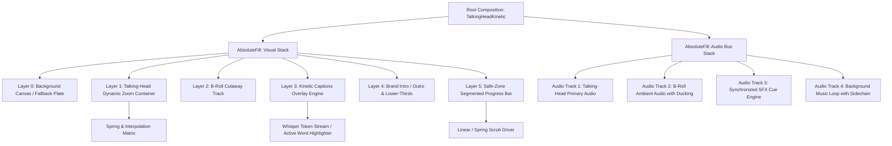
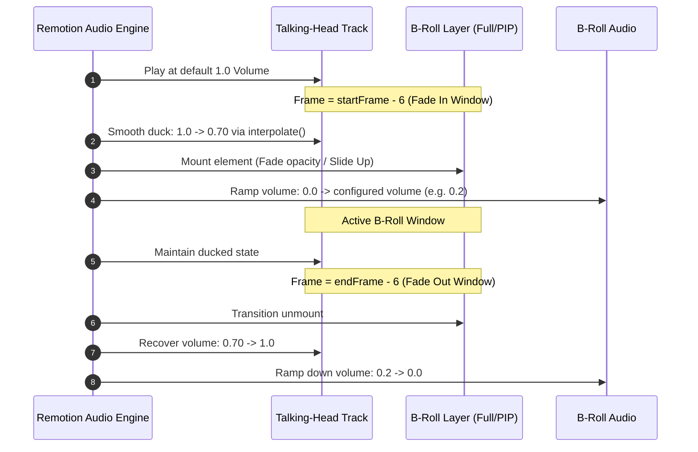

# Talking-Head + Kinetic Captions Template Specification

`docs/remotion/02-talking-head-template.md`  
**Engine Version:** Remotion v4.0.x  
**Target Runtime:** Node.js 20.x LTS / Remotion Lambda (Chromium headless)  
**Aspect Ratio Target:** 9:16 Vertical Video (1080x1920) for TikTok, YouTube Shorts, and Instagram Reels  

---

## 1. Composition Architecture & Layer Hierarchy

The `TalkingHeadKinetic` template is structured around a non-destructive multi-track compositing stack. Visual layers resolve from bottom (z-index: 0) to top (z-index: 50), while the audio engine routes voiceover, sound effects (SFX), and ambient background audio with dynamic side-chain ducking.



### Visual Stacking Order (Z-Index Indexing)

| Index | Component Layer | Blending Mode | Transform Origin | Description |
| :--- | :--- | :--- | :--- | :--- |
| `0` | `BackgroundCanvas` | `normal` | `center center` | Base canvas plate for pillarboxing or blur fallback. |
| `10` | `TalkingHeadContainer` | `normal` | Dynamic `(focalX, focalY)` | Primary camera footage with scale/pan keyframing. |
| `20` | `BRollCutawayTrack` | `normal` | `center center` | Full-coverage or PIP contextual visual cutaways. |
| `30` | `KineticCaptionEngine` | `normal` | `center bottom` | High-contrast, dynamic-scaling, word-level text. |
| `40` | `BrandOverlayLayer` | `normal` | `top left` | Watermark, dynamic lower-thirds, intro bumper. |
| `45` | `OutroCard` | `normal` | `center center` | Call-to-action (CTA) motion card running over end frames. |
| `50` | `SegmentedProgressBar`| `screen` | `left center` | Persistent execution tracker bounded within safe zones. |

---

## 2. Data Contracts & TypeScript Schemas

All inputs entering the Remotion rendering pipeline are validated using strict [Zod](https://zod.dev) schemas to prevent pipeline halts on Remotion Lambda workers.

```typescript
// types/talking-head-schema.ts
import { z } from 'zod';

export const WordTokenSchema = z.object({
  word: z.string(),
  start: z.number(), // In seconds
  end: z.number(),   // In seconds
  confidence: z.number().min(0).max(1),
  punctuationOffset: z.boolean().default(false),
});

export const ZoomKeyframeSchema = z.object({
  frame: z.number().int().nonnegative(),
  scale: z.number().min(1.0).max(2.5),
  focalPoint: z.object({
    x: z.number().min(0).max(100), // Percent from top-left
    y: z.number().min(0).max(100),
  }),
  easing: z.enum(['spring', 'linear', 'ease-in-out']).default('spring'),
  durationInFrames: z.number().int().positive().default(15),
});

export const BRollCutawaySchema = z.object({
  id: z.string().uuid(),
  src: z.string().url(),
  startFrame: z.number().int().nonnegative(),
  durationInFrames: z.number().int().positive(),
  type: z.enum(['full', 'pip']),
  pipConfig: z
    .object({
      x: z.number().default(10), // Safe zone coordinate (%)
      y: z.number().default(15),
      width: z.number().default(40),
      borderRadius: z.number().default(24),
      borderWidth: z.number().default(4),
      borderColor: z.string().default('#FFFFFF'),
    })
    .optional(),
  volume: z.number().min(0).max(1).default(0.1),
  transition: z.enum(['cut', 'fade', 'slide-up']).default('fade'),
});

export const SoundEffectCueSchema = z.object({
  id: z.string().uuid(),
  src: z.string().url(),
  frame: z.number().int().nonnegative(),
  volume: z.number().min(0).max(1).default(0.75),
});

export const BrandConfigSchema = z.object({
  primaryColor: z.string().regex(/^#([0-9a-fA-F]{3}|[0-9a-fA-F]{6})$/).default('#FFDD00'),
  secondaryColor: z.string().regex(/^#([0-9a-fA-F]{3}|[0-9a-fA-F]{6})$/).default('#FFFFFF'),
  accentColor: z.string().regex(/^#([0-9a-fA-F]{3}|[0-9a-fA-F]{6})$/).default('#FF0055'),
  fontFamily: z.string().default('Inter, -apple-system, BlinkMacSystemFont, sans-serif'),
  handle: z.string().default('@creatoros'),
  watermarkUrl: z.string().url().optional(),
  introDurationInFrames: z.number().int().nonnegative().default(30),
  outroDurationInFrames: z.number().int().nonnegative().default(60),
});

export const TalkingHeadCompositionSchema = z.object({
  videoSrc: z.string().url(),
  videoWidth: z.number().int().default(1080),
  videoHeight: z.number().int().default(1920),
  videoOffsetFrames: z.number().int().default(0),
  audioSrc: z.string().url().optional(), // Independent high-fidelity audio stream if decoupled
  backgroundMusicSrc: z.string().url().optional(),
  backgroundMusicVolume: z.number().min(0).max(1).default(0.15),
  transcription: z.array(WordTokenSchema),
  zoomKeyframes: z.array(ZoomKeyframeSchema),
  bRollCutaways: z.array(BRollCutawaySchema),
  soundEffects: z.array(SoundEffectCueSchema),
  brand: BrandConfigSchema,
  totalDurationInFrames: z.number().int().positive(),
  fps: z.literal(30).or(z.literal(60)).default(30),
});

export type WordToken = z.infer<typeof WordTokenSchema>;
export type ZoomKeyframe = z.infer<typeof ZoomKeyframeSchema>;
export type BRollCutaway = z.infer<typeof BRollCutawaySchema>;
export type SoundEffectCue = z.infer<typeof SoundEffectCueSchema>;
export type BrandConfig = z.infer<typeof BrandConfigSchema>;
export type TalkingHeadProps = z.infer<typeof TalkingHeadCompositionSchema>;
```

---

## 3. Dynamic Zoom & Camera Motion Engine

The zoom engine calculates spatial matrices frame-by-frame. It replaces static cuts with continuous or impulse-driven push-ins aligned with speech emphasis points, driven by either physics-based springs (`remotion.spring`) or parametric Bezier curves (`remotion.interpolate`).

```
Scale Matrix Calculation Pipeline:
+------------------------------------+
| Lookup Active & Previous Keyframe  |
+------------------------------------+
                  |
                  v
+------------------------------------+
| Calculate Progress Factor (0 to 1) |
| Using remotion.spring or interp    |
+------------------------------------+
                  |
                  v
+------------------------------------+
| Interp Matrix: Scale, Focal X, Y   |
+------------------------------------+
                  |
                  v
+------------------------------------+
| Apply CSS transform origin         |
| transform: scale(S) translate(X, Y)|
+------------------------------------+
```

### Motion Keyframe Solver

```typescript
// components/DynamicZoomContainer.tsx
import React, { useMemo } from 'react';
import { AbsoluteFill, interpolate, spring, useCurrentFrame, useVideoConfig } from 'remotion';
import { ZoomKeyframe } from '../types/talking-head-schema';

interface DynamicZoomContainerProps {
  keyframes: ZoomKeyframe[];
  children: React.ReactNode;
}

export const DynamicZoomContainer: React.FC<DynamicZoomContainerProps> = ({
  keyframes,
  children,
}) => {
  const frame = useCurrentFrame();
  const { fps } = useVideoConfig();

  // Find active and adjacent bounding keyframes
  const sortedKeyframes = useMemo(
    () => [...keyframes].sort((a, b) => a.frame - b.frame),
    [keyframes]
  );

  const { currentScale, currentFocalX, currentFocalY } = useMemo(() => {
    if (sortedKeyframes.length === 0) {
      return { currentScale: 1.0, currentFocalX: 50, currentFocalY: 50 };
    }

    // Default base state (start of video)
    if (frame < sortedKeyframes[0].frame) {
      return {
        currentScale: 1.0,
        currentFocalX: sortedKeyframes[0].focalPoint.x,
        currentFocalY: sortedKeyframes[0].focalPoint.y,
      };
    }

    // Find the current keyframe slot
    let targetIndex = sortedKeyframes.length - 1;
    for (let i = 0; i < sortedKeyframes.length; i++) {
      if (frame < sortedKeyframes[i].frame) {
        targetIndex = i - 1;
        break;
      }
    }

    const currentKf = sortedKeyframes[targetIndex];
    const nextKf = sortedKeyframes[targetIndex + 1];

    if (!nextKf) {
      return {
        currentScale: currentKf.scale,
        currentFocalX: currentKf.focalPoint.x,
        currentFocalY: currentKf.focalPoint.y,
      };
    }

    // Calculate progression towards nextKf
    const transitionDuration = nextKf.durationInFrames;
    const progressStartFrame = nextKf.frame - transitionDuration;

    if (frame < progressStartFrame) {
      return {
        currentScale: currentKf.scale,
        currentFocalX: currentKf.focalPoint.x,
        currentFocalY: currentKf.focalPoint.y,
      };
    }

    const localProgressFrame = frame - progressStartFrame;

    let progression = 0;
    if (nextKf.easing === 'spring') {
      progression = spring({
        frame: localProgressFrame,
        fps,
        config: {
          damping: 18,
          mass: 0.8,
          stiffness: 140,
          overshootClamping: false,
        },
      });
    } else {
      progression = interpolate(
        localProgressFrame,
        [0, transitionDuration],
        [0, 1],
        { extrapolateLeft: 'clamp', extrapolateRight: 'clamp' }
      );
    }

    const scale = interpolate(progression, [0, 1], [currentKf.scale, nextKf.scale]);
    const focalX = interpolate(progression, [0, 1], [currentKf.focalPoint.x, nextKf.focalPoint.x]);
    const focalY = interpolate(progression, [0, 1], [currentKf.focalPoint.y, nextKf.focalPoint.y]);

    return {
      currentScale: scale,
      currentFocalX: focalX,
      currentFocalY: focalY,
    };
  }, [frame, fps, sortedKeyframes]);

  return (
    <AbsoluteFill
      style={{
        overflow: 'hidden',
        transformOrigin: `${currentFocalX}% ${currentFocalY}%`,
        transform: `scale(${currentScale})`,
        willChange: 'transform',
      }}
    >
      {children}
    </AbsoluteFill>
  );
};
```

---

## 4. Word-by-Word Kinetic Caption Engine

The caption engine consumes discrete Whisper JSON tokens containing sub-second boundaries. It builds windowed line chunks (maximum 3 words per window for fast viral retention) and renders active-state kinetic updates with zero frame drift.

```
Transcription Word Streaming Logic:
+-------------------------------------------------------------+
| Filter Active Chunk [t_start, t_end] where t_curr in range  |
+-------------------------------------------------------------+
                              |
                              v
+-------------------------------------------------------------+
| Map over words within active line chunk                     |
| Evaluate: Is word active?                                   |
+-------------------------------------------------------------+
          /                                         \
     (Active)                                   (Inactive)
        /                                             \
+-----------------------------+              +-----------------------------+
| Color: Brand Primary        |              | Color: Muted Neutral        |
| Scale: 1.15 via spring()   |              | Scale: 1.0                  |
| Drop-shadow: Dynamic glow   |              | Drop-shadow: Minimal        |
+-----------------------------+              +-----------------------------+
```

```typescript
// components/KineticCaptions.tsx
import React, { useMemo } from 'react';
import { AbsoluteFill, spring, useCurrentFrame, useVideoConfig } from 'remotion';
import { BrandConfig, WordToken } from '../types/talking-head-schema';

interface KineticCaptionsProps {
  transcription: WordToken[];
  brand: BrandConfig;
}

interface CaptionGroup {
  id: string;
  tokens: WordToken[];
  startFrame: number;
  endFrame: number;
}

export const KineticCaptions: React.FC<KineticCaptionsProps> = ({ transcription, brand }) => {
  const frame = useCurrentFrame();
  const { fps } = useVideoConfig();

  // Chunk tokens into groups of max 3 words
  const captionGroups = useMemo(() => {
    const CHUNK_SIZE = 3;
    const groups: CaptionGroup[] = [];
    
    for (let i = 0; i < transcription.length; i += CHUNK_SIZE) {
      const slice = transcription.slice(i, i + CHUNK_SIZE);
      const startSec = slice[0].start;
      const endSec = slice[slice.length - 1].end;

      // Force minimum padding buffer for transient syllables
      const adjustedEndSec = Math.max(endSec, startSec + 0.35);

      groups.push({
        id: `chunk-${i}`,
        tokens: slice,
        startFrame: Math.floor(startSec * fps),
        endFrame: Math.ceil(adjustedEndSec * fps),
      });
    }
    return groups;
  }, [transcription, fps]);

  // Find currently active group
  const activeGroup = useMemo(() => {
    return captionGroups.find(
      (group) => frame >= group.startFrame && frame <= group.endFrame
    );
  }, [captionGroups, frame]);

  if (!activeGroup) {
    return null;
  }

  const currentSeconds = frame / fps;

  return (
    <AbsoluteFill
      style={{
        justifyContent: 'flex-end',
        alignItems: 'center',
        paddingBottom: '380px', // Safe area bounds above bottom interfaces
        pointerEvents: 'none',
      }}
    >
      <div
        style={{
          display: 'flex',
          flexDirection: 'row',
          flexWrap: 'wrap',
          justifyContent: 'center',
          gap: '16px',
          maxWidth: '920px',
          padding: '24px 32px',
          backgroundColor: 'rgba(0, 0, 0, 0.45)',
          borderRadius: '32px',
          backdropFilter: 'blur(8px)',
        }}
      >
        {activeGroup.tokens.map((token, index) => {
          const isActive = currentSeconds >= token.start && currentSeconds < token.end;
          const hasPassed = currentSeconds >= token.end;

          // Word entrance spring
          const tokenStartFrame = Math.floor(token.start * fps);
          const activeProgress = spring({
            frame: Math.max(0, frame - tokenStartFrame),
            fps,
            config: { damping: 12, mass: 0.4, stiffness: 220 },
          });

          const scale = isActive ? 1.0 + activeProgress * 0.15 : 1.0;

          return (
            <span
              key={`${activeGroup.id}-word-${index}`}
              style={{
                fontFamily: brand.fontFamily,
                fontWeight: 900,
                fontSize: '76px',
                lineHeight: 1.1,
                textTransform: 'uppercase',
                transform: `scale(${scale})`,
                color: isActive
                  ? brand.primaryColor
                  : hasPassed
                  ? brand.secondaryColor
                  : 'rgba(255, 255, 255, 0.4)',
                textShadow: isActive
                  ? `0px 4px 20px ${brand.primaryColor}88, 0px 0px 40px rgba(0,0,0,0.9)`
                  : '0px 4px 12px rgba(0,0,0,0.8)',
                display: 'inline-block',
                willChange: 'transform, color',
              }}
            >
              {token.word}
            </span>
          );
        })}
      </div>
    </AbsoluteFill>
  );
};
```

---

## 5. B-Roll Overlay & Dynamic Audio Ducking

The B-roll pipeline mounts auxiliary footage dynamically. When an overlay is active, the primary vocal audio ducks slightly to maintain mix clarity, while the B-roll's ambient audio layer is mixed in using calibrated crossfades.



```typescript
// components/BRollLayer.tsx
import React from 'react';
import { AbsoluteFill, OffthreadVideo, interpolate, useCurrentFrame, useVideoConfig } from 'remotion';
import { BRollCutaway } from '../types/talking-head-schema';

interface BRollLayerProps {
  cutaway: BRollCutaway;
}

export const BRollLayer: React.FC<BRollLayerProps> = ({ cutaway }) => {
  const frame = useCurrentFrame();
  const { fps } = useVideoConfig();

  const FADE_FRAMES = 8;
  const relativeFrame = frame - cutaway.startFrame;

  if (relativeFrame < 0 || relativeFrame >= cutaway.durationInFrames) {
    return null;
  }

  // Calculate Opacity Transition Envelope
  const opacity = interpolate(
    relativeFrame,
    [0, FADE_FRAMES, cutaway.durationInFrames - FADE_FRAMES, cutaway.durationInFrames],
    [0, 1, 1, 0],
    { extrapolateLeft: 'clamp', extrapolateRight: 'clamp' }
  );

  if (cutaway.type === 'full') {
    return (
      <AbsoluteFill
        style={{
          opacity,
          zIndex: 20,
          backgroundColor: '#000000',
        }}
      >
        <OffthreadVideo
          src={cutaway.src}
          style={{
            width: '100%',
            height: '100%',
            objectFit: 'cover',
          }}
          volume={() => cutaway.volume}
        />
      </AbsoluteFill>
    );
  }

  // PIP (Picture-in-Picture) Rendering Logic
  const pip = cutaway.pipConfig ?? {
    x: 8,
    y: 12,
    width: 45,
    borderRadius: 24,
    borderWidth: 6,
    borderColor: '#FFFFFF',
  };

  const scale = interpolate(
    relativeFrame,
    [0, FADE_FRAMES],
    [0.85, 1.0],
    { extrapolateLeft: 'clamp', extrapolateRight: 'clamp' }
  );

  return (
    <AbsoluteFill
      style={{
        zIndex: 20,
        pointerEvents: 'none',
      }}
    >
      <div
        style={{
          position: 'absolute',
          left: `${pip.x}%`,
          top: `${pip.y}%`,
          width: `${pip.width}%`,
          aspectRatio: '9 / 16',
          borderRadius: `${pip.borderRadius}px`,
          border: `${pip.borderWidth}px solid ${pip.borderColor}`,
          overflow: 'hidden',
          boxShadow: '0 20px 50px rgba(0,0,0,0.65)',
          opacity,
          transform: `scale(${scale})`,
          transformOrigin: 'center center',
        }}
      >
        <OffthreadVideo
          src={cutaway.src}
          style={{
            width: '100%',
            height: '100%',
            objectFit: 'cover',
          }}
          volume={() => cutaway.volume}
        />
      </div>
    </AbsoluteFill>
  );
};
```

---

## 6. SFX Cue Engine & Primary Voice Ducking

Dynamic audio triggers (such as swooshes for zooms, pop hits for captions, and risers for intros) mount precisely on specific frames. The primary audio volume ducks dynamically based on these visual events.

```typescript
// components/AudioBusMixer.tsx
import React, { useMemo } from 'react';
import { Audio, interpolate, useCurrentFrame } from 'remotion';
import { BRollCutaway, SoundEffectCue } from '../types/talking-head-schema';

interface AudioBusMixerProps {
  primaryAudioSrc?: string;
  primaryVideoSrc: string;
  backgroundMusicSrc?: string;
  bgmBaseVolume: number;
  bRollCutaways: BRollCutaway[];
  soundEffects: SoundEffectCue[];
}

export const AudioBusMixer: React.FC<AudioBusMixerProps> = ({
  primaryAudioSrc,
  primaryVideoSrc,
  backgroundMusicSrc,
  bgmBaseVolume,
  bRollCutaways,
  soundEffects,
}) => {
  const frame = useCurrentFrame();

  // Dynamic Ducking Calculation
  const duckingFactor = useMemo(() => {
    let factor = 1.0;
    const TRANSITION_WINDOW = 6;

    for (const broll of bRollCutaways) {
      const start = broll.startFrame;
      const end = broll.startFrame + broll.durationInFrames;

      if (frame >= start - TRANSITION_WINDOW && frame <= end + TRANSITION_WINDOW) {
        const duckedProgress = interpolate(
          frame,
          [start - TRANSITION_WINDOW, start, end, end + TRANSITION_WINDOW],
          [1.0, 0.65, 0.65, 1.0],
          { extrapolateLeft: 'clamp', extrapolateRight: 'clamp' }
        );
        factor = Math.min(factor, duckedProgress);
      }
    }
    return factor;
  }, [bRollCutaways, frame]);

  return (
    <>
      {/* Primary Voice Audio Track */}
      {primaryAudioSrc ? (
        <Audio
          src={primaryAudioSrc}
          volume={() => 1.0 * duckingFactor}
        />
      ) : (
        <Audio
          src={primaryVideoSrc}
          volume={() => 1.0 * duckingFactor}
        />
      )}

      {/* Synchronized SFX Triggers */}
      {soundEffects.map((sfx) => {
        if (frame < sfx.frame) return null;
        return (
          <Audio
            key={sfx.id}
            src={sfx.src}
            startFrom={0}
            volume={() => sfx.volume}
          />
        );
      })}

      {/* Loop-capable ducked Background Music */}
      {backgroundMusicSrc && (
        <Audio
          src={backgroundMusicSrc}
          volume={() => bgmBaseVolume * duckingFactor}
          loop
        />
      )}
    </>
  );
};
```

---

## 7. Segmented Progress Bar & Brand Engine

Retention drops if users cannot gauge content length. The `SegmentedProgressBar` provides a visual anchor that respects mobile platform UI safe zones (staying clear of the TikTok right-side action column and top platform chrome).

```
Vertical Layout Safe Boundaries (1080 x 1920):
+-----------------------------------------------+ 0px
|   Safe Zone Top Padding: 140px               |
| +-------------------------------------------+ |
| | [SegmentedProgressBar]                    | | 148px (8px Bar Height)
| +-------------------------------------------+ |
|                                               |
|   Lower Safe Zone Padding: 320px              |
|                                               |
|   Caption Engine Render Box                   |
|                                               |
+-----------------------------------------------+ 1920px
```

```typescript
// components/SegmentedProgressBar.tsx
import React from 'react';
import { AbsoluteFill, useCurrentFrame, useVideoConfig } from 'remotion';

interface SegmentedProgressBarProps {
  totalDurationInFrames: number;
  segmentsCount?: number;
  barColor: string;
  trackColor?: string;
  topOffset?: number;
}

export const SegmentedProgressBar: React.FC<SegmentedProgressBarProps> = ({
  totalDurationInFrames,
  segmentsCount = 1,
  barColor,
  trackColor = 'rgba(255, 255, 255, 0.25)',
  topOffset = 140, // Avoid system time / camera notches
}) => {
  const frame = useCurrentFrame();
  const { width } = useVideoConfig();

  const progress = Math.min(1, Math.max(0, frame / totalDurationInFrames));

  return (
    <AbsoluteFill
      style={{
        zIndex: 50,
        height: '12px',
        top: `${topOffset}px`,
        paddingLeft: '36px',
        paddingRight: '36px',
      }}
    >
      <div
        style={{
          width: '100%',
          height: '8px',
          display: 'flex',
          gap: '8px',
          alignItems: 'center',
        }}
      >
        {Array.from({ length: segmentsCount }).map((_, index) => {
          const segmentCapacity = 1 / segmentsCount;
          const segmentStart = index * segmentCapacity;
          const segmentEnd = segmentStart + segmentCapacity;

          let segmentFill = 0;
          if (progress >= segmentEnd) {
            segmentFill = 1;
          } else if (progress <= segmentStart) {
            segmentFill = 0;
          } else {
            segmentFill = (progress - segmentStart) / segmentCapacity;
          }

          return (
            <div
              key={`seg-${index}`}
              style={{
                flex: 1,
                height: '100%',
                backgroundColor: trackColor,
                borderRadius: '4px',
                overflow: 'hidden',
                position: 'relative',
              }}
            >
              <div
                style={{
                  width: `${segmentFill * 100}%`,
                  height: '100%',
                  backgroundColor: barColor,
                  borderRadius: '4px',
                  boxShadow: `0 0 10px ${barColor}AA`,
                }}
              />
            </div>
          );
        })}
      </div>
    </AbsoluteFill>
  );
};
```

---

## 8. Complete Master Composition Entrypoint

This master component combines the visual layers, audio ducking, and kinetic text engine into a single entry point for rendering.

```typescript
// compositions/TalkingHeadKineticComposition.tsx
import React from 'react';
import {
  AbsoluteFill,
  OffthreadVideo,
  Sequence,
  spring,
  useCurrentFrame,
  useVideoConfig,
} from 'remotion';
import { TalkingHeadProps } from '../types/talking-head-schema';
import { DynamicZoomContainer } from '../components/DynamicZoomContainer';
import { KineticCaptions } from '../components/KineticCaptions';
import { BRollLayer } from '../components/BRollLayer';
import { AudioBusMixer } from '../components/AudioBusMixer';
import { SegmentedProgressBar } from '../components/SegmentedProgressBar';

export const TalkingHeadKineticComposition: React.FC<TalkingHeadProps> = ({
  videoSrc,
  audioSrc,
  backgroundMusicSrc,
  backgroundMusicVolume,
  transcription,
  zoomKeyframes,
  bRollCutaways,
  soundEffects,
  brand,
  totalDurationInFrames,
}) => {
  const frame = useCurrentFrame();
  const { fps } = useVideoConfig();

  // Outro Sequence Transition
  const outroStartFrame = totalDurationInFrames - brand.outroDurationInFrames;
  const isOutroActive = frame >= outroStartFrame;

  const outroProgress = spring({
    frame: Math.max(0, frame - outroStartFrame),
    fps,
    config: { damping: 16, mass: 0.9, stiffness: 180 },
  });

  return (
    <AbsoluteFill style={{ backgroundColor: '#000000', overflow: 'hidden' }}>
      {/* 1. Base Layer: Talking-Head with Dynamic Camera Zooms */}
      <DynamicZoomContainer keyframes={zoomKeyframes}>
        <OffthreadVideo
          src={videoSrc}
          style={{
            width: '100%',
            height: '100%',
            objectFit: 'cover',
          }}
          // Volume is muted here because the AudioBusMixer handles audio tracks
          volume={0}
        />
      </DynamicZoomContainer>

      {/* 2. Visual Layer: B-Roll Cutaway Track */}
      {bRollCutaways.map((cutaway) => (
        <BRollLayer key={cutaway.id} cutaway={cutaway} />
      ))}

      {/* 3. Dynamic Visual Layer: Kinetic Captions Engine */}
      <KineticCaptions transcription={transcription} brand={brand} />

      {/* 4. Chrome: Upper-Bounding Segmented Progress Bar */}
      <SegmentedProgressBar
        totalDurationInFrames={totalDurationInFrames}
        segmentsCount={3}
        barColor={brand.primaryColor}
        topOffset={140}
      />

      {/* 5. Channel Watermark / Identity Plate */}
      <AbsoluteFill
        style={{
          zIndex: 40,
          pointerEvents: 'none',
          padding: '180px 48px',
          alignItems: 'flex-start',
        }}
      >
        <div
          style={{
            backgroundColor: 'rgba(0, 0, 0, 0.6)',
            padding: '10px 20px',
            borderRadius: '16px',
            border: '1px solid rgba(255, 255, 255, 0.15)',
            display: 'flex',
            alignItems: 'center',
            gap: '10px',
          }}
        >
          <div
            style={{
              width: '12px',
              height: '12px',
              borderRadius: '50%',
              backgroundColor: brand.accentColor,
            }}
          />
          <span
            style={{
              color: '#FFFFFF',
              fontFamily: brand.fontFamily,
              fontWeight: 700,
              fontSize: '22px',
              letterSpacing: '0.04em',
            }}
          >
            {brand.handle}
          </span>
        </div>
      </AbsoluteFill>

      {/* 6. Motion Outro Card Layer */}
      {isOutroActive && (
        <AbsoluteFill
          style={{
            zIndex: 45,
            backgroundColor: `rgba(0, 0, 0, ${0.85 * outroProgress})`,
            justifyContent: 'center',
            alignItems: 'center',
            backdropFilter: `blur(${12 * outroProgress}px)`,
          }}
        >
          <div
            style={{
              display: 'flex',
              flexDirection: 'column',
              alignItems: 'center',
              transform: `scale(${outroProgress})`,
              gap: '24px',
            }}
          >
            <h1
              style={{
                fontFamily: brand.fontFamily,
                fontWeight: 900,
                fontSize: '84px',
                color: brand.primaryColor,
                margin: 0,
                textTransform: 'uppercase',
                textAlign: 'center',
                lineHeight: 1.05,
              }}
            >
              Scale Your
              <br />
              Audience
            </h1>
            <p
              style={{
                fontFamily: brand.fontFamily,
                fontWeight: 600,
                fontSize: '36px',
                color: brand.secondaryColor,
                margin: 0,
              }}
            >
              Follow {brand.handle}
            </p>
          </div>
        </AbsoluteFill>
      )}

      {/* 7. Comprehensive Audio Bus Architecture */}
      <AudioBusMixer
        primaryAudioSrc={audioSrc}
        primaryVideoSrc={videoSrc}
        backgroundMusicSrc={backgroundMusicSrc}
        bgmBaseVolume={backgroundMusicVolume}
        bRollCutaways={bRollCutaways}
        soundEffects={soundEffects}
      />
    </AbsoluteFill>
  );
};
```

---

## 9. Root Registration & Lambda Optimization

```typescript
// Root.tsx
import React from 'react';
import { Composition } from 'remotion';
import { TalkingHeadKineticComposition } from './compositions/TalkingHeadKineticComposition';
import { TalkingHeadCompositionSchema } from './types/talking-head-schema';

export const RemotionRoot: React.FC = () => {
  return (
    <Composition
      id="TalkingHeadKinetic"
      component={TalkingHeadKineticComposition}
      durationInFrames={900} // Dynamic default (30s @ 30fps)
      fps={30}
      width={1080}
      height={1920}
      schema={TalkingHeadCompositionSchema}
      defaultProps={{
        videoSrc: 'https://cdn.creatoros.dev/assets/samples/talking-head.mp4',
        videoWidth: 1080,
        videoHeight: 1920,
        videoOffsetFrames: 0,
        backgroundMusicSrc: 'https://cdn.creatoros.dev/assets/music/lofi-drift.mp3',
        backgroundMusicVolume: 0.12,
        totalDurationInFrames: 900,
        fps: 30,
        brand: {
          primaryColor: '#00F0FF',
          secondaryColor: '#FFFFFF',
          accentColor: '#FF003C',
          fontFamily: 'Montserrat, sans-serif',
          handle: '@creatoros',
          introDurationInFrames: 30,
          outroDurationInFrames: 60,
        },
        transcription: [
          {
