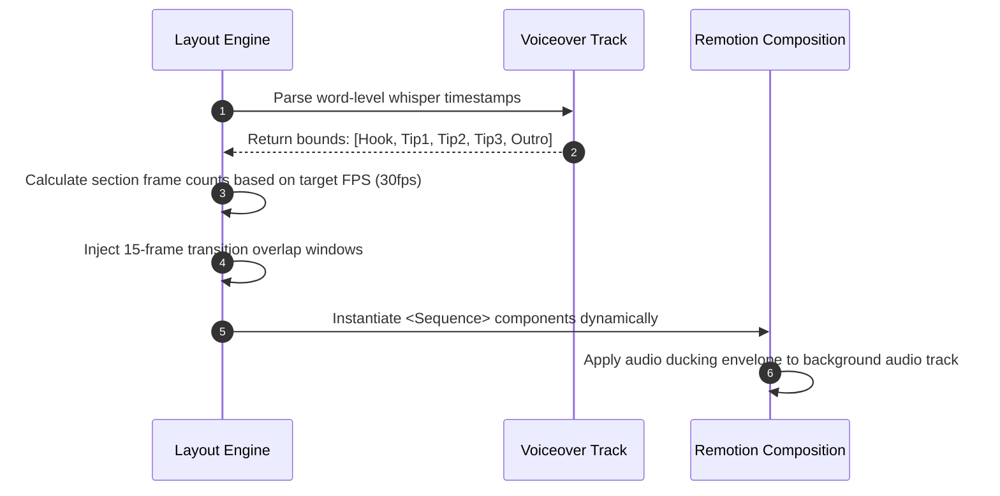

# docs/remotion/03-three-tips-template.md

## 1. Architecture Overview

The `ThreeTipsTemplate` is a fully autonomous Remotion composition engineered for programmatic video synthesis without user-provided primary footage (B-roll/A-roll). It converts structured text prompts and voiceover tracks into high-retention short-form video assets (9:16 vertical format, optimized for TikTok, YouTube Shorts, and Instagram Reels).

The template operates on a deterministic layout engine driven by audio-synchronized cues. Visual output is achieved through a multi-layer composite pipeline consisting of procedural ambient backgrounds, video asset loops, kinetic typography cards, contextual motion graphics, programmatic transition stingers, and an audio-reactive Call To Action (CTA) end-card.

```
+----------------------------------------------------------------------------------------------------+
|                                    ThreeTipsTemplate Composition                                   |
|                                                                                                    |
|  +----------------------------------------------------------------------------------------------+  |
|  | Layer 0: Procedural / Curated Stock Video Background Loop Canvas                             |  |
|  |   - CSS Filters (Dynamic Blur, Brightness, Saturation)                                        |  |
|  |   - Programmatic Ken Burns panning/zooming via interpolate()                                 |  |
|  +----------------------------------------------------------------------------------------------+  |
|  | Layer 1: Ambient Motion Graphics & Particle Field                                             |  |
|  |   - Dynamic SVG Grid, Noise Overlays, Geometric Accents                                      |  |
|  +----------------------------------------------------------------------------------------------+  |
|  | Layer 2: Main Content Sequence (Series & Sequence Pipeline)                                  |  |
|  |   +---------------------------------------------------------------------------------------+  |  |
|  |   | Intro Hook Segment: Typography Explosion, Kinetic Title, Subtitle                    |  |  |
|  |   +---------------------------------------------------------------------------------------+  |  |
|  |   | Tip 1 Segment: Number Badge, Dynamic Headline, Word-Level Synchronized Card           |  |  |
|  |   +---------------------------------------------------------------------------------------+  |  |
|  |   | Transition Stinger: Motion Blur Whip Pan / Scaled Card Morph                         |  |  |
|  |   +---------------------------------------------------------------------------------------+  |  |
|  |   | Tip 2 Segment: Number Badge, Dynamic Headline, Word-Level Synchronized Card           |  |  |
|  |   +---------------------------------------------------------------------------------------+  |  |
|  |   | Transition Stinger: Motion Blur Whip Pan / Scaled Card Morph                         |  |  |
|  |   +---------------------------------------------------------------------------------------+  |  |
|  |   | Tip 3 Segment: Number Badge, Dynamic Headline, Word-Level Synchronized Card           |  |  |
|  |   +---------------------------------------------------------------------------------------+  |  |
|  |   | Outro Segment: Brand Pulse, Channel Handle, Interactive Tap CTA                       |  |  |
|  |   +---------------------------------------------------------------------------------------+  |  |
|  +----------------------------------------------------------------------------------------------+  |
|  | Layer 3: Audio Layer Orchestration                                                           |  |
|  |   - Voiceover Track (Master Audio Clock)                                                     |  |
|  |   - Background Music (Ducked dynamically during speech active frames)                        |  |
|  |   - Sound Effects (SFX) aligned to Transition Stingers and Badge Entrances                    |  |
|  +----------------------------------------------------------------------------------------------+  |
+----------------------------------------------------------------------------------------------------+
```

### Video Metrics Specifications
* **Target Aspect Ratio:** 9:16 (1080x1920)
* **Framerate:** 30 fps (or 60 fps for ultra-smooth typography interpolation)
* **Standard Runtime:** 45 to 60 seconds (1350 to 1800 frames at 30 fps)
* **Color Space:** Rec. 709 with high-contrast accessibility compliance

---

## 2. Sequence Lifecycle & Timeline Budget

The template partitions the timeline dynamically based on audio timestamps generated upstream by the CreatorOS Transcription and Alignment Service. If dynamic duration metadata is not provided, the layout engine falls back to standard timeline budgeting:

```
0s             4s                     16s                    28s                    40s           45s
+--------------+----------------------+----------------------+----------------------+--------------+
|  Intro Hook  |        Tip 1         |        Tip 2         |        Tip 3         |   CTA End    |
|   (120 f)    |       (360 f)        |       (360 f)        |       (360 f)        |   (150 f)    |
+--------------+----------------------+----------------------+----------------------+--------------+
               ^                      ^                      ^                      ^
         Stinger (15 f)         Stinger (15 f)         Stinger (15 f)         Stinger (15 f)
         (Frame 113-127)        (Frame 473-487)        (Frame 833-847)        (Frame 1193-1207)
```

### Sequence Calculation Logic



---

## 3. TypeScript Interfaces & Zod Validation Schemas

Below is the authoritative schema defining the configuration payload for `ThreeTipsTemplate`.

```typescript
import { z } from "zod";

export const WordTimingSchema = z.object({
  word: z.string(),
  startMs: z.number().nonnegative(),
  endMs: z.number().nonnegative(),
  confidence: z.number().min(0).max(1).optional(),
});

export const TipSectionSchema = z.object({
  tipNumber: z.number().int().min(1).max(3),
  badgeLabel: z.string().default("TIP"),
  headline: z.string().min(1).max(60),
  bodyText: z.string().min(1).max(240),
  scriptSnippet: z.string(),
  wordTimings: z.array(WordTimingSchema),
  startFrame: z.number().int().nonnegative(),
  durationInFrames: z.number().int().positive(),
  visualAsset: z.object({
    type: z.enum(["video", "image", "procedural"]),
    url: z.string().url().optional(),
    playbackRate: z.number().positive().default(1.0),
    blur: z.number().nonnegative().default(12),
    darkenOpacity: z.number().min(0).max(1).default(0.5),
  }),
});

export const IntroHookSchema = z.object({
  headline: z.string().min(1).max(80),
  subheadline: z.string().max(120).optional(),
  startFrame: z.number().int().nonnegative().default(0),
  durationInFrames: z.number().int().positive(),
  wordTimings: z.array(WordTimingSchema),
});

export const CtaSchema = z.object({
  primaryText: z.string().min(1).max(50),
  secondaryText: z.string().max(80),
  actionUrlOrHandle: z.string().min(1).max(50),
  startFrame: z.number().int().nonnegative(),
  durationInFrames: z.number().int().positive(),
  buttonColor: z.string().regex(/^#([A-Fa-f0-9]{6}|[A-Fa-f0-9]{3})$/).default("#FF3B30"),
});

export const ThemeConfigurationSchema = z.object({
  fontFamilyHeading: z.string().default("Inter, system-ui, sans-serif"),
  fontFamilyBody: z.string().default("Inter, system-ui, sans-serif"),
  primaryColor: z.string().default("#00FF88"),
  secondaryColor: z.string().default("#0066FF"),
  backgroundColor: z.string().default("#0D0D11"),
  surfaceColor: z.string().default("rgba(255, 255, 255, 0.08)"),
  textColor: z.string().default("#FFFFFF"),
  accentColor: z.string().default("#FFE600"),
  borderRadiusPx: z.number().default(24),
});

export const AudioAssetsSchema = z.object({
  voiceoverUrl: z.string().url(),
  backgroundMusicUrl: z.string().url(),
  sfxTransitionUrl: z.string().url(),
  sfxPopUrl: z.string().url(),
  bgmVolume: z.number().min(0).max(1).default(0.12),
  voiceVolume: z.number().min(0).max(1).default(1.0),
  sfxVolume: z.number().min(0).max(1).default(0.4),
});

export const ThreeTipsTemplatePropsSchema = z.object({
  id: z.string().uuid(),
  theme: ThemeConfigurationSchema,
  audio: AudioAssetsSchema,
  intro: IntroHookSchema,
  tips: z.tuple([TipSectionSchema, TipSectionSchema, TipSectionSchema]),
  cta: CtaSchema,
  fps: z.number().int().positive().default(30),
  totalDurationInFrames: z.number().int().positive(),
});

export type WordTiming = z.infer<typeof WordTimingSchema>;
export type TipSection = z.infer<typeof TipSectionSchema>;
export type IntroHook = z.infer<typeof IntroHookSchema>;
export type CtaConfig = z.infer<typeof CtaSchema>;
export type ThemeConfig = z.infer<typeof ThemeConfigurationSchema>;
export type AudioAssets = z.infer<typeof AudioAssetsSchema>;
export type ThreeTipsTemplateProps = z.infer<typeof ThreeTipsTemplatePropsSchema>;
```

---

## 4. Animation Engine & Math Primitives

The core visual impact relies on non-linear easing, spring physics, and continuous domain mapping.

### Spring Parameter Reference
* **Entry Cards:** `damping: 14`, `stiffness: 120`, `mass: 0.8` (Punchy bounce without settling lag)
* **Counter Badge:** `damping: 10`, `stiffness: 180`, `mass: 0.5` (Fast snap with dynamic overshoot)
* **Transitions:** `damping: 20`, `stiffness: 90`, `mass: 1.0` (Cinematic drag)

### Motion Graphics Formulas

1. **Ken Burns Dynamic Background Interpolation:**
   $$\text{Scale}(t) = \text{Scale}_{\min} + (\text{Scale}_{\max} - \text{Scale}_{\min}) \cdot \sin\left(\frac{\pi t}{2 D}\right)$$
   $$\text{PanY}(t) = \Delta Y_{\max} \cdot \left(\frac{t}{D}\right)$$
   *Where $t$ is the current relative frame and $D$ is the scene segment duration in frames.*

2. **Word Sync Highlight Opacity Step Function:**
   $$\text{Active}(w_i, t) = \begin{cases} 
   1.0 & \text{if } \text{StartFrame}(w_i) \leq t \leq \text{EndFrame}(w_i) \\ 
   0.3 & \text{otherwise} 
   \end{cases}$$

---

## 5. Complete Implementation Files

### 5.1 Main Composition Entrypoint (`ThreeTipsComposition.tsx`)

```tsx
import React, { useMemo } from "react";
import {
  AbsoluteFill,
  Audio,
  Sequence,
  interpolate,
  useCurrentFrame,
  useVideoConfig,
} from "remotion";
import { ThreeTipsTemplateProps } from "./types";
import { BackgroundLayer } from "./components/BackgroundLayer";
import { IntroHookScene } from "./components/IntroHookScene";
import { TipCardScene } from "./components/TipCardScene";
import { TransitionStinger } from "./components/TransitionStinger";
import { CtaEndCardScene } from "./components/CtaEndCardScene";

export const ThreeTipsComposition: React.FC<ThreeTipsTemplateProps> = ({
  theme,
  audio,
  intro,
  tips,
  cta,
  totalDurationInFrames,
}) => {
  const frame = useCurrentFrame();
  const { fps } = useVideoConfig();

  // Dynamic Audio Ducking Engine
  // Calculates real-time background music attenuation when voiceover is vocalized
  const bgmVolumeCurve = useMemo(() => {
    return (currentFrame: number): number => {
      // Duck within intro, tips, and cta; maintain subtle floor
      const baseDuckVolume = audio.bgmVolume * 0.25;
      const isVoiceActive = currentFrame < cta.startFrame + cta.durationInFrames - 30;
      return isVoiceActive ? baseDuckVolume : audio.bgmVolume;
    };
  }, [audio.bgmVolume, cta.startFrame, cta.durationInFrames]);

  return (
    <AbsoluteFill
      style={{
        backgroundColor: theme.backgroundColor,
        fontFamily: theme.fontFamilyBody,
        color: theme.textColor,
        overflow: "hidden",
      }}
    >
      {/* Dynamic Background Video/Procedural Canvas Layer */}
      <BackgroundLayer
        tips={tips}
        theme={theme}
        totalFrames={totalDurationInFrames}
      />

      {/* Global Ambience Grain / Particle Simulator */}
      <AbsoluteFill
        style={{
          backgroundImage: `radial-gradient(circle at 50% 50%, transparent 40%, rgba(0,0,0,0.7) 100%)`,
          pointerEvents: "none",
          zIndex: 1,
        }}
      />

      {/* Primary Video Narrative Track */}
      <AbsoluteFill style={{ zIndex: 10 }}>
        {/* SCENE 0: INTRO HOOK */}
        <Sequence
          from={intro.startFrame}
          durationInFrames={intro.durationInFrames}
          name="Scene: Intro Hook"
        >
          <IntroHookScene intro={intro} theme={theme} />
        </Sequence>

        {/* SCENE 1: TIP 1 */}
        <Sequence
          from={tips[0].startFrame}
          durationInFrames={tips[0].durationInFrames}
          name="Scene: Tip 1"
        >
          <TipCardScene tip={tips[0]} theme={theme} />
        </Sequence>

        {/* SCENE 2: TIP 2 */}
        <Sequence
          from={tips[1].startFrame}
          durationInFrames={tips[1].durationInFrames}
          name="Scene: Tip 2"
        >
          <TipCardScene tip={tips[1]} theme={theme} />
        </Sequence>

        {/* SCENE 3: TIP 3 */}
        <Sequence
          from={tips[2].startFrame}
          durationInFrames={tips[2].durationInFrames}
          name="Scene: Tip 3"
        >
          <TipCardScene tip={tips[2]} theme={theme} />
        </Sequence>

        {/* SCENE 4: CTA END CARD */}
        <Sequence
          from={cta.startFrame}
          durationInFrames={cta.durationInFrames}
          name="Scene: CTA Outro"
        >
          <CtaEndCardScene cta={cta} theme={theme} />
        </Sequence>
      </AbsoluteFill>

      {/* Programmatic Transition Stingers */}
      <AbsoluteFill style={{ zIndex: 20, pointerEvents: "none" }}>
        {/* Stinger: Intro to Tip 1 */}
        <Sequence from={tips[0].startFrame - 8} durationInFrames={16}>
          <TransitionStinger theme={theme} />
        </Sequence>

        {/* Stinger: Tip 1 to Tip 2 */}
        <Sequence from={tips[1].startFrame - 8} durationInFrames={16}>
          <TransitionStinger theme={theme} />
        </Sequence>

        {/* Stinger: Tip 2 to Tip 3 */}
        <Sequence from={tips[2].startFrame - 8} durationInFrames={16}>
          <TransitionStinger theme={theme} />
        </Sequence>

        {/* Stinger: Tip 3 to CTA */}
        <Sequence from={cta.startFrame - 8} durationInFrames={16}>
          <TransitionStinger theme={theme} />
        </Sequence>
      </AbsoluteFill>

      {/* Audio Layer Architecture */}
      <Audio
        src={audio.voiceoverUrl}
        volume={audio.voiceVolume}
      />
      <Audio
        src={audio.backgroundMusicUrl}
        volume={() => bgmVolumeCurve(frame)}
        loop
      />

      {/* Synchronized SFX Sequences */}
      <Sequence from={tips[0].startFrame - 4} durationInFrames={30}>
        <Audio src={audio.sfxTransitionUrl} volume={audio.sfxVolume} />
      </Sequence>
      <Sequence from={tips[1].startFrame - 4} durationInFrames={30}>
        <Audio src={audio.sfxTransitionUrl} volume={audio.sfxVolume} />
      </Sequence>
      <Sequence from={tips[2].startFrame - 4} durationInFrames={30}>
        <Audio src={audio.sfxTransitionUrl} volume={audio.sfxVolume} />
      </Sequence>
      <Sequence from={cta.startFrame - 4} durationInFrames={30}>
        <Audio src={audio.sfxTransitionUrl} volume={audio.sfxVolume} />
      </Sequence>
    </AbsoluteFill>
  );
};
```

---

### 5.2 Background Engine (`BackgroundLayer.tsx`)

```tsx
import React from "react";
import {
  AbsoluteFill,
  OffthreadVideo,
  interpolate,
  useCurrentFrame,
} from "remotion";
import { ThemeConfig, TipSection } from "../types";

interface BackgroundLayerProps {
  tips: [TipSection, TipSection, TipSection];
  theme: ThemeConfig;
  totalFrames: number;
}

export const BackgroundLayer: React.FC<BackgroundLayerProps> = ({
  tips,
  theme,
  totalFrames,
}) => {
  const frame = useCurrentFrame();

  // Dynamic global subtle scale oscillation (Continuous Ken Burns effect)
  const scale = interpolate(frame, [0, totalFrames], [1.0, 1.18], {
    extrapolateRight: "clamp",
  });

  const panY = interpolate(frame, [0, totalFrames], [0, -60], {
    extrapolateRight: "clamp",
  });

  return (
    <AbsoluteFill style={{ transform: `scale(${scale}) translateY(${panY}px)` }}>
      {/* Fallback Ambient Dynamic Mesh Background */}
      <AbsoluteFill
        style={{
          background: `radial-gradient(at 10% 20%, ${theme.secondaryColor}44 0px, transparent 50%),
                       radial-gradient(at 90% 80%, ${theme.primaryColor}33 0px, transparent 50%),
                       ${theme.backgroundColor}`,
          filter: "blur(40px)",
        }}
      />

      {/* Render stock loops if URLs are present within individual tip definitions */}
      {tips.map((tip, index) => {
        if (!tip.visualAsset.url || tip.visualAsset.type !== "video") return null;

        const isCurrentlyVisible =
          frame >= tip.startFrame &&
          frame < tip.startFrame + tip.durationInFrames;

        if (!isCurrentlyVisible) return null;

        const localFrame = frame - tip.startFrame;
        const opacity = interpolate(
          localFrame,
          [0, 15, tip.durationInFrames - 15, tip.durationInFrames],
          [0, 1, 1, 0],
          { extrapolateLeft: "clamp", extrapolateRight: "clamp" }
        );

        return (
          <AbsoluteFill
            key={`bg-video-${index}`}
            style={{
              opacity,
              filter: `blur(${tip.visualAsset.blur}px)`,
            }}
          >
            <OffthreadVideo
              src={tip.visualAsset.url}
              playbackRate={tip.visualAsset.playbackRate}
              style={{
                width: "100%",
                height: "100%",
                objectFit: "cover",
              }}
            />
            {/* Visual Dimmer Overlay */}
            <AbsoluteFill
              style={{
                backgroundColor: theme.backgroundColor,
                opacity: tip.visualAsset.darkenOpacity,
              }}
            />
          </AbsoluteFill>
        );
      })}
    </AbsoluteFill>
  );
};
```

---

### 5.3 Scene Component: Intro Hook (`IntroHookScene.tsx`)

```tsx
import React from "react";
import {
  AbsoluteFill,
  interpolate,
  spring,
  useCurrentFrame,
  useVideoConfig,
} from "remotion";
import { IntroHook, ThemeConfig } from "../types";

export const IntroHookScene: React.FC<{
  intro: IntroHook;
  theme: ThemeConfig;
}> = ({ intro, theme }) => {
  const frame = useCurrentFrame();
  const { fps } = useVideoConfig();

  // Entrance spring for main headline
  const headlineSpring = spring({
    frame,
    fps,
    config: { damping: 12, stiffness: 100, mass: 0.8 },
  });

  const headlineY = interpolate(headlineSpring, [0, 1], [120, 0]);
  const headlineOpacity = interpolate(headlineSpring, [0, 1], [0, 1]);

  // Entrance spring for badge tag
  const tagSpring = spring({
    frame: frame - 6,
    fps,
    config: { damping: 14, stiffness: 150, mass: 0.5 },
  });

  const tagScale = interpolate(tagSpring, [0, 1], [0.6, 1]);

  return (
    <AbsoluteFill
      style={{
        display: "flex",
        flexDirection: "column",
        justifyContent: "center",
        alignItems: "center",
        padding: "0 64px",
      }}
    >
      {/* Category / Teaser Tag */}
      <div
        style={{
          transform: `scale(${tagScale})`,
          opacity: interpolate(tagSpring, [0, 1], [0, 1]),
          backgroundColor: theme.primaryColor,
          color: theme.backgroundColor,
          padding: "12px 28px",
          borderRadius: "999px",
          fontWeight: 900,
          fontSize: 28,
          letterSpacing: "0.1em",
          textTransform: "uppercase",
          marginBottom: 32,
          boxShadow: `0 10px 30px ${theme.primaryColor}66`,
        }}
      >
        TOP 3 SECRETS
      </div>

      {/* Main Punchy Hook Title */}
      <h1
        style={{
          fontFamily: theme.fontFamilyHeading,
          fontSize: 84,
          lineHeight: 1.1,
          textAlign: "center",
          fontWeight: 900,
          transform: `translateY(${headlineY}px)`,
          opacity: headlineOpacity,
          margin: 0,
          textShadow: "0 8px 30px rgba(0,0,0,0.8)",
          background: `linear-gradient(180deg, #FFFFFF 0%, ${theme.textColor}AA 100%)`,
          WebkitBackgroundClip: "text",
          WebkitTextFillColor: "transparent",
        }}
      >
        {intro.headline}
      </h1>

      {/* Subheadline Card */}
      {intro.subheadline && (
        <div
          style={{
            marginTop: 40,
            opacity: interpolate(frame, [15, 30], [0, 1], {
              extrapolateLeft: "clamp",
            }),
            transform: `translateY(${interpolate(frame, [15, 30], [20, 0], {
              extrapolateLeft: "clamp",
            })}px)`,
            fontSize: 32,
            fontWeight: 500,
            color: "rgba(255, 255, 255, 0.7)",
            textAlign: "center",
            maxWidth: 800,
          }}
        >
          {intro.subheadline}
        </div>
      )}
    </AbsoluteFill>
  );
};
```

---

### 5.4 Scene Component: Tip Card (`TipCardScene.tsx`)

```tsx
import React from "react";
import {
  AbsoluteFill,
  interpolate,
  spring,
  useCurrentFrame,
  useVideoConfig,
} from "remotion";
import { ThemeConfig, TipSection } from "../types";

export const TipCardScene: React.FC<{
  tip: TipSection;
  theme: ThemeConfig;
}> = ({ tip, theme }) => {
  const frame = useCurrentFrame();
  const { fps } = useVideoConfig();

  // Root Card Animation Spring
  const cardSpring = spring({
    frame,
    fps,
    config: { damping: 14, stiffness: 120, mass: 0.8 },
  });

  const cardScale = interpolate(cardSpring, [0, 1], [0.85, 1]);
  const cardOpacity = interpolate(cardSpring, [0, 1], [0, 1]);
  const cardTranslateY = interpolate(cardSpring, [0, 1], [100, 0]);

  // Badge Spring (Slightly delayed pop)
  const badgeSpring = spring({
    frame: frame - 6,
    fps,
    config: { damping: 12, stiffness: 160, mass: 0.6 },
  });

  // Milliseconds reference for word-level sync typography
  const currentElapsedMs = (frame / fps) * 1000;

  return (
    <AbsoluteFill
      style={{
        display: "flex",
        flexDirection: "column",
        justifyContent: "center",
        alignItems: "center",
        padding: "0 48px",
      }}
    >
      {/* Floating Section Index Badge */}
      <div
        style={{
          transform: `scale(${interpolate(badgeSpring, [0, 1], [0, 1])})`,
          opacity: interpolate(badgeSpring, [0, 1], [0, 1]),
          width: 96,
          height: 96,
          borderRadius: "50%",
          backgroundColor: theme.primaryColor,
          display: "flex",
          justifyContent: "center",
          alignItems: "center",
          fontSize: 48,
          fontWeight: 900,
          color: theme.backgroundColor,
          marginBottom: -48,
          zIndex: 5,
          boxShadow: `0 12px 36px ${theme.primaryColor}55`,
        }}
      >
        {tip.tipNumber}
      </div>

      {/* Main Glassmorphic Typography Card Container */}
      <div
        style={{
          transform: `scale(${cardScale}) translateY(${cardTranslateY}px)`,
          opacity: cardOpacity,
          width: "100%",
          backgroundColor: theme.surfaceColor,
          backdropFilter: "blur(24px)",
          WebkitBackdropFilter: "blur(24px)",
          border: "1px solid rgba(255, 255, 255, 0.15)",
          borderRadius: theme.borderRadiusPx,
          padding: "80px 48px 56px 48px",
          boxShadow: "0 24px 64px rgba(0, 0, 0, 0.4)",
          display: "flex",
          flexDirection: "column",
          alignItems: "center",
        }}
      >
        {/* Tip Dynamic Headline */}
        <h2
          style={{
            fontFamily: theme.fontFamilyHeading,
            fontSize: 54,
            fontWeight: 800,
            textAlign: "center",
            margin: "0 0 32px 0",
            color: theme.textColor,
            lineHeight: 1.2,
          }}
        >
          {tip.headline}
        </h2>

        {/* Dynamic Transcript Container with Active Word Highlighting */}
        <div
          style={{
            display: "flex",
            flexWrap: "wrap",
            justifyContent: "center",
            gap: "10px",
            lineHeight: 1.5,
          }}
        >
          {tip.wordTimings.map((token, index) => {
            const isWordActive =
              currentElapsedMs >= token.startMs &&
              currentElapsedMs <= token.endMs;

            const isPassed = currentElapsedMs > token.endMs;

            return (
              <span
                key={`word-${index}`}
                style={{
                  fontSize: 34,
                  fontWeight: isWordActive ? 800 : 500,
                  color: isWordActive
                    ? theme.accentColor
                    : isPassed
                    ? theme.textColor
                    : "rgba(255, 255, 255, 0.4)",
                  transform: isWordActive ? "scale(1.15)" : "scale(1)",
                  transition: "color 0.1s ease, transform 0.1s ease",
                  display: "inline-block",
                }}
              >
                {token.word}
              </span>
            );
          })}
        </div>
      </div>
    </AbsoluteFill>
  );
};
```

---

### 5.5 Scene Component: CTA End-Card (`CtaEndCardScene.tsx`)

```tsx
import React from "react";
import {
  AbsoluteFill,
  interpolate,
  spring,
  useCurrentFrame,
  useVideoConfig,
} from "remotion";
import { CtaConfig, ThemeConfig } from "../types";

export const CtaEndCardScene: React.FC<{
  cta: CtaConfig;
  theme: ThemeConfig;
}> = ({ cta, theme }) => {
  const frame = useCurrentFrame();
  const { fps } = useVideoConfig();

  const entrance = spring({
    frame,
    fps,
    config: { damping: 12, stiffness: 100, mass: 0.8 },
  });

  // Infinite pulsing beacon effect for conversion button
  const pulseLoop = Math.sin(frame / 6) * 0.04 + 1;

  return (
    <AbsoluteFill
      style={{
        display: "flex",
        flexDirection: "column",
        justifyContent: "center",
        alignItems: "center",
        padding: "0 54px",
      }}
    >
      {/* Brand Icon or Avatar Pulse */}
      <div
        style={{
          width: 120,
          height: 120,
          borderRadius: "50%",
          backgroundColor: theme.primaryColor,
          display: "flex",
          justifyContent: "center",
          alignItems: "center",
          marginBottom: 36,
          transform: `scale(${entrance})`,
          boxShadow: `0 0 40px ${theme.primaryColor}88`,
        }}
      >
        <svg
          width="64"
          height="64"
          viewBox="0 0 24 24"
          fill="none"
          stroke={theme.backgroundColor}
          strokeWidth="2.5"
          strokeLinecap="round"
          strokeLinejoin="round"
        >
          <path d="M5 12h14M12 5l7 7-7 7" />
        </svg>
      </div>

      {/* Main Punchy CTA Heading */}
      <h2
        style={{
          fontFamily: theme.fontFamilyHeading,
          fontSize: 68,
          fontWeight: 900,
          textAlign: "center",
          margin: "0 0 16px 0",
          opacity: interpolate(entrance, [0, 1], [0, 1]),
          transform: `translateY(${interpolate(entrance, [0, 1], [40, 0])}px)`,
        }}
      >
        {cta.primaryText}
      </h2>

      {/* Secondary Description */}
      <p
        style={{
          fontSize: 32,
          fontWeight: 400,
          color: "rgba(255, 255, 255, 0.7)",
          textAlign: "center",
          margin: "0 0 48px 0",
          maxWidth: 700,
          opacity: interpolate(entrance, [0, 1], [0, 1]),
        }}
      >
        {cta.secondaryText}
      </p>

      {/* Conversional Button Pill */}
      <div
        style={{
          transform: `scale(${entrance * pulseLoop})`,
          backgroundColor: cta.buttonColor,
          padding: "24px 60px",
          borderRadius: 999,
          boxShadow: `0 16px 40px ${cta.buttonColor}66`,
          display: "flex",
          alignItems: "center",
          gap: 16,
        }}
      >
        <span
          style={{
            fontFamily: theme.fontFamilyHeading,
            fontSize: 36,
            fontWeight: 800,
            color: "#FFFFFF",
            letterSpacing: "-0.02em",
          }}
        >
          {cta.actionUrlOrHandle}
        </span>
      </div>
    </AbsoluteFill>
  );
};
```

---

### 5.6 Transition Engine: Motion Stinger (`TransitionStinger.tsx`)

```tsx
import React from "react";
import { AbsoluteFill, interpolate, useCurrentFrame } from "remotion";
import { ThemeConfig } from "../types";

export const TransitionStinger: React.FC<{ theme: ThemeConfig }> = ({
  theme,
}) => {
  const frame = useCurrentFrame();
  const DURATION = 16; // Exact matches to component sequence bounds

  // Dual-blade horizontal slash effect
  const leftBladeX = interpolate(
    frame,
    [0, DURATION / 2, DURATION],
    [-100, 0, 100],
    { extrapolateLeft: "clamp", extrapolateRight: "clamp" }
  );

  const opacityBlade = interpolate(
    frame,
    [0, DURATION * 0.3, DURATION * 0.7, DURATION],
    [0, 1, 1, 0]
  );

  return (
    <AbsoluteFill style={{ overflow: "hidden" }}>
      {/* Upper Blade */}
      <div
        style={{
          position: "absolute",
          top: 0,
          left: 0,
          width: "100%",
          height: "52%",
          backgroundColor: theme.primaryColor,
          transform: `translateX(${leftBladeX}%) skewX(-12deg)`,
          opacity: opacityBlade,
          boxShadow: "0 0 60px rgba(0,0,0,0.6)",
        }}
      />
      {/* Lower Inverse Blade */}
      <div
        style={{
          position: "absolute",
          bottom: 0,
          left: 0,
          width: "100%",
          height: "52%",
          backgroundColor: theme.secondaryColor,
          transform: `translateX(${-leftBladeX}%) skewX(-12deg)`,
          opacity: opacityBlade,
          boxShadow: "0 0 60px rgba(0,0,0,0.6)",
        }}
      />
    </AbsoluteFill>
  );
};
```

---

## 6. Layout Engine: Script-to-Timeline Transformer

The following standalone orchestrator converts the raw textual script and word timings into calculated frame windows, satisfying all requirements of the `ThreeTipsTemplateProps` payload.

```typescript
import {
  ThreeTipsTemplateProps,
  WordTiming,
  TipSection,
  IntroHook,
  CtaConfig,
} from "./types";

interface GenerationPayload {
  id: string;
  script: {
    hook: string;
    hookWords: WordTiming[];
    tips: Array<{
      headline: string;
      body: string;
      words: WordTiming[];
      stockVideoUrl?: string;
    }>;
    cta: {
      title: string;
      subtitle: string;
      handle: string;
    };
  };
  assets: {
    voiceoverUrl: string;
    bgmUrl: string;
    sfxStingerUrl: string;
    sfxPopUrl: string;
  };
  fps: number;
}

export function buildThreeTipsComposition(
  payload: GenerationPayload
): ThreeTipsTemplateProps {
  const { fps, script, assets, id } = payload;

  const msToFrame = (ms: number) => Math.round((ms / 1000) * fps);

  // 1. Calculate Intro Timing
  const hookEndMs =
    script.hookWords[script.hookWords.length - 1]?.endMs ?? 3500;
  const introDurationFrames = msToFrame(hookEndMs);

  const intro: IntroHook = {
    headline: script.hook,
    startFrame: 0,
    durationInFrames: introDurationFrames,
    wordTimings: script.hookWords,
  };

  // 2. Compute Tips Timings sequentially
  let currentFrameCursor = introDurationFrames;
  const tips: TipSection[] = script.tips.slice(0, 3).map((rawTip, index) => {
    const firstWordMs = rawTip.words[0]?.startMs ?? 0;
    const lastWordMs = rawTip.words[rawTip.words.length - 1]?.endMs ?? 5000;
    const durationFrames = msToFrame(lastWordMs - firstWordMs);

    // Adjust relative word timestamps to fit within current local sequence (0ms based)
    const normalizedWordTimings = rawTip.words.map((w) => ({
      word: w.word,
      startMs: Math.max(0, w.startMs - firstWordMs),
      endMs: Math.max(0, w.endMs - firstWordMs),
      confidence: w.confidence,
    }));

    const tipSection: TipSection = {
      tipNumber: index + 1,
      badgeLabel: `TIP #${index + 1}`,
      headline: rawTip.headline,
      bodyText: rawTip.body,
      scriptSnippet: rawTip.body,
      wordTimings: normalizedWordTimings,
      startFrame: currentFrameCursor,
      durationInFrames: durationFrames,
      visualAsset: {
        type: rawTip.stockVideoUrl ? "video" : "procedural",
        url: rawTip.stockVideoUrl,
        playbackRate: 1.0,
        blur: 16,
        darkenOpacity: 0.65,
      },
    };

    currentFrameCursor += durationFrames;
    return tipSection;
  }) as [TipSection, TipSection, TipSection];

  // 3. Compute Outro CTA
  const ctaDurationFrames = 5 * fps; // 5 seconds default
  const cta: CtaConfig = {
    primaryText: script.cta.title,
    secondaryText: script.cta.subtitle,
    actionUrlOrHandle: script.cta.handle,
    startFrame: currentFrameCursor,
    durationInFrames: ctaDurationFrames,
    buttonColor: "#00FF88",
  };

  const totalDurationInFrames = currentFrameCursor + ctaDurationFrames;

  return {
    id,
    fps,
    totalDurationInFrames,
    theme: {
      fontFamilyHeading: "Inter, system-ui, -apple-system, sans-serif",
      fontFamilyBody: "Inter, system-ui, -apple-system, sans-serif",
      primaryColor: "#00FF88",
      secondaryColor: "#0066FF",
      backgroundColor: "#0B0C10",
      surfaceColor: "rgba(255, 255, 255, 0.07)",
      textColor: "#FFFFFF",
      accentColor: "#FFE600",
      borderRadiusPx: 32,
    },
    audio: {
      voiceoverUrl: assets.voiceoverUrl,
      backgroundMusicUrl: assets.bgmUrl,
      sfxTransitionUrl: assets.sfxStingerUrl,
      sfxPopUrl: assets.sfxPopUrl,
      bgmVolume: 0.1,
      voiceVolume: 1.0,
      sfxVolume: 0.35,
    },
    intro,
    tips: [tips[0], tips[1], tips[2]],
    cta,
  };
}
```

---

## 7. Remotion Root Registration (`Root.tsx`)

```tsx
import React from "react";
import { Composition } from "remotion";
import { ThreeTipsComposition } from "./ThreeTipsComposition";
import { ThreeTipsTemplatePropsSchema } from "./types";

export const RemotionRoot
