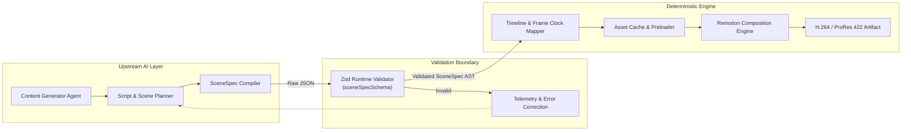
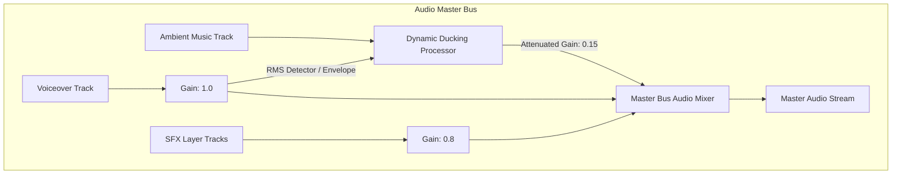

# CreatorOS Architecture Specification: SceneSpec Schema

- **Document ID**: `SPEC-0002`
- **Status**: Stable / Production-Ready
- **Version**: 2.4.0
- **Authors**: CreatorOS Core Platform Architecture Team
- **Target Runtime**: Node.js 20+ / Remotion 4.0+ / V8 Engine

---

## 1. Executive Overview & System Boundary

The `SceneSpec` serves as the deterministic interface contract between non-deterministic AI generation pipelines (orchestrated by LLMs, multi-modal agents, and prompt chains) and the deterministic rendering engine built on Remotion.

Every visual element, audio sample, layout rule, transition curve, and caption frame rendered by CreatorOS must be compiled into a valid `SceneSpec` document prior to entering the render queue. The contract ensures complete decoupling: upstream agents generate intent-driven structural manifests, while downstream Remotion compositions execute frame-accurate pixel and audio synthesis without network calls or unpredictable side effects.

### Pipeline Boundary & Ingestion Topology



---

## 2. Global Composition Parameters

CreatorOS renders programmatic video targeting mobile-first, short-form consumption. The default render pipeline enforces the following invariants:

| Parameter | Default Value | Supported Domain | Unit | Invariant Description |
| :--- | :--- | :--- | :--- | :--- |
| `width` | `1080` | `720` to `3840` | Pixels | Horizontal canvas resolution. |
| `height` | `1920` | `1280` to `3840` | Pixels | Vertical canvas resolution (Default 9:16 portrait). |
| `fps` | `30` | `24`, `25`, `30`, `60` | Frames / Sec | Internal timebase for all frame calculations. |
| `durationInFrames` | Derived | $\mathbb{Z}^+$ | Frames | $D_{\text{frames}} = \sum_{i=1}^{N} \text{scene}_i.\text{durationInFrames}$. |
| `colorSpace` | `"sRGB"` | `"sRGB"`, `"display-p3"` | String | Target canvas color gamut. |

### Timebase Invariants & Conversions

All duration metrics in `SceneSpec` are expressed in integer frames (`frames`) to eliminate floating-point drift across varying framerates. Upstream planners that output millisecond or second values must execute exact quantization at validation time:

$$\text{durationInFrames} = \left\lfloor (\text{durationInSeconds} \times \text{fps}) + 0.5 \right\rfloor$$

$$\text{frameToSeconds}(f, \text{fps}) = \frac{f}{\text{fps}}$$

---

## 3. Brand & Design System Tokens

To maintain visual identity across AI-generated scenes, `SceneSpec` embeds an immutable `BrandTheme` configuration containing typography rules, strict palette mapping, layout spacing scales, and global aesthetic guidelines.

```typescript
export interface BrandTheme {
  id: string;
  name: string;
  palette: {
    primary: string;       // Hex or CSS Color (e.g., #4F46E5)
    secondary: string;     // Hex or CSS Color (e.g., #06B6D4)
    accent: string;        // Hex or CSS Color (e.g., #F43F5E)
    background: string;    // Hex or CSS Color (e.g., #09090B)
    surface: string;       // Hex or CSS Color (e.g., #18181B)
    textPrimary: string;   // Hex or CSS Color (e.g., #FFFFFF)
    textSecondary: string; // Hex or CSS Color (e.g., #A1A1AA)
    border: string;        // Hex or CSS Color (e.g., #27272A)
  };
  typography: {
    headingFontFamily: string;
    bodyFontFamily: string;
    codeFontFamily?: string;
    fontWeights: {
      normal: number;
      medium: number;
      bold: number;
      extraBold: number;
    };
    letterSpacing: {
      tight: string;
      normal: string;
      wide: string;
    };
  };
  layout: {
    safeAreaPadding: {
      top: number;    // In pixels (e.g., 120px to avoid UI overlays)
      bottom: number; // In pixels (e.g., 180px to avoid engagement docks)
      left: number;   // In pixels (e.g., 64px)
      right: number;  // In pixels (e.g., 64px)
    };
    borderRadius: {
      none: number;
      sm: number;
      md: number;
      lg: number;
      full: number;
    };
  };
  watermark?: {
    assetUrl: string;
    position: "top_left" | "top_right" | "bottom_left" | "bottom_right";
    opacity: number;
    width: number;
  };
}
```

---

## 4. Audio Architecture & Track Specification

Audio in CreatorOS is handled as an independent Directed Acyclic Graph (DAG) mixed parallel to the video timeline. Audio tracks are categorized into three distinct channels:

1. **Voiceover (`voiceover`)**: Primary speech layer driving visual synchronization and subtitle locks.
2. **Background Music (`ambient_music`)**: Dynamic backing tracks that automatically duck under the voiceover.
3. **Sound Effects (`sfx`)**: Spatial or punctual audio triggers tied to scene transitions or motion elements.



### Dynamic Ducking Formulation

When voiceover audio is active at frame $f$, the dynamic volume multiplier $V_{\text{bgm}}(f)$ for background music is calculated via an exponential smoothing filter:

$$V_{\text{target}}(f) = \begin{cases} 
D_{\text{duckFactor}} & \text{if } \text{isVoiceActive}(f) \\ 
1.0 & \text{otherwise} 
\end{cases}$$

$$V_{\text{bgm}}(f) = V_{\text{bgm}}(f - 1) + \alpha \cdot \left(V_{\text{target}}(f) - V_{\text{bgm}}(f - 1)\right)$$

Where $\alpha = 1 - e^{-\frac{1}{\text{fps} \cdot \tau}}$ and $\tau$ is the attack/release time constant in seconds.

---

## 5. Scene Blocks & Visual Layer Hierarchy

A `SceneSpec` document contains an ordered array of `scenes`. Each scene represents an absolute chronological slice of the global timeline with its own internal layer composition.

### Scene Block Types

* `hook`: High-intensity opening block featuring aggressive animations, large text typography, dynamic visual effects, and high pacing (typically 1.5–3.0 seconds).
* `talking_head`: Primary subject video layer (e.g., green-screened or masked avatar/human presenter) layered over dynamic contextual graphics.
* `broll`: Supplemental contextual video or high-resolution photo asset, scaled and panned via programmatic camera paths (Ken Burns effect).
* `quote`: Clean, high-impact typographic layout emphasizing a customer testimonial, critical statistic, or memorable statement.
* `list`: Sequenced, multi-item visual presentation that animates sequential sub-elements (bullet points, numbered rankings, or metric comparisons).
* `cta`: Call-to-action layout terminating the composition, emphasizing branding, links, engagement buttons, or follow directives.

### Visual Layer Stack

Inside every scene block exists an ordered array of visual `layers`. Layers are rendered using CSS z-index painter semantics: `index 0` is the bottom-most background layer, while `index N - 1` is rendered on top.

```
+-------------------------------------------------------------+
| Layer N-1: Subtitle / Caption Layer (Always on top)         |
+-------------------------------------------------------------+
| Layer 3: Visual Overlays (Shapes, Icons, Accents)           |
+-------------------------------------------------------------+
| Layer 2: Typographic Content (Headlines, Sub-text)          |
+-------------------------------------------------------------+
| Layer 1: Foreground Subject (Masked Talent, Cutouts)        |
+-------------------------------------------------------------+
| Layer 0: Background Media (Looping Video, Solid, Gradient)   |
+-------------------------------------------------------------+
```

---

## 6. Complete TypeScript Definition File

Below is the definitive TypeScript contract, exposed via `@creatoros/scene-spec/types`.

```typescript
/**
 * @file scene-spec.types.ts
 * @package @creatoros/scene-spec
 * @version 2.4.0
 * Formal contract between CreatorOS AI Content Engines and the Remotion Rendering Pipeline.
 */

export type UUID = string;
export type AssetURL = string;
export type HexColor = string;

export type AspectRatio = "9:16" | "16:9" | "1:1" | "4:5";

export interface Dimensions {
  width: number;
  height: number;
}

export type EasingType =
  | "linear"
  | "ease-in"
  | "ease-out"
  | "ease-in-out"
  | "spring";

export interface SpringConfig {
  damping: number;
  mass: number;
  stiffness: number;
  overshootClamping?: boolean;
}

export type TransitionType =
  | "none"
  | "fade"
  | "slide-left"
  | "slide-right"
  | "slide-up"
  | "slide-down"
  | "wipe-left"
  | "wipe-right"
  | "zoom-in"
  | "zoom-out"
  | "flip-horizontal"
  | "blur";

export interface TransitionSpec {
  type: TransitionType;
  durationInFrames: number;
  easing: EasingType;
  springConfig?: SpringConfig;
}

export interface TransformOrigin {
  x: number; // 0 to 1 (0 = left, 0.5 = center, 1 = right)
  y: number; // 0 to 1 (0 = top, 0.5 = center, 1 = bottom)
}

export interface AnimationKeyframe {
  frame: number; // Relative to layer start frame
  opacity?: number;
  scale?: number;
  positionX?: number; // In canvas pixels
  positionY?: number; // In canvas pixels
  rotation?: number;  // In degrees
  blurRadius?: number; // In pixels
}

export interface MotionConfig {
  keyframes: AnimationKeyframe[];
  easing: EasingType;
  springConfig?: SpringConfig;
  loop?: boolean;
}

export interface SpatialBox {
  x: number;         // Top-left pixel offset
  y: number;         // Top-left pixel offset
  width: number;     // Absolute pixels
  height: number;    // Absolute pixels
  zIndex: number;    // Painter layer order
  rotation?: number; // Degrees
  opacity?: number;  // 0.0 to 1.0
}

export type LayerKind =
  | "video"
  | "image"
  | "text"
  | "caption"
  | "shape"
  | "lottie"
  | "shader_overlay";

export interface BaseLayer {
  id: UUID;
  name: string;
  kind: LayerKind;
  box: SpatialBox;
  startFrameOffset: number; // Relative to parent scene start
  durationInFrames: number;
  enterAnimation?: MotionConfig;
  exitAnimation?: MotionConfig;
  ambientAnimation?: MotionConfig;
}

export interface VideoLayer extends BaseLayer {
  kind: "video";
  assetUrl: AssetURL;
  playbackRate: number;
  volume: number;
  muted: boolean;
  startTrimInFrames: number;
  chromaKey?: {
    color: HexColor;
    similarity: number;
    smoothness: number;
  };
  filter?: {
    brightness?: number;
    contrast?: number;
    saturation?: number;
    grayscale?: boolean;
  };
}

export interface ImageLayer extends BaseLayer {
  kind: "image";
  assetUrl: AssetURL;
  fit: "contain" | "cover" | "fill";
  kenBurns?: {
    startScale: number;
    endScale: number;
    startPosition: { x: number; y: number };
    endPosition: { x: number; y: number };
  };
}

export interface TextStyle {
  fontFamily: string;
  fontSize: number;
  fontWeight: number;
  color: HexColor;
  textAlign: "left" | "center" | "right" | "justify";
  lineHeight: number;
  letterSpacing: number;
  backgroundColor?: HexColor;
  borderWidth?: number;
  borderColor?: HexColor;
  shadow?: {
    color: HexColor;
    offsetX: number;
    offsetY: number;
    blurRadius: number;
  };
}

export interface TextLayer extends BaseLayer {
  kind: "text";
  rawText: string;
  style: TextStyle;
}

export interface CaptionToken {
  word: string;
  startFrame: number;
  endFrame: number;
}

export interface CaptionLayer extends BaseLayer {
  kind: "caption";
  tokens: CaptionToken[];
  style: TextStyle;
  activeWordStyle: Partial<TextStyle>;
  maxWordsPerScreen: number;
}

export interface ShapeLayer extends BaseLayer {
  kind: "shape";
  shapeType: "rectangle" | "circle" | "ellipse" | "polygon";
  fillColor: HexColor;
  strokeColor?: HexColor;
  strokeWidth?: number;
  borderRadius?: number;
}

export interface LottieLayer extends BaseLayer {
  kind: "lottie";
  assetUrl: AssetURL;
  speed: number;
  loop: boolean;
}

export interface ShaderOverlayLayer extends BaseLayer {
  kind: "shader_overlay";
  shaderType: "film_grain" | "vignette" | "glitch" | "light_leak";
  intensity: number;
}

export type SceneVisualLayer =
  | VideoLayer
  | ImageLayer
  | TextLayer
  | CaptionLayer
  | ShapeLayer
  | LottieLayer
  | ShaderOverlayLayer;

export type SceneBlockType =
  | "hook"
  | "talking_head"
  | "broll"
  | "quote"
  | "list"
  | "cta";

export interface SceneBlock {
  id: UUID;
  sceneIndex: number;
  type: SceneBlockType;
  durationInFrames: number;
  transitionIn: TransitionSpec;
  transitionOut: TransitionSpec;
  layers: SceneVisualLayer[];
  metadata: {
    scriptSegment: string;
    targetPacingScore: number;
    notes?: string;
  };
}

export interface AudioVolumeKeyframe {
  frame: number;
  gain: number; // 0.0 to 1.0 (or > 1.0 for boost)
}

export type AudioCategory = "voiceover" | "ambient_music" | "sfx";

export interface AudioTrack {
  id: UUID;
  category: AudioCategory;
  assetUrl: AssetURL;
  startFrameOffset: number;
  durationInFrames: number;
  startTrimInFrames: number;
  volume: number;
  pan: number; // -1.0 (Full Left) to 1.0 (Full Right)
  loop: boolean;
  duckingConfig?: {
    targetGain: number;       // Gain multiplier during duck (e.g. 0.15)
    attackInFrames: number;   // Ramp-down duration
    releaseInFrames: number;  // Ramp-up duration
  };
  envelope?: AudioVolumeKeyframe[];
}

export interface SceneSpecMetadata {
  specVersion: "2.4.0";
  contentId: UUID;
  projectId: UUID;
  generator: {
    engineId: string;
    model: string;
    promptHash: string;
    generatedAt: string; // ISO 8601
  };
  renderHints: {
    concurrencyHint: number;
    hardwareAcceleration: "require" | "prefer" | "disable";
    estimatedTotalFrames: number;
  };
}

export interface BrandThemePalette {
  primary: HexColor;
  secondary: HexColor;
  accent: HexColor;
  background: HexColor;
  surface: HexColor;
  textPrimary: HexColor;
  textSecondary: HexColor;
  border: HexColor;
}

export interface BrandThemeTypography {
  headingFontFamily: string;
  bodyFontFamily: string;
  codeFontFamily?: string;
  fontWeights: {
    normal: number;
    medium: number;
    bold: number;
    extraBold: number;
  };
  letterSpacing: {
    tight: string;
    normal: string;
    wide: string;
  };
}

export interface BrandThemeLayout {
  safeAreaPadding: {
    top: number;
    bottom: number;
    left: number;
    right: number;
  };
  borderRadius: {
    none: number;
    sm: number;
    md: number;
    lg: number;
    full: number;
  };
}

export interface BrandTheme {
  id: UUID;
  name: string;
  palette: BrandThemePalette;
  typography: BrandThemeTypography;
  layout: BrandThemeLayout;
  watermark?: {
    assetUrl: AssetURL;
    position: "top_left" | "top_right" | "bottom_left" | "bottom_right";
    opacity: number;
    width: number;
  };
}

export interface SceneSpec {
  schemaVersion: "2.4.0";
  meta: SceneSpecMetadata;
  composition: {
    width: number;
    height: number;
    fps: number;
    durationInFrames: number;
    aspectRatio: AspectRatio;
  };
  brand: BrandTheme;
  audioTimeline: AudioTrack[];
  scenes: SceneBlock[];
}
```

---

## 7. Complete Runtime Zod Schema

Below is the definitive Zod schema, strictly enforcing structural types, value bounds, regular expressions, and cross-field consistency.

```typescript
/**
 * @file scene-spec.schema.ts
 * @package @creatoros/scene-spec
 * @version 2.4.0
 * Pure runtime Zod validation for SceneSpec JSON payloads.
 */

import { z } from "zod";

const hexColorRegex = /^#([0-9a-fA-F]{3}|[0-9a-fA-F]{4}|[0-9a-fA-F]{6}|[0-9a-fA-F]{8})$/;
const hexColorSchema = z.string().regex(hexColorRegex, "Invalid hex color format.");
const urlSchema = z.string().url("Must be a fully qualified URL.");

export const dimensionsSchema = z.object({
  width: z.number().int().min(128).max(7680),
  height: z.number().int().min(128).max(7680),
});

export const springConfigSchema = z.object({
  damping: z.number().positive(),
  mass: z.number().positive(),
  stiffness: z.number().positive(),
  overshootClamping: z.boolean().optional(),
});

export const transitionTypeSchema = z.enum([
  "none",
  "fade",
  "slide-left",
  "slide-right",
  "slide-up",
  "slide-down",
  "wipe-left",
  "wipe-right",
  "zoom-in",
  "zoom-out",
  "flip-horizontal",
  "blur",
]);

export const easingTypeSchema = z.enum([
  "linear",
  "ease-in",
  "ease-out",
  "ease-in-out",
  "spring",
]);

export const transitionSpecSchema = z.object({
  type: transitionTypeSchema,
  durationInFrames: z.number().int().min(0).max(180),
  easing: easingTypeSchema,
  springConfig: springConfigSchema.optional(),
});

export const animationKeyframeSchema = z.object({
  frame: z.number().int().min(0),
  opacity: z.number().min(0).max(1).optional(),
  scale: z.number().min(0).max(10).optional(),
  positionX: z.number().optional(),
  positionY: z.number().optional(),
  rotation: z.number().optional(),
  blurRadius: z.number().min(0).optional(),
});

export const motionConfigSchema = z.object({
  keyframes: z.array(animationKeyframeSchema).min(1),
  easing: easingTypeSchema,
  springConfig: springConfigSchema.optional(),
  loop: z.boolean().optional(),
});

export const spatialBoxSchema = z.object({
  x: z.number(),
  y: z.number(),
  width: z.number().positive(),
  height: z.number().positive(),
  zIndex: z.number().int(),
  rotation: z.number().default(0),
  opacity: z.number().min(0).max(1).default(1),
});

export const textStyleSchema = z.object({
  fontFamily: z.string().min(1),
  fontSize: z.number().positive(),
  fontWeight: z.number().int().min(100).max(900),
  color: hexColorSchema,
  textAlign: z.enum(["left", "center", "right", "justify"]),
  lineHeight: z.number().positive(),
  letterSpacing: z.number(),
  backgroundColor: hexColorSchema.optional(),
  borderWidth: z.number().min(0).optional(),
  borderColor: hexColorSchema.optional(),
  shadow: z
    .object({
      color: hexColorSchema,
      offsetX: z.number(),
      offsetY: z.number(),
      blurRadius: z.number().min(0),
    })
    .optional(),
});

const baseLayerSchema = z.object({
  id: z.string().uuid(),
  name: z.string().min(1),
  box: spatialBoxSchema,
  startFrameOffset: z.number().int().min(0),
  durationInFrames: z.number().int().positive(),
  enterAnimation: motionConfigSchema.optional(),
  exitAnimation: motionConfigSchema.optional(),
  ambientAnimation: motionConfigSchema.optional(),
});

export const videoLayerSchema = baseLayerSchema.extend({
  kind: z.literal("video"),
  assetUrl: urlSchema,
  playbackRate: z.number().positive().default(1.0),
  volume: z.number().min(0).max(2).default(1.0),
  muted: z.boolean().default(false),
  startTrimInFrames: z.number().int().min(0).default(0),
  chromaKey: z
    .object({
      color: hexColorSchema,
      similarity: z.number().min(0).max(1),
      smoothness: z.number().min(0).max(1),
    })
    .optional(),
  filter: z
    .object({
      brightness: z.number().optional(),
      contrast: z.number().optional(),
      saturation: z.number().optional(),
      grayscale: z.boolean().optional(),
    })
    .optional(),
});

export const imageLayerSchema = baseLayerSchema.extend({
  kind: z.literal("image"),
  assetUrl: urlSchema,
  fit: z.enum(["contain", "cover", "fill"]).default("cover"),
  kenBurns: z
    .object({
      startScale: z.number().positive(),
      endScale: z.number().positive(),
      startPosition: z.object({ x: z.number(), y: z.number() }),
      endPosition: z.object({ x: z.number(), y: z.number() }),
    })
    .optional(),
});

export const textLayerSchema = baseLayerSchema.extend({
  kind: z.literal("text"),
  rawText: z.string(),
  style: textStyleSchema,
});

export const captionTokenSchema = z.object({
  word: z.string(),
  startFrame: z.number().int().min(0),
  endFrame: z.number().int().min(0),
});

export const captionLayerSchema = baseLayerSchema.extend({
  kind: z.literal("caption"),
  tokens: z.array(captionTokenSchema),
  style: textStyleSchema,
  activeWordStyle: textStyleSchema.partial(),
  maxWordsPerScreen: z.number().int().positive().default(3),
});

export const shapeLayerSchema = baseLayerSchema.extend({
  kind: z.literal("shape"),
  shapeType: z.enum(["rectangle", "circle", "ellipse", "polygon"]),
  fillColor: hexColorSchema,
  strokeColor: hexColorSchema.optional(),
  strokeWidth: z.number().min(0).optional(),
  borderRadius: z.number().min(0).optional(),
});

export const lottieLayerSchema = baseLayerSchema.extend({
  kind: z.literal("lottie"),
  assetUrl: urlSchema,
  speed: z.number().positive().default(1.0),
  loop: z.boolean().default(true),
});

export const shaderOverlayLayerSchema = baseLayerSchema.extend({
  kind: z.literal("shader_overlay"),
  shaderType: z.enum(["film_grain", "vignette", "glitch", "light_leak"]),
  intensity: z.number().min(0).max(1).default(0.5),
});

export const visualLayerSchema = z.discriminatedUnion("kind", [
  videoLayerSchema,
  imageLayerSchema,
  textLayerSchema,
  captionLayerSchema,
  shapeLayerSchema,
  lottieLayerSchema,
  shaderOverlayLayerSchema,
]);

export const sceneBlockTypeSchema = z.enum([
  "hook",
  "talking_head",
  "broll",
  "quote",
  "list",
  "cta",
]);

export const sceneBlockSchema = z.object({
  id: z.string().uuid(),
  sceneIndex: z.number().int().min(0),
  type: sceneBlockTypeSchema,
  durationInFrames: z.number().int().positive(),
  transitionIn: transitionSpecSchema,
  transitionOut: transitionSpecSchema,
  layers: z.array(visualLayerSchema),
  metadata: z.object({
    scriptSegment: z.string(),
    targetPacingScore: z.number().min(0).max(1),
    notes: z.string().optional(),
  }),
});

export const audioVolumeKeyframeSchema = z.object({
  frame: z.number().int().min(0),
  gain: z.number().min(0).max(2),
});

export const audioCategorySchema = z.enum(["voiceover", "ambient_music", "sfx"]);

export const audioTrackSchema = z.object({
  id: z.string().uuid(),
  category: audioCategorySchema,
  assetUrl: urlSchema,
  startFrameOffset: z.number().int().min(0),
  durationInFrames: z.number().int().positive(),
  startTrimInFrames: z.number().int().min(0).default(0),
  volume: z.number().min(0).max(2).default(1.0),
  pan: z.number().min(-1.0).max(1.0).default(0.0),
  loop: z.boolean().default(false),
  duckingConfig: z
    .object({
      targetGain: z.number().min(0).max(1),
      attackInFrames: z.number().int().positive(),
      releaseInFrames: z.number().int().positive(),
    })
    .optional(),
  envelope: z.array(audioVolumeKeyframeSchema).optional(),
});

export const brandThemeSchema = z.object({
  id: z.string().uuid(),
  name: z.string().min(1),
  palette: z.object({
    primary: hexColorSchema,
    secondary: hexColorSchema,
    accent: hexColorSchema,
    background: hexColorSchema,
    surface: hexColorSchema,
    textPrimary: hexColorSchema,
    textSecondary: hexColorSchema,
    border: hexColorSchema,
  }),
  typography: z.object({
    headingFontFamily: z.string().min(1),
    bodyFontFamily: z.string().min(1),
    codeFontFamily: z.string().optional(),
    fontWeights: z.object({
      normal: z.number().int(),
      medium: z.number().int(),
      bold: z.number().int(),
      extraBold: z.number().int(),
    }),
    letterSpacing: z.object({
      tight: z.string(),
      normal: z.string(),
      wide: z.string(),
    }),
  }),
  layout: z.object({
    safeAreaPadding: z.object({
      top: z.number().int().nonnegative(),
      bottom: z.number().int().nonnegative(),
      left: z.number().int().nonnegative(),
      right: z.number().int().nonnegative(),
    }),
    borderRadius: z.object({
      none: z.literal(0),
      sm: z.number().nonnegative(),
      md: z.number().nonnegative(),
      lg: z.number().nonnegative(),
      full: z.number().nonnegative(),
    }),
  }),
  watermark: z
    .object({
      assetUrl: urlSchema,
      position: z.enum(["top_left", "top_right", "bottom_left", "bottom_right"]),
      opacity: z.number().min(0).max(1),
      width: z.number().positive(),
    })
    .optional(),
});

export const sceneSpecSchema = z
  .object({
    schemaVersion: z.literal("2.4.0"),
    meta: z.object({
      specVersion: z.literal("2.4.0"),
      contentId: z.string().uuid(),
      projectId: z.string().uuid(),
      generator: z.object({
        engineId: z.string(),
        model: z.string(),
        promptHash: z.string(),
        generatedAt: z.string().datetime(),
      }),
      renderHints: z.object({
        concurrencyHint: z.number().int().positive().max(64),
        hardwareAcceleration: z.enum(["require", "prefer", "disable"]),
        estimatedTotalFrames: z.number().int().positive(),
      }),
    }),
    composition: z.object({
      width: z.number().int().positive(),
      height: z.number().int().positive(),
      fps: z.number().int().min(24).max(60),
      durationInFrames: z.number().int().positive(),
      aspectRatio: z.enum(["9:16", "16:9", "1:1", "4:5"]),
    }),
    brand: brandThemeSchema,
    audioTimeline: z.array(audioTrackSchema),
    scenes: z.array(sceneBlockSchema).min(1),
  })
  .superRefine((val, ctx) => {
    // Invariant Check 1: Ensure total scene duration matches composition durationInFrames
    const totalSceneFrames = val.scenes.reduce(
      (acc, s) => acc + s.durationInFrames,
      0
    );
    if (totalSceneFrames !== val.composition.durationInFrames) {
      ctx.addIssue({
        code: z.ZodIssueCode.custom,
        message: `Sum of scene block durations (${totalSceneFrames}) must exactly equal composition.durationInFrames (${val.composition.durationInFrames}).`,
        path: ["composition", "durationInFrames"],
      });
    }

    // Invariant Check 2: Sequential Scene Indices
    val.scenes.forEach((scene, idx) => {
      if (scene.sceneIndex !== idx) {
        ctx.addIssue({
          code: z.ZodIssueCode.custom,
          message: `Scene block at index ${idx} defines invalid sceneIndex ${scene.sceneIndex}.`,
          path: ["scenes", idx, "sceneIndex"],
        });
      }

      // Invariant Check 3: Layers must not overrun the parent scene block
      scene.layers.forEach((layer, layerIdx) => {
        const layerEndFrame = layer.startFrameOffset + layer.durationInFrames;
        if (layerEndFrame > scene.durationInFrames) {
          ctx.addIssue({
            code: z.ZodIssueCode.custom,
            message: `Layer '${layer.name}' (duration: ${layer.durationInFrames}, offset: ${layer.startFrameOffset}) exceeds parent scene block duration (${scene.durationInFrames}).`,
            path: ["scenes", idx, "layers", layerIdx, "durationInFrames"],
          });
        }
      });
    });
  });

export type ValidatedSceneSpec = z.infer<typeof sceneSpecSchema>;
```

---

## 8. Canonical Production JSON Instance

The following production payload demonstrates a high-impact, 12-second (360 frames @ 30fps) short-form video consisting of a `hook`, a `talking_head`, and a concluding `cta`.

```json
{
  "schemaVersion": "2.4.0",
  "meta": {
    "specVersion": "2.4.0",
    "contentId": "b1a13e2f-52a3-4811-9a74-ec0f4a217642",
    "projectId": "87c4bf59-45f8-4566-a6ae-a2ce893b8277",
    "generator": {
      "engineId": "creatoros-director-agent",
      "model": "claude-3-7-sonnet",
      "promptHash": "sha256:d8a5f471e4ebaa3a0273c52a0a2df37b4b3bfa9900994918e7e171f6ad3b0e2c",
      "generatedAt": "2025-03-30T10:15:30.000Z"
    },
    "renderHints": {
      "concurrencyHint": 16,
      "hardwareAcceleration": "require",
      "estimatedTotalFrames": 360
    }
  },
  "composition": {
    "width": 1080,
    "height": 1920,
    "fps": 30,
    "durationInFrames": 360,
    "aspectRatio": "9:16"
  },
  "brand": {
    "id": "e7b0bcfe-6a56-4c47-975f-22a30bb0b88e",
    "name": "CreatorOS Neon Dark",
    "palette": {
      "primary": "#6366F1",
      "secondary": "#06B6D4",
      "accent": "#F43F5E",
      "background": "#09090B",
      "surface": "#18181B",
      "textPrimary": "#FFFFFF",
      "textSecondary": "#A1A1AA",
      "border": "#27272A"
    },
    "typography": {
      "headingFontFamily": "Inter",
      "bodyFontFamily": "Inter",
      "codeFontFamily": "JetBrains Mono",
      "fontWeights": {
        "normal": 400,
        "medium": 500,
        "bold": 700,
        "extraBold": 900
      },
      "letterSpacing": {
        "tight": "-0.02em",
        "normal": "0em",
        "wide": "0.04em"
      }
    },
    "layout": {
      "safeAreaPadding": {
        "top": 140,
        "bottom": 220,
        "left": 64,
        "right": 64
      },
      "borderRadius": {
        "none": 0,
        "sm": 8,
        "md": 16,
        "lg": 24,
        "full": 9999
      }
    },
    "watermark": {
      "assetUrl": "https://assets.creatoros.com/brand/watermark-badge.png",
      "position": "top_right",
      "opacity": 0.6,
      "width": 120
    }
  },
  "audioTimeline": [
    {
      "id": "c71fa776-9285-45c1-8ce5-8cb6ee7ca701",
      "category": "voiceover
