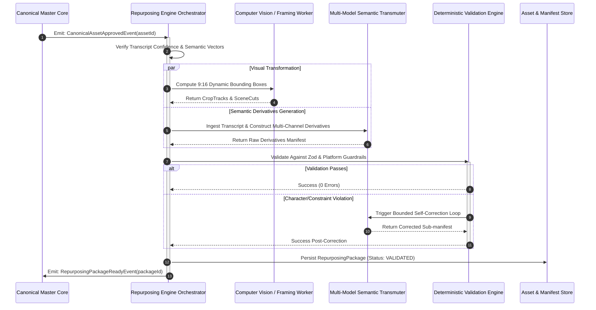

# CreatorOS Specification: 03-content-repurposing-package

**Status:** APPROVED  
**Version:** 1.0.0  
**Author:** CreatorOS Architecture Group  
**Target Engine:** `@creatoros/transformer-engine >= 2.4.0`  
**Related Specs:** `01-core-domain-primitives.md`, `02-pipeline-orchestration.md`, `04-distribution-connectors.md`

---

## 1. Executive Summary & Architectural Context

The `RepurposingPackage` is the authoritative multi-channel asset compilation generated from a single, approved master video within the CreatorOS pipeline. In the CreatorOS operational paradigm, creators produce high-bandwidth, primary canonical video assets (long-form YouTube videos, keynote recordings, podcasts, or masterclasses). The ingestion pipeline processes this source asset through transcription, speaker diarization, scene detection, visual OCR, and semantic keyframe extraction.

Once the source asset reaches `APPROVED` state in the lifecycle, the `RepurposingEngine` executes a deterministic, parallel fan-out transformation to produce a unified `RepurposingPackage`. This package encapsulates cross-platform derivatives engineered to exploit the algorithmic and formatting nuances of each target surface:

1. **Short-Form Vertical Videos:** Micro-hooks, vertical crops (9:16), dynamic dynamic subtitle manifests, platform-specific metadata (TikTok, Shorts, Reels).
2. **LinkedIn Long-Form Posts:** Narrative-first, whitespace-optimized text with targeted business hooks, synthesized insights, and custom engagement loops.
3. **X/Twitter Threads:** Character-constrained, viral-hook-led cascading tweet arrays with native media markers and engagement-maximizing terminal nodes.
4. **Carousels (Instagram & LinkedIn):** Highly visual, slide-by-slide graphic definitions, structural hierarchy, and swipe-compelling progressive disclosure.
5. **Email Newsletter Excerpts:** A/B subject lines, conversational lead-ins, actionable insight frameworks, and retention links back to the canonical asset.
6. **Follow-Up Content Ideation:** Predictive algorithmic spin-offs, counter-argument prompts, community polls, and AMA queries derived from conversational gaps.

```
+--------------------------------------------------------------------------------------------------+
|                                    Canonical Video Asset                                         |
|                 (16:9 4K Video, Multi-channel Audio, Word-level SRT, Semantic Graph)             |
+--------------------------------------------------------------------------------------------------+
                                                 |
                                     [Repurposing Engine]
                                                 |
        +-------------------+--------------------+-------------------+--------------------+
        |                   |                    |                   |                    |
        v                   v                    v                   v                    v
+---------------+   +---------------+   +----------------+   +---------------+   +----------------+
|  Short-Form   |   |   LinkedIn    |   |   X/Twitter    |   |   Carousel    |   |   Newsletter   |
|   Variants    |   |   Long-Form   |   |    Threads     |   |    Slides     |   |    Excerpts    |
+---------------+   +---------------+   +----------------+   +---------------+   +----------------+
        |                   |                    |                   |                    |
        +-------------------+--------------------+-------------------+--------------------+
                                                 |
                                                 v
+--------------------------------------------------------------------------------------------------+
|                               Follow-Up Content Ideation Matrix                                  |
|                   (Spinoffs, Counter-Narratives, Micro-Polls, Community Prompts)                 |
+--------------------------------------------------------------------------------------------------+
```

---

## 2. Ingestion Context & Upstream Dependencies

The generation of a `RepurposingPackage` requires an immutable upstream input: the `CanonicalEnrichedSource`. Transformations fail fast if upstream acoustic, visual, or semantic confidences fall below calibrated operational thresholds.

```typescript
export interface CanonicalEnrichedSource {
  canonicalAssetId: string;
  sourceUri: string;
  durationMs: number;
  aspectRatio: "16:9" | "9:16" | "1:1" | "4:5";
  metadata: {
    title: string;
    description: string;
    publishedAt?: string;
    language: string;
    speakerIds: string[];
  };
  transcript: {
    fullText: string;
    segments: Array<{
      id: number;
      startMs: number;
      endMs: number;
      speakerId: string;
      text: string;
      confidence: number;
      words: Array<{
        word: string;
        startMs: number;
        endMs: number;
        confidence: number;
      }>;
    }>;
  };
  semanticAnalysis: {
    coreTheses: string[];
    keyTakeaways: string[];
    sentimentProfile: Array<{
      timecodeMs: number;
      sentiment: "positive" | "neutral" | "negative" | "provocative";
      score: number;
    }>;
    detectedHooks: Array<{
      startMs: number;
      endMs: number;
      hookType: "contrarian" | "curiosity_gap" | "statistic" | "story" | "framework";
      score: number;
      proposedHookText: string;
    }>;
  };
  visualAnalysis: {
    focalCoordinates: Array<{
      timecodeMs: number;
      primarySpeakerBox: { x: number; y: number; width: number; height: number };
    }>;
    sceneChangesMs: number[];
  };
}
```

---

## 3. TypeScript Domain Specifications

### 3.1. Primitives and Enumerations

```typescript
export type PlatformTarget = 
  | "TIKTOK" 
  | "YOUTUBE_SHORTS" 
  | "INSTAGRAM_REELS" 
  | "LINKEDIN" 
  | "TWITTER" 
  | "NEWSLETTER";

export type RepurposingPackageStatus = 
  | "DRAFT" 
  | "GENERATING" 
  | "VALIDATED" 
  | "USER_EDITED" 
  | "APPROVED" 
  | "REJECTED" 
  | "PUBLISHED";

export interface BoundingBox {
  x: number; // Normalized [0.0, 1.0]
  y: number; // Normalized [0.0, 1.0]
  width: number; // Normalized [0.0, 1.0]
  height: number; // Normalized [0.0, 1.0]
}

export interface MediaCropWindow {
  timestampMs: number;
  box: BoundingBox;
}

export interface DynamicTextOverlay {
  text: string;
  startMs: number;
  endMs: number;
  style: "POP_IN" | "KARAOKE_WORD" | "SUBTLE_BOTTOM" | "IMPACT_CENTER";
  fontFamily: string;
  fontSize: number;
  primaryColorHex: string;
  highlightColorHex: string;
  position: { xPercent: number; yPercent: number };
}
```

### 3.2. Short-Form Video Derivatives (Shorts, Reels, TikTok)

```typescript
export interface ShortFormPlatformMetadata {
  title: string;
  caption: string;
  hashtags: string[];
  soundRecommendation: {
    type: "ORIGINAL_AUDIO" | "COMMERCIAL_TRENDING" | "BACKGROUND_AMBIENT";
    queryKeywords: string[];
  };
  thumbnailFrameTimeMs: number;
}

export interface ShortFormVideoVariant {
  id: string;
  canonicalAssetId: string;
  internalLabel: string;
  targetPlatforms: Array<"TIKTOK" | "YOUTUBE_SHORTS" | "INSTAGRAM_REELS">;
  sourceWindow: {
    startMs: number;
    endMs: number;
    durationMs: number;
  };
  composition: {
    targetAspectRatio: "9:16";
    cropTrack: MediaCropWindow[];
    overlays: DynamicTextOverlay[];
    retentionEdits: Array<{
      type: "JUMP_CUT" | "B_ROLL_INSERT" | "ZOOM_IN" | "ZOOM_OUT" | "SPEED_RAMP";
      startMs: number;
      endMs: number;
      parameters?: Record<string, string | number | boolean>;
    }>;
  };
  platformMetadata: {
    tiktok: ShortFormPlatformMetadata;
    youtubeShorts: ShortFormPlatformMetadata;
    instagramReels: ShortFormPlatformMetadata;
  };
  editorialMetrics: {
    hookStrengthScore: number; // 0.0 - 1.0
    viralityPotentialScore: number; // 0.0 - 1.0
    estimatedWatchThroughRate: number; // Percentage 0 - 100
  };
}
```

### 3.3. Text-First Channels: LinkedIn & X/Twitter

```typescript
export interface LinkedInLongFormPost {
  id: string;
  canonicalAssetId: string;
  hook: string;
  bodyParagraphs: string[];
  bulletPoints: string[];
  callToAction: string;
  suggestedHashtags: string[];
  characterCount: number;
  attachedAssetRecommendations: Array<{
    type: "CAROUSEL_PDF" | "SINGLE_IMAGE" | "NATIVE_VIDEO_CLIP" | "NONE";
    assetReferenceId?: string;
  }>;
  distributionScheduleAdvice: {
    suggestedPostTimeUtc: string;
    rationale: string;
  };
}

export interface TweetNode {
  index: number;
  text: string;
  characterCount: number;
  mediaPlacement?: {
    type: "VIDEO_CLIP" | "IMAGE_STILL" | "POLL";
    mediaReferenceId?: string;
    pollOptions?: [string, string, string?, string?];
  };
  isThreadTerminal: boolean;
}

export interface TwitterThread {
  id: string;
  canonicalAssetId: string;
  threadHookVariantA: string;
  threadHookVariantB: string;
  tweets: TweetNode[];
  totalTweets: number;
  callToAction: {
    type: "RETWEET_FIRST" | "EXTERNAL_LINK" | "NEWSLETTER_SIGNUP" | "REPLY_PROMPT";
    targetUrl?: string;
    promptText: string;
  };
}
```

### 3.4. Visual Swipes: Carousel Slide Specification

```typescript
export interface CarouselSlide {
  slideNumber: number;
  headline: string;
  bodyText: string;
  highlightText?: string;
  visualPromptForDesignerOrAI: string;
  suggestedLayout: 
    | "TITLE_CARD" 
    | "HERO_STATEMENT" 
    | "TWO_COLUMN_CONTRAST" 
    | "DATA_CALLOUT" 
    | "FRAMEWORK_DIAGRAM" 
    | "CLOSING_CALL_TO_ACTION";
  uiAnnotations?: {
    showSwipeIndicator: boolean;
    pageIndicator: string; // e.g., "02/07"
  };
}

export interface CarouselPackage {
  id: string;
  canonicalAssetId: string;
  title: string;
  targetPlatforms: Array<"LINKEDIN" | "INSTAGRAM">;
  canvasConfiguration: {
    widthPx: number; // Standard: 1080
    heightPx: number; // Standard: 1350 for 4:5 (IG) or 1080/1350 for LinkedIn
    aspectRatio: "1:1" | "4:5";
    colorPalette: {
      backgroundHex: string;
      primaryTextHex: string;
      accentTextHex: string;
      brandAccentHex: string;
    };
    fontStyles: {
      headlineFont: string;
      bodyFont: string;
    };
  };
  slides: CarouselSlide[];
  coverSlideVariation: {
    headlineOptionA: string;
    headlineOptionB: string;
    subheadline: string;
  };
  caption: {
    instagramCopy: string;
    linkedInCopy: string;
  };
}
```

### 3.5. Direct Response: Email Newsletter Excerpts

```typescript
export interface NewsletterExcerpt {
  id: string;
  canonicalAssetId: string;
  subjectLines: Array<{
    variant: "CURIOSITY" | "DIRECT_VALUE" | "CONTRARIAN" | "URGENT";
    text: string;
  }>;
  previewText: string;
  markdownContent: string;
  htmlContentPreview: string;
  callToActionBlock: {
    buttonLabel: string;
    destinationUrl: string;
    supportingMicrocopy: string;
  };
  keyTakeawayBox: {
    title: string;
    points: string[];
  };
}
```

### 3.6. Ideation Engine: Follow-Up Content System

```typescript
export interface FollowUpContentIdea {
  id: string;
  title: string;
  premise: string;
  archetype: 
    | "COUNTER_NARRATIVE" 
    | "TECHNICAL_DEEP_DIVE" 
    | "CASE_STUDY_APPLICATION" 
    | "AUDIENCE_CHALLENGE" 
    | "FAQ_TEARDOWN";
  suggestedMedium: "LONG_FORM_VIDEO" | "LIVE_STREAM" | "SHORT_SERIES" | "ESSAY";
  audienceSentimentDriver: string;
  starterPrompt: string;
}

export interface CommunityPollSpec {
  question: string;
  targetPlatform: "YOUTUBE_COMMUNITY" | "LINKEDIN" | "TWITTER";
  options: [string, string, string, string];
  strategicObjective: "VALIDATE_NEW_TOPIC" | "PROVOKE_DEBATE" | "AUDIENCE_SEGMENTATION";
}

export interface FollowUpIdeationPackage {
  id: string;
  canonicalAssetId: string;
  editorialSpinOffs: FollowUpContentIdea[];
  interactivePolls: CommunityPollSpec[];
  unansweredQuestionsToExplore: string[];
}
```

### 3.7. The Root Container: RepurposingPackage

```typescript
export interface RepurposingPackage {
  id: string;
  schemaVersion: "1.0.0";
  canonicalAssetId: string;
  sourceHash: string; // SHA-256 of canonical transcript + analysis for caching
  generatedAt: string; // ISO-8601
  status: RepurposingPackageStatus;
  derivatives: {
    shortFormClips: ShortFormVideoVariant[];
    linkedInPosts: LinkedInLongFormPost[];
    twitterThreads: TwitterThread[];
    carousels: CarouselPackage[];
    newsletters: NewsletterExcerpt[];
  };
  ideation: FollowUpIdeationPackage;
  pipelineDiagnostics: {
    generationDurationMs: number;
    tokensConsumed: number;
    modelIdentifiers: Record<string, string>;
  };
}
```

---

## 4. Formal JSON Schema Representation

The following JSON Schema (Draft 2020-12) strictly enforces validation for data serialization over network boundaries:

```json
{
  "$schema": "https://json-schema.org/draft/2020-12/schema",
  "$id": "https://creatoros.io/schemas/repurposing-package.v1.json",
  "title": "RepurposingPackage",
  "type": "object",
  "required": [
    "id",
    "schemaVersion",
    "canonicalAssetId",
    "sourceHash",
    "generatedAt",
    "status",
    "derivatives",
    "ideation",
    "pipelineDiagnostics"
  ],
  "properties": {
    "id": { "type": "string", "format": "uuid" },
    "schemaVersion": { "type": "string", "const": "1.0.0" },
    "canonicalAssetId": { "type": "string" },
    "sourceHash": { "type": "string", "pattern": "^[a-f0-9]{64}$" },
    "generatedAt": { "type": "string", "format": "date-time" },
    "status": {
      "type": "string",
      "enum": ["DRAFT", "GENERATING", "VALIDATED", "USER_EDITED", "APPROVED", "REJECTED", "PUBLISHED"]
    },
    "derivatives": {
      "type": "object",
      "required": ["shortFormClips", "linkedInPosts", "twitterThreads", "carousels", "newsletters"],
      "properties": {
        "shortFormClips": {
          "type": "array",
          "items": {
            "type": "object",
            "required": ["id", "canonicalAssetId", "internalLabel", "targetPlatforms", "sourceWindow", "composition", "platformMetadata", "editorialMetrics"],
            "properties": {
              "id": { "type": "string" },
              "canonicalAssetId": { "type": "string" },
              "internalLabel": { "type": "string" },
              "targetPlatforms": {
                "type": "array",
                "items": { "type": "string", "enum": ["TIKTOK", "YOUTUBE_SHORTS", "INSTAGRAM_REELS"] },
                "minItems": 1
              },
              "sourceWindow": {
                "type": "object",
                "required": ["startMs", "endMs", "durationMs"],
                "properties": {
                  "startMs": { "type": "integer", "minimum": 0 },
                  "endMs": { "type": "integer", "minimum": 0 },
                  "durationMs": { "type": "integer", "minimum": 1000, "maximum": 90000 }
                }
              },
              "composition": {
                "type": "object",
                "required": ["targetAspectRatio", "cropTrack", "overlays", "retentionEdits"],
                "properties": {
                  "targetAspectRatio": { "type": "string", "const": "9:16" },
                  "cropTrack": {
                    "type": "array",
                    "items": {
                      "type": "object",
                      "required": ["timestampMs", "box"],
                      "properties": {
                        "timestampMs": { "type": "integer" },
                        "box": {
                          "type": "object",
                          "required": ["x", "y", "width", "height"],
                          "properties": {
                            "x": { "type": "number", "minimum": 0, "maximum": 1 },
                            "y": { "type": "number", "minimum": 0, "maximum": 1 },
                            "width": { "type": "number", "minimum": 0, "maximum": 1 },
                            "height": { "type": "number", "minimum": 0, "maximum": 1 }
                          }
                        }
                      }
                    }
                  },
                  "overlays": { "type": "array" },
                  "retentionEdits": { "type": "array" }
                }
              },
              "platformMetadata": {
                "type": "object",
                "required": ["tiktok", "youtubeShorts", "instagramReels"]
              },
              "editorialMetrics": {
                "type": "object",
                "required": ["hookStrengthScore", "viralityPotentialScore", "estimatedWatchThroughRate"],
                "properties": {
                  "hookStrengthScore": { "type": "number", "minimum": 0, "maximum": 1 },
                  "viralityPotentialScore": { "type": "number", "minimum": 0, "maximum": 1 },
                  "estimatedWatchThroughRate": { "type": "number", "minimum": 0, "maximum": 100 }
                }
              }
            }
          }
        },
        "linkedInPosts": {
          "type": "array",
          "items": {
            "type": "object",
            "required": ["id", "canonicalAssetId", "hook", "bodyParagraphs", "bulletPoints", "callToAction", "characterCount"],
            "properties": {
              "id": { "type": "string" },
              "canonicalAssetId": { "type": "string" },
              "hook": { "type": "string", "maxLength": 300 },
              "bodyParagraphs": { "type": "array", "items": { "type": "string" } },
              "bulletPoints": { "type": "array", "items": { "type": "string" } },
              "callToAction": { "type": "string", "maxLength": 300 },
              "characterCount": { "type": "integer", "maximum": 3000 }
            }
          }
        },
        "twitterThreads": {
          "type": "array",
          "items": {
            "type": "object",
            "required": ["id", "canonicalAssetId", "threadHookVariantA", "threadHookVariantB", "tweets", "totalTweets", "callToAction"],
            "properties": {
              "id": { "type": "string" },
              "canonicalAssetId": { "type": "string" },
              "tweets": {
                "type": "array",
                "items": {
                  "type": "object",
                  "required": ["index", "text", "characterCount", "isThreadTerminal"],
                  "properties": {
                    "index": { "type": "integer", "minimum": 1 },
                    "text": { "type": "string", "maxLength": 280 },
                    "characterCount": { "type": "integer", "maximum": 280 },
                    "isThreadTerminal": { "type": "boolean" }
                  }
                }
              }
            }
          }
        },
        "carousels": {
          "type": "array",
          "items": {
            "type": "object",
            "required": ["id", "canonicalAssetId", "title", "targetPlatforms", "canvasConfiguration", "slides", "caption"],
            "properties": {
              "id": { "type": "string" },
              "slides": {
                "type": "array",
                "minItems": 2,
                "maxItems": 20,
                "items": {
                  "type": "object",
                  "required": ["slideNumber", "headline", "bodyText", "visualPromptForDesignerOrAI", "suggestedLayout"],
                  "properties": {
                    "slideNumber": { "type": "integer", "minimum": 1 },
                    "headline": { "type": "string", "maxLength": 100 },
                    "bodyText": { "type": "string", "maxLength": 500 }
                  }
                }
              }
            }
          }
        },
        "newsletters": {
          "type": "array",
          "items": {
            "type": "object",
            "required": ["id", "canonicalAssetId", "subjectLines", "previewText", "markdownContent", "callToActionBlock", "keyTakeawayBox"],
            "properties": {
              "id": { "type": "string" },
              "subjectLines": {
                "type": "array",
                "minItems": 2,
                "items": {
                  "type": "object",
                  "required": ["variant", "text"],
                  "properties": {
                    "variant": { "type": "string", "enum": ["CURIOSITY", "DIRECT_VALUE", "CONTRARIAN", "URGENT"] },
                    "text": { "type": "string", "maxLength": 100 }
                  }
                }
              }
            }
          }
        }
      }
    },
    "ideation": {
      "type": "object",
      "required": ["id", "canonicalAssetId", "editorialSpinOffs", "interactivePolls", "unansweredQuestionsToExplore"],
      "properties": {
        "id": { "type": "string" },
        "editorialSpinOffs": { "type": "array" },
        "interactivePolls": { "type": "array" },
        "unansweredQuestionsToExplore": { "type": "array", "items": { "type": "string" } }
      }
    },
    "pipelineDiagnostics": {
      "type": "object",
      "required": ["generationDurationMs", "tokensConsumed", "modelIdentifiers"],
      "properties": {
        "generationDurationMs": { "type": "integer" },
        "tokensConsumed": { "type": "integer" },
        "modelIdentifiers": { "type": "object", "additionalProperties": { "type": "string" } }
      }
    }
  }
}
```

---

## 5. Channel Transformation Specifications & Algorithmic Guardrails

Every target platform enforces asymmetric consumption behaviors, rendering rules, and distribution parameters. The repurposing engine executes platform-tailored transformation rules to preserve fidelity while matching platform conventions.

### 5.1. Channel Rules Matrix

| Channel | Hard Constraint | Algorithmic Pacing Rule | Hook Mechanics | Retention Loop Strategy |
| :--- | :--- | :--- | :--- | :--- |
| **TikTok** | $\le 60\text{s}$ optimal; 9:16 vertical | Visual scene cut every $\le 2.2\text{s}$ | Disruption/Subversion within $0.0\text{s} - 1.5\text{s}$ | Loop dynamic text matching end to beginning phrase |
| **YouTube Shorts** | $< 60\text{s}$ strict limit | Continuous dynamic text overlays | Direct thesis statement within $0.0\text{s} - 2.0\text{s}$ | Audio bridge carrying final syllable into frame 1 |
| **Instagram Reels**| $\le 90\text{s}$; safe-zone clearance | Aesthetic balance; audio track sync | Visually striking OCR context within $0.0\text{s} - 3.0\text{s}$ | "Read caption for step-by-step breakdown" |
| **LinkedIn Posts** | 3,000 chars; "see more" at char 140 | 1–2 sentence paragraphs; high whitespace | Contrarian industry assertion before char 140 | Conversational, provocative prompt in final line |
| **X/Twitter Threads** | 280 chars/tweet; max 25 nodes | Standalone value node every single tweet | Pattern interrupt + quantitative outcome statement | Terminal tweet points to root or email capture |
| **Carousels** | 1080x1350px (4:5); 5–10 slides | $\le 25$ words per slide; progressive disclosure | "The [Topic] Playbook Most [Target] Miss" | Actionable recap + immediate download prompt |
| **Newsletters** | 45 chars for subject visibility | F-pattern reading flow; scannable bullets | Subject matches internal identity trigger | Explicit primary CTA above the physical fold |

---

## 6. Pipeline Orchestration Flow

The compilation process is executed as an orchestrated directed acyclic graph (DAG) managed by the CreatorOS pipeline worker nodes.



---

## 7. Deterministic Runtime Validation (Zod Schema)

All transformations must pass runtime validation prior to persistent database state mutation or distribution trigger emission.

```typescript
import { z } from "zod";

export const BoundingBoxSchema = z.object({
  x: z.number().min(0).max(1),
  y: z.number().min(0).max(1),
  width: z.number().min(0).max(1),
  height: z.number().min(0).max(1),
});

export const MediaCropWindowSchema = z.object({
  timestampMs: z.number().nonnegative(),
  box: BoundingBoxSchema,
});

export const DynamicTextOverlaySchema = z.object({
  text: z.string().min(1),
  startMs: z.number().nonnegative(),
  endMs: z.number().nonnegative(),
  style: z.enum(["POP_IN", "KARAOKE_WORD", "SUBTLE_BOTTOM", "IMPACT_CENTER"]),
  fontFamily: z.string(),
  fontSize: z.number().positive(),
  primaryColorHex: z.string().regex(/^#[0-9A-F]{6}$/i),
  highlightColorHex: z.string().regex(/^#[0-9A-F]{6}$/i),
  position: z.object({
    xPercent: z.number().min(0).max(100),
    yPercent: z.number().min(0).max(100),
  }),
});

export const ShortFormPlatformMetadataSchema = z.object({
  title: z.string().min(3).max(100),
  caption: z.string().max(2200),
  hashtags: z.array(z.string().regex(/^#[a-zA-Z0-9_]+$/)).max(15),
  soundRecommendation: z.object({
    type: z.enum(["ORIGINAL_AUDIO", "COMMERCIAL_TRENDING", "BACKGROUND_AMBIENT"]),
    queryKeywords: z.array(z.string()),
  }),
  thumbnailFrameTimeMs: z.number().nonnegative(),
});

export const ShortFormVideoVariantSchema = z.object({
  id: z.string().uuid(),
  canonicalAssetId: z.string(),
  internalLabel: z.string(),
  targetPlatforms: z.array(z.enum(["TIKTOK", "YOUTUBE_SHORTS", "INSTAGRAM_REELS"])).min(1),
  sourceWindow: z.object({
    startMs: z.number().nonnegative(),
    endMs: z.number().nonnegative(),
    durationMs: z.number().min(3000).max(90000), // Enforce shorts <= 90s
  }).refine((data) => data.endMs > data.startMs, {
    message: "endMs must be strictly greater than startMs",
  }),
  composition: z.object({
    targetAspectRatio: z.literal("9:16"),
    cropTrack: z.array(MediaCropWindowSchema),
    overlays: z.array(DynamicTextOverlaySchema),
    retentionEdits: z.array(
      z.object({
        type: z.enum(["JUMP_CUT", "B_ROLL_INSERT", "ZOOM_IN", "ZOOM_OUT", "SPEED_RAMP"]),
        startMs: z.number().nonnegative(),
        endMs: z.number().nonnegative(),
        parameters: z.record(z.union([z.string(), z.number(), z.boolean()])).optional(),
      })
    ),
  }),
  platformMetadata: z.object({
    tiktok: ShortFormPlatformMetadataSchema,
    youtubeShorts: ShortFormPlatformMetadataSchema,
    instagramReels: ShortFormPlatformMetadataSchema,
  }),
  editorialMetrics: z.object({
    hookStrengthScore: z.number().min(0).max(1),
    viralityPotentialScore: z.number().min(0).max(1),
    estimatedWatchThroughRate: z.number().min(0).max(100),
  }),
});

export const LinkedInLongFormPostSchema = z.object({
  id: z.string().uuid(),
  canonicalAssetId: z.string(),
  hook: z.string().max(250),
  bodyParagraphs: z.array(z.string()).min(2),
  bulletPoints: z.array(z.string()),
  callToAction: z.string().max(300),
  suggestedHashtags: z.array(z.string()).max(5),
  characterCount: z.number().max(3000),
  attachedAssetRecommendations: z.array(
    z.object({
      type: z.enum(["CAROUSEL_PDF", "SINGLE_IMAGE", "NATIVE_VIDEO_CLIP", "NONE"]),
      assetReferenceId: z.string().optional(),
    })
  ),
  distributionScheduleAdvice: z.object({
    suggestedPostTimeUtc: z.string(),
    rationale: z.string(),
  }),
}).refine(
  (post) => {
    const totalChars =
      post.hook.length +
      post.bodyParagraphs.join("\n\n").length +
      post.bulletPoints.join("\n").length +
      post.callToAction.length;
    return totalChars <= 3000;
  },
  { message: "Aggregated character length exceeds LinkedIn max limit of 3000" }
);

export const TweetNodeSchema = z.object({
  index: z.number().int().positive(),
  text: z.string().min(1).max(280),
  characterCount: z.number().max(280),
  mediaPlacement: z.object({
    type: z.enum(["VIDEO_CLIP", "IMAGE_STILL", "POLL"]),
    mediaReferenceId: z.string().optional(),
    pollOptions: z.tuple([z.string(), z.string()]).rest(z.string()).optional(),
  }).optional(),
  isThreadTerminal: z.boolean(),
});

export const TwitterThreadSchema = z.object({
  id: z.string().uuid(),
  canonicalAssetId: z.string(),
  threadHookVariantA: z.string().max(280),
  threadHookVariantB: z.string().max(280),
  tweets: z.array(TweetNodeSchema).min(2).max(25),
  totalTweets: z.number().int().min(2).max(25),
  callToAction: z.object({
    type: z.enum(["RETWEET_FIRST", "EXTERNAL_LINK", "NEWSLETTER_SIGNUP", "REPLY_PROMPT"]),
    targetUrl: z.string().url().optional(),
    promptText: z.string().max(280),
  }),
}).refine((thread) => thread.tweets.length === thread.totalTweets, {
  message: "Reported totalTweets must match the length of the tweets array",
});

export const CarouselSlideSchema = z.object({
  slideNumber: z.number().int().positive(),
  headline: z.string().max(100),
  bodyText: z.string().max(500),
  highlightText: z.string().optional(),
  visualPromptForDesignerOrAI: z.string(),
  suggestedLayout: z.enum([
    "TITLE_CARD",
    "HERO_STATEMENT",
    "TWO_COLUMN_CONTRAST",
    "DATA_CALLOUT",
    "FRAMEWORK_DIAGRAM",
    "CLOSING_CALL_TO_ACTION",
  ]),
  uiAnnotations: z.object({
    showSwipeIndicator: z.boolean(),
    pageIndicator: z.string(),
  }).optional(),
});

export const CarouselPackageSchema = z.object({
  id: z.string().uuid(),
  canonicalAssetId: z.string(),
  title: z.string().max(120),
  targetPlatforms: z.array(z.enum(["LINKEDIN", "INSTAGRAM"])).min(1),
  canvasConfiguration: z.object({
    widthPx: z.number().default(1080),
    heightPx: z.number().default(1350),
    aspectRatio: z.enum(["1:1", "4:5"]),
    colorPalette: z.object({
      backgroundHex: z.string().regex(/^#[0-9A-F]{6}$/i),
      primaryTextHex: z.string().regex(/^#[0-9A-F]{6}$/i),
      accentTextHex: z.string().regex(/^#[0-9A-F]{6}$/i),
      brandAccentHex: z.string().regex(/^#[0-9A-F]{6}$/i),
    }),
    fontStyles: z.object({
      headlineFont: z.string(),
      bodyFont: z.string(),
    }),
  }),
  slides: z.array(CarouselSlideSchema).min(3).max(15),
  coverSlideVariation: z.object({
    headlineOptionA: z.string(),
    headlineOptionB: z.string(),
    subheadline: string
