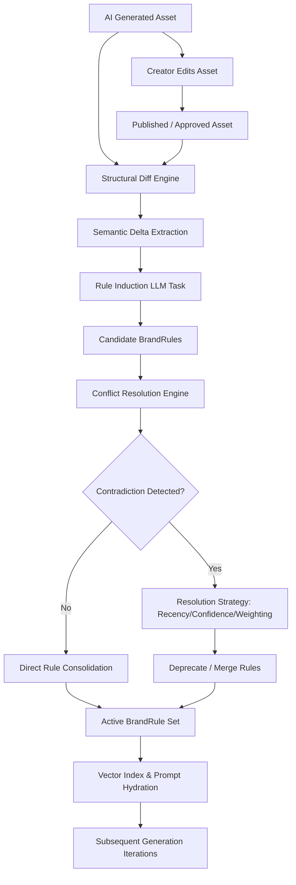
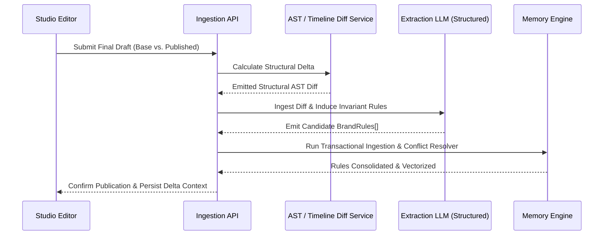
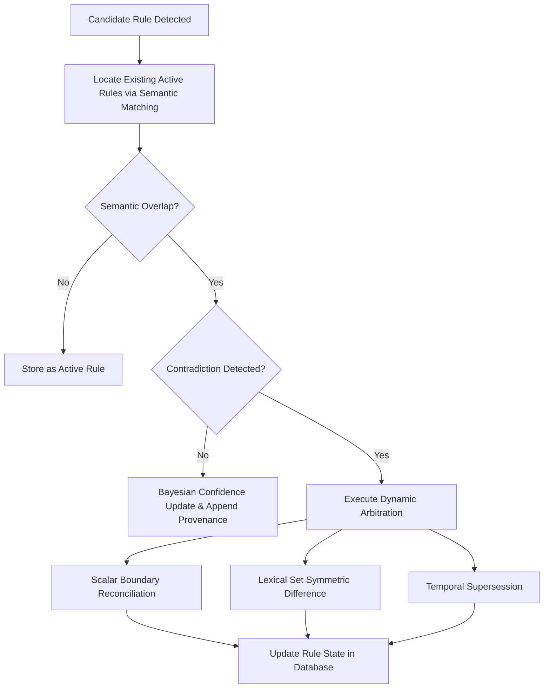
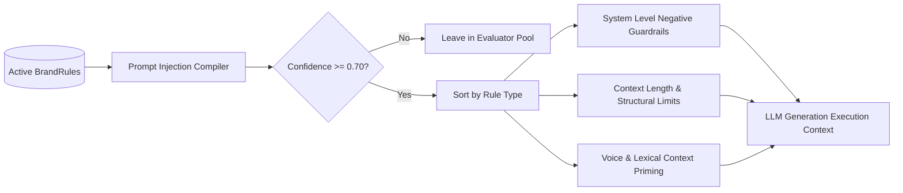

# Revision Feedback Loop & Memory Engine Specification

**Document Version:** 1.0.0  
**Target Component:** `@creatoros/memory-engine` & `@creatoros/revision-pipeline`  
**Status:** Approved for Implementation

---

## 1. System Overview

The Revision Feedback Loop translates human editorial decisions (diffs between AI-generated drafts and creator-published variants) into deterministic, persistent constraints called **BrandRules**. When a creator changes a hook, cuts words, adjusts visual pacing, or rewrites a call-to-action (CTA), the platform does not simply store the final asset. It computes a structural diff, extracts implicit stylistic and semantic preferences, resolves conflicts against historical rules, and persists high-confidence rules into the creator's long-term semantic memory.



### Core Architecture Guarantees
1. **Determinism over Stochastic Drift:** Inferred preferences must resolve into structured, typed schemas containing machine-enforceable negative constraints and operational targets.
2. **Deterministic Conflict Resolution:** Conflicting rules (e.g., "Always use emojis" vs. "Never use emojis") are reconciled via directed acyclic graph (DAG) lineage resolution, Bayesian confidence updates, and semantic supersession.
3. **Decoupled Rule Extraction:** Rule extraction runs asynchronously off the critical path of rendering and publishing, emitting transactional events to update creator state.

---

## 2. BrandRule Schema

The `BrandRule` contract represents the system's foundational unit of memory. Every rule belongs to a functional domain, contains target boundaries, and defines programmatic validation criteria.

### 2.1 Complete TypeScript Interfaces

```typescript
export type RuleDomain = 
  | 'hook'
  | 'script_body'
  | 'visual_pacing'
  | 'audio_music'
  | 'typography'
  | 'lexical_choice'
  | 'cta';

export type RuleEnforcementType = 
  | 'negative_constraint'   // Absolute rejection: "Never use word X"
  | 'positive_constraint'   // Absolute requirement: "Always cite source"
  | 'scalar_range'          // Bounded values: "Intros must be between 1.5s and 3.0s"
  | 'stylistic_preference'; // Soft target for prompt engineering: "Use passive-aggressive irony"

export type RuleStatus = 
  | 'candidate' 
  | 'active' 
  | 'deprecated' 
  | 'superseded';

export interface ScalarConstraint {
  metric: 'duration_seconds' | 'word_count' | 'wpm' | 'reading_level' | 'cut_frequency_seconds';
  operator: 'lt' | 'lte' | 'gt' | 'gte' | 'eq' | 'range';
  value: number;
  secondaryValue?: number; // Used when operator === 'range'
  unit: string;
}

export interface LexicalConstraint {
  forbiddenTokens: string[];
  mandatoryTokens: string[];
  caseSensitive: boolean;
}

export interface ProvenanceLog {
  sourceAssetId: string;
  sourceAssetType: 'short_form_video' | 'newsletter' | 'tweet_thread' | 'linkedin_post';
  diffSnapshotId: string;
  inferredAt: string; // ISO 8601
  modelIdentifier: string;
}

export interface BrandRule {
  id: string;
  creatorId: string;
  domain: RuleDomain;
  enforcementType: RuleEnforcementType;
  status: RuleStatus;
  
  // Natural language expressions
  canonicalInstruction: string;
  rationale: string;
  
  // Programmatic enforcement parameters
  scalarConstraint?: ScalarConstraint;
  lexicalConstraint?: LexicalConstraint;
  
  // Metrics & Confidence
  confidenceScore: number;     // Range: [0.00, 1.00]
  supportCount: number;        // Number of observations confirming this rule
  contradictionCount: number;  // Number of user edits contradicting this rule
  
  // Lineage and Deprecation
  supersededBy?: string;       // Foreign Key to replacing BrandRule
  supersedes?: string[];       // Foreign Keys to superseded BrandRules
  conflictResolutionNotes?: string;
  
  provenance: ProvenanceLog[];
  createdAt: string;
  updatedAt: string;
}
```

### 2.2 JSON Schema Specification

```json
{
  "$schema": "https://json-schema.org/draft/2020-12/schema",
  "$id": "https://creatoros.io/schemas/brand-rule.json",
  "title": "BrandRule",
  "type": "object",
  "required": [
    "id",
    "creatorId",
    "domain",
    "enforcementType",
    "status",
    "canonicalInstruction",
    "rationale",
    "confidenceScore",
    "supportCount",
    "contradictionCount",
    "provenance",
    "createdAt",
    "updatedAt"
  ],
  "properties": {
    "id": { "type": "string", "format": "uuid" },
    "creatorId": { "type": "string", "format": "uuid" },
    "domain": {
      "type": "string",
      "enum": ["hook", "script_body", "visual_pacing", "audio_music", "typography", "lexical_choice", "cta"]
    },
    "enforcementType": {
      "type": "string",
      "enum": ["negative_constraint", "positive_constraint", "scalar_range", "stylistic_preference"]
    },
    "status": {
      "type": "string",
      "enum": ["candidate", "active", "deprecated", "superseded"]
    },
    "canonicalInstruction": { "type": "string", "maxLength": 512 },
    "rationale": { "type": "string", "maxLength": 1024 },
    "confidenceScore": { "type": "number", "minimum": 0, "maximum": 1 },
    "supportCount": { "type": "integer", "minimum": 1 },
    "contradictionCount": { "type": "integer", "minimum": 0 },
    "supersededBy": { "type": "string", "format": "uuid" },
    "supersedes": {
      "type": "array",
      "items": { "type": "string", "format": "uuid" }
    },
    "scalarConstraint": {
      "type": "object",
      "required": ["metric", "operator", "value", "unit"],
      "properties": {
        "metric": {
          "type": "string",
          "enum": ["duration_seconds", "word_count", "wpm", "reading_level", "cut_frequency_seconds"]
        },
        "operator": {
          "type": "string",
          "enum": ["lt", "lte", "gt", "gte", "eq", "range"]
        },
        "value": { "type": "number" },
        "secondaryValue": { "type": "number" },
        "unit": { "type": "string" }
      }
    },
    "lexicalConstraint": {
      "type": "object",
      "required": ["forbiddenTokens", "mandatoryTokens", "caseSensitive"],
      "properties": {
        "forbiddenTokens": { "type": "array", "items": { "type": "string" } },
        "mandatoryTokens": { "type": "array", "items": { "type": "string" } },
        "caseSensitive": { "type": "boolean" }
      }
    },
    "provenance": {
      "type": "array",
      "items": {
        "type": "object",
        "required": ["sourceAssetId", "sourceAssetType", "diffSnapshotId", "inferredAt", "modelIdentifier"],
        "properties": {
          "sourceAssetId": { "type": "string" },
          "sourceAssetType": { "type": "string" },
          "diffSnapshotId": { "type": "string" },
          "inferredAt": { "type": "string", "format": "date-time" },
          "modelIdentifier": { "type": "string" }
        }
      }
    },
    "createdAt": { "type": "string", "format": "date-time" },
    "updatedAt": { "type": "string", "format": "date-time" }
  }
}
```

---

## 3. Structural Diff & Semantic Extraction Pipeline

Extracting durable preferences requires translating raw document or timeline changes into semantic deltas. String diff algorithms (e.g., Levenshtein or Myers Diff) fail on rich content; they do not distinguish between typo corrections and structural editorial decisions.



### 3.1 Structural Diff Node Taxonomy

The diff engine normalizes inputs across scripts and visual timelines into typed operational diff elements:

```typescript
export interface TextASTDiff {
  type: 'lexical_replacement' | 'pruning' | 'structural_expansion' | 'structural_reordering';
  targetComponent: 'hook' | 'script_body' | 'cta';
  originalValue: string;
  revisedValue: string;
  charDelta: number;
  wordDelta: number;
}

export interface TimelineASTDiff {
  type: 'duration_compression' | 'b_roll_swap' | 'audio_ducking' | 'pacing_acceleration';
  targetComponent: 'hook' | 'visual_pacing';
  originalMetrics: { durationSeconds: number; cutCount: number };
  revisedMetrics: { durationSeconds: number; cutCount: number };
}

export type ASTDiff = TextASTDiff | TimelineASTDiff;
```

### 3.2 Few-Shot Extraction Prompting Architecture

The extractor consumes the calculated diff alongside historical rule contexts. The prompt enforces output conformance using strict JSON schema output constraints.

```text
SYSTEM:
You are the Chief Editorial Intelligence Engine for CreatorOS. Your job is to analyze structural diffs between an AI-generated production draft and the final user-edited version. 

Determine the durable, systemic INTENT behind the user's manual revisions. 
Do not extract transient single-use content variations.
Extract invariants: brand voice rules, lexical bans, hook length bounds, pacing changes, or stylistic boundaries.

You must output a JSON array of CandidateBrandRules complying with the system BrandRule schema.

RULES FOR INFERENCE:
1. If a user deletes an adjective/phrase and replaces it with a shorter alternative, determine if the rejection was domain-specific or lexical-specific.
2. If the user consistently shortens introductions, calculate the precise scalar upper limit for intro duration.
3. If a change contradicts an existing known rule, flag it as a potential override.
4. Set baseline confidence:
   - 0.60 for single instances of stylistic drift.
   - 0.85 for clear deletions of generic corporate speak (e.g., "delve", "game-changer", "unleash").
   - 0.95 for direct lexical substitutions that occur repeatedly.

Diff Context:
Type: TextASTDiff
Domain: hook
Original Value: "In today's fast-paced digital ecosystem, delving into deep work is a total game-changer."
Revised Value: "Deep work isn't optional anymore. Here is the operational blueprint:"
Char Delta: -29
Word Delta: -5

Existing Active Rules:
[None]

RESPONSE:
```

```json
[
  {
    "domain": "lexical_choice",
    "enforcementType": "negative_constraint",
    "canonicalInstruction": "Never use the phrases 'game-changer', 'delve into', or 'digital ecosystem'.",
    "rationale": "User stripped corporate marketing jargon during hook optimization, opting for direct, authoritative phrasing.",
    "confidenceScore": 0.90,
    "supportCount": 1,
    "contradictionCount": 0,
    "lexicalConstraint": {
      "forbiddenTokens": ["game-changer", "delve into", "digital ecosystem"],
      "mandatoryTokens": [],
      "caseSensitive": false
    }
  },
  {
    "domain": "hook",
    "enforcementType": "scalar_range",
    "canonicalInstruction": "Keep hooks under 10 words. Lead directly with an assertive thesis.",
    "rationale": "User truncated a 13-word intro down to 7 words, cutting transitional filler.",
    "confidenceScore": 0.75,
    "supportCount": 1,
    "contradictionCount": 0,
    "scalarConstraint": {
      "metric": "word_count",
      "operator": "lte",
      "value": 10,
      "unit": "words"
    }
  }
]
```

---

## 4. Conflict Resolution Engine

As creators update their editorial style, new preferences invariably clash with older constraints. The engine prevents circular logic, conflicting prompts, and stale stylistic directives.



### 4.1 Resolution Matrix Strategies

| Conflict Type | Manifestation | Resolution Algorithm | Resulting State |
| :--- | :--- | :--- | :--- |
| **Direct Negation** | Rule A: "Always end with an open question."<br>Rule B: "Never ask questions in the CTA; state a command." | **Temporal Supersession with Bayesian Decay:** Candidate rule takes precedence if confidence $\ge 0.80$. | Rule A $\to$ `superseded`<br>Rule B $\to$ `active` (linked via `supersedes: [A]`) |
| **Scalar Boundary Drift** | Rule A: "Intro duration $\le 5$ seconds."<br>Rule B: "Intro duration $\le 3$ seconds." | **Interval Narrowing:** Update scalar boundary to the most restrictive constraint if delta conforms to latest edits. | Rule A updated in place to 3s. `supportCount` incremented. |
| **Scalar Boundary Expansion**| Rule A: "Intro duration $\le 3$ seconds."<br>Rule B: "Intro duration $\le 6$ seconds." | **Variance Assessment:** If Rule B observed on $> 2$ consecutive diffs, relax bounds; otherwise flag as candidate exception. | Temporary candidate hold until confirmed by secondary diff. |
| **Lexical Collision** | Rule A: "Banned words: `[delve, unlock]`"<br>Rule B: Draft explicitly incorporates "unlock". | **Contradiction Penalty:** Subtract confidence from Rule A. Remove collided token if creator ignores warning twice. | Rule A `confidenceScore` decays. Word removed from `forbiddenTokens`. |

### 4.2 Mathematical Resolution Models

#### 4.2.1 Bayesian Confidence Update
When a candidate diff supports an existing rule $R$, its confidence score $C_t$ updates using a bounded asymptotic reinforcement:

$$C_{t} = C_{t-1} + (1.0 - C_{t-1}) \cdot \eta$$

Where:
- $\eta$ is the learning rate, dynamically set based on diff clarity: $\eta \in [0.15, 0.35]$.
- $C_t$ is capped at $0.99$.

When an edit explicitly violates rule $R$:

$$C_{t} = C_{t-1} - (C_{t-1} \cdot \delta)$$

Where:
- $\delta$ is the penalty decay factor, dynamically scaled by author authority: $\delta \in [0.25, 0.50]$.
- If $C_t < 0.40$, the rule status flips to `deprecated`.

#### 4.2.2 Scalar Moving Boundaries
Scalar constraints (e.g., Intro Length, Cut Frequency) are updated via an Exponentially Weighted Moving Average (EWMA) applied across approved diffs:

$$S_t = \alpha \cdot X_{\text{new}} + (1 - \alpha) \cdot S_{t-1}$$

Where:
- $X_{\text{new}}$ is the latest observed scalar value.
- $\alpha = 0.4$ prioritizes current style variations without causing sudden wild shifts.

---

## 5. End-to-End Implementation

The following complete TypeScript pipeline handles ingestion, semantic parsing, dynamic conflict resolution, and deterministic state reconciliation.

```typescript
import { v4 as uuidv4 } from 'uuid';
import { 
  BrandRule, 
  RuleDomain, 
  RuleStatus, 
  ASTDiff, 
  ScalarConstraint, 
  LexicalConstraint 
} from './types';

export interface StorageAdapter {
  getActiveRulesByDomain(creatorId: string, domain: RuleDomain): Promise<BrandRule[]>;
  saveRule(rule: BrandRule): Promise<void>;
  updateRule(rule: BrandRule): Promise<void>;
  archiveRule(ruleId: string, supersededById: string): Promise<void>;
}

export interface InferenceClient {
  inferBrandRulesFromDiff(diff: ASTDiff, historicalRules: BrandRule[]): Promise<BrandRule[]>;
}

export class BrandMemoryEngine {
  private storage: StorageAdapter;
  private inference: InferenceClient;

  constructor(storage: StorageAdapter, inference: InferenceClient) {
    this.storage = storage;
    this.inference = inference;
  }

  /**
   * Primary entry point for processing asset revisions.
   */
  public async processRevisionEvent(
    creatorId: string,
    assetId: string,
    diff: ASTDiff
  ): Promise<BrandRule[]> {
    const domain = this.mapDiffTargetToDomain(diff.targetComponent);
    const existingRules = await this.storage.getActiveRulesByDomain(creatorId, domain);
    
    // 1. Infer candidate rules from LLM
    const candidates = await this.inference.inferBrandRulesFromDiff(diff, existingRules);
    const finalizedRules: BrandRule[] = [];

    // 2. Reconcile candidates against the current state machine
    for (const candidate of candidates) {
      candidate.creatorId = creatorId;
      const reconciled = await this.reconcileCandidate(candidate, existingRules, assetId);
      finalizedRules.push(reconciled);
    }

    return finalizedRules;
  }

  private async reconcileCandidate(
    candidate: BrandRule,
    existingRules: BrandRule[],
    assetId: string
  ): Promise<BrandRule> {
    const conflictingRule = this.findConflictingRule(candidate, existingRules);

    if (!conflictingRule) {
      // Direct insertion: No collisions detected
      candidate.id = uuidv4();
      candidate.status = 'active';
      candidate.createdAt = new Date().toISOString();
      candidate.updatedAt = candidate.createdAt;
      await this.storage.saveRule(candidate);
      return candidate;
    }

    // Direct Conflict Encountered: Execute strategy based on enforcement type
    if (
      candidate.enforcementType === 'scalar_range' && 
      conflictingRule.enforcementType === 'scalar_range' &&
      candidate.scalarConstraint &&
      conflictingRule.scalarConstraint
    ) {
      return await this.resolveScalarCollision(candidate, conflictingRule);
    }

    if (
      candidate.enforcementType === 'negative_constraint' && 
      conflictingRule.enforcementType === 'negative_constraint' &&
      candidate.lexicalConstraint &&
      conflictingRule.lexicalConstraint
    ) {
      return await this.resolveLexicalCollision(candidate, conflictingRule);
    }

    // Fallback: Direct Semantic Negation -> Apply Temporal Supersession
    return await this.supersedeRule(candidate, conflictingRule);
  }

  private findConflictingRule(candidate: BrandRule, activeRules: BrandRule[]): BrandRule | null {
    for (const active of activeRules) {
      // Domain matching criteria
      if (active.domain !== candidate.domain) continue;

      // Check for direct lexical constraint intersections
      if (candidate.lexicalConstraint && active.lexicalConstraint) {
        const candidateTokens = new Set(candidate.lexicalConstraint.forbiddenTokens);
        const activeTokens = new Set(active.lexicalConstraint.forbiddenTokens);
        const intersection = [...candidateTokens].filter(x => activeTokens.has(x));
        if (intersection.length > 0) return active;
      }

      // Check for identical scalar target metrics
      if (
        candidate.scalarConstraint && 
        active.scalarConstraint && 
        candidate.scalarConstraint.metric === active.scalarConstraint.metric
      ) {
        return active;
      }

      // Direct semantic opposition flag
      if (
        (candidate.enforcementType === 'positive_constraint' && active.enforcementType === 'negative_constraint') ||
        (candidate.enforcementType === 'negative_constraint' && active.enforcementType === 'positive_constraint')
      ) {
        return active;
      }
    }
    return null;
  }

  private async resolveScalarCollision(
    candidate: BrandRule, 
    existing: BrandRule
  ): Promise<BrandRule> {
    const ALPHA = 0.4;
    const oldVal = existing.scalarConstraint!.value;
    const newVal = candidate.scalarConstraint!.value;
    
    // Apply Exponentially Weighted Moving Average (EWMA)
    const reconciledVal = Number((ALPHA * newVal + (1 - ALPHA) * oldVal).toFixed(2));

    existing.scalarConstraint!.value = reconciledVal;
    existing.supportCount += 1;
    existing.confidenceScore = Math.min(
      0.99, 
      existing.confidenceScore + (1.0 - existing.confidenceScore) * 0.2
    );
    existing.updatedAt = new Date().toISOString();
    existing.rationale = `Bounds adjusted based on EWMA update from revision. Latest observed: ${newVal}. Reconciled: ${reconciledVal}.`;

    await this.storage.updateRule(existing);
    return existing;
  }

  private async resolveLexicalCollision(
    candidate: BrandRule,
    existing: BrandRule
  ): Promise<BrandRule> {
    const existingTokens = new Set(existing.lexicalConstraint!.forbiddenTokens);
    const newTokens = candidate.lexicalConstraint!.forbiddenTokens;

    for (const token of newTokens) {
      existingTokens.add(token);
    }

    existing.lexicalConstraint!.forbiddenTokens = Array.from(existingTokens);
    existing.supportCount += 1;
    existing.confidenceScore = Math.min(0.99, existing.confidenceScore + 0.1);
    existing.updatedAt = new Date().toISOString();

    await this.storage.updateRule(existing);
    return existing;
  }

  private async supersedeRule(candidate: BrandRule, staleRule: BrandRule): Promise<BrandRule> {
    const newRuleId = uuidv4();
    const timestamp = new Date().toISOString();

    // Configure new rule
    candidate.id = newRuleId;
    candidate.status = 'active';
    candidate.supersedes = [staleRule.id];
    candidate.createdAt = timestamp;
    candidate.updatedAt = timestamp;
    candidate.conflictResolutionNotes = `Supersedes rule ${staleRule.id} via temporal resolution. Confidence threshold met.`;

    // Persist new rule before archiving old to avoid orphaned states
    await this.storage.saveRule(candidate);

    // Update old rule to superseded status
    staleRule.status = 'superseded';
    staleRule.supersededBy = newRuleId;
    staleRule.updatedAt = timestamp;
    await this.storage.updateRule(staleRule);

    return candidate;
  }

  private mapDiffTargetToDomain(target: string): RuleDomain {
    switch (target) {
      case 'hook': return 'hook';
      case 'script_body': return 'script_body';
      case 'cta': return 'cta';
      case 'visual_pacing': return 'visual_pacing';
      default: return 'lexical_choice';
    }
  }
}
```

---

## 6. Prompt Injection & Enforcement Layer

BrandRules are consumed down-stream by generation pipelines. Rules with high confidence scores are mapped into system-level generation constraints, ensuring that human edits directly shape future model output.



### 6.1 Compilation & Assembly Algorithm

When compiling generation prompts for a specific domain (e.g., creating a TikTok hook), rules are retrieved, prioritized, and formatted to prevent conflicting instructions from reaching the generation pipeline.

```typescript
export class PromptRuleCompiler {
  /**
   * Compiles validated BrandRules into explicit system prompt instructions.
   */
  public static compileForPrompt(rules: BrandRule[], targetDomain: RuleDomain): string {
    const filteredRules = rules.filter(
      r => (r.domain === targetDomain || r.domain === 'lexical_choice') && 
      r.status === 'active' && 
      r.confidenceScore >= 0.70
    );

    if (filteredRules.length === 0) return '';

    const negativeConstraints: string[] = [];
    const scalarConstraints: string[] = [];
    const stylisticRules: string[] = [];

    for (const rule of filteredRules) {
      if (rule.enforcementType === 'negative_constraint') {
        if (rule.lexicalConstraint?.forbiddenTokens?.length) {
          negativeConstraints.push(`- DO NOT use the following words/phrases: ${rule.lexicalConstraint.forbiddenTokens.map(t => `"${t}"`).join(', ')}.`);
        } else {
          negativeConstraints.push(`- ${rule.canonicalInstruction}`);
        }
      } else if (rule.enforcementType === 'scalar_range' && rule.scalarConstraint) {
        const sc = rule.scalarConstraint;
        scalarConstraints.push(`- ${sc.metric.toUpperCase()} CONSTRAINT: Must be ${sc.operator} ${sc.value} ${sc.unit}. (${rule.canonicalInstruction})`);
      } else {
        stylisticRules.push(`- ${rule.canonicalInstruction}`);
      }
    }

    return `
### BRAND IDENTITY CONSTRAINTS & ENFORCEMENT
Adhere to the following learned brand rules. Violations will cause output rejection:

CRITICAL RESTRICTIONS:
${negativeConstraints.length ? negativeConstraints.join('\n') : '- No hard restrictions defined.'}

STRUCTURAL BOUNDS:
${scalarConstraints.length ? scalarConstraints.join('\n') : '- Maintain standard output metrics.'}

EDITORIAL STYLE PREFERENCES:
${stylisticRules.length ? stylisticRules.join('\n') : '- Retain primary platform voice.'}
`.trim();
  }
}
```

---

## 7. Auditability, History, and Manual Overrides

To avoid "algorithmic hallucination creep"—where incorrect automated assumptions cascade into future outputs—the platform gives creators full visibility and manual control over their memory rules via an administrative API.

### 7.1 Lifecycle State Transition Table

```
   [Candidate]  <--- Inferred via Diff Engine (Confidence < 0.70)
        │
        ├─────────────────────────────┐
        ▼                             ▼
    [Active]                    [Deprecated] (Confidence decayed < 0.40)
        │
        ▼
   [Superseded] (Replaced by newer conflicting rule)
```

### 7.2 Manual Interventions API

The Memory Engine provides three key endpoints for managing rules:

1. **Rule Promotion:** Transition a candidate rule to active status.
   ```http
   POST /v1/creators/{creatorId}/rules/{ruleId}/promote
   ```
   Sets `confidenceScore = 1.0` and `status = 'active'`.

2. **Rule Demotion / Archival:** Deprecate a rule to remove it from generation prompts.
   ```http
   POST /v1/creators/{creatorId}/rules/{ruleId}/deprecate
   Content-Type: application/json

   {
     "reason": "Style pivot: Now pivoting to longer, story-driven introductions."
   }
   ```
   Sets `status = 'deprecated'` and removes the rule from prompt assembly.

3. **Rule Mutation:** Update the parameters of an existing rule.
   ```http
   PATCH /v1/creators/{creatorId}/rules/{ruleId}
   Content-Type: application/json

   {
     "scalarConstraint": {
       "metric": "word_count",
       "operator": "lte",
       "value": 8,
       "unit": "words"
     }
   }
   ```

### 7.3 Drift Detection and Telemetry

The memory loop tracks operational metrics through Prometheus/OpenTelemetry:

```typescript
// Telemetry schema for memory engine operations
export interface MemoryEngineMetrics {
  'rules.inferred.total': { value: number; labels: { domain: RuleDomain } };
  'rules.conflicts.detected': { value: number; labels: { type: 'scalar' | 'lexical' | 'semantic' } };
  'rules.superseded.total': { value: number };
  'rules.confidence.decayed': { value: number; labels: { ruleId: string } };
  'rules.manual_override.total': { value: number; labels: { action: 'promote' | 'deprecate' | 'edit' } };
}
```

If the ratio of `rules.conflicts.detected` to `rules.inferred.total` exceeds **0.35** over a trailing 7-day window, the creator's profile is flagged for a **Style Shift Event**. The engine pauses automated supersession and prompts the creator with an interactive review session:

> *"You've revised several scripts in ways that conflict with your established style. Would you like to update your Brand Rules to reflect this new direction?"*

This human-in-the-loop checkpoint prevents memory corruption during intentional brand pivots while keeping the revision feedback loop fully autonomous for regular production workflows.
