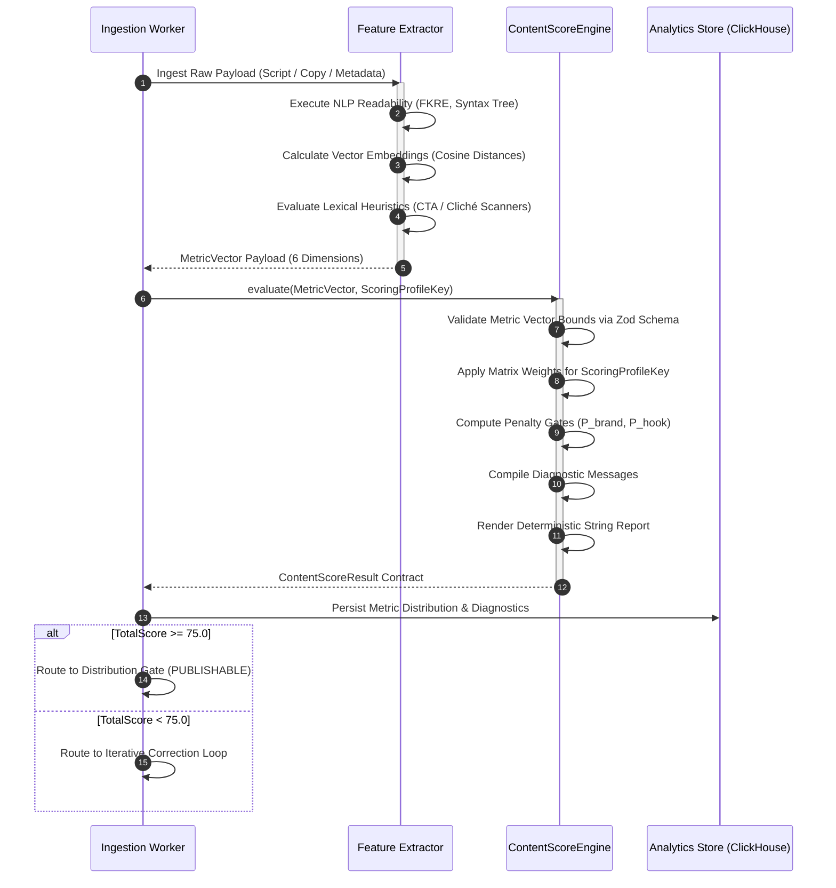

# ContentScore Formal Specification

- **Document ID**: `SPEC-0005`
- **Component**: Evaluation Engine / Quality Assurance Pipeline
- **Status**: Stable / Production-Grade
- **Target Runtime**: Node.js $\ge$ 20.x, Bun $\ge$ 1.1.x, Cloudflare Workers
- **Revision**: 2.4.0

---

## 1. Executive Summary & Purpose

The `ContentScore` framework provides an empirical, deterministic, and multidimensional evaluation model for content artifacts generated within CreatorOS (`@creatoros`). The specification governs:

1. **Dimensional Analysis**: Six bounded scalar metrics representing fundamental attributes of social performance, brand preservation, and production feasibility.
2. **Composite Normalization**: Multi-profile weighted aggregation featuring non-linear penalty gates and safety constraints.
3. **Structured Diagnostic Feedback**: Standardized human- and machine-readable diagnostics mapping directly to corrective transformations.

```
                      ┌──────────────────────────────────────────────┐
                      │              Raw Content Ingest              │
                      └──────────────────────┬───────────────────────┘
                                             │
                                             ▼
                      ┌──────────────────────────────────────────────┐
                      │    Metric Extraction & Inference Pipeline    │
                      │  (NLP, Vector Distances, Lexical Heuristics) │
                      └──────────────────────┬───────────────────────┘
                                             │
           ┌─────────────────┬───────────────┼───────────────┬─────────────────┐
           ▼                 ▼               ▼               ▼                 ▼
    ┌─────────────┐   ┌─────────────┐ ┌─────────────┐ ┌─────────────┐   ┌─────────────┐
    │hookStrength │   │   clarity   │ │ originality │ │  brandFit   │...│ ctaStrength │
    └──────┬──────┘   └──────┬──────┘ └──────┬──────┘ └──────┬──────┘   └──────┬──────┘
           │                 │               │               │                 │
           └─────────────────┼───────────────┼───────────────┼─────────────────┘
                             │               │               │
                             ▼               ▼               ▼
                      ┌──────────────────────────────────────────────┐
                      │    Weighting Matrix & Constraint Gating      │
                      │       (Channel / Format Specialization)      │
                      └──────────────────────┬───────────────────────┘
                                             │
                                             ▼
                      ┌──────────────────────────────────────────────┐
                      │     Deterministic Score & Diagnostic AST    │
                      └──────────────────────────────────────────────┘
```

---

## 2. Metric Dimension Specifications

Every metric dimension is constrained to a real continuous range $[0.0, 100.0]$, represented as a 64-bit IEEE 754 floating-point number during calculation, and serialized as a fixed 2-decimal precision scalar or whole integer depending on output targets.

### 2.1 Metric Taxonomy

| Metric Key | Cardinality | Evaluator Vector | Target Optimization Objective |
| :--- | :--- | :--- | :--- |
| `hookStrength` | $[0.0, 100.0]$ | Structural syntax, thumb-stop cadence, novelty delta | Maximize viewer retention within the initial engagement window ($t \le 3\text{s}$ or first 120 characters). |
| `clarity` | $[0.0, 100.0]$ | Flesch-Kincaid Grade Level, syntactic parse depth | Minimize cognitive friction; enforce lexical economy and syntactical coherence. |
| `originality` | $[0.0, 100.0]$ | Corpus cosine distance, n-gram entropy | Penalize formulaic clichés, regurgitated LLM tropes, and over-represented platform templates. |
| `brandFit` | $[0.0, 100.0]$ | Semantic alignment against `BrandVoiceSpec` embeddings | Enforce tone boundaries, taboo-list avoidance, target persona resonance, and domain authority. |
| `visualPotential`| $[0.0, 100.0]$ | Scene-shift density, kinetic potential, b-roll feasibility | Maximize multi-modal translation efficiency into video timelines, graphics, and B-roll cutaways. |
| `ctaStrength` | $[0.0, 100.0]$ | Intent singularity, cognitive commitment cost | Maximize conversion velocity via unambiguous directive alignment and minimized friction. |

---

### 2.2 Deep Metric Formulations

#### 2.2.1 `hookStrength`
Evaluates the initial segment of an asset (the text/audio/visual component occupying the first 15% of the total length, or a maximum of 150 characters / 3 seconds of runtime).
- **Core Indicators**: Curiosity gap index, pattern interrupt coefficient, dynamic pacing, and absence of introductory filler ("Hey guys", "In today's video").
- **Failure Floor ($< 40$)**: Slow ramp-up, redundant preamble, passive voice constructs, zero stakes.
- **Ceiling ($\ge 85$)**: High-stakes framing, open loop construction, visceral action verbs, immediate value proposition.

#### 2.2.2 `clarity`
Calculates readability and cognitive load across the entire asset body.
- **Core Indicators**: Modified Flesch-Kincaid Reading Ease ($FKRE$), average sentence length ($ASL$), passive-to-active ratio ($PAR$), and ambiguous pronominal references ($APR$).
$$\text{ClarityBase} = 206.835 - (1.015 \times ASL) - (84.6 \times \text{ASW})$$
Where $ASW$ is Average Syllables per Word. The final metric incorporates syntactic parse tree depth penalties:
$$\text{clarity} = \text{clamp}_{[0, 100]}\left( \text{ClarityBase} \times (1.0 - 0.05 \times D_{\text{max\_depth} > 4}) - (15.0 \times PAR) \right)$$

#### 2.2.3 `originality`
Quantifies structural and thematic uniqueness using cross-corpus semantic vector comparisons and n-gram overlap.
- **Core Indicators**: Embedding distance against the platform's global cache of published hooks/scripts within a rolling 90-day window, cliché n-gram frequency index ($CFI$).
$$\text{originality} = \text{clamp}_{[0, 100]}\left( \left(1.0 - \max_{c \in \text{Corpus}} \cos(\mathbf{e}_{\text{content}}, \mathbf{e}_c)\right) \times 100 \times (1.0 - CFI) \right)$$

#### 2.2.4 `brandFit`
Quantifies compliance with the organization's deterministic voice directives.
- **Core Indicators**: Centroid distance to approved brand tone embeddings, compliance with structural rules (e.g., lowercase only, strict jargon requirements), and absolute binary absence of prohibited terms.
- **Hard Gate**: If a prohibited lexical token is detected, $\text{brandFit}$ drops immediately to zero:
$$\text{brandFit} = \begin{cases} 0.0 & \text{if } \exists t \in \text{ProhibitedLexicon} \\ \cos(\mathbf{e}_{\text{content}}, \mathbf{e}_{\text{brand}}) \times 100 & \text{otherwise} \end{cases}$$

#### 2.2.5 `visualPotential`
Computes the feasibility and impact of mapping written or audio copy to multi-modal visual timelines.
- **Core Indicators**: Concrete vs. abstract noun ratio ($CANR$), explicit action verbs, implied kinetic scene changes per 100 words, and asset-generation promptability.
$$\text{visualPotential} = \text{clamp}_{[0, 100]}\left( (CANR \times 50) + (\text{SceneTransitions}_{/100w} \times 25) + (\text{KineticVerbRatio} \times 25) \right)$$

#### 2.2.6 `ctaStrength`
Evaluates the terminus of the asset for action viability.
- **Core Indicators**: Singular call-to-action identification, low cognitive commitment, imperative verb framing, and continuity with the preceding message body.
- **Multi-CTA Penalty**: If multiple conflicting calls-to-action are detected (e.g., "Like, subscribe, share, click the link, and comment below"), a punitive factor of $\prod_{k=1}^{n-1} 0.5$ is applied.

---

## 3. Composite Total Score Formulation

The composite `totalScore` is calculated through a channel-profiled weighted sum subjected to non-linear penalty modifiers. It is not an unweighted arithmetic mean.

### 3.1 Profile Weighting Vectors

Let $\mathbf{w} = [w_h, w_c, w_o, w_b, w_v, w_a]^T$ be the normalized weight vector such that:
$$\sum_{i \in \{h, c, o, b, v, a\}} w_i = 1.0$$

The standard production profiles are defined as:

| Profile Engine Key | Hook ($w_h$) | Clarity ($w_c$) | Originality ($w_o$) | Brand Fit ($w_b$) | Visual ($w_v$) | CTA ($w_a$) | Intended Channel / Target |
| :--- | :--- | :--- | :--- | :--- | :--- | :--- | :--- |
| `VIRAL_SHORT_FORM` | $0.35$ | $0.15$ | $0.20$ | $0.05$ | $0.20$ | $0.05$ | TikTok, YouTube Shorts, Reels |
| `LONG_FORM_AUTHORITY`| $0.15$ | $0.30$ | $0.15$ | $0.20$ | $0.10$ | $0.10$ | YouTube Video, Long-Form Essay |
| `DIRECT_RESPONSE` | $0.25$ | $0.15$ | $0.10$ | $0.10$ | $0.15$ | $0.25$ | Ad Creatives, Conversion Landing Pages |
| `EXECUTIVE_B2B` | $0.20$ | $0.35$ | $0.15$ | $0.20$ | $0.00$ | $0.10$ | LinkedIn Text/Carousels, X/Twitter Threads |
| `BALANCED_DEFAULT` | $0.25$ | $0.20$ | $0.15$ | $0.15$ | $0.15$ | $0.10$ | Generic Fallback Profile |

---

### 3.2 Non-Linear Penalty Gating (Critical Floors)

Certain dimensional failures compromise an asset regardless of performance in other categories. We define continuous penalty gates:

1. **Brand Safety Constraint ($P_{\text{brand}}$)**:
   If $\text{brandFit} < 40.0$, the entire composite score decays exponentially:
   $$P_{\text{brand}} = \begin{cases} 1.0 & \text{if } \text{brandFit} \ge 40.0 \\ \left(\frac{\text{brandFit}}{40.0}\right)^2 & \text{if } \text{brandFit} < 40.0 \end{cases}$$

2. **Hook Failure Constraint ($P_{\text{hook}}$)**:
   For short-form profiles (`VIRAL_SHORT_FORM`, `DIRECT_RESPONSE`), a hook score below $30.0$ applies an aggregate dampener:
   $$P_{\text{hook}} = \begin{cases} 1.0 & \text{if } \text{hookStrength} \ge 30.0 \lor \text{profile} \notin \{\text{Short Form}\} \\ 0.5 + 0.5 \times \left(\frac{\text{hookStrength}}{30.0}\right) & \text{if } \text{hookStrength} < 30.0 \end{cases}$$

### 3.3 Final Aggregation Formula

The unconstrained linear aggregation $S_{\text{linear}}$:
$$S_{\text{linear}} = (w_h \cdot \text{hookStrength}) + (w_c \cdot \text{clarity}) + (w_o \cdot \text{originality}) + (w_b \cdot \text{brandFit}) + (w_v \cdot \text{visualPotential}) + (w_a \cdot \text{ctaStrength})$$

The final bounded composite score $S_{\text{composite}}$:
$$S_{\text{composite}} = \text{round}\Big(\text{clamp}_{[0.0, 100.0]}\left( S_{\text{linear}} \times P_{\text{brand}} \times P_{\text{hook}} \right), 2\Big)$$

---

## 4. TypeScript Reference Architecture & Implementation

```typescript
/**
 * @file ContentScoreEngine.ts
 * @module @creatoros/scoring
 * @version 2.4.0
 * Formal Reference Implementation for CreatorOS ContentScore Specification.
 */

import { z } from 'zod';

// ============================================================================
// DOMAIN ENUMS & TYPES
// ============================================================================

export const ScoringProfileKey = {
  VIRAL_SHORT_FORM: 'VIRAL_SHORT_FORM',
  LONG_FORM_AUTHORITY: 'LONG_FORM_AUTHORITY',
  DIRECT_RESPONSE: 'DIRECT_RESPONSE',
  EXECUTIVE_B2B: 'EXECUTIVE_B2B',
  BALANCED_DEFAULT: 'BALANCED_DEFAULT',
} as const;

export type ScoringProfileKey = (typeof ScoringProfileKey)[keyof typeof ScoringProfileKey];

export const DiagnosticSeverity = {
  CRITICAL: 'CRITICAL',
  WARNING: 'WARNING',
  INFO: 'INFO',
  OPTIMIZATION: 'OPTIMIZATION',
} as const;

export type DiagnosticSeverity = (typeof DiagnosticSeverity)[keyof typeof DiagnosticSeverity];

export const DiagnosticDimension = {
  HOOK: 'HOOK',
  CLARITY: 'CLARITY',
  ORIGINALITY: 'ORIGINALITY',
  BRAND: 'BRAND',
  VISUAL: 'VISUAL',
  CTA: 'CTA',
  GLOBAL: 'GLOBAL',
} as const;

export type DiagnosticDimension = (typeof DiagnosticDimension)[keyof typeof DiagnosticDimension];

// ============================================================================
// ZOD SCHEMAS & CONTRACTS
// ============================================================================

const ScoreScalarSchema = z
  .number()
  .min(0, { message: 'Metric score cannot fall below 0.0' })
  .max(100, { message: 'Metric score cannot exceed 100.0' });

export const MetricVectorSchema = z.object({
  hookStrength: ScoreScalarSchema,
  clarity: ScoreScalarSchema,
  originality: ScoreScalarSchema,
  brandFit: ScoreScalarSchema,
  visualPotential: ScoreScalarSchema,
  ctaStrength: ScoreScalarSchema,
});

export type MetricVector = z.infer<typeof MetricVectorSchema>;

export const WeightVectorSchema = z.object({
  hookStrength: z.number().min(0).max(1),
  clarity: z.number().min(0).max(1),
  originality: z.number().min(0).max(1),
  brandFit: z.number().min(0).max(1),
  visualPotential: z.number().min(0).max(1),
  ctaStrength: z.number().min(0).max(1),
}).refine(
  (w) => {
    const sum = w.hookStrength + w.clarity + w.originality + w.brandFit + w.visualPotential + w.ctaStrength;
    return Math.abs(sum - 1.0) < 0.0001;
  },
  { message: 'Profile weights must aggregate precisely to 1.0' }
);

export type WeightVector = z.infer<typeof WeightVectorSchema>;

export const DiagnosticMessageSchema = z.object({
  code: z.string().regex(/^ERR_[A-Z]{3,8}_[0-9]{3}$/),
  dimension: z.nativeEnum(DiagnosticDimension),
  severity: z.nativeEnum(DiagnosticSeverity),
  message: z.string().min(1),
  context: z.record(z.unknown()).optional(),
  remediation: z.string().optional(),
});

export type DiagnosticMessage = z.infer<typeof DiagnosticMessageSchema>;

export const ContentScoreResultSchema = z.object({
  version: z.literal('2.4.0'),
  profile: z.nativeEnum(ScoringProfileKey),
  metrics: MetricVectorSchema,
  totalScore: ScoreScalarSchema,
  penaltiesApplied: z.object({
    brandSafetyMultiplier: z.number().min(0).max(1),
    hookFailureMultiplier: z.number().min(0).max(1),
  }),
  diagnostics: z.array(DiagnosticMessageSchema),
  formattedReport: z.string(),
  calculatedAt: z.string().datetime(),
});

export type ContentScoreResult = z.infer<typeof ContentScoreResultSchema>;

// ============================================================================
// PROFILE DEFINITIONS
// ============================================================================

export const PROFILE_REGISTRY: Record<ScoringProfileKey, WeightVector> = {
  [ScoringProfileKey.VIRAL_SHORT_FORM]: {
    hookStrength: 0.35,
    clarity: 0.15,
    originality: 0.20,
    brandFit: 0.05,
    visualPotential: 0.20,
    ctaStrength: 0.05,
  },
  [ScoringProfileKey.LONG_FORM_AUTHORITY]: {
    hookStrength: 0.15,
    clarity: 0.30,
    originality: 0.15,
    brandFit: 0.20,
    visualPotential: 0.10,
    ctaStrength: 0.10,
  },
  [ScoringProfileKey.DIRECT_RESPONSE]: {
    hookStrength: 0.25,
    clarity: 0.15,
    originality: 0.10,
    brandFit: 0.10,
    visualPotential: 0.15,
    ctaStrength: 0.25,
  },
  [ScoringProfileKey.EXECUTIVE_B2B]: {
    hookStrength: 0.20,
    clarity: 0.35,
    originality: 0.15,
    brandFit: 0.20,
    visualPotential: 0.00,
    ctaStrength: 0.10,
  },
  [ScoringProfileKey.BALANCED_DEFAULT]: {
    hookStrength: 0.25,
    clarity: 0.20,
    originality: 0.15,
    brandFit: 0.15,
    visualPotential: 0.15,
    ctaStrength: 0.10,
  },
};

// ============================================================================
// EVALUATION ENGINE CORE
// ============================================================================

export class ContentScoreEngine {
  private static readonly VERSION = '2.4.0';

  /**
   * Deterministically evaluates a metric vector against a scoring profile.
   */
  public static evaluate(
    metrics: MetricVector,
    profileKey: ScoringProfileKey = ScoringProfileKey.BALANCED_DEFAULT
  ): ContentScoreResult {
    // 1. Strict Structural Validation
    const validatedMetrics = MetricVectorSchema.parse(metrics);
    const weights = PROFILE_REGISTRY[profileKey];

    // 2. Linear Aggregation
    const linearScore =
      validatedMetrics.hookStrength * weights.hookStrength +
      validatedMetrics.clarity * weights.clarity +
      validatedMetrics.originality * weights.originality +
      validatedMetrics.brandFit * weights.brandFit +
      validatedMetrics.visualPotential * weights.visualPotential +
      validatedMetrics.ctaStrength * weights.ctaStrength;

    // 3. Penalty Calculations
    let brandSafetyMultiplier = 1.0;
    if (validatedMetrics.brandFit < 40.0) {
      brandSafetyMultiplier = Math.pow(validatedMetrics.brandFit / 40.0, 2);
    }

    let hookFailureMultiplier = 1.0;
    const isShortForm =
      profileKey === ScoringProfileKey.VIRAL_SHORT_FORM ||
      profileKey === ScoringProfileKey.DIRECT_RESPONSE;

    if (isShortForm && validatedMetrics.hookStrength < 30.0) {
      hookFailureMultiplier = 0.5 + 0.5 * (validatedMetrics.hookStrength / 30.0);
    }

    // 4. Clamping and Normalization
    const rawTotal = linearScore * brandSafetyMultiplier * hookFailureMultiplier;
    const totalScore = Number(Math.min(100.0, Math.max(0.0, rawTotal)).toFixed(2));

    // 5. Diagnostic Construction
    const diagnostics = this.compileDiagnostics(validatedMetrics, profileKey, brandSafetyMultiplier, hookFailureMultiplier);
    const formattedReport = this.renderDiagnosticReport(diagnostics, totalScore, profileKey);

    return {
      version: this.VERSION,
      profile: profileKey,
      metrics: validatedMetrics,
      totalScore,
      penaltiesApplied: {
        brandSafetyMultiplier: Number(brandSafetyMultiplier.toFixed(4)),
        hookFailureMultiplier: Number(hookFailureMultiplier.toFixed(4)),
      },
      diagnostics,
      formattedReport,
      calculatedAt: new Date().toISOString(),
    };
  }

  /**
   * Deterministically generates actionable diagnostic signals based on empirical thresholds.
   */
  private static compileDiagnostics(
    m: MetricVector,
    profile: ScoringProfileKey,
    brandPenalty: number,
    hookPenalty: number
  ): DiagnosticMessage[] {
    const list: DiagnosticMessage[] = [];

    // HOOK DIAGNOSTICS
    if (m.hookStrength < 30.0) {
      list.push({
        code: 'ERR_HOOK_001',
        dimension: DiagnosticDimension.HOOK,
        severity: DiagnosticSeverity.CRITICAL,
        message: 'Severe hook latency detected: opening lacks pattern interrupt or immediate tension.',
        remediation: 'Eliminate preamble; inject dynamic premise, question, or contradiction within first 3 seconds.',
        context: { hookStrength: m.hookStrength, floorThreshold: 30.0 },
      });
    } else if (m.hookStrength < 60.0) {
      list.push({
        code: 'ERR_HOOK_002',
        dimension: DiagnosticDimension.HOOK,
        severity: DiagnosticSeverity.WARNING,
        message: 'Moderate hook efficiency: current lead may not survive fast-scroll behavior.',
        remediation: 'Shorten time-to-value; front-load emotional stakes or data anomalies.',
        context: { hookStrength: m.hookStrength },
      });
    }

    // CLARITY DIAGNOSTICS
    if (m.clarity < 45.0) {
      list.push({
        code: 'ERR_CLR_001',
        dimension: DiagnosticDimension.CLARITY,
        severity: DiagnosticSeverity.CRITICAL,
        message: 'Elevated cognitive drag: sentence complexity exceeds consumer comprehension bounds.',
        remediation: 'Split complex sentences, eliminate nested clauses, and lower grade reading level to ≤ 7th grade.',
        context: { clarity: m.clarity },
      });
    } else if (m.clarity < 70.0) {
      list.push({
        code: 'ERR_CLR_002',
        dimension: DiagnosticDimension.CLARITY,
        severity: DiagnosticSeverity.OPTIMIZATION,
        message: 'Sub-optimal information flow: presence of passive structures detected.',
        remediation: 'Convert passive voice instances to active voice imperatives.',
        context: { clarity: m.clarity },
      });
    }

    // ORIGINALITY DIAGNOSTICS
    if (m.originality < 40.0) {
      list.push({
        code: 'ERR_ORIG_001',
        dimension: DiagnosticDimension.ORIGINALITY,
        severity: DiagnosticSeverity.WARNING,
        message: 'Derivative linguistic structure: high cosine similarity to established template corpora.',
        remediation: 'Replace cliché tropes and formulaic bridge phrases with counter-intuitive perspectives.',
        context: { originality: m.originality },
      });
    }

    // BRAND FIT DIAGNOSTICS
    if (m.brandFit < 40.0) {
      list.push({
        code: 'ERR_BRD_001',
        dimension: DiagnosticDimension.BRAND,
        severity: DiagnosticSeverity.CRITICAL,
        message: 'Core brand misalignment: tone vector deviates fundamentally from brand identity directives.',
        remediation: 'Cross-reference approved vocabulary registers; strip unaligned dialect or colloquialisms.',
        context: { brandFit: m.brandFit, penaltyApplied: brandPenalty < 1.0 },
      });
    }

    // VISUAL POTENTIAL DIAGNOSTICS
    if (m.visualPotential < 40.0 && profile !== ScoringProfileKey.EXECUTIVE_B2B) {
      list.push({
        code: 'ERR_VIS_001',
        dimension: DiagnosticDimension.VISUAL,
        severity: DiagnosticSeverity.WARNING,
        message: 'Textual abstraction: low density of concrete nouns and visual triggers.',
        remediation: 'Add concrete physical nouns, specify B-roll cues, and design scene pacing markers.',
        context: { visualPotential: m.visualPotential },
      });
    }

    // CTA DIAGNOSTICS
    if (m.ctaStrength < 50.0) {
      list.push({
        code: 'ERR_CTA_001',
        dimension: DiagnosticDimension.CTA,
        severity: DiagnosticSeverity.WARNING,
        message: 'Diffuse conversion signal: terminus lacks definitive, singular instruction.',
        remediation: 'Isolate a single transactional verb; reduce friction by removing competing outbound links.',
        context: { ctaStrength: m.ctaStrength },
      });
    }

    // PENALTY META-DIAGNOSTICS
    if (hookPenalty < 1.0) {
      list.push({
        code: 'ERR_GLB_001',
        dimension: DiagnosticDimension.GLOBAL,
        severity: DiagnosticSeverity.CRITICAL,
        message: `Pacing penalty active: composite score penalized by ${Math.round((1 - hookPenalty) * 100)}% due to hook failure.`,
        remediation: 'Resolve ERR_HOOK_001 to release aggregate score dampening.',
        context: { multiplier: hookPenalty },
      });
    }

    return list;
  }

  /**
   * Serializes the diagnostic array into an RFC-compliant structural log and readable summary.
   */
  public static renderDiagnosticReport(
    diagnostics: DiagnosticMessage[],
    totalScore: number,
    profile: ScoringProfileKey
  ): string {
    const lines: string[] = [];
    lines.push(`================================================================================`);
    lines.push(`CREATOROS CONTENT EVALUATION REPORT [PROFILE: ${profile}]`);
    lines.push(`COMPOSITE SCORE: ${totalScore.toFixed(2)} / 100.00`);
    lines.push(`STATUS: ${totalScore >= 75.0 ? 'PASSED_PUBLISHABLE' : totalScore >= 50.0 ? 'NEEDS_REVISION' : 'REJECTED'}`);
    lines.push(`================================================================================`);

    if (diagnostics.length === 0) {
      lines.push(`SUCCESS: No diagnostic warnings or failures detected. Asset optimal.`);
      return lines.join('\n');
    }

    lines.push(`DIAGNOSTIC EVENTS (${diagnostics.length} issue(s) detected):`);

    diagnostics.forEach((d) => {
      lines.push(`  [${d.severity}] [${d.dimension}] ${d.code}: ${d.message}`);
      if (d.remediation) {
        lines.push(`    -> FIX: ${d.remediation}`);
      }
    });

    lines.push(`================================================================================`);
    return lines.join('\n');
  }
}
```

---

## 5. Diagnostic Feedback String Specification

Diagnostic feedback outputs must adhere to strict machine parsability and immediate developer/creator clarity. The schema dictates the output format for all pipeline components that log or transmit diagnostic alerts.

### 5.1 Canonical Serialization Grammar (ABNF)

```abnf
DiagnosticEntry   = "[" Severity "]" SP "[" Dimension "]" SP Code ":" SP Message [ SP "{" Context "}" ] [ CRLF "    -> FIX:" SP Remediation ]
Severity          = "CRITICAL" / "WARNING" / "INFO" / "OPTIMIZATION"
Dimension         = "HOOK" / "CLARITY" / "ORIGINALITY" / "BRAND" / "VISUAL" / "CTA" / "GLOBAL"
Code              = "ERR_" 3*8ALPHA "_" 3DIGIT
Message           = 1*(%x20-7E)
Context           = JSON-Object-String
Remediation       = 1*(%x20-7E)
```

### 5.2 Diagnostic Code Standard Registry

| Diagnostic Code | Metric Dimension | Severity | Trigger Threshold Condition | Canonical Engine Message |
| :--- | :--- | :--- | :--- | :--- |
| `ERR_HOOK_001` | `HOOK` | `CRITICAL` | `hookStrength < 30.0` | Severe hook latency detected: opening lacks pattern interrupt or immediate tension. |
| `ERR_HOOK_002` | `HOOK` | `WARNING` | `hookStrength < 60.0` | Moderate hook efficiency: current lead may not survive fast-scroll behavior. |
| `ERR_CLR_001` | `CLARITY` | `CRITICAL` | `clarity < 45.0` | Elevated cognitive drag: sentence complexity exceeds consumer comprehension bounds. |
| `ERR_CLR_002` | `CLARITY` | `OPTIMIZATION`| `clarity < 70.0` | Sub-optimal information flow: presence of passive structures detected. |
| `ERR_ORIG_001` | `ORIGINALITY` | `WARNING` | `originality < 40.0`| Derivative linguistic structure: high cosine similarity to established template corpora. |
| `ERR_BRD_001` | `BRAND` | `CRITICAL` | `brandFit < 40.0` | Core brand misalignment: tone vector deviates fundamentally from brand identity directives. |
| `ERR_VIS_001` | `VISUAL` | `WARNING` | `visualPotential < 40`| Textual abstraction: low density of concrete nouns and visual triggers. |
| `ERR_CTA_001` | `CTA` | `WARNING` | `ctaStrength < 50.0` | Diffuse conversion signal: terminus lacks definitive, singular instruction. |
| `ERR_GLB_001` | `GLOBAL` | `CRITICAL` | Aggregated Multiplier $< 1.0$ | Pacing penalty active: composite score penalized due to upstream gate failures. |

---

## 6. Pipeline Architecture & Execution Flow



---

## 7. JSON Schema & OpenAPI 3.1 Specification

### 7.1 JSON Schema: `ContentScoreResult.json`

```json
{
  "$schema": "https://json-schema.org/draft/2020-12/schema",
  "$id": "https://specs.creatoros.com/schemas/v2/ContentScoreResult.json",
  "title": "ContentScoreResult",
  "type": "object",
  "additionalProperties": false,
  "required": [
    "version",
    "profile",
    "metrics",
    "totalScore",
    "penaltiesApplied",
    "diagnostics",
    "formattedReport",
    "calculatedAt"
  ],
  "properties": {
    "version": {
      "type": "string",
      "const": "2.4.0"
    },
    "profile": {
      "type": "string",
      "enum": [
        "VIRAL_SHORT_FORM",
        "LONG_FORM_AUTHORITY",
        "DIRECT_RESPONSE",
        "EXECUTIVE_B2B",
        "BALANCED_DEFAULT"
      ]
    },
    "metrics": {
      "type": "object",
      "additionalProperties": false,
      "required": [
        "hookStrength",
        "clarity",
        "originality",
        "brandFit",
        "visualPotential",
        "ctaStrength"
      ],
      "properties": {
        "hookStrength": { "type": "number", "minimum": 0.0, "maximum": 100.0 },
        "clarity": { "type": "number", "minimum": 0.0, "maximum": 100.0 },
        "originality": { "type": "number", "minimum": 0.0, "maximum": 100.0 },
        "brandFit": { "type": "number", "minimum": 0.0, "maximum": 100.0 },
        "visualPotential": { "type": "number", "minimum": 0.0, "maximum": 100.0 },
        "ctaStrength": { "type": "number", "minimum": 0.0, "maximum": 100.0 }
      }
    },
    "totalScore": {
      "type": "number",
      "minimum": 0.0,
      "maximum": 100.0
    },
    "penaltiesApplied": {
      "type": "object",
      "additionalProperties": false,
      "required": ["brandSafetyMultiplier", "hookFailureMultiplier"],
      "properties": {
        "brandSafetyMultiplier": { "type": "number", "minimum": 0.0, "maximum": 1.0 },
        "hookFailureMultiplier": { "type": "number", "minimum": 0.0, "maximum": 1.0 }
      }
    },
    "diagnostics": {
      "type": "array",
      "items": {
        "type": "object",
        "additionalProperties": false,
        "required": ["code", "dimension", "severity", "message"],
        "properties": {
          "code": {
            "type": "string",
            "pattern": "^ERR_[A-Z]{3,8}_[0-9]{3}$"
          },
          "dimension": {
            "type": "string",
            "enum": ["HOOK", "CLARITY", "ORIGINALITY", "BRAND", "VISUAL", "CTA", "GLOBAL"]
          },
          "severity": {
            "type": "string",
            "enum": ["CRITICAL", "WARNING", "INFO", "OPTIMIZATION"]
          },
          "message": { "type": "string" },
          "context": { "type": "object" },
          "remediation": { "type": "string" }
        }
      }
    },
    "formattedReport": {
      "type": "string"
    },
    "calculatedAt": {
      "type": "string",
      "format": "date-time"
    }
  }
}
```

---

## 8. Concrete Test Vectors & Verification Suite

Deterministic tests verify that composite score calculations and penalty applications match reference values across platforms and edge cases.

### Test Vector 01: High-Performance Viral Short-Form Asset
- **Profile**: `VIRAL_SHORT_FORM`
- **Input Metrics**:
  ```json
  {
    "hookStrength": 94.0,
    "clarity": 88.0,
    "originality": 82.0,
    "brandFit": 90.0,
    "visualPotential": 85.0,
    "ctaStrength": 78.0
  }
  ```
- **Weights Used**:
  $$\mathbf{w} = [0.35, 0.15, 0.20, 0.05, 0.20, 0.05]$$
- **Intermediate Calculus**:
  $$S_{\text{linear}} = (94 \times 0.35) + (88 \times 0.15) + (82 \times 0.20) + (90 \times 0.05) + (85 \times 0.20) + (78 \times 0.05)$$
  $$S_{\text{linear}} = 32.90 + 13.20 + 16.40 + 4.50 + 17.00 + 3.90 = 87.90$$
  $$P_{\text{brand}} = 1.0, \quad P_{\text{hook}} = 1.0
