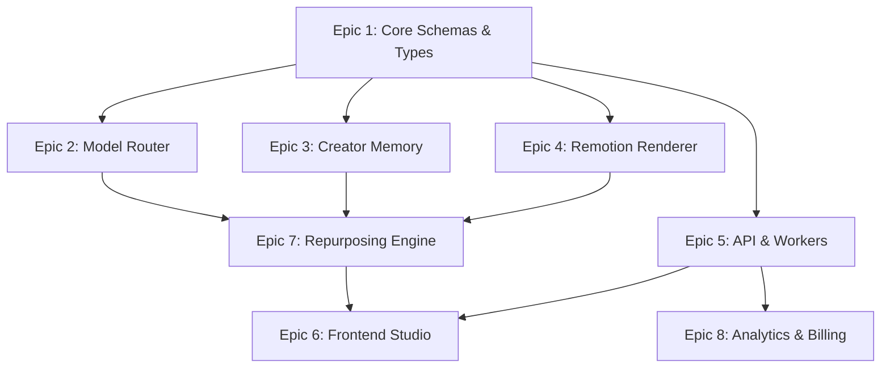

# CreatorOS Engineering Task Backlog (T-001 through T-060)

## Backlog Overview & Execution Framework

This document defines the exhaustive, production-grade engineering task backlog for **CreatorOS** (`@creatoros`). The backlog is partitioned into eight foundational architectural epics covering core type safety, intelligent multi-model routing, creator vector memory, programmatic video rendering via Remotion, distributed async job orchestration, studio frontend, intelligent content repurposing, and metered billing analytics.

### Priority Classifications

* **`P0` (Blocker / Critical Path):** Fundamental architectural scaffolding, security controls, or core data models required for system compilation and deployment.
* **`P1` (High):** Mission-critical business logic, renderer pipelines, model orchestration, and primary studio UI features.
* **`P2` (Medium):** Performance enhancements, optimization routines, secondary user interaction paths, and third-party integrations.
* **`P3` (Low / Refinement):** Non-blocking UX polish, edge-case recovery strategies, and extended analytics metrics.

### Status Taxonomy

* `[BACKLOG]`: Defined, specified, pending prioritization into an active sprint.
* `[READY]`: Specification complete, technical schema signed off, dependencies satisfied.
* `[IN_PROGRESS]`: Assigned to an engineering team, implementation underway.
* `[IN_REVIEW]`: Implementation complete; automated CI passing; undergoing architectural review.
* `[DONE]`: Merged to `main`, integration tests passing, verified in staging.



---

## Epic 1: Core Schemas & Types (T-001 - T-007)

### T-001: Core Content Artifact Zod Schemas
* **Status:** `[DONE]`
* **Priority:** `P0` | **Story Points:** 3 | **Component:** `@creatoros/shared-types`
* **Dependencies:** None
* **Description:** Implement runtime and compile-time Zod schemas defining fundamental content entities: `Script`, `Scene`, `Take`, `Asset`, and `ContentArtifact`. Support strict validation, brand safety flags, and multi-platform variant metadata.
* **Acceptance Criteria:**
  1. Schemas export TypeScript inferred types via `z.infer<typeof Schema>`.
  2. `ContentArtifactSchema` validates payloads containing nested scenes, duration in milliseconds, and platform targets (`YOUTUBE_SHORTS`, `TIKTOK`, `INSTAGRAM_REELS`, `LINKEDIN`).
  3. Validation rejects missing primary keys, non-UUID v4 identifiers, and negative audio/video frame durations.
  4. Unit test suite achieves 100% path coverage across valid, malformed, and boundary-value JSON payloads.

```typescript
import { z } from "zod";

export const PlatformTargetSchema = z.enum(["YOUTUBE_SHORTS", "TIKTOK", "INSTAGRAM_REELS", "LINKEDIN"]);
export type PlatformTarget = z.infer<typeof PlatformTargetSchema>;

export const SceneSchema = z.object({
  id: z.string().uuid(),
  sequenceIndex: z.number().int().nonnegative(),
  durationInFrames: z.number().int().positive(),
  scriptText: z.string().min(1),
  visualPrompt: z.string().min(1),
  audioTrackUrl: z.string().url().optional(),
});
export type Scene = z.infer<typeof SceneSchema>;

export const ContentArtifactSchema = z.object({
  id: z.string().uuid(),
  tenantId: z.string().uuid(),
  title: z.string().min(1).max(255),
  platform: PlatformTargetSchema,
  scenes: z.array(SceneSchema).min(1),
  createdAt: z.string().datetime(),
  updatedAt: z.string().datetime(),
});
export type ContentArtifact = z.infer<typeof ContentArtifactSchema>;
```

---

### T-002: Temporal & Video Asset Metadata Typings
* **Status:** `[DONE]`
* **Priority:** `P0` | **Story Points:** 3 | **Component:** `@creatoros/shared-types`
* **Dependencies:** T-001
* **Description:** Define immutable structures representing video asset parameters: frame rates (23.976, 24, 29.97, 30, 60), color space designations (sRGB, Rec.709, Rec.2020), pixel aspect ratios, container formats, and audio channel configurations.
* **Acceptance Criteria:**
  1. Strict mathematical time-unit primitives implemented: `FrameNumber`, `Millisecond`, and `TimestampString` (HH:MM:SS.mmm).
  2. Type-level conversion utilities verify frame-to-millisecond roundtripping precision within `< 0.001ms` tolerance.
  3. Zod schema enforces exact video stream specifications matching FFmpeg probe outputs (`ffprobe -show_streams -print_format json`).

---

### T-003: Persona & Style Guide Strict Schemas
* **Status:** `[DONE]`
* **Priority:** `P1` | **Story Points:** 5 | **Component:** `@creatoros/shared-types`
* **Dependencies:** T-001
* **Description:** Build the schemas representing creator branding constraints: tone directives, vocabulary whitelists/blacklists, typography hierarchies (Google Fonts / custom OTF), color palettes (hex, HSL, RGBA), and layout templates.
* **Acceptance Criteria:**
  1. `CreatorPersonaSchema` enforces non-empty tone vectors and strict hex validation (`/^#([A-Fa-f0-9]{6}|[A-Fa-f0-9]{8})$/`).
  2. Font configurations support primary, secondary, and accent styling with fallback font stacks.
  3. Schema validates reading level targets (Flesch-Kincaid Grade Level integer bounds: 1 through 18).

---

### T-004: Event Bus & Worker Message Protocol Typings
* **Status:** `[DONE]`
* **Priority:** `P0` | **Story Points:** 3 | **Component:** `@creatoros/shared-types`
* **Dependencies:** T-001, T-002
* **Description:** Define discriminated union types and message wrappers for the asynchronous event bus (BullMQ / Redis Streams / SNS-SQS), covering ingest, transcode, render, publish, and notify channels.
* **Acceptance Criteria:**
  1. Base envelope requires `eventId` (UUIDv4), `traceId` (W3C Trace Context standard), `timestamp` (ISO8601), and `producerId`.
  2. Discriminated union key `eventType` disambiguates all engine signals (e.g., `VIDEO.INGESTED`, `RENDER.STARTED`, `RENDER.COMPLETED`, `RENDER.FAILED`).
  3. Strict schema validation occurs before queue push and after queue pop; payloads failing validation are routed to dead-letter structures.

---

### T-005: Normalized Database Schema (Prisma / Drizzle)
* **Status:** `[READY]`
* **Priority:** `P0` | **Story Points:** 5 | **Component:** `@creatoros/database`
* **Dependencies:** T-001, T-002, T-003
* **Description:** Construct the production PostgreSQL relational schema utilizing Prisma or Drizzle ORM. Model multi-tenant organizations, memberships, creators, brand kits, projects, runs, and asset records with referential integrity.
* **Acceptance Criteria:**
  1. Complete foreign key constraints, cascading deletions, and composite indexes for common queries (e.g., `[tenantId, createdAt DESC]`).
  2. Tenant isolation enforced through explicit `tenant_id` columns across all multi-tenant tables.
  3. Up/down migration files generate clean staging databases with zero schema drift.

---

### T-006: Telemetry, Observability & Tracing Event Schemas
* **Status:** `[READY]`
* **Priority:** `P2` | **Story Points:** 2 | **Component:** `@creatoros/telemetry`
* **Dependencies:** T-001
* **Description:** Formalize OpenTelemetry log, metric, and span attribute schemas to unify tracing across the Fastify API, Remotion render workers, and model router pipelines.
* **Acceptance Criteria:**
  1. Define standard semantic conventions for LLM operations: `gen_ai.system`, `gen_ai.request.model`, `gen_ai.usage.prompt_tokens`, `gen_ai.usage.completion_tokens`.
  2. Implement video rendering spans capturing frame render duration, FFmpeg stitch latencies, and output byte sizes.
  3. Enforce zero Personally Identifiable Information (PII) leakage in tracing attributes via attribute scrubbing sanitizers.

---

### T-007: API Request/Response DTO Contracts (OpenAPI 3.1)
* **Status:** `[READY]`
* **Priority:** `P1` | **Story Points:** 3 | **Component:** `@creatoros/api-client`
* **Dependencies:** T-001, T-003, T-005
* **Description:** Generate OpenAPI 3.1 compliant schemas and TypeScript interfaces for all customer-facing endpoints using `@asteasolutions/zod-to-openapi`.
* **Acceptance Criteria:**
  1. Generated JSON OpenAPI document validates cleanly against Swagger/OpenAPI validator CLI tools.
  2. Error response shapes follow RFC 7807 (Problem Details for HTTP APIs).
  3. Automated drift-detection CI job checks that backend route types and OpenAPI definitions remain fully synchronized.

---

## Epic 2: Model Router & LLM Gateway (T-008 - T-015)

### T-008: Tiered Multi-Provider LLM Client Abstraction
* **Status:** `[READY]`
* **Priority:** `P0` | **Story Points:** 5 | **Component:** `@creatoros/model-router`
* **Dependencies:** T-001, T-006
* **Description:** Implement an abstract provider factory unifying Anthropic (Claude 3.5 Sonnet), OpenAI (GPT-4o), and local/open-source endpoints (vLLM / Mistral). Standardize prompt invocation, system instruction piping, and temperature normalization.
* **Acceptance Criteria:**
  1. Universal interface exposes `complete(req: PromptRequest): Promise<PromptResponse>` and `stream(req: PromptRequest): AsyncIterable<StreamChunk>`.
  2. Provider-specific errors (rate limits, authentication failures, content filter trips) are caught and normalized into `ModelRouterException` subclasses.
  3. Unit tests verify interchangeable usage across mock providers using identical input arguments.

---

### T-009: Dynamic Semantic Cost & Latency-Based Router
* **Status:** `[READY]`
* **Priority:** `P1` | **Story Points:** 8 | **Component:** `@creatoros/model-router`
* **Dependencies:** T-008
* **Description:** Develop an algorithmic routing module that inspects incoming prompt token counts, requested task complexity (classification vs. long-form script generation), and real-time provider latency to dispatch to the optimal provider.
* **Acceptance Criteria:**
  1. Routes low-complexity tasks (tagging, keyword extraction) to sub-cent models (e.g., GPT-4o-mini, Haiku).
  2. Routes complex script creation and stylistic analysis to tier-1 models (Claude 3.5 Sonnet, GPT-4o).
  3. Dynamically bypasses a provider if its p95 latency exceeds 5,000ms over the trailing 60-second rolling window.

---

### T-010: Context Window Token Truncation & Compaction Pipeline
* **Status:** `[READY]`
* **Priority:** `P1` | **Story Points:** 5 | **Component:** `@creatoros/model-router`
* **Dependencies:** T-008
* **Description:** Construct a token-aware context budget manager using `tiktoken` and `@anthropic-ai/tokenizer`. Prune and summarize episodic conversation history to ensure prompt payloads stay under strict input window thresholds.
* **Acceptance Criteria:**
  1. Computes precise token boundaries for mixed text and code inputs prior to model dispatch.
  2. Employs a sliding-window algorithm that preserves the system prompt, the original creator brief, and the $N$ most recent turns while summarizing intermediate steps.
  3. Guaranteed zero context window overflow exceptions under maximum load tests.

---

### T-011: Structured Output Validation with Auto-Healing JSON Repair
* **Status:** `[READY]`
* **Priority:** `P0` | **Story Points:** 5 | **Component:** `@creatoros/model-router`
* **Dependencies:** T-001, T-008
* **Description:** Implement structured output enforcement using vendor native JSON schemas (e.g., OpenAI Structured Outputs, Anthropic Tool Calling) combined with a local jsonrepair algorithm and recursive LLM correction prompts for broken JSON.
* **Acceptance Criteria:**
  1. Responses are parsed against target Zod schemas at runtime.
  2. On schema validation failure, the engine executes a zero-shot auto-heal parsing attempt via AST extraction (`jsonrepair`).
  3. If deterministic parsing fails, a single retry is executed appending the JSON Schema validation errors to the LLM context; failures after retry trigger an explicit exception.

---

### T-012: Streaming SSE Gateway with Backpressure Handling
* **Status:** `[READY]`
* **Priority:** `P1` | **Story Points:** 5 | **Component:** `@creatoros/model-router`
* **Dependencies:** T-008
* **Description:** Build a streaming Server-Sent Events (SSE) pipe for real-time script and scene token streaming from LLMs to the API client, handling downstream client pause/drop events without leaking upstream provider connections.
* **Acceptance Criteria:**
  1. Implements standard `text/event-stream` headers with `Cache-Control: no-cache` and `Connection: keep-alive`.
  2. Client disconnect events (`req.raw.on('close')`) trigger immediate cancellation of upstream provider HTTP connections using `AbortController`.
  3. Output stream properly formats data payloads: `data: {"token": "...", "index": 1}\n\n`.

---

### T-013: Distributed Redis Rate Limiting & Quota Management
* **Status:** `[READY]`
* **Priority:** `P1` | **Story Points:** 5 | **Component:** `@creatoros/model-router`
* **Dependencies:** T-008
* **Description:** Build a sliding-window rate limiter on top of Redis using Lua scripts to enforce tier-based Requests Per Minute (RPM) and Tokens Per Minute (TPM) across organizations and LLM providers.
* **Acceptance Criteria:**
  1. Atomically computes and increments token usage via Redis EVAL scripts.
  2. Rejects out-of-quota invocations immediately with HTTP 429 and standard headers (`Retry-After`, `X-RateLimit-Limit`, `X-RateLimit-Remaining`).
  3. Operates with sub-2ms overhead per check under a load of 10,000 requests/sec.

---

### T-014: Fallback & Circuit Breaker Engine for Model Outages
* **Status:** `[READY]`
* **Priority:** `P1` | **Story Points:** 3 | **Component:** `@creatoros/model-router`
* **Dependencies:** T-008, T-009
* **Description:** Integrate a circuit breaker pattern (Closed, Open, Half-Open) per provider model. When upstream provider 5xx rates exceed 20% over 30 seconds, immediately trip the circuit and route all traffic to the configured secondary provider.
* **Acceptance Criteria:**
  1. Circuit transitions to `OPEN` state after threshold trips; requests fail over to fallback provider without attempting primary.
  2. After configurable cooldown (e.g., 30s), transition to `HALF_OPEN` and allow a single canary probe through.
  3. Emits metrics on state transitions to OpenTelemetry collector.

---

### T-015: Model Evaluation & Prompt Regression Test Harness
* **Status:** `[BACKLOG]`
* **Priority:** `P2` | **Story Points:** 5 | **Component:** `@creatoros/model-router`
* **Dependencies:** T-008, T-011
* **Description:** Construct a CI test harness that evaluates prompt modifications against a gold-standard dataset of creator personas. Compute semantic similarity, schema compliance rates, and tone-match scores.
* **Acceptance Criteria:**
  1. Automated test suite runs on prompt changes, executing parallel evaluations.
  2. Computes cosine similarity of output embeddings against benchmark reference vectors.
  3. Fails CI if schema conformance falls below 99% or tone divergence exceeds 15%.

---

## Epic 3: Creator Memory & Vector Store (T-016 - T-023)

### T-016: Qdrant Vector Collection Architecture & Initialization
* **Status:** `[READY]`
* **Priority:** `P0` | **Story Points:** 5 | **Component:** `@creatoros/creator-memory`
* **Dependencies:** T-001
* **Description:** Design and script the initialization of Qdrant vector collections for creator memory embeddings. Configure HNSW indexing parameters, distance metrics (Cosine), payload schemas, and multi-tenant payload filtering.
* **Acceptance Criteria:**
  1. Scripts provision collections with 1536-dimensional (or 3072-dimensional) vector fields configured for Cosine distance.
  2. Payload index configured on `tenantId` (keyword), `creatorId` (keyword), and `timestamp` (integer).
  3. Tenant isolation verified: queries targeting tenant A cannot retrieve points belonging to tenant B under any filter combination.

---

### T-017: Multi-Modal Embedding Generation Pipeline
* **Status:** `[READY]`
* **Priority:** `P1` | **Story Points:** 5 | **Component:** `@creatoros/creator-memory`
* **Dependencies:** T-016
* **Description:** Implement an embedding ingestion pipeline utilizing OpenAI `text-embedding-3-large` and an open-source audio embedding model to vectorize script transcripts, video descriptions, and audio style signatures.
* **Acceptance Criteria:**
  1. Chunks long texts using a sliding-window token chunker (512 tokens with 10% overlap).
  2. Generates and stores normalized vector embeddings with attached metadata payloads in Qdrant.
  3. Includes exponential retry backoff handling for vendor embedding rate limits.

---

### T-018: Hybrid Search Engine (Dense Vector + BM25 Sparse Search)
* **Status:** `[READY]`
* **Priority:** `P1` | **Story Points:** 8 | **Component:** `@creatoros/creator-memory`
* **Dependencies:** T-016, T-017
* **Description:** Implement hybrid search combining dense semantic vectors (Qdrant) and sparse lexical vectors (BM25) with Reciprocal Rank Fusion (RRF) to retrieve past creator styles, catchphrases, and contextual knowledge.
* **Acceptance Criteria:**
  1. Executes dense and sparse queries concurrently against the target index.
  2. Merges search candidate lists using Reciprocal Rank Fusion: $RRF(d) = \sum_{m} \frac{1}{k + r_m(d)}$ with default $k=60$.
  3. Outperforms pure dense vector retrieval in benchmark precision tests for exact creator catchphrase matching.

```typescript
export interface SearchResult {
  id: string;
  score: number;
  content: string;
  metadata: Record<string, unknown>;
}

export function reciprocalRankFusion(
  denseResults: SearchResult[],
  sparseResults: SearchResult[],
  k = 60
): SearchResult[] {
  const scoreMap = new Map<string, { result: SearchResult; score: number }>();

  const processList = (list: SearchResult[]) => {
    list.forEach((item, rank) => {
      const existing = scoreMap.get(item.id);
      const contribution = 1 / (k + (rank + 1));
      if (existing) {
        existing.score += contribution;
      } else {
        scoreMap.set(item.id, { result: item, score: contribution });
      }
    });
  };

  processList(denseResults);
  processList(sparseResults);

  return Array.from(scoreMap.values())
    .sort((a, b) => b.score - a.score)
    .map((entry) => ({ ...entry.result, score: entry.score }));
}
```

---

### T-019: Contextual Memory Ingestion Worker
* **Status:** `[READY]`
* **Priority:** `P1` | **Story Points:** 5 | **Component:** `@creatoros/creator-memory`
* **Dependencies:** T-004, T-016, T-017
* **Description:** Build an asynchronous worker consuming `CONTENT.INGEST_MEMORY` queue events. The worker parses raw video transcripts, SRT files, and published scripts, extracts contextual metadata, chunks the text, and updates the vector store.
* **Acceptance Criteria:**
  1. Ingests raw SRT/VTT subtitle files, strips time codes, and reconstructs natural sentence structures.
  2. Appends metadata: source URL, publish timestamp, topic tags, and performance tier.
  3. Worker acknowledges queue messages only after successful persistence in Qdrant and relational database sync.

---

### T-020: Creator Tone & Style Extractor
* **Status:** `[READY]`
* **Priority:** `P1` | **Story Points:** 5 | **Component:** `@creatoros/creator-memory`
* **Dependencies:** T-008, T-018
* **Description:** Build a stylistic analysis module that evaluates a corpus of ingested creator scripts to extract quantitative tone metrics: vocabulary richness (Type-Token Ratio), average sentence length, punctuation habits, and structural pacing.
* **Acceptance Criteria:**
  1. Computes quantitative lexical statistics from a minimum sample of 5 ingested scripts.
  2. Generates a structured system instruction prompt detailing creator idiosyncrasies, recurring hooks, and structural formatting rules.
  3. Persists synthesized persona traits to PostgreSQL `creator_personas` table.

---

### T-021: Long-Term Episodic Memory Graph Storage
* **Status:** `[BACKLOG]`
* **Priority:** `P2` | **Story Points:** 8 | **Component:** `@creatoros/creator-memory`
* **Dependencies:** T-018, T-020
* **Description:** Prototype Graph RAG capabilities linking recurring entities, series storylines, brand sponsorships, and topic mentions across historical creator uploads using a graph data store (Neo4j or PostgreSQL recursive CTEs).
* **Acceptance Criteria:**
  1. Extracts entities (Products, People, Series, Brands) from new content and creates nodes and edges.
  2. Enables multi-hop queries (e.g., "Find all video hooks used when referencing Brand X").
  3. Sub-50ms query response time for 2-hop neighborhood traversals.

---

### T-022: Temporal Memory Decay & Relevance Weighting Engine
* **Status:** `[READY]`
* **Priority:** `P2` | **Story Points:** 3 | **Component:** `@creatoros/creator-memory`
* **Dependencies:** T-018
* **Description:** Implement an exponential temporal decay scoring algorithm on top of hybrid retrieval to ensure recent style trends, updated opinions, and current brand directives take precedence over historic content.
* **Acceptance Criteria:**
  1. Applies decay multiplier: $Score_{decayed} = Score_{base} \times e^{-\lambda \cdot \Delta t}$, where $\Delta t$ is days since publication.
  2. Configurable half-life $\lambda$ exposed per creator persona (default: 180 days).
  3. Decay can be selectively disabled for evergreen core brand guidelines via boolean metadata flag.

---

### T-023: Memory Privacy Isolation & Cryptographic Tenant Sharding
* **Status:** `[READY]`
* **Priority:** `P0` | **Story Points:** 5 | **Component:** `@creatoros/creator-memory`
* **Dependencies:** T-005, T-016
* **Description:** Build cryptographic and architectural isolation layers verifying that enterprise creator memories cannot be extracted via prompt injection or cross-tenant query manipulation.
* **Acceptance Criteria:**
  1. All vector queries enforce an unalterable tenant filter injected at the data layer, bypassing user input override.
  2. Enforce AES-256 encryption at rest for raw text chunks stored in document backing stores.
  3. Penetration test suite validates that adversarial prompt injections cannot exfiltrate out-of-tenant vector payloads.

---

## Epic 4: Remotion Renderer & Video Engine (T-024 - T-031)

### T-024: Remotion Root Composition Infrastructure & Parameterized Props
* **Status:** `[READY]`
* **Priority:** `P0` | **Story Points:** 5 | **Component:** `@creatoros/render-engine`
* **Dependencies:** T-001, T-002
* **Description:** Build the foundational Remotion entry point (`Root.tsx`) hosting parameterized compositions. Support dynamic resolution (1080x1920, 1920x1080, 1080x1080), dynamic framerates (30fps, 60fps), and calculated dynamic duration.
* **Acceptance Criteria:**
  1. Composition props strictly validate against `ContentArtifactSchema`.
  2. Total video duration dynamically calculates from the sum of underlying scene durations: $\sum Scene_i$.
  3. Remotion CLI preview renders canvas without layout shifts or unhandled React hydration errors.

```tsx
import React from "react";
import { Composition } from "remotion";
import { MainVideoComposition } from "./MainVideoComposition";
import { ContentArtifactSchema } from "@creatoros/shared-types";

export const RemotionRoot: React.FC = () => {
  return (
    <Composition
      id="DynamicContentArtifact"
      component={MainVideoComposition}
      durationInFrames={900}
      fps={30}
      width={1080}
      height={1920}
      schema={ContentArtifactSchema}
      defaultProps={{
        id: "00000000-0000-0000-0000-000000000000",
        tenantId: "00000000-0000-0000-0000-000000000000",
        title: "Default Preview",
        platform: "YOUTUBE_SHORTS",
        scenes: [
          {
            id: "11111111-1111-1111-1111-111111111111",
            sequenceIndex: 0,
            durationInFrames: 900,
            scriptText: "Welcome to CreatorOS automated rendering engine.",
            visualPrompt: "High-tech studio environment",
          },
        ],
        createdAt: new Date().toISOString(),
        updatedAt: new Date().toISOString(),
      }}
    />
  );
};
```

---

### T-025: Dynamic Kinetic Typography Component with Syllable Highlighting
* **Status:** `[READY]`
* **Priority:** `P1` | **Story Points:** 8 | **Component:** `@creatoros/render-engine`
* **Dependencies:** T-024
* **Description:** Construct an animated subtitle component rendering word-by-word and syllable-by-syllable karaoke highlights synced with Whisper audio timestamps. Utilize spring physics for pop-in scaling.
* **Acceptance Criteria:**
  1. Word highlight syncs precisely to audio track within a single frame boundary ($\pm 33\text{ms}$ at 30fps).
  2. Kinetic pop animations use Remotion `spring()` configurations with zero frame drops during rendering.
  3. Supports dynamic text-wrapping without clipping on 9:16 mobile viewports.

---

### T-026: AWS ECS / Fargate Distributed Render Farm Dispatcher
* **Status:** `[READY]`
* **Priority:** `P0` | **Story Points:** 8 | **Component:** `@creatoros/render-engine`
* **Dependencies:** T-004, T-024
* **Description:** Implement an orchestration service leveraging `@remotion/lambda` or containerized AWS ECS Fargate workers to execute parallelized multi-part video rendering across chunked frame ranges.
* **Acceptance Criteria:**
  1. Video composition chunks split into discrete frame ranges, rendered across multiple worker nodes in parallel.
  2. Worker tasks aggregate and stitch rendered chunks into target MP4 container using Remotion stitcher.
  3. Achieves 10x faster than real-time rendering speed for a 60-second 1080x1920 30fps short.

---

### T-027: Audio Waveform & Spectral Visualizer Components
* **Status:** `[READY]`
* **Priority:** `P2` | **Story Points:** 5 | **Component:** `@creatoros/render-engine`
* **Dependencies:** T-024
* **Description:** Develop GPU-accelerated Remotion audio visualization components utilizing `@remotion/media-utils` (`useAudioData`) to render dynamic waveforms, frequency bars, and circular pulses matching background audio.
* **Acceptance Criteria:**
  1. Accurately computes FFT frequency bins across time frames.
  2. Visual elements render dynamically using SVG and Canvas APIs without exceeding worker memory limits.
  3. Supports color customization matching creator brand theme schemas.

---

### T-028: Automated B-Roll Sequence Stitcher & Asset Interpolation
* **Status:** `[READY]`
* **Priority:** `P1` | **Story Points:** 8 | **Component:** `@creatoros/render-engine`
* **Dependencies:** T-024
* **Description:** Build a timeline composition manager that programmatically interlaces primary A-roll creator footage with semantic B-roll video assets and Ken Burns panning/zooming photographic sequences.
* **Acceptance Criteria:**
  1. Applies continuous smooth Ken Burns zoom transformations using `interpolate()` across asset display spans.
  2. B-roll assets auto-cut on audio emphasis markers generated from speech cadence analysis.
  3. Handles missing assets gracefully by falling back to styled branded solid backgrounds with typography.

---

### T-029: WebGL Transition Shaders for Remotion Compositions
* **Status:** `[BACKLOG]`
* **Priority:** `P2` | **Story Points:** 5 | **Component:** `@creatoros/render-engine`
* **Dependencies:** T-024
* **Description:** Integrate GLSL shader transitions (cross-zooms, light leaks, whip pans, directional wipes) between scene cuts using `@remotion/transitions` and Three.js/WebGL render targets.
* **Acceptance Criteria:**
  1. Shaders render deterministically across headless Linux Docker environments without software GL crashes.
  2. Transition buffers run without dropping frames during headless Remotion rendering passes.
  3. Shader configuration accepts easing parameters and configurable transition windows (10-30 frames).

---

### T-030: Multi-Platform Aspect Ratio Adapter (9:16, 16:9, 1:1, 4:5)
* **Status:** `[READY]`
* **Priority:** `P1` | **Story Points:** 5 | **Component:** `@creatoros/render-engine`
* **Dependencies:** T-024
* **Description:** Create an adaptive
